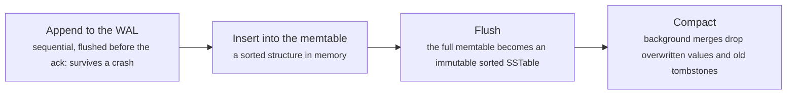
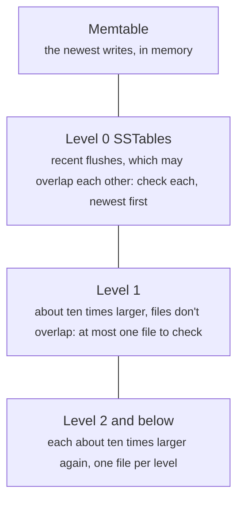
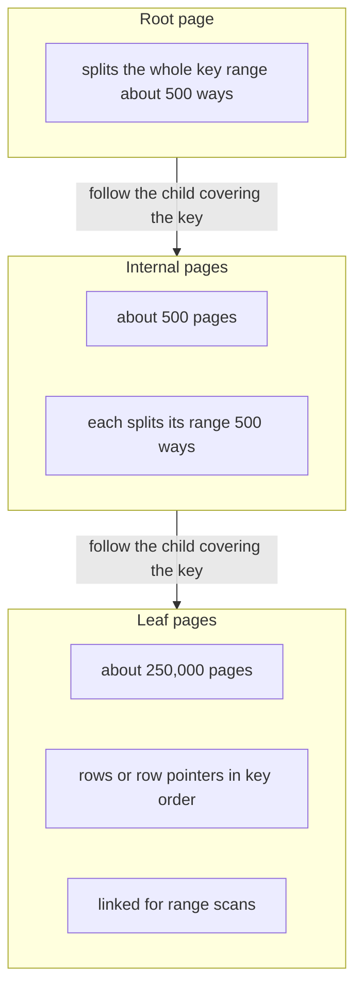

# Storage engines: B-trees, LSM trees and the write-ahead log

> System Design · L3 Specialist · Consensus and storage engines · about 110 min · hub module `m05` ([open the hub](https://claude.ai/artifact/W93mxxEWBqV4MS8kJiz9dU))

## Why it matters
Every database sits on a storage engine, and the engine decides what's cheap. B-trees update sorted pages in place: quick, predictable reads, but scattered writes. LSM trees buffer writes in memory, flush them as sorted files and merge those files in the background: fast writes, paid for with reads that may check several files and with compaction work. Both use a write-ahead log for durability. The trade-offs between read, write and space amplification tell you when PostgreSQL's B-trees fit a workload and when Cassandra's or RocksDB's LSM trees do.

## Pre-question (answer before reading)
**Q:** A metrics service ingests 500,000 small writes a second and mostly reads the last hour. Should its storage engine update records in place on disk, or append them and sort later? Why?

<details><summary>Answer</summary>

Append and sort later, which is what an LSM tree does. Writes become sequential appends to a log plus sorted flushes from memory, which disks and SSDs handle far better than random in-place updates. Reads of recent data hit memory or the newest files. The costs are background compaction and reads that may check several files, which Bloom filters keep cheap.

</details>

## 🍎 Story time (kid version)
**Pizza Town and the family road trip: Luigi's order books**

Luigi used to keep one alphabetical ledger of customers, rubbing out and rewriting each entry in place, flipping to the right page for every change. Now orders pour in too fast, so he jots each one on a notepad, and when it's full he copies it out, sorted, into a fresh booklet. Each night an apprentice merges booklets into one, dropping crossed-out lines. To look a customer up, Luigi checks the notepad, then the booklets from newest to oldest; a coded sticker on each cover can tell him a name is definitely not inside. And before any change, he writes it in a diary, so a spilt coffee never loses an order.

| In the story | In a real system |
|---|---|
| The alphabetical ledger rewritten in place | A B-tree: sorted pages updated in place, one place to look for each key |
| Notepad, sorted booklets, nightly merge | An LSM tree: an in-memory memtable, immutable sorted SSTables, background compaction |
| The coded sticker on each booklet | A Bloom filter per SSTable: skip files that can't contain the key |
| The diary written before any change | The write-ahead log, replayed after a crash |

**Where the story breaks:** Luigi's apprentice merges at night, when the shop is shut. A database never shuts: compaction competes with live traffic for disk bandwidth, and when it falls behind, reads slow down and disk use grows.

## Key ideas (grown-up version)
- **Storage engines**: the part of a database that lays data out on disk and finds it again. Two families dominate: B-trees (PostgreSQL, MySQL's InnoDB, SQL Server and most relational databases) and log-structured merge trees (RocksDB, LevelDB, Cassandra, ScyllaDB, HBase, and the engines under CockroachDB and TiKV). This module is about choosing between them; the SQL L4 hub covers their internals.
- **B-trees**: keys live in sorted, fixed-size pages (often 8 or 16 KB) that form a shallow tree; with hundreds of keys per page, three or four levels index billions of rows. A read follows one root-to-leaf path. A write changes its leaf page in place and splits it when full, so a small change still rewrites a whole page, and random keys scatter writes across the index.
- **The write-ahead log (WAL)**: every change is appended to a sequential log and flushed (fsync) before the write is acknowledged, so after a crash the engine replays the log onto the last checkpoint. Group commit lets many transactions share one fsync. The same log feeds replication and change data capture.
- **LSM trees**: a write goes to the WAL and into a sorted in-memory memtable; a full memtable is flushed as an immutable sorted file, an SSTable. Reads check the memtable, then SSTables from newest to oldest. A delete writes a tombstone. Background compaction merges SSTables, dropping overwritten values, and tombstones once nothing older can remain.
- **Amplification**: write amplification is the bytes written to disk per byte of data (whole-page rewrites in a B-tree, repeated compaction in an LSM tree); read amplification is the pages or files touched per read; space amplification is the disk used per byte of live data (half-empty pages, obsolete versions awaiting compaction). The RUM conjecture: no design minimises all three at once.
- **Bloom filters and caches**: each SSTable carries a Bloom filter that answers 'definitely not here' or 'maybe', so point reads skip most files; about 10 bits per key gives roughly 1% false positives. A block cache keeps hot blocks in memory. Range scans can't use Bloom filters and must merge across files.
- **Compaction strategies**: leveled compaction (RocksDB's default) keeps each level about ten times the size of the previous one, with no overlapping files within a level: lower read and space amplification, more write amplification. Size-tiered compaction (Cassandra's long-time default) merges files of similar size: cheaper writes, more files per read, and temporary space for big merges. Time-window compaction suits time series.
- **Choosing**: read-heavy work with updates, range scans and a need for steady latency suits a B-tree; heavy ingestion of events, metrics, logs or messages suits an LSM tree. Prefer time-ordered keys (UUIDv7, ULIDs) over random ones in B-tree indexes. Then measure your own workload, and watch compaction backlog, tombstone counts and checkpoint I/O.

## Diagrams
**An LSM write, and what happens to it later**



_Every step writes sequentially, which is why LSM trees ingest so quickly; compaction rewrites the same data several times, which is the price._

**Where an LSM point read looks, in order**



_The read stops at the first version it finds. Bloom filters let it skip files that can't hold the key, so most reads touch one file on disk._

**A B-tree lookup**



_Three levels of about 500 keys per page index 125 million rows. The upper levels stay cached, so a lookup costs about one disk read._

## Comparisons
**B-tree or LSM tree**

|  | B-tree | LSM tree |
|---|---|---|
| Writes | In place, scattered; a whole page rewritten per change | Sequential appends and flushes, rewritten later by compaction |
| Point reads | One root-to-leaf path, predictable | Memtable, then SSTables; Bloom filters skip most |
| Range scans | Excellent: leaves are in key order | Good, but merges several files |
| Space | Half-empty pages after splits | Old versions and tombstones until compaction |
| Latency risks | Page splits, checkpoint I/O bursts | Compaction backlog, tombstone build-up |
| Examples | PostgreSQL, MySQL InnoDB, SQL Server | RocksDB, Cassandra, ScyllaDB, HBase |

**Leveled or size-tiered compaction**

|  | Leveled | Size-tiered |
|---|---|---|
| How | Each level about 10× the previous; files in a level don't overlap | Merge several similar-sized files into a bigger one |
| Write amplification | Higher | Lower |
| Read and space amplification | Lower | Higher, with spare space needed for big merges |
| Fits | Read-heavy and update-heavy tables | Write-heavy, mostly-append tables |

## Code (JavaScript + Python)
### The seeded random generator and a string hash used by the examples
```python
def mulberry32(seed):                           # a tiny seeded random generator, same as the JavaScript one
    state = seed & 0xFFFFFFFF
    def rand():
        nonlocal state
        state = (state + 0x6D2B79F5) & 0xFFFFFFFF
        t = ((state ^ (state >> 15)) * (state | 1)) & 0xFFFFFFFF
        t = (t ^ (t + (((t ^ (t >> 7)) * (t | 61)) & 0xFFFFFFFF))) & 0xFFFFFFFF
        return ((t ^ (t >> 14)) & 0xFFFFFFFF) / 4294967296
    return rand

def fnv1a(text, seed=2166136261):               # the 32-bit FNV-1a hash, same as the JavaScript one
    h = seed
    for ch in text:
        h = ((h ^ ord(ch)) * 16777619) & 0xFFFFFFFF
    return h
```

```javascript
function mulberry32(seed) {                     // a tiny seeded random generator, same as the Python one
  return function () {
    seed = (seed + 0x6D2B79F5) | 0;
    let t = Math.imul(seed ^ (seed >>> 15), 1 | seed);
    t = (t + Math.imul(t ^ (t >>> 7), 61 | t)) ^ t;
    return ((t ^ (t >>> 14)) >>> 0) / 4294967296;
  };
}

function fnv1a(text, seed = 2166136261) {       // the 32-bit FNV-1a hash, same as the Python one
  let h = seed >>> 0;
  for (const ch of text) h = Math.imul(h ^ ch.charCodeAt(0), 16777619) >>> 0;
  return h;
}
```

### An LSM tree: reads search more files until compaction
```python
from bisect import bisect_left

class LSMTree:
    def __init__(self, memtable_limit=100):
        self.memtable, self.sstables, self.limit = {}, [], memtable_limit   # sstables: newest first
        self.written = 0                               # entries written to disk

    def put(self, key, value):
        self.memtable[key] = value
        if len(self.memtable) >= self.limit:
            self.flush()

    def flush(self):
        table = sorted(self.memtable.items())          # one sorted, immutable file
        self.sstables.insert(0, table)
        self.written += len(table)
        self.memtable = {}

    def get(self, key):
        if key in self.memtable:
            return self.memtable[key], 0
        for searched, table in enumerate(self.sstables, start=1):
            i = bisect_left(table, (key,))             # binary search inside the file
            if i < len(table) and table[i][0] == key:
                return table[i][1], searched           # the newest file holding the key wins
        return None, len(self.sstables)

    def compact(self):
        merged = {}
        for table in reversed(self.sstables):          # oldest first, so newer values overwrite older ones
            merged.update(table)
        self.sstables = [sorted(merged.items())]
        self.written += len(self.sstables[0])

rand = mulberry32(5)
db = LSMTree()
for _ in range(5000):
    db.put(f"user-{int(rand() * 2000):04d}", int(rand() * 100))
db.flush()
lookups = [f"user-{int(rand() * 2000):04d}" for _ in range(1000)]

def average_searched():
    total = sum(db.get(key)[1] for key in lookups) * 10 // len(lookups)
    return f"{total // 10}.{total % 10}"

print(f"5000 writes: {len(db.sstables)} sstables holding {db.written} entries; reads search {average_searched()} sstables on average")
db.compact()
print(f"after compaction: 1 sstable of {len(db.sstables[0])} live keys; reads search {average_searched()}; {db.written} entries written in all")
```

Output:
```text
5000 writes: 49 sstables holding 4874 entries; reads search 19.0 sstables on average
after compaction: 1 sstable of 1833 live keys; reads search 1.0; 6707 entries written in all
```

- line 9: Writes only touch memory; repeated updates to a key in the memtable cost nothing on disk until the flush.
- line 14: A flush writes one sorted file sequentially, never modifying an older file.
- line 22: A read walks the files from newest to oldest, so an old version never hides a newer one; a missing key searches them all.
- line 28: Compaction keeps only the newest version of each key. The fade at the end builds the streaming merge real engines use.
- line 48: Reads drop from about 19 files to 1, but the disk has now been written 6,707 entries for 5,000 writes: write amplification.

```javascript
class LSMTree {
  constructor(memtableLimit = 100) {
    this.memtable = new Map(); this.sstables = []; this.limit = memtableLimit;   // sstables: newest first
    this.written = 0;                                // entries written to disk
  }

  put(key, value) {
    this.memtable.set(key, value);
    if (this.memtable.size >= this.limit) this.flush();
  }

  flush() {
    const table = [...this.memtable].sort((a, b) => (a[0] < b[0] ? -1 : 1));   // one sorted, immutable file
    this.sstables.unshift(table);
    this.written += table.length;
    this.memtable = new Map();
  }

  get(key) {
    if (this.memtable.has(key)) return [this.memtable.get(key), 0];
    for (let n = 0; n < this.sstables.length; n++) {
      const table = this.sstables[n];
      let lo = 0, hi = table.length;
      while (lo < hi) { const mid = (lo + hi) >> 1; if (table[mid][0] < key) lo = mid + 1; else hi = mid; }   // binary search inside the file
      if (lo < table.length && table[lo][0] === key) return [table[lo][1], n + 1];   // the newest file holding the key wins
    }
    return [null, this.sstables.length];
  }

  compact() {
    const merged = new Map();
    for (const table of [...this.sstables].reverse()) for (const [k, v] of table) merged.set(k, v);   // oldest first, so newer values overwrite older ones
    this.sstables = [[...merged].sort((a, b) => (a[0] < b[0] ? -1 : 1))];
    this.written += this.sstables[0].length;
  }
}

const rand = mulberry32(5);
const db = new LSMTree();
const userKey = () => `user-${String(Math.floor(rand() * 2000)).padStart(4, "0")}`;
for (let i = 0; i < 5000; i++) { const key = userKey(); db.put(key, Math.floor(rand() * 100)); }
db.flush();
const lookups = Array.from({ length: 1000 }, userKey);

function averageSearched() {
  const total = Math.floor(lookups.reduce((sum, key) => sum + db.get(key)[1], 0) * 10 / lookups.length);
  return `${Math.floor(total / 10)}.${total % 10}`;
}

console.log(`5000 writes: ${db.sstables.length} sstables holding ${db.written} entries; reads search ${averageSearched()} sstables on average`);
db.compact();
console.log(`after compaction: 1 sstable of ${db.sstables[0].length} live keys; reads search ${averageSearched()}; ${db.written} entries written in all`);
```

Output:
```text
5000 writes: 49 sstables holding 4874 entries; reads search 19.0 sstables on average
after compaction: 1 sstable of 1833 live keys; reads search 1.0; 6707 entries written in all
```

- line 8: Writes only touch memory; repeated updates to a key in the memtable cost nothing on disk until the flush.
- line 13: A flush writes one sorted file sequentially, never modifying an older file.
- line 21: A read walks the files from newest to oldest, so an old version never hides a newer one; a missing key searches them all.
- line 30: Compaction keeps only the newest version of each key. The fade at the end builds the streaming merge real engines use.
- line 52: Reads drop from about 19 files to 1, but the disk has now been written 6,707 entries for 5,000 writes: write amplification.

### Bloom filters: skipping SSTables that can't hold the key
```python
class BloomFilter:
    def __init__(self, keys, bits_per_key, k):
        self.m, self.k = len(keys) * bits_per_key, k
        self.bits = bytearray(self.m)
        for key in keys:
            for p in self.positions(key):
                self.bits[p] = 1

    def positions(self, key):
        h1, h2 = fnv1a(key), fnv1a(key, 0x9747B28C) | 1   # two hashes combine into k positions
        return [(h1 + i * h2) % self.m for i in range(self.k)]

    def might_contain(self, key):
        return all(self.bits[p] for p in self.positions(key))   # any 0 bit: definitely absent

rand = mulberry32(21)
tables = [[f"user-{int(rand() * 1_000_000):06d}" for _ in range(100)] for _ in range(50)]
stored = {key for table in tables for key in table}
missing = []
while len(missing) < 1000:
    key = f"user-{int(rand() * 1_000_000):06d}"
    if key not in stored:
        missing.append(key)                            # keys that are in no sstable at all

for bits_per_key, k in ((5, 3), (10, 7), (15, 10)):
    filters = [BloomFilter(table, bits_per_key, k) for table in tables]
    searched = sum(f.might_contain(key) for key in missing for f in filters)
    rate = searched * 1000 // (len(missing) * len(filters))
    print(f"{bits_per_key} bits per key: {searched} of 50000 sstable searches still needed ({rate // 10}.{rate % 10}% false positives)")
```

Output:
```text
5 bits per key: 5007 of 50000 sstable searches still needed (10.0% false positives)
10 bits per key: 453 of 50000 sstable searches still needed (0.9% false positives)
15 bits per key: 67 of 50000 sstable searches still needed (0.1% false positives)
```

- line 7: Adding a key sets k bits; bits are never cleared, which is why SSTables, being immutable, suit Bloom filters so well.
- line 10: Double hashing: two hash values generate all k positions, as RocksDB and Cassandra do, instead of k separate hash functions.
- line 14: Any zero bit proves the key was never added. All ones means only 'maybe': another key may have set them.
- line 29: Each extra 5 bits per key cuts false positives roughly tenfold; 10 bits is the usual default, about 1.2 MB per million keys.

```javascript
class BloomFilter {
  constructor(keys, bitsPerKey, k) {
    this.m = keys.length * bitsPerKey; this.k = k;
    this.bits = new Uint8Array(this.m);
    for (const key of keys) for (const p of this.positions(key)) this.bits[p] = 1;
  }

  positions(key) {
    const h1 = fnv1a(key), h2 = (fnv1a(key, 0x9747B28C) | 1) >>> 0;   // two hashes combine into k positions
    return Array.from({ length: this.k }, (_, i) => (h1 + i * h2) % this.m);
  }

  mightContain(key) {
    return this.positions(key).every(p => this.bits[p] === 1);   // any 0 bit: definitely absent
  }
}

const rand = mulberry32(21);
const userKey = () => `user-${String(Math.floor(rand() * 1000000)).padStart(6, "0")}`;
const tables = Array.from({ length: 50 }, () => Array.from({ length: 100 }, userKey));
const stored = new Set(tables.flat());
const missing = [];
while (missing.length < 1000) {
  const key = userKey();
  if (!stored.has(key)) missing.push(key);           // keys that are in no sstable at all
}

for (const [bitsPerKey, k] of [[5, 3], [10, 7], [15, 10]]) {
  const filters = tables.map(table => new BloomFilter(table, bitsPerKey, k));
  let searched = 0;
  for (const key of missing) for (const f of filters) if (f.mightContain(key)) searched++;
  const rate = Math.floor(searched * 1000 / (missing.length * filters.length));
  console.log(`${bitsPerKey} bits per key: ${searched} of 50000 sstable searches still needed (${Math.floor(rate / 10)}.${rate % 10}% false positives)`);
}
```

Output:
```text
5 bits per key: 5007 of 50000 sstable searches still needed (10.0% false positives)
10 bits per key: 453 of 50000 sstable searches still needed (0.9% false positives)
15 bits per key: 67 of 50000 sstable searches still needed (0.1% false positives)
```

- line 5: Adding a key sets k bits; bits are never cleared, which is why SSTables, being immutable, suit Bloom filters so well.
- line 9: Double hashing: two hash values generate all k positions, as RocksDB and Cassandra do, instead of k separate hash functions.
- line 14: Any zero bit proves the key was never added. All ones means only 'maybe': another key may have set them.
- line 33: Each extra 5 bits per key cuts false positives roughly tenfold; 10 bits is the usual default, about 1.2 MB per million keys.

### B-tree inserts: random keys against time-ordered keys
```python
rand = mulberry32(3)
ROWS_PER_PAGE, PAGE_BYTES, ROW_BYTES = 64, 8192, 128
EXISTING_ROWS = 1_000_000                          # an index of 15,625 full leaf pages

def page_writes(next_key, inserts=10_000, checkpoint_every=1_000):
    dirty, written = set(), 0
    for n in range(1, inserts + 1):
        dirty.add(next_key(n) // ROWS_PER_PAGE)       # the leaf page this key belongs in
        if n % checkpoint_every == 0:
            written += len(dirty)                      # a checkpoint writes each dirty page once
            dirty = set()
    return written

for label, next_key in (("random keys (UUIDv4)", lambda n: int(rand() * EXISTING_ROWS)),
                        ("time-ordered keys (UUIDv7)", lambda n: EXISTING_ROWS + n)):
    pages = page_writes(next_key)
    print(f"{label}: 10000 inserts dirtied {pages} pages, {pages * PAGE_BYTES // (10_000 * ROW_BYTES)}x the bytes inserted")
```

Output:
```text
random keys (UUIDv4): 10000 inserts dirtied 9692 pages, 62x the bytes inserted
time-ordered keys (UUIDv7): 10000 inserts dirtied 166 pages, 1x the bytes inserted
```

- line 8: A random key lands on a random leaf page; a time-ordered key always lands on the rightmost one.
- line 10: Between checkpoints, a page changed many times is written once, so locality decides how much is written.
- line 17: Random keys rewrite a whole 8 KB page for almost every 128-byte row; if the index is bigger than memory, each insert also needs a random read.

```javascript
const rand = mulberry32(3);
const ROWS_PER_PAGE = 64, PAGE_BYTES = 8192, ROW_BYTES = 128;
const EXISTING_ROWS = 1000000;                     // an index of 15,625 full leaf pages

function pageWrites(nextKey, inserts = 10000, checkpointEvery = 1000) {
  let dirty = new Set(), written = 0;
  for (let n = 1; n <= inserts; n++) {
    dirty.add(Math.floor(nextKey(n) / ROWS_PER_PAGE));   // the leaf page this key belongs in
    if (n % checkpointEvery === 0) {
      written += dirty.size;                         // a checkpoint writes each dirty page once
      dirty = new Set();
    }
  }
  return written;
}

for (const [label, nextKey] of [["random keys (UUIDv4)", n => Math.floor(rand() * EXISTING_ROWS)],
                                ["time-ordered keys (UUIDv7)", n => EXISTING_ROWS + n]]) {
  const pages = pageWrites(nextKey);
  console.log(`${label}: 10000 inserts dirtied ${pages} pages, ${Math.floor(pages * PAGE_BYTES / (10000 * ROW_BYTES))}x the bytes inserted`);
}
```

Output:
```text
random keys (UUIDv4): 10000 inserts dirtied 9692 pages, 62x the bytes inserted
time-ordered keys (UUIDv7): 10000 inserts dirtied 166 pages, 1x the bytes inserted
```

- line 8: A random key lands on a random leaf page; a time-ordered key always lands on the rightmost one.
- line 10: Between checkpoints, a page changed many times is written once, so locality decides how much is written.
- line 20: Random keys rewrite a whole 8 KB page for almost every 128-byte row; if the index is bigger than memory, each insert also needs a random read.

## Worked example
**Problem.** A key-value service receives 2,000 writes within one second, and each fsync of its write-ahead log takes 2 ms. Compare three ways to acknowledge a write: straight away, before any fsync; after an fsync for that write alone; and with group commit, where every write waiting for the log shares the next fsync. Count the fsyncs, the average time a client waits, and the acknowledged writes lost if the power fails at 777 ms.

1. An acknowledgement promises the client its write is durable. Data in the operating system's cache isn't: a power cut loses it. So a durable engine fsyncs its log before acknowledging.
2. The log device does one fsync at a time, so an fsync per write caps throughput at 1 ÷ 2 ms = 500 writes a second. At 2,000 a second, a queue builds and waits grow without limit.
3. Group commit lets every write that arrived during one fsync share the next. Under load, batches grow and the fsync count stays near 500 a second, while each write waits at most about two fsync times.
4. What remains is a choice of latency against durability. Systems that acknowledge before the fsync, such as PostgreSQL with synchronous_commit off, accept losing the last moments of acknowledged writes in exchange for speed.

```python
rand = mulberry32(12)
arrivals = sorted(int(rand() * 1000) for _ in range(2000))   # 2,000 writes within one second, in ms
FSYNC_MS = 2                                                  # one fsync of the log takes 2 ms

def run(mode):
    acks, durable, fsyncs, now, i = [], [], 0, 0, 0
    if mode == "ack before fsync":
        for t in arrivals:
            acks.append(t)                                    # acknowledged at once, from the OS cache
            durable.append((t // 500 + 1) * 500)              # the OS writes its cache back every 500 ms
        return acks, durable, fsyncs
    while i < len(arrivals):
        now = max(now, arrivals[i])                           # the log device idles until a write arrives
        j = i + 1
        if mode == "group commit":
            while j < len(arrivals) and arrivals[j] <= now:
                j += 1                                        # every waiting write joins this fsync
        now += FSYNC_MS
        fsyncs += 1
        acks += [now] * (j - i)                               # acknowledged once the fsync completes
        durable += [now] * (j - i)
        i = j
    return acks, durable, fsyncs

crash = 777
for mode in ("ack before fsync", "fsync per write", "group commit"):
    acks, durable, fsyncs = run(mode)
    wait = sum(a - t for a, t in zip(acks, arrivals)) * 10 // len(arrivals)
    lost = sum(1 for a, d in zip(acks, durable) if a <= crash < d)   # acknowledged, but not yet on disk
    print(f"{mode}: {fsyncs} fsyncs, average wait {wait // 10}.{wait % 10} ms, acknowledged writes lost in a crash at {crash} ms: {lost}")
```

Output:
```text
ack before fsync: 0 fsyncs, average wait 0.0 ms, acknowledged writes lost in a crash at 777 ms: 532
fsync per write: 2000 fsyncs, average wait 1518.4 ms, acknowledged writes lost in a crash at 777 ms: 0
group commit: 494 fsyncs, average wait 2.4 ms, acknowledged writes lost in a crash at 777 ms: 0
```

```javascript
const rand = mulberry32(12);
const arrivals = Array.from({ length: 2000 }, () => Math.floor(rand() * 1000)).sort((a, b) => a - b);   // 2,000 writes within one second, in ms
const FSYNC_MS = 2;                                           // one fsync of the log takes 2 ms

function run(mode) {
  const acks = [], durable = [];
  let fsyncs = 0, now = 0, i = 0;
  if (mode === "ack before fsync") {
    for (const t of arrivals) {
      acks.push(t);                                           // acknowledged at once, from the OS cache
      durable.push((Math.floor(t / 500) + 1) * 500);          // the OS writes its cache back every 500 ms
    }
    return [acks, durable, fsyncs];
  }
  while (i < arrivals.length) {
    now = Math.max(now, arrivals[i]);                         // the log device idles until a write arrives
    let j = i + 1;
    if (mode === "group commit") {
      while (j < arrivals.length && arrivals[j] <= now) j++;  // every waiting write joins this fsync
    }
    now += FSYNC_MS;
    fsyncs++;
    for (let w = i; w < j; w++) { acks.push(now); durable.push(now); }   // acknowledged once the fsync completes
    i = j;
  }
  return [acks, durable, fsyncs];
}

const crash = 777;
for (const mode of ["ack before fsync", "fsync per write", "group commit"]) {
  const [acks, durable, fsyncs] = run(mode);
  const wait = Math.floor(acks.reduce((sum, a, w) => sum + a - arrivals[w], 0) * 10 / arrivals.length);
  const lost = acks.filter((a, w) => a <= crash && crash < durable[w]).length;   // acknowledged, but not yet on disk
  console.log(`${mode}: ${fsyncs} fsyncs, average wait ${Math.floor(wait / 10)}.${wait % 10} ms, acknowledged writes lost in a crash at ${crash} ms: ${lost}`);
}
```

Output:
```text
ack before fsync: 0 fsyncs, average wait 0.0 ms, acknowledged writes lost in a crash at 777 ms: 532
fsync per write: 2000 fsyncs, average wait 1518.4 ms, acknowledged writes lost in a crash at 777 ms: 0
group commit: 494 fsyncs, average wait 2.4 ms, acknowledged writes lost in a crash at 777 ms: 0
```

**Answer.** Acknowledging before the fsync answers instantly, but the power cut at 777 ms loses 532 writes the clients were told were safe: everything since the operating system's last write-back at 500 ms. An fsync per write loses nothing acknowledged, but the device can only do 500 fsyncs a second, so the queue grows and the average wait reaches about 1.5 seconds. Group commit also loses nothing acknowledged, needs only 494 fsyncs because each one carries every write that was waiting, and keeps the average wait at 2.4 ms. That's why durable engines batch their log flushes.

## Your turn (faded example)
**Problem.** Finish `compact(tables, bottom)`: merge sorted SSTables, given newest first, into one sorted list, keeping only the newest version of each key. A tombstone (a None value) must survive unless the output is the bottom level.

- ✓ Keep one position per table. Each round, the smallest key at the head of any table is the next key of the output, so the merge streams through the files without loading them whole.
- **Several tables hold that key. Whose value wins?**
  <details><summary>Answer</summary>The newest table's. Tables are given newest first, so the first match wins; every table holding the key steps past it, so older versions are dropped.</details>
- **Why keep tombstones unless this is the bottom level?**
  <details><summary>Answer</summary>An older value for the key may still sit in a lower level that this merge didn't include. Dropping the tombstone would let that old value reappear, so it's only safe when nothing older can exist below.</details>
- **What does it cost?**
  <details><summary>Answer</summary>O(n·k) for n entries across k tables, scanning the heads each round. Real engines keep the heads in a heap, O(n log k), and stream blocks from disk, so memory stays small however big the files are.</details>

Starter:
```python
def compact(tables, bottom):
    pos, out = [0] * len(tables), []                 # tables: sorted (key, value) lists, newest first
    while True:
        heads = [table[p][0] for table, p in zip(tables, pos) if p < len(table)]
        if not heads:
            return out
        key, value, found = min(heads), None, False  # the smallest key at the head of any table
        for i, table in enumerate(tables):
            if pos[i] < len(table) and table[pos[i]][0] == key:
                ...                                  # TODO: keep only the newest version
                pos[i] += 1                          # step past this copy
        ...                                          # TODO: append (key, value) unless it's a tombstone that can go
```

```javascript
function compact(tables, bottom) {
  const pos = tables.map(() => 0), out = [];       // tables: sorted [key, value] lists, newest first
  while (true) {
    const heads = [];
    tables.forEach((table, i) => { if (pos[i] < table.length) heads.push(table[pos[i]][0]); });
    if (heads.length === 0) return out;
    const key = heads.reduce((a, b) => (b < a ? b : a));   // the smallest key at the head of any table
    let value = null, found = false;
    tables.forEach((table, i) => {
      if (pos[i] < table.length && table[pos[i]][0] === key) {
        // TODO: keep only the newest version
        pos[i]++;                                  // step past this copy
      }
    });
    // TODO: push [key, value] unless it's a tombstone that can go
  }
}
```

<details><summary>Full solution</summary>

```python
def compact(tables, bottom):
    pos, out = [0] * len(tables), []                 # tables: sorted (key, value) lists, newest first
    while True:
        heads = [table[p][0] for table, p in zip(tables, pos) if p < len(table)]
        if not heads:
            return out
        key, value, found = min(heads), None, False  # the smallest key at the head of any table
        for i, table in enumerate(tables):
            if pos[i] < len(table) and table[pos[i]][0] == key:
                if not found:
                    value, found = table[pos[i]][1], True   # the newest table's version wins
                pos[i] += 1                          # step past this copy
        if value is not None or not bottom:
            out.append((key, value))                 # a tombstone (None) survives unless this is the bottom level

newest = [("ann", "rome"), ("bob", None)]            # bob was deleted
middle = [("bob", "oslo"), ("cat", "lima")]
oldest = [("ann", "paris"), ("dan", "kyiv")]
show = lambda rows: " ".join(f"{k}={'tombstone' if v is None else v}" for k, v in rows)
print("into a middle level:", show(compact([newest, middle, oldest], bottom=False)))
print("into the bottom level:", show(compact([newest, middle, oldest], bottom=True)))
```

Output:
```text
into a middle level: ann=rome bob=tombstone cat=lima dan=kyiv
into the bottom level: ann=rome cat=lima dan=kyiv
```

```javascript
function compact(tables, bottom) {
  const pos = tables.map(() => 0), out = [];       // tables: sorted [key, value] lists, newest first
  while (true) {
    const heads = [];
    tables.forEach((table, i) => { if (pos[i] < table.length) heads.push(table[pos[i]][0]); });
    if (heads.length === 0) return out;
    const key = heads.reduce((a, b) => (b < a ? b : a));   // the smallest key at the head of any table
    let value = null, found = false;
    tables.forEach((table, i) => {
      if (pos[i] < table.length && table[pos[i]][0] === key) {
        if (!found) { value = table[pos[i]][1]; found = true; }   // the newest table's version wins
        pos[i]++;                                  // step past this copy
      }
    });
    if (value !== null || !bottom) out.push([key, value]);   // a tombstone (null) survives unless this is the bottom level
  }
}

const newest = [["ann", "rome"], ["bob", null]];   // bob was deleted
const middle = [["bob", "oslo"], ["cat", "lima"]];
const oldest = [["ann", "paris"], ["dan", "kyiv"]];
const show = rows => rows.map(([k, v]) => `${k}=${v === null ? "tombstone" : v}`).join(" ");
console.log("into a middle level:", show(compact([newest, middle, oldest], false)));
console.log("into the bottom level:", show(compact([newest, middle, oldest], true)));
```

Output:
```text
into a middle level: ann=rome bob=tombstone cat=lima dan=kyiv
into the bottom level: ann=rome cat=lima dan=kyiv
```

</details>

## Socratic checks and quiz (answers hidden)
**1. What does this print?**

```python
keys, fanout, levels = 1_000_000_000, 500, 1
while fanout ** levels < keys:
    levels += 1
print(levels)
```

```javascript
let keys = 1000000000, fanout = 500, levels = 1;
while (fanout ** levels < keys) levels++;
console.log(levels);
```

- A. 4
- B. 3
- C. 9
- D. 500

<details><summary>Answer</summary>

4. 500³ is 125 million, short of a billion; 500⁴ is 62.5 billion. Four levels, and the upper three are usually cached, so a lookup costs about one disk read.

</details>

**2. What does this print?**

```python
memtable = {"b": None}                         # None is a tombstone
sstables = [{"a": 2, "b": 5}, {"a": 1, "c": 9}]    # newest first
def get(key):
    if key in memtable:
        return memtable[key]
    for table in sstables:
        if key in table:
            return table[key]
    return None
print(*("-" if get(k) is None else get(k) for k in "abcd"))
```

```javascript
const memtable = new Map([["b", null]]);       // null is a tombstone
const sstables = [new Map([["a", 2], ["b", 5]]), new Map([["a", 1], ["c", 9]])];   // newest first
function get(key) {
  if (memtable.has(key)) return memtable.get(key);
  for (const table of sstables) if (table.has(key)) return table.get(key);
  return null;
}
console.log(..."abcd".split("").map(k => (get(k) === null ? "-" : get(k))));
```

- A. 2 - 9 -
- B. 1 5 9 -
- C. 2 5 9 -
- D. 1 - 9 -

<details><summary>Answer</summary>

2 - 9 -. The newest version wins: a is 2 from the newer SSTable, b's tombstone in the memtable hides the older 5, c is only in the oldest table, and d is nowhere.

</details>

**3. Which workload most favours an LSM tree over a B-tree?**

- A. Storing a high rate of sensor readings that are never updated and are read by time range
- B. Account balances with frequent reads and in-place updates
- C. A read-mostly product catalogue searched by price range
- D. A small configuration table read on every request

<details><summary>Answer</summary>

Storing a high rate of sensor readings that are never updated and are read by time range. Heavy, append-mostly ingestion is where sequential LSM writes shine; the others are read-heavy or update-heavy, where B-trees give steadier reads.

</details>

**4. Rows deleted from a Cassandra table weeks ago reappear after a repair. What most likely happened?**

- A. A replica missed the delete, and the tombstones were purged before repair reached it, so its old value spread back
- B. A Bloom filter returned a false positive
- C. The memtable was flushed too early
- D. The write-ahead log was replayed twice

<details><summary>Answer</summary>

A replica missed the delete, and the tombstones were purged before repair reached it, so its old value spread back. Tombstones must outlive the time it takes every replica to learn of the delete. Purge them sooner, and repair treats the stale copy as live data: zombie rows.

</details>

**5. What does a write-ahead log give a storage engine? (choose 3)**

- A. Durability: after a crash, the log is replayed
- B. One sequential write per commit instead of scattered page writes
- C. A change stream for replication and change data capture
- D. Faster range scans
- E. Automatic compaction

<details><summary>Answer</summary>

Durability: after a crash, the log is replayed, One sequential write per commit instead of scattered page writes, A change stream for replication and change data capture. The log turns commits into sequential appends and is the source of truth after a crash; replicas and CDC tools read the same stream. Scans and compaction are separate matters.

</details>

**6. Judge each statement.**

- A Bloom filter can say a key is definitely not in an SSTable.
- A Bloom filter can say a key is definitely in an SSTable.
- Leveled compaction usually writes more bytes than size-tiered compaction.
- Random UUID primary keys spread B-tree inserts across the whole index.

<details><summary>Answer</summary>

A Bloom filter can say a key is definitely not in an SSTable.: Yes; A Bloom filter can say a key is definitely in an SSTable.: No; Leveled compaction usually writes more bytes than size-tiered compaction.: Yes; Random UUID primary keys spread B-tree inserts across the whole index.: Yes. Bloom filters have false positives but no false negatives. Leveled compaction trades extra writes for fewer files per read and less wasted space. Random keys touch random pages; time-ordered keys keep inserts together.

</details>

**7. Put an LSM tree write's journey in order.**

- (put the steps in order)

<details><summary>Answer</summary>

Append the change to the write-ahead log → Insert it into the in-memory memtable → Acknowledge the client → Flush the full memtable as an immutable SSTable → Merge it with other SSTables during compaction. The write is durable once logged, and visible once in the memtable; flushing and compaction happen later, in the background.

</details>

**8. Complete the Python function that rebuilds account balances after a crash, from the last checkpoint's snapshot and the write-ahead log.**

```
def recover(snapshot, snapshot_lsn, wal):
    balances = dict(snapshot)                  # the pages as of the last checkpoint
    for lsn, account, delta in wal:
        if lsn <= {{0}}:
            continue                           # already reflected in the snapshot
        balances[account] = balances.get(account, 0) + {{1}}
    return balances

```

<details><summary>Answer</summary>

snapshot_lsn | delta. Every log record has a log sequence number (LSN). The snapshot already includes everything up to its LSN, so replaying those records again would apply the same deposits twice; only later records are replayed.

</details>

## Traps & misconceptions
- **“LSM trees are faster than B-trees.”** Faster at ingesting writes; often slower for point reads and range scans, and compaction adds background I/O and latency spikes. The right engine depends on the read and write mix, so benchmark your own workload.
- **“Random UUIDs are fine as primary keys.”** In a B-tree index each random key lands on a different page, rewriting a whole page per row and, once the index outgrows memory, adding a random read per insert. Time-ordered keys (UUIDv7, ULIDs) keep inserts on the newest pages.
- **“Deletes free space in an LSM tree right away.”** A delete writes a tombstone, which costs space and slows reads until compaction removes it; mass deletes can pile up tombstones and time out queries. Prefer TTLs and time-window compaction, or drop whole partitions or tables.
- **“Purge tombstones as soon as possible.”** A replica that missed the delete still holds the old value; if tombstones vanish before repair reaches it, the value comes back as zombie data. Cassandra keeps them for gc_grace_seconds (ten days by default), and repairs must run within that window.
- **“Acknowledging writes before the fsync is safe; the OS will write them soon.”** Until the fsync, the data is only in memory: a power cut loses writes the clients were told were saved. Use group commit to stay durable and fast, and relax durability only where losing the last moments of writes is acceptable.
- **“Compaction is background work; it won't affect users.”** It competes for disk bandwidth, and when it falls behind, files pile up, reads slow down and disk use grows. Rate-limit it, leave headroom, and alert on pending compaction bytes.

## Discussion prompts
- **You're choosing storage for user profiles (read-heavy, frequent small updates) and for click events (2 million writes a second, read in time ranges). Which engines, and why?**
  <details><summary>One good answer</summary>Profiles: a B-tree database such as PostgreSQL, with predictable point reads, in-place updates and secondary indexes. Clicks: an LSM store such as Cassandra or ScyllaDB, with time-window compaction and TTLs, partitioned by time bucket and source, since writes dominate, rows are never updated and reads scan time ranges.</details>
- **Reads on a Cassandra table have slowed down over a month, although traffic is steady. What would you check?**
  <details><summary>One good answer</summary>The number of SSTables read per query and whether compaction is falling behind; tombstones scanned per read, which deletes and nulls inflate; partition sizes, since huge partitions are slow to read; and the Bloom filter false-positive rate and cache hit rates. The fixes follow: a better compaction strategy or more compaction throughput, TTLs instead of deletes, and smaller partitions.</details>

## Teach-back
**Prompt:** Explain to a junior colleague how B-trees and LSM trees store data, and how you would choose between them.

Rubric:
- [ ] B-trees: sorted pages updated in place, shallow trees, page splits
- [ ] LSM trees: WAL, memtable, immutable SSTables, newest-first reads, compaction
- [ ] Read, write and space amplification, and Bloom filters
- [ ] The WAL, fsync and group commit for durability
- [ ] Choosing by workload, plus tombstones and key ordering

<details><summary>Model answer</summary>

A B-tree keeps keys in sorted pages arranged as a shallow tree, so a lookup reads three or four pages, mostly cached, and a write changes its leaf page in place. That gives fast, predictable reads and range scans, but each small write rewrites a page, and random keys scatter those writes. An LSM tree writes to a log and a sorted memtable in memory, flushes full memtables as immutable SSTables, and merges them in the background. Writes are sequential and fast; reads check the memtable, then files newest first, with Bloom filters to skip most of them; deletes are tombstones until compaction. Both rely on a write-ahead log, fsynced before acknowledging, with group commit to share the cost. So I'd pick a B-tree for read-heavy, update-heavy data, and an LSM tree for heavy ingestion of events or time series, then measure with the real workload.

</details>

## Quick Q&A (also in the SRS deck)
- **What does a B-tree write change on disk?** Its leaf page, rewritten in place, plus the log record.
- **Where does an LSM tree look for a key?** The memtable, then the SSTables from newest to oldest.
- **What does a Bloom filter answer?** Definitely not present, or maybe present.
- **What is write amplification?** The bytes written to disk for each byte of data written by the application.
- **What is group commit?** Many transactions sharing one fsync of the write-ahead log.
- **Why are tombstones kept until compaction reaches the bottom level?** So an older value in a lower level can't reappear.

## Practice problems
- [ ] [Reading · The Log-Structured Merge-Tree (O'Neil et al., 1996)](https://www.cs.umb.edu/~poneil/lsmtree.pdf) · summarise the paper's argument for batching writes, and compare it with how RocksDB does it today
- [ ] [Reference · RocksDB: Leveled compaction](https://github.com/facebook/rocksdb/wiki/Leveled-Compaction) · work out the write amplification of leveled compaction with a fan-out of 10 and four levels
- [ ] [Reference · PostgreSQL: Write-ahead logging](https://www.postgresql.org/docs/current/wal-intro.html) · explain why the WAL makes it unnecessary to flush data pages on every commit
- [ ] [Reference · Cassandra: Tombstones](https://cassandra.apache.org/doc/latest/cassandra/managing/operating/compaction/tombstones.html) · describe how zombie data arises, and what gc_grace_seconds and repairs have to do with it

## Sources (accessed 2026-10-09)
- [O'Neil, Cheng, Gawlick and O'Neil: The Log-Structured Merge-Tree (1996)](https://www.cs.umb.edu/~poneil/lsmtree.pdf)
- [Athanassoulis et al.: Designing Access Methods: The RUM Conjecture (EDBT 2016)](https://stratos.seas.harvard.edu/files/stratos/files/rum.pdf)
- [RocksDB wiki: Leveled compaction](https://github.com/facebook/rocksdb/wiki/Leveled-Compaction)
- [PostgreSQL docs: Write-Ahead Logging (WAL)](https://www.postgresql.org/docs/current/wal-intro.html)
- [Apache Cassandra docs: Compaction](https://cassandra.apache.org/doc/latest/cassandra/managing/operating/compaction/index.html)
- [Apache Cassandra docs: Tombstones](https://cassandra.apache.org/doc/latest/cassandra/managing/operating/compaction/tombstones.html)
