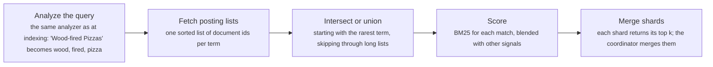
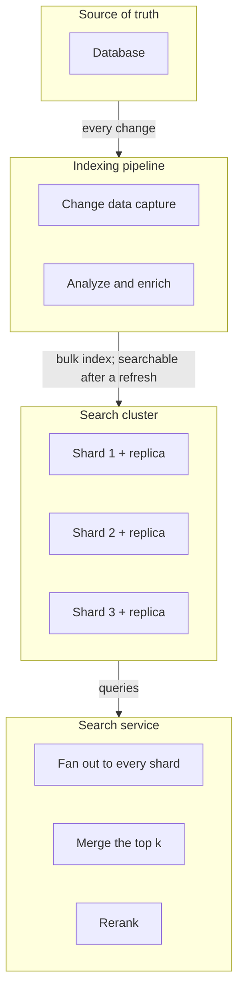
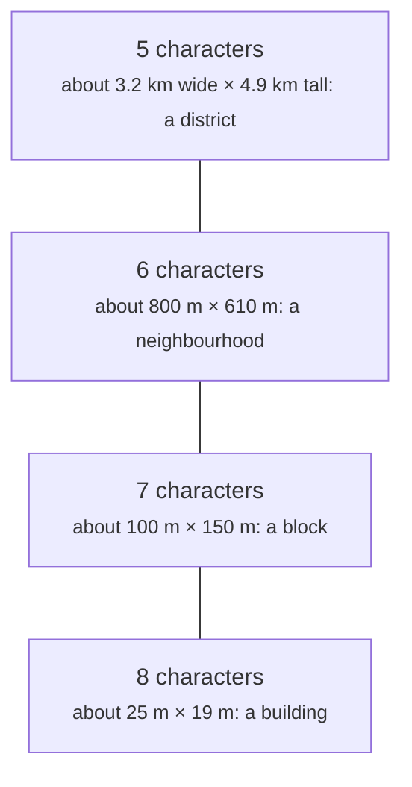

# Search and geo: inverted indexes, ranking, geohashes and quadtrees

> System Design · L3 Specialist · Search, regions and security · about 120 min · hub module `m06` ([open the hub](https://claude.ai/artifact/W93mxxEWBqV4MS8kJiz9dU))

## Why it matters
"Wood-fired pizza near me" is two hard problems at once. Text search needs an inverted index, from each word to the documents that contain it, plus a ranking function such as BM25 that rewards rare, focused matches. Geo search needs a spatial index: geohash cells turn closeness into key prefixes, and quadtrees split space where places crowd. Both indexes narrow millions of candidates to a few hundred before anything expensive is computed, and both live in systems that are derived copies of the database.

## Pre-question (answer before reading)
**Q:** A food app runs SELECT * FROM restaurants WHERE description LIKE '%pizza%' ORDER BY distance LIMIT 10. It's slow, misses 'pizzas', and ranks a pizza-spam page first. What would you change?

<details><summary>Answer</summary>

LIKE with a leading wildcard can't use a B-tree index, so every row is scanned, and the distance sort computes a distance for every match. An inverted index with an analyzer (lower-casing, stemming 'pizzas' to 'pizza') finds the matches directly; BM25 ranks them, damping repeated words and long descriptions; and a spatial index, such as geohash cells, limits the search to nearby places before exact distances are computed.

</details>

## 🍎 Story time (kid version)
**Pizza Town and the family road trip: Luigi's recipe cards and town squares**

Luigi keeps a card for every ingredient listing the recipes that use it, so finding recipes with both basil and garlic means comparing two short cards, not reading every recipe. When several recipes match, the one that mentions the rarer ingredient more often comes first, but mentioning it a hundred times doesn't help much more than a few. For deliveries, his town map is cut into squares, each cut into smaller ones, with names that grow a letter per cut; to find riders near a customer he checks the customer's square and the eight around it. Downtown, where riders crowd, he cuts squares smaller.

| In the story | In a real system |
|---|---|
| An ingredient card listing its recipes | An inverted index: each term maps to a sorted posting list of documents |
| Rarer ingredients first, with diminishing returns for repeats | BM25: inverse document frequency and saturating term frequency |
| Squares named by a growing string of letters | Geohash: each extra character picks a smaller cell inside the last |
| Checking the eight squares around too | Searching neighbouring cells, because nearby points can sit across an edge |
| Smaller squares downtown | A quadtree: cells split where points are dense |

**Where the story breaks:** Luigi's cards hold exact ingredient names. Real text needs analysis first: lower-casing, splitting words, stemming 'pizzas' to 'pizza', handling typos and synonyms. Get that wrong, and good documents can't be found at all.

## Key ideas (grown-up version)
- **Inverted indexes**: map each term to a posting list: the sorted ids of the documents containing it, often with term frequencies and positions. A query looks up each term's list and intersects (AND) or unions (OR) them; sorted lists merge in one pass, compress well as gaps between ids, and let long lists be skipped through. Lucene, and so Elasticsearch, OpenSearch and Solr, are built on it, and PostgreSQL's full-text search uses one too (a GIN index).
- **Text analysis**: the same analyzer runs at indexing time and at query time: split into tokens, lower-case, drop or keep stop words, stem or lemmatise ('pizzas' to 'pizza'), add synonyms. Stored positions allow phrase queries; n-grams and edit-distance (fuzzy) matching handle prefixes and typos. Changing the analyzer means reindexing.
- **BM25 ranking**: a document's score sums, over the query terms, the inverse document frequency (rare terms count more) times a term frequency that saturates (the tenth mention adds little), normalised by document length (long documents don't win by being long). k1 ≈ 1.2 sets the saturation and b ≈ 0.75 the length normalisation; it's the default in Lucene and Elasticsearch.
- **Beyond BM25**: production ranking blends text relevance with other signals (popularity, freshness, distance, personalisation), often by reranking the top few hundred candidates with a learned model. Semantic search adds embedding vectors and approximate nearest-neighbour indexes (HNSW), frequently fused with BM25 as hybrid search. Judge changes with labelled queries (precision at 10, NDCG) and A/B tests.
- **Running search at scale**: an index is split into shards by document; a query fans out to every shard, each returns its top k, and a coordinator merges them, while replicas add query capacity. Index segments are immutable and merged in the background, much like an LSM tree, so new documents become searchable after a refresh (about a second in Elasticsearch). The index is a derived copy, fed from the database by change data capture and rebuildable from it.
- **Geohash**: interleave the bits of repeated longitude and latitude halvings and write them in base 32. Each character narrows the cell: 5 characters are about 4.9 × 4.9 km at the equator, 6 about 1.2 × 0.6 km, 7 about 153 × 153 m, and cells get narrower east to west away from the equator. Close points don't always share a prefix, so a radius search reads the query's cell and its 8 neighbours, with cells at least as large as the radius.
- **Quadtrees, R-trees, S2 and H3**: a quadtree splits a box into four whenever it holds more than k points, so dense areas get small cells; R-trees (PostGIS's GiST indexes) group shapes by bounding boxes; S2 numbers cells on a cube along a Hilbert curve; H3 uses hexagons, whose neighbours are all the same distance away. Filter candidates with the index, then compute exact distances: a flat approximation inside a city, haversine between cities.
- **Text plus location**: 'pizza near me' filters by place first (cells, or a geo_point field in a search engine), applies the must-match terms, then scores with BM25 blended with a distance decay, rating and opening hours. Moving objects such as drivers are a different, write-heavy problem, kept in memory and partitioned by city; the ride-hailing design in module 9 covers it.

## Diagrams
**Answering a search query**



_Only documents that survive the posting-list step are ever scored, which is why search stays fast as the collection grows._

**A search index beside the database**



_The index is a derived, eventually consistent copy. When the mapping or analyzer changes, build a new index from the source and switch an alias to it._

**Geohash lengths and cell sizes in Paris**



_Cells are fixed in degrees. At the equator a 5-character cell is about 4.9 km square; at Paris's latitude, longitude degrees are shorter, so cells are narrower._

## Comparisons
**LIKE or an inverted index**

|  | WHERE text LIKE '%pizza%' | An inverted index (Lucene, PostgreSQL GIN) |
|---|---|---|
| Finding matches | Scans every row | Looks the term's posting list up |
| Plurals, typos, synonyms | Not handled | Analyzers, fuzzy matching, synonym lists |
| Ranking | None | BM25, field boosts, other signals |
| Freshness | Immediate, transactional | Near real time in a search engine; immediate with PostgreSQL GIN |

**Spatial indexes compared**

|  | Geohash | Quadtree | R-tree (PostGIS GiST) | H3 or S2 |
|---|---|---|---|---|
| Cells | A fixed grid of rectangles | Squares that split where data is dense | Overlapping bounding boxes | Hexagons (H3) or cube-face cells (S2) |
| Adapts to density | No | Yes | Yes | No: pick a resolution |
| Stored as | A string or integer key | A tree in memory | A tree inside the database | A 64-bit cell id |
| Good for | Key-value stores, Redis, prefix scans | In-memory indexes of uneven data | Shapes and polygons in a database | Analytics, ride hailing, rings of neighbours |

## Code (JavaScript + Python)
### Helpers used by every example: text analysis, geohash encoding and a city-scale distance
```python
import math
import re

def mulberry32(seed):                           # a tiny seeded random generator, same as the JavaScript one
    state = seed & 0xFFFFFFFF
    def rand():
        nonlocal state
        state = (state + 0x6D2B79F5) & 0xFFFFFFFF
        t = ((state ^ (state >> 15)) * (state | 1)) & 0xFFFFFFFF
        t = (t ^ (t + (((t ^ (t >> 7)) * (t | 61)) & 0xFFFFFFFF))) & 0xFFFFFFFF
        return ((t ^ (t >> 14)) & 0xFFFFFFFF) / 4294967296
    return rand

STOP = {"a", "all", "and", "by", "from", "of", "on", "the", "with"}

def analyze(text):                              # the same steps at indexing time and at query time
    words = re.findall(r"[a-z]+", text.lower())
    return [w[:-1] if len(w) > 3 and w.endswith("s") else w for w in words if w not in STOP]   # crude stemming: pizzas -> pizza

BASE32 = "0123456789bcdefghjkmnpqrstuvwxyz"
M_PER_DEG_LAT, M_PER_DEG_LON = 111_195, 73_160  # metres per degree; longitude degrees shrink with latitude (Paris, 48.86° N)

def encode(lat, lon, length):
    """Geohash: halve the longitude and latitude ranges in turn, one bit each time, 5 bits per character."""
    lat_r, lon_r = [-90.0, 90.0], [-180.0, 180.0]
    value, chars = 0, []
    for i in range(length * 5):
        rng, x = (lon_r, lon) if i % 2 == 0 else (lat_r, lat)   # even bits split longitude, odd bits latitude
        mid = (rng[0] + rng[1]) / 2
        bit = 1 if x >= mid else 0
        rng[1 - bit] = mid                      # keep the half that contains the point
        value = value * 2 + bit
        if i % 5 == 4:
            chars.append(BASE32[value])
            value = 0
    return "".join(chars)

def bbox(gh):
    """The cell a geohash names: (lat_lo, lat_hi, lon_lo, lon_hi)."""
    lat_r, lon_r = [-90.0, 90.0], [-180.0, 180.0]
    i = 0
    for ch in gh:
        v = BASE32.index(ch)
        for shift in range(4, -1, -1):
            rng = lon_r if i % 2 == 0 else lat_r
            rng[1 - ((v >> shift) & 1)] = (rng[0] + rng[1]) / 2
            i += 1
    return lat_r[0], lat_r[1], lon_r[0], lon_r[1]

def metres(lat1, lon1, lat2, lon2):             # a flat-earth distance: accurate enough across a city
    dy, dx = (lat2 - lat1) * M_PER_DEG_LAT, (lon2 - lon1) * M_PER_DEG_LON
    return math.sqrt(dx * dx + dy * dy)
```

```javascript
function mulberry32(seed) {                     // a tiny seeded random generator, same as the Python one
  return function () {
    seed = (seed + 0x6D2B79F5) | 0;
    let t = Math.imul(seed ^ (seed >>> 15), 1 | seed);
    t = (t + Math.imul(t ^ (t >>> 7), 61 | t)) ^ t;
    return ((t ^ (t >>> 14)) >>> 0) / 4294967296;
  };
}

const STOP = new Set(["a", "all", "and", "by", "from", "of", "on", "the", "with"]);

function analyze(text) {                        // the same steps at indexing time and at query time
  const words = text.toLowerCase().match(/[a-z]+/g) ?? [];
  return words.filter(w => !STOP.has(w)).map(w => (w.length > 3 && w.endsWith("s") ? w.slice(0, -1) : w));   // crude stemming: pizzas -> pizza
}

const BASE32 = "0123456789bcdefghjkmnpqrstuvwxyz";
const M_PER_DEG_LAT = 111_195, M_PER_DEG_LON = 73_160;   // metres per degree; longitude degrees shrink with latitude (Paris, 48.86° N)

function encode(lat, lon, length) {
  // geohash: halve the longitude and latitude ranges in turn, one bit each time, 5 bits per character
  const latR = [-90, 90], lonR = [-180, 180];
  let value = 0, chars = "";
  for (let i = 0; i < length * 5; i++) {
    const [rng, x] = i % 2 === 0 ? [lonR, lon] : [latR, lat];   // even bits split longitude, odd bits latitude
    const mid = (rng[0] + rng[1]) / 2;
    const bit = x >= mid ? 1 : 0;
    rng[1 - bit] = mid;                         // keep the half that contains the point
    value = value * 2 + bit;
    if (i % 5 === 4) { chars += BASE32[value]; value = 0; }
  }
  return chars;
}

function bbox(gh) {
  // the cell a geohash names: [latLo, latHi, lonLo, lonHi]
  const latR = [-90, 90], lonR = [-180, 180];
  let i = 0;
  for (const ch of gh) {
    const v = BASE32.indexOf(ch);
    for (let shift = 4; shift >= 0; shift--) {
      const rng = i % 2 === 0 ? lonR : latR;
      rng[1 - ((v >> shift) & 1)] = (rng[0] + rng[1]) / 2;
      i++;
    }
  }
  return [latR[0], latR[1], lonR[0], lonR[1]];
}

function metres(lat1, lon1, lat2, lon2) {       // a flat-earth distance: accurate enough across a city
  const dy = (lat2 - lat1) * M_PER_DEG_LAT, dx = (lon2 - lon1) * M_PER_DEG_LON;
  return Math.sqrt(dx * dx + dy * dy);
}
```

### An inverted index and an AND query
```python
docs = ["Wood-fired pizzas and fresh pasta", "Pasta bar with a wood oven", "Neapolitan pizza, wood-fired oven",
        "Burgers and fries", "Pizza by the slice", "Sushi and ramen", "Stone oven bakery: breads and pizza",
        "Vegan burgers, wood-fired"]
index = {}
for doc_id, text in enumerate(docs):
    for term in analyze(text):
        postings = index.setdefault(term, [])
        if not postings or postings[-1] != doc_id:
            postings.append(doc_id)                  # ids arrive in order, so every posting list stays sorted

def intersect(a, b):
    i = j = 0
    out = []
    while i < len(a) and j < len(b):                # one pass over both sorted lists
        if a[i] == b[j]:
            out.append(a[i])
            i, j = i + 1, j + 1
        elif a[i] < b[j]:
            i += 1
        else:
            j += 1
    return out

def search(query):
    lists = sorted((index.get(term, []) for term in analyze(query)), key=len)   # rarest term first
    result = lists[0] if lists else []
    for postings in lists[1:]:
        result = intersect(result, postings)        # AND: the result can only shrink
    return result

print("pizza ->", *index["pizza"], "| oven ->", *index["oven"], "| wood ->", *index["wood"])
for query in ("wood-fired pizza", "Pizzas, oven", "sushi burger"):
    print(f'"{query}":', " ".join(map(str, search(query))) or "no match")

rand = mulberry32(8)
common = [d for d in range(100_000) if rand() < 0.5]          # a term in half of all documents
rare = [d for d in range(100_000) if rand() < 0.001]          # a term in about 1 in 1,000
probes, found = 0, 0
for d in rare:                                                # look each rare id up in the long list
    lo, hi = 0, len(common)
    while lo < hi:
        probes += 1
        mid = (lo + hi) // 2
        if common[mid] < d:
            lo = mid + 1
        else:
            hi = mid
    found += lo < len(common) and common[lo] == d
print(f"rare AND common in 100000 documents: {found} matches; a merge walks up to {len(common) + len(rare)} entries, binary search takes {probes} probes")
```

Output:
```text
pizza -> 0 2 4 6 | oven -> 1 2 6 | wood -> 0 1 2 7
"wood-fired pizza": 0 2
"Pizzas, oven": 2 6
"sushi burger": no match
rare AND common in 100000 documents: 53 matches; a merge walks up to 49964 entries, binary search takes 1554 probes
```

- line 9: Documents are added in id order, so every posting list is sorted for free; real engines also store term counts and positions.
- line 14: Two sorted lists intersect in one pass, like the merge step of merge sort.
- line 25: Starting with the shortest list keeps every intermediate result small: an AND can only shrink.
- line 33: 'Pizzas' matches documents that say 'pizza' because the query goes through the same analyzer as the documents.
- line 49: When one list is tiny, jumping through the long one (binary search, skip lists) beats walking it: about 1,500 probes instead of 50,000 steps.

```javascript
const docs = ["Wood-fired pizzas and fresh pasta", "Pasta bar with a wood oven", "Neapolitan pizza, wood-fired oven",
              "Burgers and fries", "Pizza by the slice", "Sushi and ramen", "Stone oven bakery: breads and pizza",
              "Vegan burgers, wood-fired"];
const index = new Map();
docs.forEach((text, docId) => {
  for (const term of analyze(text)) {
    if (!index.has(term)) index.set(term, []);
    const postings = index.get(term);
    if (postings.at(-1) !== docId) postings.push(docId);   // ids arrive in order, so every posting list stays sorted
  }
});

function intersect(a, b) {
  let i = 0, j = 0;
  const out = [];
  while (i < a.length && j < b.length) {           // one pass over both sorted lists
    if (a[i] === b[j]) { out.push(a[i]); i++; j++; }
    else if (a[i] < b[j]) i++;
    else j++;
  }
  return out;
}

function search(query) {
  const lists = analyze(query).map(term => index.get(term) ?? []).sort((a, b) => a.length - b.length);   // rarest term first
  let result = lists.length ? lists[0] : [];
  for (const postings of lists.slice(1)) result = intersect(result, postings);   // AND: the result can only shrink
  return result;
}

console.log("pizza ->", ...index.get("pizza"), "| oven ->", ...index.get("oven"), "| wood ->", ...index.get("wood"));
for (const query of ["wood-fired pizza", "Pizzas, oven", "sushi burger"]) {
  console.log(`"${query}":`, search(query).join(" ") || "no match");
}

const rand = mulberry32(8);
const common = [], rare = [];
for (let d = 0; d < 100000; d++) if (rand() < 0.5) common.push(d);     // a term in half of all documents
for (let d = 0; d < 100000; d++) if (rand() < 0.001) rare.push(d);     // a term in about 1 in 1,000
let probes = 0, found = 0;
for (const d of rare) {                                     // look each rare id up in the long list
  let lo = 0, hi = common.length;
  while (lo < hi) {
    probes++;
    const mid = (lo + hi) >> 1;
    if (common[mid] < d) lo = mid + 1; else hi = mid;
  }
  if (lo < common.length && common[lo] === d) found++;
}
console.log(`rare AND common in 100000 documents: ${found} matches; a merge walks up to ${common.length + rare.length} entries, binary search takes ${probes} probes`);
```

Output:
```text
pizza -> 0 2 4 6 | oven -> 1 2 6 | wood -> 0 1 2 7
"wood-fired pizza": 0 2
"Pizzas, oven": 2 6
"sushi burger": no match
rare AND common in 100000 documents: 53 matches; a merge walks up to 49964 entries, binary search takes 1554 probes
```

- line 9: Documents are added in id order, so every posting list is sorted for free; real engines also store term counts and positions.
- line 16: Two sorted lists intersect in one pass, like the merge step of merge sort.
- line 25: Starting with the shortest list keeps every intermediate result small: an AND can only shrink.
- line 33: 'Pizzas' matches documents that say 'pizza' because the query goes through the same analyzer as the documents.
- line 50: When one list is tiny, jumping through the long one (binary search, skip lists) beats walking it: about 1,500 probes instead of 50,000 steps.

### BM25 against counting words
```python
docs = ["Pizza pizza pizza pizza pizza pizza: the best pizza, cheap pizza, pizza all night",
        "Neapolitan pizza from a wood-fired oven",
        "Family restaurant with a long menu: burgers, salads, pasta, steaks, fish, desserts, and a wood-fired pizza on Fridays",
        "Wood-fired bakery: sourdough breads", "Pizza by the slice", "Sushi and ramen"]
terms = [analyze(d) for d in docs]
avg_len = sum(len(t) for t in terms) / len(terms)

def idf(term):
    df = sum(term in t for t in terms)               # how many documents contain the term
    return math.log(1 + (len(terms) - df + 0.5) / (df + 0.5))

def bm25(doc, query, k1=1.2, b=0.75):
    score = 0.0
    for term in query:
        tf = doc.count(term)
        norm = k1 * (1 - b + b * len(doc) / avg_len)  # longer than average: each mention counts for less
        score += idf(term) * tf * (k1 + 1) / (tf + norm)   # saturates: the 10th mention adds little
    return score

def two_places(x):
    n = int(x * 100 + 0.5)
    return f"{n // 100}.{n % 100:02d}"

query = analyze("wood-fired pizza")
print("idf:", ", ".join(f"{term} {two_places(idf(term))}" for term in query))
counts = sorted(((-sum(t.count(q) for q in query), i) for i, t in enumerate(terms)))
print("by raw counts:", " | ".join(f"#{i} {-c}" for c, i in counts if c))
scores = sorted((-bm25(t, query), i) for i, t in enumerate(terms))
print("by BM25:", " | ".join(f"#{i} {two_places(-s)}" for s, i in scores if s))
```

Output:
```text
idf: wood 0.69, fired 0.69, pizza 0.44
by raw counts: #0 9 | #1 3 | #2 3 | #3 2 | #4 1
by BM25: #1 2.04 | #3 1.54 | #2 1.26 | #0 0.80 | #4 0.62
```

- line 10: Inverse document frequency: a term in most documents says little about any of them.
- line 16: Length normalisation: a mention in a long menu counts for less than one in a short description.
- line 17: Saturation: tf / (tf + norm) approaches 1, so nine mentions of 'pizza' score barely twice one.
- line 27: Counting words puts the spam page first.
- line 29: BM25 puts the short, focused match first. The bakery comes second on 'wood' and 'fired' alone; requiring every term, or the phrase, would drop it.

```javascript
const docs = ["Pizza pizza pizza pizza pizza pizza: the best pizza, cheap pizza, pizza all night",
              "Neapolitan pizza from a wood-fired oven",
              "Family restaurant with a long menu: burgers, salads, pasta, steaks, fish, desserts, and a wood-fired pizza on Fridays",
              "Wood-fired bakery: sourdough breads", "Pizza by the slice", "Sushi and ramen"];
const terms = docs.map(analyze);
const avgLen = terms.reduce((sum, t) => sum + t.length, 0) / terms.length;

function idf(term) {
  const df = terms.filter(t => t.includes(term)).length;   // how many documents contain the term
  return Math.log(1 + (terms.length - df + 0.5) / (df + 0.5));
}

function bm25(doc, query, k1 = 1.2, b = 0.75) {
  let score = 0;
  for (const term of query) {
    const tf = doc.filter(w => w === term).length;
    const norm = k1 * (1 - b + b * doc.length / avgLen);   // longer than average: each mention counts for less
    score += idf(term) * tf * (k1 + 1) / (tf + norm);       // saturates: the 10th mention adds little
  }
  return score;
}

function twoPlaces(x) {
  const n = Math.floor(x * 100 + 0.5);
  return `${Math.floor(n / 100)}.${String(n % 100).padStart(2, "0")}`;
}

const query = analyze("wood-fired pizza");
console.log("idf:", query.map(term => `${term} ${twoPlaces(idf(term))}`).join(", "));
const counts = terms.map((t, i) => [query.reduce((sum, q) => sum + t.filter(w => w === q).length, 0), i])
  .sort((a, b) => b[0] - a[0] || a[1] - b[1]);
console.log("by raw counts:", counts.filter(([c]) => c > 0).map(([c, i]) => `#${i} ${c}`).join(" | "));
const scores = terms.map((t, i) => [bm25(t, query), i]).sort((a, b) => b[0] - a[0] || a[1] - b[1]);
console.log("by BM25:", scores.filter(([s]) => s > 0).map(([s, i]) => `#${i} ${twoPlaces(s)}`).join(" | "));
```

Output:
```text
idf: wood 0.69, fired 0.69, pizza 0.44
by raw counts: #0 9 | #1 3 | #2 3 | #3 2 | #4 1
by BM25: #1 2.04 | #3 1.54 | #2 1.26 | #0 0.80 | #4 0.62
```

- line 10: Inverse document frequency: a term in most documents says little about any of them.
- line 17: Length normalisation: a mention in a long menu counts for less than one in a short description.
- line 18: Saturation: tf / (tf + norm) approaches 1, so nine mentions of 'pizza' score barely twice one.
- line 32: Counting words puts the spam page first.
- line 34: BM25 puts the short, focused match first. The bakery comes second on 'wood' and 'fired' alone; requiring every term, or the phrase, would drop it.

### A quadtree: small cells where places crowd together
```python
class QuadTree:
    """Split a box into four once it holds more than `capacity` points, so dense areas get small cells."""
    def __init__(self, lat_lo, lat_hi, lon_lo, lon_hi, capacity=8, depth=0):
        self.box, self.capacity, self.depth = (lat_lo, lat_hi, lon_lo, lon_hi), capacity, depth
        self.points, self.children = [], None

    def child_for(self, lat, lon):
        lat_lo, lat_hi, lon_lo, lon_hi = self.box
        return self.children[(2 if lat >= (lat_lo + lat_hi) / 2 else 0) + (1 if lon >= (lon_lo + lon_hi) / 2 else 0)]

    def insert(self, lat, lon, pid):
        if self.children is not None:
            return self.child_for(lat, lon).insert(lat, lon, pid)
        self.points.append((lat, lon, pid))
        if len(self.points) > self.capacity and self.depth < 20:   # too full: split into four quarters
            lat_lo, lat_hi, lon_lo, lon_hi = self.box
            mlat, mlon = (lat_lo + lat_hi) / 2, (lon_lo + lon_hi) / 2
            self.children = [QuadTree(a, b, c, d, self.capacity, self.depth + 1)
                             for a, b in ((lat_lo, mlat), (mlat, lat_hi)) for c, d in ((lon_lo, mlon), (mlon, lon_hi))]
            for p in self.points:
                self.child_for(p[0], p[1]).insert(*p)
            self.points = []

    def query(self, lat_lo, lat_hi, lon_lo, lon_hi, stats):
        b = self.box
        if b[0] > lat_hi or b[1] < lat_lo or b[2] > lon_hi or b[3] < lon_lo:
            return []                              # this box can't overlap the query: skip it entirely
        stats["nodes"] += 1
        if self.children is not None:
            return [p for c in self.children for p in c.query(lat_lo, lat_hi, lon_lo, lon_hi, stats)]
        stats["points"] += len(self.points)
        return [pid for lat, lon, pid in self.points if lat_lo <= lat <= lat_hi and lon_lo <= lon <= lon_hi]

    def leaves(self):
        return [self] if self.children is None else [leaf for c in self.children for leaf in c.leaves()]

rand = mulberry32(1)
pts = []
for _ in range(4000):
    if rand() < 0.8:
        pts.append((48.855 + rand() * 0.01, 2.335 + rand() * 0.015))   # 80% crowd into a small downtown area
    else:
        pts.append((48.80 + rand() * 0.12, 2.25 + rand() * 0.17))
tree = QuadTree(48.80, 48.92, 2.25, 2.42)
for pid, (lat, lon) in enumerate(pts):
    tree.insert(lat, lon, pid)
leaves = tree.leaves()
side = math.isqrt(len(leaves))                     # a uniform grid with about as many cells, for comparison
grid = {}
for lat, lon in pts:
    key = (min(side - 1, int((lat - 48.80) / 0.12 * side)), min(side - 1, int((lon - 2.25) / 0.17 * side)))
    grid[key] = grid.get(key, 0) + 1
print(f"quadtree: {len(leaves)} leaves, {max(l.depth for l in leaves)} levels deep, at most "
      f"{max(len(l.points) for l in leaves)} places per leaf | uniform grid of {side * side} cells: up to {max(grid.values())} in one cell")
stats = {"nodes": 0, "points": 0}
hits = tree.query(48.858, 48.860, 2.340, 2.343, stats)
print(f"small downtown box: visited {stats['nodes']} nodes, checked {stats['points']} places, "
      f"found {len(hits)} (a scan checks {len(pts)})")
```

Output:
```text
quadtree: 1111 leaves, 9 levels deep, at most 8 places per leaf | uniform grid of 1089 cells: up to 411 in one cell
small downtown box: visited 100 nodes, checked 219 places, found 128 (a scan checks 4000)
```

- line 15: A leaf that gets too full splits into four and hands its points down, so no leaf holds more than a handful.
- line 27: Whole subtrees are skipped when their box can't overlap the query: that's where the savings come from.
- line 53: The quadtree keeps every leaf small, while the uniform grid's downtown cells overflow with hundreds of places.
- line 57: The query touches about a hundred nodes and a couple of hundred places instead of all 4,000.

```javascript
class QuadTree {
  // split a box into four once it holds more than `capacity` points, so dense areas get small cells
  constructor(latLo, latHi, lonLo, lonHi, capacity = 8, depth = 0) {
    this.box = [latLo, latHi, lonLo, lonHi]; this.capacity = capacity; this.depth = depth;
    this.points = []; this.children = null;
  }
  childFor(lat, lon) {
    const [latLo, latHi, lonLo, lonHi] = this.box;
    return this.children[(lat >= (latLo + latHi) / 2 ? 2 : 0) + (lon >= (lonLo + lonHi) / 2 ? 1 : 0)];
  }
  insert(lat, lon, pid) {
    if (this.children !== null) return this.childFor(lat, lon).insert(lat, lon, pid);
    this.points.push([lat, lon, pid]);
    if (this.points.length > this.capacity && this.depth < 20) {   // too full: split into four quarters
      const [latLo, latHi, lonLo, lonHi] = this.box;
      const mlat = (latLo + latHi) / 2, mlon = (lonLo + lonHi) / 2;
      this.children = [];
      for (const [a, b] of [[latLo, mlat], [mlat, latHi]]) {
        for (const [c, d] of [[lonLo, mlon], [mlon, lonHi]]) this.children.push(new QuadTree(a, b, c, d, this.capacity, this.depth + 1));
      }
      for (const p of this.points) this.childFor(p[0], p[1]).insert(...p);
      this.points = [];
    }
  }
  query(latLo, latHi, lonLo, lonHi, stats) {
    const b = this.box;
    if (b[0] > latHi || b[1] < latLo || b[2] > lonHi || b[3] < lonLo) return [];   // this box can't overlap the query: skip it entirely
    stats.nodes++;
    if (this.children !== null) return this.children.flatMap(c => c.query(latLo, latHi, lonLo, lonHi, stats));
    stats.points += this.points.length;
    return this.points.filter(([lat, lon]) => latLo <= lat && lat <= latHi && lonLo <= lon && lon <= lonHi).map(([, , pid]) => pid);
  }
  leaves() {
    return this.children === null ? [this] : this.children.flatMap(c => c.leaves());
  }
}

const rand = mulberry32(1);
const pts = [];
for (let i = 0; i < 4000; i++) {
  if (rand() < 0.8) pts.push([48.855 + rand() * 0.01, 2.335 + rand() * 0.015]);   // 80% crowd into a small downtown area
  else pts.push([48.80 + rand() * 0.12, 2.25 + rand() * 0.17]);
}
const tree = new QuadTree(48.80, 48.92, 2.25, 2.42);
pts.forEach(([lat, lon], pid) => tree.insert(lat, lon, pid));
const leaves = tree.leaves();
const side = Math.floor(Math.sqrt(leaves.length));   // a uniform grid with about as many cells, for comparison
const grid = new Map();
for (const [lat, lon] of pts) {
  const key = `${Math.min(side - 1, Math.floor((lat - 48.80) / 0.12 * side))},${Math.min(side - 1, Math.floor((lon - 2.25) / 0.17 * side))}`;
  grid.set(key, (grid.get(key) ?? 0) + 1);
}
console.log(`quadtree: ${leaves.length} leaves, ${Math.max(...leaves.map(l => l.depth))} levels deep, at most ` +
            `${Math.max(...leaves.map(l => l.points.length))} places per leaf | uniform grid of ${side * side} cells: up to ${Math.max(...grid.values())} in one cell`);
const stats = { nodes: 0, points: 0 };
const hits = tree.query(48.858, 48.860, 2.340, 2.343, stats);
console.log(`small downtown box: visited ${stats.nodes} nodes, checked ${stats.points} places, ` +
            `found ${hits.length} (a scan checks ${pts.length})`);
```

Output:
```text
quadtree: 1111 leaves, 9 levels deep, at most 8 places per leaf | uniform grid of 1089 cells: up to 411 in one cell
small downtown box: visited 100 nodes, checked 219 places, found 128 (a scan checks 4000)
```

- line 14: A leaf that gets too full splits into four and hands its points down, so no leaf holds more than a handful.
- line 27: Whole subtrees are skipped when their box can't overlap the query: that's where the savings come from.
- line 53: The quadtree keeps every leaf small, while the uniform grid's downtown cells overflow with hundreds of places.
- line 57: The query touches about a hundred nodes and a couple of hundred places instead of all 4,000.

## Worked example
**Problem.** Design “pizza near me” for a food app with 20,000 restaurants across Paris, each with a few words of description. A query has words and a location; return the five best pizza places within 500 m, ranked by how well they match and how close they are. Show how much work the geo filter saves.

1. Build two indexes once: geohash cells (6 characters, about 800 × 600 m in Paris) to restaurant ids, and the statistics BM25 needs (document frequencies and the average length). A search engine would keep the words in an inverted index as well.
2. Filter before scoring: the query's cell and its 8 neighbours give a few hundred candidates; keep only those within 500 m that are pizza places, a must-match clause.
3. Score what's left: BM25 for the words, divided by a distance decay of 1 + d / 250, so a strong match 300 m away can beat a weak one next door. Search engines express the same idea with decay functions in a function score.
4. Check the index against brute force: the top five must be exactly what scoring every restaurant gives, which the tests confirm at random locations.

```python
rand = mulberry32(31)
CUISINES = ["pizza", "pizza", "sushi", "burger", "curry", "taco", "noodle", "bakery", "salad", "pasta"]   # pizza is twice as likely
EXTRAS = ["wood", "fired", "oven", "vegan", "cheap", "family", "terrace", "late", "delivery", "fresh", "spicy", "wine"]
places = []
for _ in range(20_000):                                  # restaurants across Paris
    lat, lon = 48.80 + rand() * 0.12, 2.25 + rand() * 0.17
    words = [CUISINES[int(rand() * len(CUISINES))]] + [e for e in EXTRAS if rand() < 0.3]
    places.append((lat, lon, words))

cells, df, total = {}, {}, 0                             # build both indexes once
for pid, (lat, lon, words) in enumerate(places):
    cells.setdefault(encode(lat, lon, 6), []).append(pid)
    for w in set(words):
        df[w] = df.get(w, 0) + 1
    total += len(words)
avg_len = total / len(places)

def bm25(words, query, k1=1.2, b=0.75):
    score = 0.0
    for term in query:
        tf = words.count(term)
        if tf:
            idf = math.log(1 + (len(places) - df[term] + 0.5) / (df[term] + 0.5))
            score += idf * tf * (k1 + 1) / (tf + k1 * (1 - b + b * len(words) / avg_len))
    return score

def block_of_nine(gh):
    lat_lo, lat_hi, lon_lo, lon_hi = bbox(gh)
    h, w = lat_hi - lat_lo, lon_hi - lon_lo
    clat, clon = (lat_lo + lat_hi) / 2, (lon_lo + lon_hi) / 2
    return [encode(clat + dy * h, clon + dx * w, len(gh)) for dy in (-1, 0, 1) for dx in (-1, 0, 1)]

def search(text, must, lat, lon, radius=500, k=5):
    query = analyze(text)
    candidates = [pid for cell in block_of_nine(encode(lat, lon, 6)) for pid in cells.get(cell, [])]
    hits = []
    for pid in candidates:
        plat, plon, words = places[pid]
        d = metres(lat, lon, plat, plon)
        if d <= radius and must in words:                # filters first: inside the radius, and a pizza place
            hits.append((-bm25(words, query) / (1 + d / 250), pid, d))   # relevance, halved at 250 m
    hits.sort()
    return len(candidates), len(hits), hits[:k]

checked, matching, top = search("wood-fired pizza", "pizza", 48.8606, 2.3376)
print(f"geo filter: {checked} of {len(places)} restaurants checked, {matching} pizza places within 500 m")
for score, pid, d in top:
    n = int(-score * 100 + 0.5)
    print(f"  #{pid} at {int(d + 0.5)} m: {' '.join(places[pid][2])} (score {n // 100}.{n % 100:02d})")
```

Output:
```text
geo filter: 571 of 20000 restaurants checked, 24 pizza places within 500 m
  #13834 at 136 m: pizza fired vegan cheap (score 1.93)
  #4187 at 177 m: pizza fired family (score 1.93)
  #5036 at 187 m: pizza fired family (score 1.88)
  #10469 at 291 m: pizza wood fired terrace spicy (score 1.80)
  #14849 at 99 m: pizza wood oven cheap family late (score 1.80)
```

```javascript
const rand = mulberry32(31);
const CUISINES = ["pizza", "pizza", "sushi", "burger", "curry", "taco", "noodle", "bakery", "salad", "pasta"];   // pizza is twice as likely
const EXTRAS = ["wood", "fired", "oven", "vegan", "cheap", "family", "terrace", "late", "delivery", "fresh", "spicy", "wine"];
const places = [];
for (let i = 0; i < 20000; i++) {                        // restaurants across Paris
  const lat = 48.80 + rand() * 0.12, lon = 2.25 + rand() * 0.17;
  const words = [CUISINES[Math.floor(rand() * CUISINES.length)], ...EXTRAS.filter(() => rand() < 0.3)];
  places.push([lat, lon, words]);
}

const cells = new Map(), df = new Map();                 // build both indexes once
let total = 0;
places.forEach(([lat, lon, words], pid) => {
  const cell = encode(lat, lon, 6);
  if (!cells.has(cell)) cells.set(cell, []);
  cells.get(cell).push(pid);
  for (const w of new Set(words)) df.set(w, (df.get(w) ?? 0) + 1);
  total += words.length;
});
const avgLen = total / places.length;

function bm25(words, query, k1 = 1.2, b = 0.75) {
  let score = 0;
  for (const term of query) {
    const tf = words.filter(w => w === term).length;
    if (tf) {
      const idf = Math.log(1 + (places.length - df.get(term) + 0.5) / (df.get(term) + 0.5));
      score += idf * tf * (k1 + 1) / (tf + k1 * (1 - b + b * words.length / avgLen));
    }
  }
  return score;
}

function blockOfNine(gh) {
  const [latLo, latHi, lonLo, lonHi] = bbox(gh);
  const h = latHi - latLo, w = lonHi - lonLo, clat = (latLo + latHi) / 2, clon = (lonLo + lonHi) / 2;
  const out = [];
  for (const dy of [-1, 0, 1]) for (const dx of [-1, 0, 1]) out.push(encode(clat + dy * h, clon + dx * w, gh.length));
  return out;
}

function search(text, must, lat, lon, radius = 500, k = 5) {
  const query = analyze(text);
  const candidates = blockOfNine(encode(lat, lon, 6)).flatMap(cell => cells.get(cell) ?? []);
  const hits = [];
  for (const pid of candidates) {
    const [plat, plon, words] = places[pid];
    const d = metres(lat, lon, plat, plon);
    if (d <= radius && words.includes(must)) {           // filters first: inside the radius, and a pizza place
      hits.push([bm25(words, query) / (1 + d / 250), pid, d]);   // relevance, halved at 250 m
    }
  }
  hits.sort((a, b) => b[0] - a[0] || a[1] - b[1]);
  return [candidates.length, hits.length, hits.slice(0, k)];
}

const [checked, matching, top] = search("wood-fired pizza", "pizza", 48.8606, 2.3376);
console.log(`geo filter: ${checked} of ${places.length} restaurants checked, ${matching} pizza places within 500 m`);
for (const [score, pid, d] of top) {
  const n = Math.floor(score * 100 + 0.5);
  console.log(`  #${pid} at ${Math.floor(d + 0.5)} m: ${places[pid][2].join(" ")} (score ${Math.floor(n / 100)}.${String(n % 100).padStart(2, "0")})`);
}
```

Output:
```text
geo filter: 571 of 20000 restaurants checked, 24 pizza places within 500 m
  #13834 at 136 m: pizza fired vegan cheap (score 1.93)
  #4187 at 177 m: pizza fired family (score 1.93)
  #5036 at 187 m: pizza fired family (score 1.88)
  #10469 at 291 m: pizza wood fired terrace spicy (score 1.80)
  #14849 at 99 m: pizza wood oven cheap family late (score 1.80)
```

**Answer.** The nine cells hold 571 restaurants, so only 571 of the 20,000 are checked, and 24 of them are pizza places within 500 m. The winner is 136 m away and matches 'fired'. The closest match, #14849 at 99 m, matches as many query words but has a longer description, so BM25 scores each word lower and it ranks fifth. The decay constant sets the balance between relevance and distance, and teams tune it against click data. At scale, the same plan runs inside a search engine: a geo filter on a geo_point field, a must clause and a function score.

## Your turn (faded example)
**Problem.** Finish `neighbours(gh)`: return the 8 cells around a geohash cell, in the order N, NE, E, SE, S, SW, W, NW, each at the same length. Decode the cell's box, step one cell height or width from its centre, and encode. (Assume the cell isn't at a pole or on the ±180° line.)

- ✓ Decode the box, take its centre, and use the cell's height and width as the step sizes.
- **Why step from the centre rather than from an edge?**
  <details><summary>Answer</summary>A point exactly on an edge belongs to the cell above or to the right (the >= in encode), so stepping from an edge can land in the wrong cell, or in the cell itself. From the centre, one full step lands in the middle of the neighbour.</details>
- **Where does this simple version break?**
  <details><summary>Answer</summary>At the poles, where there's no cell further north or south, and across the ±180° line, where longitude wraps around. Real libraries handle both, and also the very narrow cells near the poles.</details>
- **What does it cost?**
  <details><summary>Answer</summary>Eight encodes of `length` characters, so O(length) time and no lookups. Some libraries go faster still with per-character lookup tables, without decoding at all.</details>

Starter:
```python
def neighbours(gh):
    lat_lo, lat_hi, lon_lo, lon_hi = bbox(gh)
    ...                                          # TODO: N, NE, E, SE, S, SW, W, NW, stepping from the centre
```

```javascript
function neighbours(gh) {
  const [latLo, latHi, lonLo, lonHi] = bbox(gh);
  // TODO: N, NE, E, SE, S, SW, W, NW, stepping from the centre
}
```

<details><summary>Full solution</summary>

```python
def neighbours(gh):
    lat_lo, lat_hi, lon_lo, lon_hi = bbox(gh)
    h, w = lat_hi - lat_lo, lon_hi - lon_lo
    clat, clon = (lat_lo + lat_hi) / 2, (lon_lo + lon_hi) / 2
    steps = [(1, 0), (1, 1), (0, 1), (-1, 1), (-1, 0), (-1, -1), (0, -1), (1, -1)]   # (north, east): N, NE, E ... NW
    return [encode(clat + dn * h, clon + de * w, len(gh)) for dn, de in steps]

print("around u09tvn:", *neighbours("u09tvn"))
print("around gcpuvp:", *neighbours("gcpuvp"))
```

Output:
```text
around u09tvn: u09tvp u09tvr u09tvq u09tvm u09tvj u09tuv u09tuy u09tuz
around gcpuvp: gcpvj0 gcpvj2 gcpuvr gcpuvq gcpuvn gcpuuy gcpuuz gcpvhb
```

```javascript
function neighbours(gh) {
  const [latLo, latHi, lonLo, lonHi] = bbox(gh);
  const h = latHi - latLo, w = lonHi - lonLo, clat = (latLo + latHi) / 2, clon = (lonLo + lonHi) / 2;
  const steps = [[1, 0], [1, 1], [0, 1], [-1, 1], [-1, 0], [-1, -1], [0, -1], [1, -1]];   // [north, east]: N, NE, E ... NW
  return steps.map(([dn, de]) => encode(clat + dn * h, clon + de * w, gh.length));
}

console.log("around u09tvn:", ...neighbours("u09tvn"));
console.log("around gcpuvp:", ...neighbours("gcpuvp"));
```

Output:
```text
around u09tvn: u09tvp u09tvr u09tvq u09tvm u09tvj u09tuv u09tuy u09tuz
around gcpuvp: gcpvj0 gcpvj2 gcpuvr gcpuvq gcpuvn gcpuuy gcpuuz gcpvhb
```

</details>

## Socratic checks and quiz (answers hidden)
**1. What does this print?**

```python
a, b = [2, 5, 9, 14, 20], [1, 5, 14, 15, 20, 31]
i = j = steps = 0
out = []
while i < len(a) and j < len(b):
    steps += 1
    if a[i] == b[j]:
        out.append(a[i])
        i, j = i + 1, j + 1
    elif a[i] < b[j]:
        i += 1
    else:
        j += 1
print(*out, steps)
```

```javascript
const a = [2, 5, 9, 14, 20], b = [1, 5, 14, 15, 20, 31];
let i = 0, j = 0, steps = 0;
const out = [];
while (i < a.length && j < b.length) {
  steps++;
  if (a[i] === b[j]) { out.push(a[i]); i++; j++; }
  else if (a[i] < b[j]) i++;
  else j++;
}
console.log(...out, steps);
```

- A. 5 14 20 7
- B. 5 14 20 11
- C. 5 14 20 5
- D. 5 14 7

<details><summary>Answer</summary>

5 14 20 7. Each step advances at least one pointer, and the loop stops when a runs out at 20, before 31 is ever looked at: seven steps for three matches.

</details>

**2. What does this print?**

```python
a, b = "u09tvny", "u09tvmr"
n = 0
while n < len(a) and a[n] == b[n]:
    n += 1
print(n, a[:n])
```

```javascript
const a = "u09tvny", b = "u09tvmr";
let n = 0;
while (n < a.length && a[n] === b[n]) n++;
console.log(n, a.slice(0, n));
```

- A. 5 u09tv
- B. 4 u09t
- C. 6 u09tvn
- D. 7 u09tvny

<details><summary>Answer</summary>

5 u09tv. The strings agree on u09tv and differ at the sixth character (n against m), so the two places share a 5-character cell but not a 6-character one.

</details>

**3. A product search uses WHERE name LIKE '%phone%'. It's slow, and it misses products named 'Phones'. What fixes both?**

- A. Full-text search with an inverted index and an analyzer that lower-cases and stems, such as PostgreSQL's tsvector with GIN or Elasticsearch
- B. A B-tree index on name
- C. A bigger database server
- D. Caching the query's results

<details><summary>Answer</summary>

Full-text search with an inverted index and an analyzer that lower-cases and stems, such as PostgreSQL's tsvector with GIN or Elasticsearch. A leading wildcard defeats a B-tree, so LIKE scans every row. An inverted index looks the term up directly, and analysis turns 'Phones' and 'phone' into the same term at both index and query time.

</details>

**4. Why doesn't a page that repeats 'pizza' fifty times beat a short, focused pizza page under BM25?**

- A. Term frequency saturates, and long documents are normalised by their length
- B. BM25 ignores term frequency
- C. Repeated words are removed as stop words
- D. Repeated words get a negative IDF

<details><summary>Answer</summary>

Term frequency saturates, and long documents are normalised by their length. Each extra mention adds less than the last, and a long page's mentions are each worth less, so stuffing a page with a word gains little.

</details>

**5. How do search clusters such as Elasticsearch handle scale? (choose 3)**

- A. Split the index into shards, query them all and merge each shard's top results
- B. Add replicas of each shard to serve more queries
- C. Make new documents searchable after a periodic refresh rather than instantly
- D. Keep every term's posting list on one node
- E. Rank results with SQL ORDER BY

<details><summary>Answer</summary>

Split the index into shards, query them all and merge each shard's top results, Add replicas of each shard to serve more queries, Make new documents searchable after a periodic refresh rather than instantly. Document-partitioned shards spread the index, replicas spread the queries, and immutable segments plus a refresh interval keep indexing cheap at the price of near-real-time visibility.

</details>

**6. Judge each statement.**

- Two points with the same 6-character geohash are in the same cell.
- Two points 1 metre apart always share a long geohash prefix.
- A rare query term adds more to a BM25 score than a common one.
- A quadtree splits busy areas into smaller cells than quiet ones.

<details><summary>Answer</summary>

Two points with the same 6-character geohash are in the same cell.: Yes; Two points 1 metre apart always share a long geohash prefix.: No; A rare query term adds more to a BM25 score than a common one.: Yes; A quadtree splits busy areas into smaller cells than quiet ones.: Yes. A shared geohash means a shared cell, but points either side of an edge can differ early. BM25 weights terms by inverse document frequency, and quadtrees adapt to density.

</details>

**7. Put a search engine's handling of a query in order.**

- (put the steps in order)

<details><summary>Answer</summary>

Analyze the query with the same analyzer used for indexing → Look up each term's posting list → Intersect or union the lists → Score the matching documents → Merge each shard's top results and return the best k. Matching narrows the candidates before any scoring happens, and each shard does that work in parallel before the coordinator merges.

</details>

**8. Complete the Python bit loop at the heart of geohash encoding.**

```
def encode_bits(lat, lon, nbits):
    lat_r, lon_r = [-90.0, 90.0], [-180.0, 180.0]
    out = []
    for i in range(nbits):
        rng, x = (lon_r, lon) if i % 2 == {{0}} else (lat_r, lat)
        mid = (rng[0] + rng[1]) / 2
        bit = 1 if x >= mid else 0
        rng[{{1}}] = mid
        out.append(bit)
    return out

```

<details><summary>Answer</summary>

0 | 1 - bit. Even bits split longitude (geohash starts with longitude), and the update keeps the half containing the point: a 1 bit raises the lower bound, a 0 bit lowers the upper bound.

</details>

## Traps & misconceptions
- **“LIKE '%term%' is good enough for search.”** It scans every row, can't rank, and misses plurals and typos. Use full-text search: PostgreSQL's GIN-indexed tsvector for modest needs, a search engine when you need relevance tuning, facets and scale.
- **“The search engine can be the source of truth.”** A search index is a derived, eventually consistent copy without transactions. Keep the truth in the database, feed the index through change data capture, and make sure it can be rebuilt from scratch.
- **“Index with one analyzer, query with another.”** If 'Running' is indexed as 'run' but the query keeps 'running', nothing matches. Analyze both sides the same way, and reindex whenever the analyzer changes.
- **“Deep pagination is free: page 500 costs the same as page 1.”** To serve results 10,000 to 10,020, every shard must find its top 10,020 and the coordinator must merge them all. Cap the page depth, and use search-after cursors for deep scrolling.
- **“A shared prefix means close, so close means a shared prefix.”** The first holds; the second doesn't. Two points either side of a cell edge can share almost no prefix, so always search the neighbouring cells too.
- **“A geohash cell is a square of fixed size.”** Cells are fixed in degrees, not metres. A 5-character cell is about 4.9 km square at the equator, but only about 3.2 km wide in Paris, and narrower still towards the poles.

## Discussion prompts
- **How would you design "restaurants near me" for 10 million restaurants and 50,000 searches a second?**
  <details><summary>One good answer</summary>Restaurants rarely move, so precompute: index them by geohash, S2 or H3 cells, store cell → restaurant ids in a key-value store or search engine, and cache the busy cells. A search picks a cell size from the radius, reads the cell and its neighbours, filters by exact distance, and ranks by relevance, distance, rating and opening hours. Shard by region, and add new restaurants in batches.</details>
- **Your product search finds the right items, but users say the order feels random. How do you improve relevance?**
  <details><summary>One good answer</summary>Measure first: a set of judged queries scored with NDCG or precision at 10, plus click-through. Then tune analysis (synonyms, stemming, typo tolerance), boost fields such as the title over the description, blend in popularity and freshness, and add a learned reranker for the top results. A/B test every change, because offline gains don't always hold with real users.</details>

## Teach-back
**Prompt:** Explain to a junior colleague how a search engine answers 'wood-fired pizza near me': indexing, matching, ranking and the location part.

Rubric:
- [ ] Analysis at index and query time, and the inverted index of sorted posting lists
- [ ] Intersecting posting lists, rarest term first, with skipping
- [ ] BM25: inverse document frequency, saturation and length normalisation
- [ ] Shards, merging top results, and refresh: an eventually consistent derived copy
- [ ] Geohash cells plus the 8 neighbours, quadtrees for dense areas, then exact distances

<details><summary>Model answer</summary>

When documents are indexed, an analyzer splits them into terms, lower-cases and stems them, and the engine records, for each term, the sorted list of documents containing it. A query goes through the same analyzer; the engine fetches the posting lists and intersects them, rarest first, jumping through long lists. Each surviving document is scored with BM25: rare terms count more, repeated mentions saturate, and long documents are normalised, so focused matches win. The index is split into shards; each returns its best results and a coordinator merges them, and new documents appear after a refresh, so it's an eventually consistent copy of the database. For 'near me', places are also indexed by geohash cell: I read the query's cell and its 8 neighbours, keep places within the radius, and blend distance into the score. Where places crowd together, a quadtree splits cells further.

</details>

## Quick Q&A (also in the SRS deck)
- **What does an inverted index map?** Each term to the sorted list of documents that contain it.
- **Why intersect posting lists starting with the rarest term?** An AND can only shrink, so the shortest list bounds the work.
- **What are BM25's three ingredients?** Inverse document frequency, saturating term frequency and document-length normalisation.
- **Why is a search index eventually consistent?** New documents become searchable only after the next refresh.
- **Why search the 8 neighbouring geohash cells?** A nearby point can sit just across a cell edge, with a different geohash.
- **What does a quadtree do in dense areas?** Splits cells into four whenever they hold more than k points, so leaves stay small.

## Practice problems
- [ ] [Reading · Introduction to Information Retrieval: Boolean retrieval](https://nlp.stanford.edu/IR-book/html/htmledition/boolean-retrieval-1.html) · build the inverted index for three short documents by hand, then answer an AND and an OR query with it
- [ ] [Reading · The Probabilistic Relevance Framework: BM25 and Beyond](https://www.staff.city.ac.uk/~sbrp622/papers/foundations_bm25_review.pdf) · explain what k1 and b control, and predict what happens to this module's ranking with b = 0
- [ ] [Reference · Redis geospatial](https://redis.io/docs/latest/develop/data-types/geospatial/) · store 1,000 points with GEOADD, query them with GEOSEARCH, and compare with this module's block of nine cells
- [ ] [Reference · H3](https://h3geo.org/docs/) · find how H3's resolutions compare with geohash lengths, and why it uses hexagons

## Sources (accessed 2026-10-09)
- [Manning, Raghavan and Schütze: Introduction to Information Retrieval, Boolean retrieval](https://nlp.stanford.edu/IR-book/html/htmledition/boolean-retrieval-1.html)
- [Robertson and Zaragoza: The Probabilistic Relevance Framework: BM25 and Beyond (2009)](https://www.staff.city.ac.uk/~sbrp622/papers/foundations_bm25_review.pdf)
- [Elasticsearch docs: Similarity settings (BM25 is the default)](https://www.elastic.co/docs/reference/elasticsearch/index-settings/similarity)
- [Elastic docs: Near real-time search](https://www.elastic.co/docs/manage-data/data-store/near-real-time-search)
- [Wikipedia: Geohash](https://en.wikipedia.org/wiki/Geohash)
- [Redis docs: Geospatial](https://redis.io/docs/latest/develop/data-types/geospatial/)
- [H3 documentation](https://h3geo.org/docs/)
- [S2 Geometry](https://s2geometry.io/)
