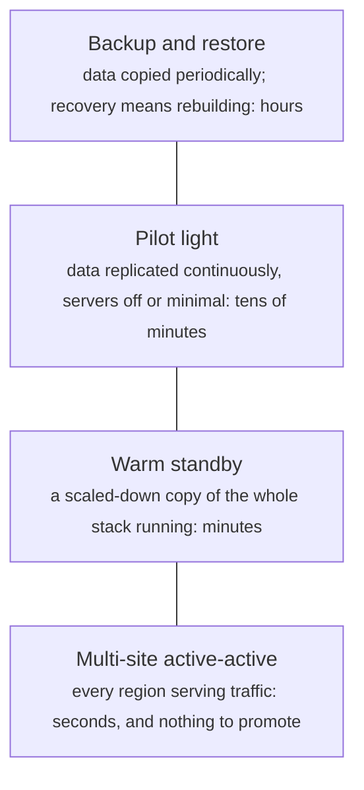
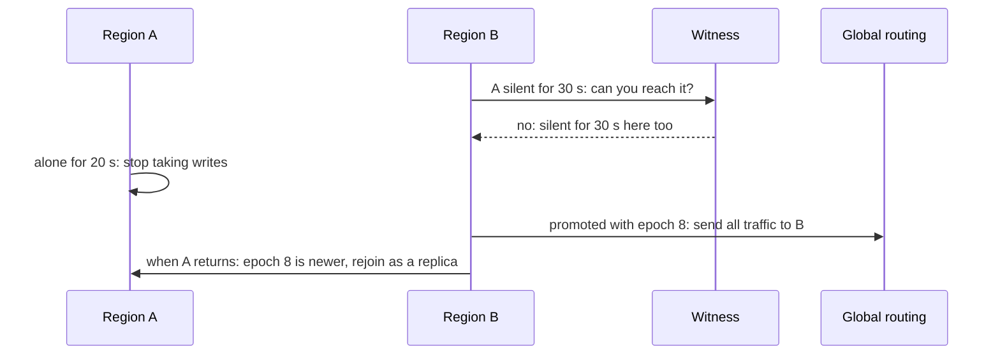
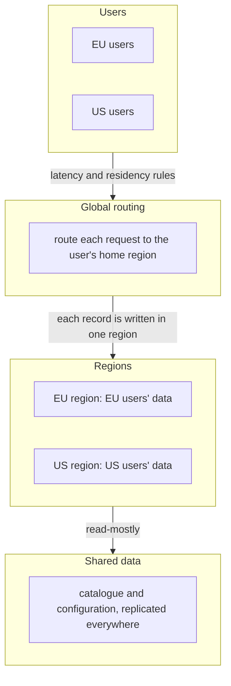

# Multi-region and disaster recovery: RPO, RTO, failover and residency

> System Design · L3 Specialist · Search, regions and security · about 110 min · hub module `m07` ([open the hub](https://claude.ai/artifact/W93mxxEWBqV4MS8kJiz9dU))

## Why it matters
Whole regions do fail: power, networking, or one bad configuration pushed everywhere. A multi-region design decides how much data you can lose when that happens (the RPO), how long you'll be down (the RTO), and what that insurance costs. Active-passive keeps a standby region and replicates to it; active-active serves from several regions at once and has to deal with conflicting writes. Failover is the risky moment, because a dead region and a broken network link look the same from the outside. And data-protection law can decide where some data may be stored at all.

## Pre-question (answer before reading)
**Q:** Your primary database runs in one region with asynchronous replication to a second. The primary region fails at 14:00:00 with replication 3 seconds behind, and it takes the team 25 minutes to decide and promote the replica. What were the RPO and RTO of this incident, and what would shrink each?

<details><summary>Answer</summary>

About 3 seconds of committed writes were lost (the RPO is the lag at the moment of failure), and the outage lasted about 25 minutes plus the time for traffic to move (the RTO). Synchronous or quorum replication to a nearby region cuts the loss to zero at the price of slower writes; automated, rehearsed failover with a warm standby and quick traffic switching cuts the downtime.

</details>

## 🍎 Story time (kid version)
**Pizza Town and the family road trip: Luigi's second kitchen**

Luigi opens a second kitchen across the river in case the first one floods. Every few minutes a runner carries copies of new orders over, so if the first kitchen floods, at most a few minutes of orders are lost, and it takes half an hour to switch the phones over and heat the ovens. If he wants to lose nothing, the runner must confirm each order before Luigi says yes to the customer, which slows every order. Running both kitchens at once is faster for customers on each side, but two cooks may change the same order differently. And by law, some customers' details must never leave their side of the river.

| In the story | In a real system |
|---|---|
| Minutes of orders the runner hadn't carried yet | RPO: how much recent data a failover can lose, set by the replication lag |
| Half an hour to switch the phones and heat the ovens | RTO: how long until service is back, set by detection, decision and failover steps |
| The runner confirming each order first | Synchronous replication: nothing lost, but every write waits for the other region |
| Both kitchens cooking at once | Active-active: closer to users and no failover wait, but conflicting writes to handle |
| Details that must stay on their side | Data residency: some data may only be stored in certain places |

**Where the story breaks:** Luigi can see the flood. Software can't easily tell a dead region from a broken link between regions, and failing over when the primary is merely unreachable leaves two kitchens taking the same orders: split brain.

## Key ideas (grown-up version)
- **RPO and RTO**: the recovery point objective is how much recent data you can afford to lose; the recovery time objective is how long you can afford to be down. They are business decisions, set per system, and they drive the design and its cost: tighter targets need more replication, more standby capacity and more rehearsal.
- **Four DR strategies**, from cheapest to fastest: backup and restore (hours to recover; the RPO is the time since the last backup), pilot light (data replicated, servers off or minimal), warm standby (a smaller copy of the whole stack running), and multi-site active-active (near-zero RTO). These are the names AWS uses; the trade-off is the same on any cloud.
- **Replicating between regions**: asynchronous replication keeps writes fast, but a failover loses whatever the replica hadn't applied, so the RPO is the replication lag at that moment, and lag spikes when writes outrun the link. Synchronous or quorum replication loses nothing but adds a cross-region round trip, often 10 to 80 ms, to every write. A common middle ground is synchronous across nearby zones and asynchronous across far regions.
- **Active-passive**: one region takes writes; another holds replicas and standby capacity. Failing over means detecting the failure, deciding, fencing the old primary, promoting the replica and moving traffic (low-TTL DNS, a global load balancer or anycast). It's simple to reason about, but the standby is capacity you pay for and rarely use, and a standby nobody tests usually fails when it's needed.
- **Active-active**: every region serves reads and writes for nearby users, so latency is low and there's nothing to promote, but concurrent writes to the same data in two regions conflict. Avoid conflicts by giving each user or tenant a home region, merge them with CRDTs (counters, sets, collaborative text), or pay for a globally consistent database (Spanner, CockroachDB) that runs a cross-region quorum per write. Last-writer-wins silently drops updates.
- **Failing over safely**: from one region, a dead peer and a broken link look identical. Confirm with an observer in a third location before promoting, and fence the old primary so it can't keep accepting writes: it steps down when it loses contact, its credentials are revoked, and a higher epoch number makes it a replica when it returns. Otherwise two regions accept writes at once: split brain.
- **Capacity and rehearsal**: with n equal regions, each can run at most (n − 1)/n of its capacity if the others must absorb one region's loss, and latency-based routing sends that load to the nearest region, not evenly. Check quotas and scaling time, look for hidden single-region dependencies (identity, DNS, secrets, deployment pipelines, third-party APIs), and rehearse with game days and real region evacuations.
- **Data residency**: data-protection rules restrict where personal data may go. GDPR allows transfers out of the EU only with an adequacy decision or safeguards such as standard contractual clauses, and some countries and sectors require data to stay in-country. Give each user or tenant a home region, keep their personal data there along with its backups, logs and caches, and fail over only to regions the data may enter.

## Diagrams
**Disaster recovery strategies, from cheapest to fastest**



_Each step costs more standby capacity and more operational care. Choose per system from its RPO and RTO, not one strategy for everything._

**A regional failover that can't cause split brain**



_A is the old primary, B the standby, and the witness runs in a third region. A fences itself before B is promoted, the witness separates a dead region from a broken link, and the epoch stops A resuming as primary when it comes back._

**Active-active with a home region per user**



_Writes never conflict, because each record has one home. If a region fails, only its users move, and only to a region their data may enter._

## Comparisons
**Active-passive or active-active**

|  | Active-passive | Active-active |
|---|---|---|
| Writes | One region at a time | Every region |
| Latency for distant users | A cross-region round trip for writes | Local |
| Failover | Detect, confirm, fence, promote, move traffic: minutes | Move traffic away: seconds to minutes |
| Conflicts | None | Avoided with home regions, or merged (CRDTs) |
| Cost | Standby capacity that's mostly idle | Every region sized to absorb a failed one |

**Replicating across regions**

|  | Asynchronous | Synchronous or quorum |
|---|---|---|
| Write latency | Local | Plus a cross-region round trip |
| Data lost if a region fails | The replication lag: usually seconds | None |
| If the other region is down | Writes carry on | Writes wait or fail, unless a quorum remains |
| Examples | Cross-region read replicas, Aurora Global Database | Spanner, CockroachDB multi-region |

## Code (JavaScript + Python)
### The seeded random generator used by the simulations
```python
def mulberry32(seed):
    state = seed & 0xFFFFFFFF
    def rand():
        nonlocal state
        state = (state + 0x6D2B79F5) & 0xFFFFFFFF
        t = ((state ^ (state >> 15)) * (state | 1)) & 0xFFFFFFFF
        t = (t ^ (t + (((t ^ (t >> 7)) * (t | 61)) & 0xFFFFFFFF))) & 0xFFFFFFFF
        return ((t ^ (t >> 14)) & 0xFFFFFFFF) / 4294967296
    return rand
```

```javascript
function mulberry32(seed) {
  return function () {
    seed = (seed + 0x6D2B79F5) | 0;
    let t = Math.imul(seed ^ (seed >>> 15), 1 | seed);
    t = (t + Math.imul(t ^ (t >>> 7), 61 | t)) ^ t;
    return ((t ^ (t >>> 14)) >>> 0) / 4294967296;
  };
}
```

### RPO under asynchronous replication: what a bulk import does to it
```python
rand = mulberry32(17)
STEP_MS, IN_FLIGHT_MS = 10, 40                         # simulate in 10 ms steps; writes spend 40 ms on the wire

def replica_backlog(rates):
    backlog, out = 0, []
    for rate in rates:                                 # writes a second on the primary, for each step
        backlog += rate * STEP_MS // 1000              # committed on the primary during this step
        backlog -= min(backlog, 1000 * STEP_MS // 1000)   # the replica applies at most 1,000 writes a second
        out.append(backlog)
    return out

def failure_losses(rates, trials=2000):
    backlog = replica_backlog(rates)
    losses = []
    for _ in range(trials):
        step = int(rand() * len(rates))                # the primary region fails at a random moment
        losses.append(backlog[step] + rates[step] * IN_FLIGHT_MS // 1000)   # committed, but not yet on the replica
    return sorted(losses), max(backlog)

normal = [200] * 60_000                                # ten minutes at 200 writes a second
for label, rates in (("import in 1 minute, full speed", normal[:18_000] + [2_000] * 6_000 + normal[24_000:]),
                     ("import in 3 minutes, throttled", normal[:18_000] + [800] * 18_000 + normal[36_000:])):
    losses, worst_backlog = failure_losses(rates)
    print(f"{label}: median loss {losses[len(losses) // 2]} writes, 90th percentile {losses[len(losses) * 9 // 10]}, "
          f"worst {losses[-1]}; replica up to {worst_backlog // 1000} s behind")
```

Output:
```text
import in 1 minute, full speed: median loss 8 writes, 90th percentile 28072, worst 59792; replica up to 60 s behind
import in 3 minutes, throttled: median loss 8 writes, 90th percentile 32, worst 32; replica up to 0 s behind
```

- line 8: The link and the replica have a fixed throughput; anything faster than it piles up as a backlog.
- line 17: A failure loses what the replica hadn't applied: the backlog plus the writes on the wire. That is the RPO, and it moves with the load.
- line 24: Most failures lose a handful of writes, but one in ten lands during or just after the import and loses tens of thousands. Throttling bulk work on replica lag keeps the RPO small.

```javascript
const rand = mulberry32(17);
const STEP_MS = 10, IN_FLIGHT_MS = 40;                 // simulate in 10 ms steps; writes spend 40 ms on the wire

function replicaBacklog(rates) {
  let backlog = 0;
  const out = [];
  for (const rate of rates) {                          // writes a second on the primary, for each step
    backlog += Math.floor(rate * STEP_MS / 1000);      // committed on the primary during this step
    backlog -= Math.min(backlog, Math.floor(1000 * STEP_MS / 1000));   // the replica applies at most 1,000 writes a second
    out.push(backlog);
  }
  return out;
}

function failureLosses(rates, trials = 2000) {
  const backlog = replicaBacklog(rates);
  const losses = [];
  for (let i = 0; i < trials; i++) {
    const step = Math.floor(rand() * rates.length);    // the primary region fails at a random moment
    losses.push(backlog[step] + Math.floor(rates[step] * IN_FLIGHT_MS / 1000));   // committed, but not yet on the replica
  }
  return [losses.sort((a, b) => a - b), backlog.reduce((m, x) => Math.max(m, x), 0)];
}

const normal = new Array(60000).fill(200);             // ten minutes at 200 writes a second
for (const [label, rates] of [["import in 1 minute, full speed", [...normal.slice(0, 18000), ...new Array(6000).fill(2000), ...normal.slice(24000)]],
                              ["import in 3 minutes, throttled", [...normal.slice(0, 18000), ...new Array(18000).fill(800), ...normal.slice(36000)]]]) {
  const [losses, worstBacklog] = failureLosses(rates);
  console.log(`${label}: median loss ${losses[Math.floor(losses.length / 2)]} writes, 90th percentile ${losses[Math.floor(losses.length * 9 / 10)]}, ` +
              `worst ${losses.at(-1)}; replica up to ${Math.floor(worstBacklog / 1000)} s behind`);
}
```

Output:
```text
import in 1 minute, full speed: median loss 8 writes, 90th percentile 28072, worst 59792; replica up to 60 s behind
import in 3 minutes, throttled: median loss 8 writes, 90th percentile 32, worst 32; replica up to 0 s behind
```

- line 9: The link and the replica have a fixed throughput; anything faster than it piles up as a backlog.
- line 20: A failure loses what the replica hadn't applied: the backlog plus the writes on the wire. That is the RPO, and it moves with the load.
- line 29: Most failures lose a handful of writes, but one in ten lands during or just after the import and loses tens of thousands. Throttling bulk work on replica lag keeps the RPO small.

### Headroom: can the other regions absorb one region's loss?
```python
TARGET = 85                                            # keep every region under 85% busy, even after losing one
print("equal regions, the most each may run at:", " | ".join(f"{n} regions {TARGET * (n - 1) // n}%" for n in (2, 3, 4, 5)))

load = {"us-east": 3000, "us-west": 1800, "eu-west": 2400, "ap-south": 1200}         # requests a second today
capacity = {"us-east": 5000, "us-west": 3000, "eu-west": 4000, "ap-south": 2500}
nearest = {"us-east": "us-west", "us-west": "us-east", "eu-west": "us-east", "ap-south": "eu-west"}

def busiest_after(failed, policy):
    new = {r: l for r, l in load.items() if r != failed}
    if policy == "nearest":
        new[nearest[failed]] += load[failed]           # latency-based routing sends everyone to the closest region
    else:
        spare = {r: capacity[r] * TARGET // 100 - new[r] for r in new}   # room left under the target
        for r in new:
            new[r] += load[failed] * spare[r] // sum(spare.values())     # share the load by spare capacity
    region = max(new, key=lambda r: new[r] * 100 // capacity[r])
    return region, new[region] * 100 // capacity[region]

for failed in load:
    (r1, u1), (r2, u2) = busiest_after(failed, "nearest"), busiest_after(failed, "by spare capacity")
    print(f"{failed} fails: all to the nearest -> {r1} at {u1}%{' OVERLOADED' if u1 > 100 else ''} | by spare capacity -> busiest {r2} at {u2}%")
```

Output:
```text
equal regions, the most each may run at: 2 regions 42% | 3 regions 56% | 4 regions 63% | 5 regions 68%
us-east fails: all to the nearest -> us-west at 160% OVERLOADED | by spare capacity -> busiest ap-south at 89%
us-west fails: all to the nearest -> us-east at 96% | by spare capacity -> busiest us-east at 74%
eu-west fails: all to the nearest -> us-east at 108% OVERLOADED | by spare capacity -> busiest us-east at 80%
ap-south fails: all to the nearest -> eu-west at 90% | by spare capacity -> busiest us-east at 70%
```

- line 2: With n equal regions, the survivors carry n ÷ (n − 1) times their load, so each may only run at (n − 1)/n of the target.
- line 11: Latency-based routing sends a failed region's users to the closest region, which can double its load.
- line 15: Weighting the shift by spare capacity spreads it; global load balancers can do this with capacity-aware routing.
- line 21: Even spread by spare capacity, losing us-east pushes ap-south past the 85% target: the biggest region's failure sets the headroom everyone needs.

```javascript
const TARGET = 85;                                     // keep every region under 85% busy, even after losing one
console.log("equal regions, the most each may run at:", [2, 3, 4, 5].map(n => `${n} regions ${Math.floor(TARGET * (n - 1) / n)}%`).join(" | "));

const load = { "us-east": 3000, "us-west": 1800, "eu-west": 2400, "ap-south": 1200 };   // requests a second today
const capacity = { "us-east": 5000, "us-west": 3000, "eu-west": 4000, "ap-south": 2500 };
const nearest = { "us-east": "us-west", "us-west": "us-east", "eu-west": "us-east", "ap-south": "eu-west" };

function busiestAfter(failed, policy) {
  const next = Object.fromEntries(Object.entries(load).filter(([r]) => r !== failed));
  if (policy === "nearest") {
    next[nearest[failed]] += load[failed];             // latency-based routing sends everyone to the closest region
  } else {
    const spare = Object.fromEntries(Object.keys(next).map(r => [r, Math.floor(capacity[r] * TARGET / 100) - next[r]]));   // room left under the target
    const total = Object.values(spare).reduce((a, b) => a + b, 0);
    for (const r of Object.keys(next)) next[r] += Math.floor(load[failed] * spare[r] / total);   // share the load by spare capacity
  }
  const util = r => Math.floor(next[r] * 100 / capacity[r]);
  const region = Object.keys(next).reduce((best, r) => (util(r) > util(best) ? r : best));
  return [region, util(region)];
}

for (const failed of Object.keys(load)) {
  const [r1, u1] = busiestAfter(failed, "nearest"), [r2, u2] = busiestAfter(failed, "by spare capacity");
  console.log(`${failed} fails: all to the nearest -> ${r1} at ${u1}%${u1 > 100 ? " OVERLOADED" : ""} | by spare capacity -> busiest ${r2} at ${u2}%`);
}
```

Output:
```text
equal regions, the most each may run at: 2 regions 42% | 3 regions 56% | 4 regions 63% | 5 regions 68%
us-east fails: all to the nearest -> us-west at 160% OVERLOADED | by spare capacity -> busiest ap-south at 89%
us-west fails: all to the nearest -> us-east at 96% | by spare capacity -> busiest us-east at 74%
eu-west fails: all to the nearest -> us-east at 108% OVERLOADED | by spare capacity -> busiest us-east at 80%
ap-south fails: all to the nearest -> eu-west at 90% | by spare capacity -> busiest us-east at 70%
```

- line 2: With n equal regions, the survivors carry n ÷ (n − 1) times their load, so each may only run at (n − 1)/n of the target.
- line 11: Latency-based routing sends a failed region's users to the closest region, which can double its load.
- line 15: Weighting the shift by spare capacity spreads it; global load balancers can do this with capacity-aware routing.
- line 24: Even spread by spare capacity, losing us-east pushes ap-south past the 85% target: the biggest region's failure sets the headroom everyone needs.

### Active-active conflicts: a likes counter in two regions
```python
rand = mulberry32(5)
events = sorted((int(rand() * 10_000), "eu" if rand() < 0.6 else "us") for _ in range(1000))   # (ms, region) of each like
DELAY = 150                                            # replication between the regions takes 150 ms

def last_writer_wins():
    state = {"eu": (0, -1), "us": (0, -1)}             # region -> (count, timestamp of the write it came from)
    inbox = []                                         # replication messages: (arrival ms, to, count, timestamp)
    for n, (t, region) in enumerate(events):
        for _, to, count, stamp in [m for m in inbox if m[0] <= t]:   # deliver what has arrived, oldest first
            if stamp > state[to][1]:
                state[to] = (count, stamp)             # the newer write wins; the older value is replaced
        inbox = [m for m in inbox if m[0] > t]
        count, stamp = state[region][0] + 1, t * 10_000 + n   # read the local copy and add one
        state[region] = (count, stamp)
        inbox.append((t + DELAY, "us" if region == "eu" else "eu", count, stamp))
    for _, to, count, stamp in inbox:                  # let replication finish
        if stamp > state[to][1]:
            state[to] = (count, stamp)
    return state["eu"][0], state["us"][0]

eu_likes = sum(1 for _, region in events if region == "eu")
print(f"{len(events)} likes in 10 s: {eu_likes} in eu, {len(events) - eu_likes} in us")
eu, us = last_writer_wins()
print(f"last writer wins in both regions: eu shows {eu}, us shows {us}; {len(events) - eu} likes lost")
print(f"one home region (eu) for the counter: {len(events)} counted, but every us like waits an extra round trip to eu")
```

Output:
```text
1000 likes in 10 s: 616 in eu, 384 in us
last writer wins in both regions: eu shows 417, us shows 417; 583 likes lost
one home region (eu) for the counter: 1000 counted, but every us like waits an extra round trip to eu
```

- line 11: A replicated value with a newer timestamp simply replaces the local one, along with any increments made here in the meantime.
- line 13: Each region reads its own copy and adds one: concurrent likes in the other region aren't in that copy yet.
- line 24: The regions agree, on a number that's far too low: last-writer-wins converges by throwing updates away.
- line 25: A home region avoids the conflict at the cost of latency for the other side; the fade builds a counter that needs neither.

```javascript
const rand = mulberry32(5);
const events = Array.from({ length: 1000 }, () => [Math.floor(rand() * 10000), rand() < 0.6 ? "eu" : "us"])
  .sort((a, b) => a[0] - b[0] || (a[1] < b[1] ? -1 : a[1] > b[1] ? 1 : 0));   // [ms, region] of each like
const DELAY = 150;                                     // replication between the regions takes 150 ms

function lastWriterWins() {
  const state = { eu: [0, -1], us: [0, -1] };          // region -> [count, timestamp of the write it came from]
  let inbox = [];                                      // replication messages: [arrival ms, to, count, timestamp]
  events.forEach(([t, region], n) => {
    for (const [, to, count, stamp] of inbox.filter(m => m[0] <= t)) {   // deliver what has arrived, oldest first
      if (stamp > state[to][1]) state[to] = [count, stamp];   // the newer write wins; the older value is replaced
    }
    inbox = inbox.filter(m => m[0] > t);
    const count = state[region][0] + 1, stamp = t * 10000 + n;   // read the local copy and add one
    state[region] = [count, stamp];
    inbox.push([t + DELAY, region === "eu" ? "us" : "eu", count, stamp]);
  });
  for (const [, to, count, stamp] of inbox) {          // let replication finish
    if (stamp > state[to][1]) state[to] = [count, stamp];
  }
  return [state.eu[0], state.us[0]];
}

const euLikes = events.filter(([, region]) => region === "eu").length;
console.log(`${events.length} likes in 10 s: ${euLikes} in eu, ${events.length - euLikes} in us`);
const [eu, us] = lastWriterWins();
console.log(`last writer wins in both regions: eu shows ${eu}, us shows ${us}; ${events.length - eu} likes lost`);
console.log(`one home region (eu) for the counter: ${events.length} counted, but every us like waits an extra round trip to eu`);
```

Output:
```text
1000 likes in 10 s: 616 in eu, 384 in us
last writer wins in both regions: eu shows 417, us shows 417; 583 likes lost
one home region (eu) for the counter: 1000 counted, but every us like waits an extra round trip to eu
```

- line 11: A replicated value with a newer timestamp simply replaces the local one, along with any increments made here in the meantime.
- line 14: Each region reads its own copy and adds one: concurrent likes in the other region aren't in that copy yet.
- line 27: The regions agree, on a number that's far too low: last-writer-wins converges by throwing updates away.
- line 28: A home region avoids the conflict at the cost of latency for the other side; the fade builds a counter that needs neither.

## Worked example
**Problem.** A primary database in region A replicates to a standby in region B. Write the rule that decides when B takes over, and test it on 300 incidents of three kinds: region A going down, the link between A and B failing while A is healthy, and A being cut off from everything except its local clients. Count how often a dead A is replaced, how often B takes over needlessly, and how often both regions accept writes at once.

1. The obvious rule, promote B after some seconds without a heartbeat from A, can't tell a dead region from a broken link. When only the link is down, A keeps serving its clients while B starts serving too: split brain.
2. Add a witness in a third region: B promotes only if the witness has lost A too. A broken A–B link leaves the witness in touch with A, so nothing happens.
3. Make A fence itself: if A hears from neither B nor the witness for 20 seconds, it stops taking writes, which is before B can be promoted at 30. When contact returns after a failover, A sees the newer epoch and rejoins as a replica instead of resuming.
4. Then count, rather than argue: simulate each rule against the same incidents and compare replaced regions, needless failovers and split brains.

```python
rand = mulberry32(23)
KINDS = ["region A down", "A-B link down", "A cut off"]

def run(policy, kind, length, wait=30):
    silent_b = silent_w = silent_a = 0                 # seconds since B, the witness and A last heard from each other
    promoted_at, demoted, split = None, False, 0
    for t in range(length + 120):                      # the incident, then two minutes after it ends
        cut = t < length
        a_alive = not (cut and kind == "region A down")
        b_hears_a = not cut                            # every incident cuts B off from A
        w_hears_a = not cut or kind == "A-B link down" # only a broken A-B link leaves the witness in touch with A
        silent_b = 0 if b_hears_a else silent_b + 1
        silent_w = 0 if w_hears_a else silent_w + 1
        silent_a = 0 if a_alive and (b_hears_a or w_hears_a) else silent_a + 1
        if promoted_at is None and silent_b >= wait and (policy == "timeout" or silent_w >= wait):
            promoted_at = t                            # B becomes the primary
        if policy == "witness" and promoted_at is not None and a_alive and (b_hears_a or w_hears_a):
            demoted = True                             # A learns of the new primary and steps down
        a_writes = a_alive and not demoted and (policy == "timeout" or silent_a < 20)   # with a witness, A stops alone after 20 s
        split += a_writes and promoted_at is not None  # both regions accepting writes: split brain
    return promoted_at, split

incidents = []
for _ in range(300):
    kind = KINDS[int(rand() * 3)]
    incidents.append((kind, 5 + int(rand() * 115) if kind == "A cut off" else 60 + int(rand() * 540)))

for policy, wait in (("timeout", 10), ("timeout", 30), ("witness", 30)):
    results = [(kind, *run(policy, kind, length, wait)) for kind, length in incidents]
    dead = [p for kind, p, _ in results if kind == "region A down"]
    needless = sum(1 for kind, p, _ in results if kind == "A-B link down" and p is not None)
    split = sum(1 for _, _, s in results if s > 0)
    label = f"B takes over after {wait} s of silence" if policy == "timeout" else f"B and the witness both silent {wait} s"
    print(f"{label}: dead A replaced {sum(p is not None for p in dead)}/{len(dead)}, "
          f"failovers over a broken A-B link {needless}, split brain in {split} incidents")
```

Output:
```text
B takes over after 10 s of silence: dead A replaced 103/103, failovers over a broken A-B link 97, split brain in 292 incidents
B takes over after 30 s of silence: dead A replaced 103/103, failovers over a broken A-B link 97, split brain in 271 incidents
B and the witness both silent 30 s: dead A replaced 103/103, failovers over a broken A-B link 0, split brain in 0 incidents
```

```javascript
const rand = mulberry32(23);
const KINDS = ["region A down", "A-B link down", "A cut off"];

function run(policy, kind, length, wait = 30) {
  let silentB = 0, silentW = 0, silentA = 0;           // seconds since B, the witness and A last heard from each other
  let promotedAt = null, demoted = false, split = 0;
  for (let t = 0; t < length + 120; t++) {             // the incident, then two minutes after it ends
    const cut = t < length;
    const aAlive = !(cut && kind === "region A down");
    const bHearsA = !cut;                              // every incident cuts B off from A
    const wHearsA = !cut || kind === "A-B link down";  // only a broken A-B link leaves the witness in touch with A
    silentB = bHearsA ? 0 : silentB + 1;
    silentW = wHearsA ? 0 : silentW + 1;
    silentA = aAlive && (bHearsA || wHearsA) ? 0 : silentA + 1;
    if (promotedAt === null && silentB >= wait && (policy === "timeout" || silentW >= wait)) {
      promotedAt = t;                                  // B becomes the primary
    }
    if (policy === "witness" && promotedAt !== null && aAlive && (bHearsA || wHearsA)) {
      demoted = true;                                  // A learns of the new primary and steps down
    }
    const aWrites = aAlive && !demoted && (policy === "timeout" || silentA < 20);   // with a witness, A stops alone after 20 s
    if (aWrites && promotedAt !== null) split++;       // both regions accepting writes: split brain
  }
  return [promotedAt, split];
}

const incidents = [];
for (let i = 0; i < 300; i++) {
  const kind = KINDS[Math.floor(rand() * 3)];
  incidents.push([kind, kind === "A cut off" ? 5 + Math.floor(rand() * 115) : 60 + Math.floor(rand() * 540)]);
}

for (const [policy, wait] of [["timeout", 10], ["timeout", 30], ["witness", 30]]) {
  const results = incidents.map(([kind, length]) => [kind, ...run(policy, kind, length, wait)]);
  const dead = results.filter(([kind]) => kind === "region A down").map(([, p]) => p);
  const needless = results.filter(([kind, p]) => kind === "A-B link down" && p !== null).length;
  const split = results.filter(([, , s]) => s > 0).length;
  const label = policy === "timeout" ? `B takes over after ${wait} s of silence` : `B and the witness both silent ${wait} s`;
  console.log(`${label}: dead A replaced ${dead.filter(p => p !== null).length}/${dead.length}, ` +
              `failovers over a broken A-B link ${needless}, split brain in ${split} incidents`);
}
```

Output:
```text
B takes over after 10 s of silence: dead A replaced 103/103, failovers over a broken A-B link 97, split brain in 292 incidents
B takes over after 30 s of silence: dead A replaced 103/103, failovers over a broken A-B link 97, split brain in 271 incidents
B and the witness both silent 30 s: dead A replaced 103/103, failovers over a broken A-B link 0, split brain in 0 incidents
```

**Answer.** All three rules replace a dead region every time. The timeout rules also fail over in all 97 broken-link incidents, and they cause split brain in almost every incident where they act: when A is healthy but cut off from B, and when a dead A comes back and resumes as primary. Waiting 30 seconds instead of 10 only spares the short blips. The witness rule never fails over on a broken link and never has two primaries, because A stops taking writes after 20 seconds alone, before B can take over at 30, and the epoch demotes A when it returns. The price is about 10 seconds with no primary when A is cut off, and a third region to run the witness.

## Your turn (faded example)
**Problem.** Finish the PN-counter, a CRDT counter that every region can update locally: `merge(other)` must combine another replica's state, and `value()` must return the total. Merges may arrive in any order and more than once.

- ✓ Each replica keeps two maps with one entry per region: increments and decrements. A region only ever raises its own entries.
- **Why merge with max rather than adding the other replica's counts?**
  <details><summary>Answer</summary>Merges can repeat or arrive out of order. Max is idempotent, commutative and associative, so merging the same state twice changes nothing; adding would count the same likes again.</details>
- **Why two maps instead of one count that goes up and down?**
  <details><summary>Answer</summary>Max only works for values that only grow: a decremented count would look like an old state and be ignored. Keeping decrements in their own growing map, and subtracting, keeps both mergeable.</details>
- **What does it cost?**
  <details><summary>Answer</summary>Space and merge time proportional to the number of regions, which is fine for a handful of regions; designs with many writers compress or garbage-collect the per-writer entries.</details>

Starter:
```python
class PNCounter:
    def __init__(self, region, regions):
        self.region = region
        self.inc = {r: 0 for r in regions}             # increments made in each region
        self.dec = {r: 0 for r in regions}             # decrements made in each region

    def add(self, n):
        if n >= 0:
            self.inc[self.region] += n                 # a region only ever raises its own entries
        else:
            self.dec[self.region] -= n

    def merge(self, other):
        ...                                            # TODO: combine other's state so repeats change nothing

    def value(self):
        ...                                            # TODO: the counter's total
```

```javascript
class PNCounter {
  constructor(region, regions) {
    this.region = region;
    this.inc = Object.fromEntries(regions.map(r => [r, 0]));   // increments made in each region
    this.dec = Object.fromEntries(regions.map(r => [r, 0]));   // decrements made in each region
  }

  add(n) {
    if (n >= 0) this.inc[this.region] += n;            // a region only ever raises its own entries
    else this.dec[this.region] -= n;
  }

  merge(other) {
    // TODO: combine other's state so repeats change nothing
  }

  value() {
    // TODO: the counter's total
  }
}
```

<details><summary>Full solution</summary>

```python
class PNCounter:
    def __init__(self, region, regions):
        self.region = region
        self.inc = {r: 0 for r in regions}             # increments made in each region
        self.dec = {r: 0 for r in regions}             # decrements made in each region

    def add(self, n):
        if n >= 0:
            self.inc[self.region] += n                 # a region only ever raises its own entries
        else:
            self.dec[self.region] -= n

    def merge(self, other):
        for r in self.inc:
            self.inc[r] = max(self.inc[r], other.inc[r])   # max: merging the same state twice changes nothing
            self.dec[r] = max(self.dec[r], other.dec[r])

    def value(self):
        return sum(self.inc.values()) - sum(self.dec.values())

eu, us = PNCounter("eu", ["eu", "us"]), PNCounter("us", ["eu", "us"])
eu.add(5)
us.add(3)
us.add(-1)
print("before replication: eu", eu.value(), "| us", us.value())
eu.merge(us)
us.merge(eu)
eu.merge(us)                                           # a repeated merge, as a retry would cause
print("after: eu", eu.value(), "| us", us.value())
```

Output:
```text
before replication: eu 5 | us 2
after: eu 7 | us 7
```

```javascript
class PNCounter {
  constructor(region, regions) {
    this.region = region;
    this.inc = Object.fromEntries(regions.map(r => [r, 0]));   // increments made in each region
    this.dec = Object.fromEntries(regions.map(r => [r, 0]));   // decrements made in each region
  }

  add(n) {
    if (n >= 0) this.inc[this.region] += n;            // a region only ever raises its own entries
    else this.dec[this.region] -= n;
  }

  merge(other) {
    for (const r of Object.keys(this.inc)) {
      this.inc[r] = Math.max(this.inc[r], other.inc[r]);   // max: merging the same state twice changes nothing
      this.dec[r] = Math.max(this.dec[r], other.dec[r]);
    }
  }

  value() {
    const sum = m => Object.values(m).reduce((a, b) => a + b, 0);
    return sum(this.inc) - sum(this.dec);
  }
}

const eu = new PNCounter("eu", ["eu", "us"]), us = new PNCounter("us", ["eu", "us"]);
eu.add(5);
us.add(3);
us.add(-1);
console.log("before replication: eu", eu.value(), "| us", us.value());
eu.merge(us);
us.merge(eu);
eu.merge(us);                                          // a repeated merge, as a retry would cause
console.log("after: eu", eu.value(), "| us", us.value());
```

Output:
```text
before replication: eu 5 | us 2
after: eu 7 | us 7
```

</details>

## Socratic checks and quiz (answers hidden)
**1. What does this print?**

```python
lag_s, detect_s, decide_s, promote_s, dns_ttl_s = 2, 30, 300, 60, 60
print("RPO", lag_s, "s | RTO", detect_s + decide_s + promote_s + dns_ttl_s, "s")
```

```javascript
const lagS = 2, detectS = 30, decideS = 300, promoteS = 60, dnsTtlS = 60;
console.log("RPO", lagS, "s | RTO", detectS + decideS + promoteS + dnsTtlS, "s");
```

- A. RPO 2 s | RTO 450 s
- B. RPO 450 s | RTO 2 s
- C. RPO 0 s | RTO 390 s
- D. RPO 2 s | RTO 390 s

<details><summary>Answer</summary>

RPO 2 s | RTO 450 s. The data lost is what hadn't replicated: 2 seconds' worth. The downtime adds every step until clients reach the new primary, and the human decision is the biggest of them.

</details>

**2. What does this print?**

```python
print(*(f"{n}:{100 * (n - 1) // n}%" for n in (2, 3, 4)))
```

```javascript
console.log(...[2, 3, 4].map(n => `${n}:${Math.floor(100 * (n - 1) / n)}%`));
```

- A. 2:50% 3:66% 4:75%
- B. 2:50% 3:33% 4:25%
- C. 2:100% 3:100% 4:100%
- D. 2:75% 3:66% 4:50%

<details><summary>Answer</summary>

2:50% 3:66% 4:75%. When one of n equal regions fails, the others carry n ÷ (n − 1) times their load, so each can run at most (n − 1)/n of capacity. More regions waste less on idle headroom.

</details>

**3. Payments need an RPO of zero but can tolerate a 15-minute RTO. Which design fits best?**

- A. Synchronous or quorum replication across zones or nearby regions, with a rehearsed, mostly automated failover
- B. Nightly backups copied to another region
- C. Asynchronous replication with an alert when lag passes 5 minutes
- D. Active-active with last-writer-wins

<details><summary>Answer</summary>

Synchronous or quorum replication across zones or nearby regions, with a rehearsed, mostly automated failover. Only synchronous or quorum replication guarantees that acknowledged writes survive a region's loss; the generous RTO leaves room for a careful, fenced failover.

</details>

**4. Users in the EU and the US edit the same shared shopping list in an active-active app. What avoids lost edits without sending every write across the ocean?**

- A. Model the list as a CRDT, such as an observed-remove set, that merges concurrent edits
- B. Last-writer-wins on the whole list
- C. Synchronize the clocks more precisely
- D. Replicate faster

<details><summary>Answer</summary>

Model the list as a CRDT, such as an observed-remove set, that merges concurrent edits. Last-writer-wins keeps one side's version and drops the other's edits, and faster replication only narrows the window. A CRDT merges both, so each region can write locally.

</details>

**5. Which belong in a regional failover runbook? (choose 3)**

- A. Fence the old primary so it can't keep accepting writes
- B. Confirm the failure from a third location before promoting
- C. Check that the surviving regions have the capacity and quotas for the extra load
- D. Delete the old primary's data straight away
- E. Raise DNS TTLs to an hour before failing over

<details><summary>Answer</summary>

Fence the old primary so it can't keep accepting writes, Confirm the failure from a third location before promoting, Check that the surviving regions have the capacity and quotas for the extra load. Fencing and confirmation prevent split brain, and capacity checks stop the failover from causing a second outage. Deleting data destroys what you may need to reconcile, and long TTLs slow the switch.

</details>

**6. Judge each statement.**

- RPO measures how long a service is down.
- With asynchronous replication, the data lost in a failover is roughly the replication lag at that moment.
- GDPR forbids personal data from ever leaving the EU.
- A region that returns after a failover must not resume as primary on its own.

<details><summary>Answer</summary>

RPO measures how long a service is down.: No; With asynchronous replication, the data lost in a failover is roughly the replication lag at that moment.: Yes; GDPR forbids personal data from ever leaving the EU.: No; A region that returns after a failover must not resume as primary on its own.: Yes. RPO is data lost and RTO is time down. GDPR restricts transfers, requiring an adequacy decision or safeguards, rather than banning them outright. A returning primary must rejoin as a replica, or there are two primaries.

</details>

**7. Put a safe regional failover in order.**

- (put the steps in order)

<details><summary>Answer</summary>

Detect that the primary region has stopped responding → Confirm it from a witness in a third location → Fence the old primary → Promote the replica in the standby region → Move traffic to the new primary. Confirming and fencing come before promotion, so there's never a moment with two primaries; moving traffic last means clients only reach a primary that is ready.

</details>

**8. Complete the Python routing function that keeps each user's data in regions it may enter.**

```
def route(user, request_region, regions_up):
    home = user["home"]
    if home in regions_up:
        return {{0}}                             # the user's data lives here
    allowed = [r for r in user["allowed"] if r in regions_up]
    return allowed[0] if allowed else {{1}}      # never fall back to a region the data may not enter

```

<details><summary>Answer</summary>

home | None. Requests go to the home region whatever region they arrive in; if it's down, only an allowed region will do, and if none is up, refusing the request is better than breaking the residency rule.

</details>

## Traps & misconceptions
- **“We replicate to another region, so we have disaster recovery.”** Replication copies mistakes too: a bad migration or a mass delete reaches the replica within seconds. Keep point-in-time backups, ideally immutable and in a separate account, and test restoring them.
- **“Fail over automatically as soon as heartbeats stop.”** From one region, a dead peer and a broken link look the same. Confirm from a third location, fence the old primary, and wait long enough to ride out short network blips.
- **“The standby region will scale up when we need it.”** In a regional outage everyone fails over at once, and capacity or quotas can run out. Keep enough capacity running or reserved, and count scaling time in the RTO.
- **“Active-active just means running the same stack twice.”** Concurrent writes to the same data in two regions conflict. Give each record a home region, use CRDTs where data can merge, or pay for a globally consistent database.
- **“Our DR plan is written down, so it works.”** Untested plans fail on hidden dependencies such as DNS, identity providers, secrets and deployment pipelines. Rehearse with game days and real region evacuations.
- **“Data residency is solved by putting the main database in the right region.”** Backups, logs, analytics copies, caches and support tools hold personal data too. Map every copy, keep each within the allowed regions, and fail over only within them.

## Discussion prompts
- **A SaaS company serves the EU and the US from one US region. Large EU customers now require their data to stay in the EU. How would you change the architecture?**
  <details><summary>One good answer</summary>Give each tenant a home region and deploy a full stack in an EU region: application, database, caches, backups and logs. Route requests by tenant through a thin global layer that holds only non-personal routing data, replicate shared reference data everywhere, and migrate existing EU tenants with a backfill and a cut-over. Make support tooling and analytics respect the same boundary, and fail EU tenants over to another EU region, never to the US.</details>
- **Your active-passive database takes 40 minutes to fail over. How would you bring that down to 5?**
  <details><summary>One good answer</summary>Break the 40 minutes into detection, decision, promotion and moving traffic. Detect with health checks from several locations; replace paging and debate with pre-approved automation and a witness; keep a warm standby already sized for full load; switch traffic with low DNS TTLs or a global load balancer, and make clients reconnect quickly. Then rehearse every quarter, so each step is known to work.</details>

## Teach-back
**Prompt:** Explain to a junior colleague how to choose between active-passive and active-active for a multi-region service, and how to fail over safely.

Rubric:
- [ ] RPO and RTO as business targets, set per system
- [ ] Asynchronous versus synchronous replication, and what each means for data loss and latency
- [ ] Active-passive failover steps, and active-active conflicts: home regions or CRDTs
- [ ] Split brain: confirm from a third location and fence the old primary
- [ ] Capacity headroom, rehearsals and data residency

<details><summary>Model answer</summary>

I start from the RPO and RTO each system needs, because they set the cost. With asynchronous replication, a failover loses whatever the replica hadn't applied, so I watch replication lag and throttle bulk work on it; synchronous or quorum replication loses nothing but adds a cross-region round trip to every write. Active-passive keeps one writing region and a standby: failing over means detecting the failure, confirming it from a third location, fencing the old primary, promoting the replica and moving traffic. Active-active serves writes everywhere, which is faster for users and needs no promotion, but concurrent writes conflict, so I give each user or tenant a home region or use CRDTs where data can merge. Either way the surviving regions need headroom for the extra load, the plan has to be rehearsed, and data that must stay in a jurisdiction, backups and logs included, never fails over outside it.

</details>

## Quick Q&A (also in the SRS deck)
- **What does RPO measure?** How much recent data a failure can lose.
- **What does RTO measure?** How long the service can be down.
- **What sets the RPO with asynchronous replication?** The replication lag at the moment of failure.
- **Why use a witness in a third location?** To tell a dead region from a broken link before promoting, so failover can't cause split brain.
- **How do home regions avoid active-active conflicts?** Each record is written only in its home region.
- **With four equal regions, how busy can each be and still absorb one failure?** At most 75% of capacity, and less to keep a safety margin.

## Practice problems
- [ ] [Reading · AWS: Disaster recovery options in the cloud](https://docs.aws.amazon.com/whitepapers/latest/disaster-recovery-workloads-on-aws/disaster-recovery-options-in-the-cloud.html) · place backup and restore, pilot light, warm standby and multi-site on a chart of RPO against RTO, and estimate each one's cost for a service you know
- [ ] [Reading · Azure Well-Architected: Disaster recovery strategies](https://learn.microsoft.com/en-us/azure/well-architected/reliability/disaster-recovery) · write RPO and RTO targets for three systems of different criticality, and justify each
- [ ] [Reading · Google SRE book: Managing critical state](https://sre.google/sre-book/managing-critical-state/) · summarise the split-brain case study, and say which of this module's rules would have prevented it
- [ ] [Reference · About CRDTs](https://crdt.tech/) · pick one CRDT besides counters, such as an observed-remove set, and explain how its merge works

## Sources (accessed 2026-10-09)
- [AWS whitepaper: Disaster recovery options in the cloud](https://docs.aws.amazon.com/whitepapers/latest/disaster-recovery-workloads-on-aws/disaster-recovery-options-in-the-cloud.html)
- [Microsoft Azure Well-Architected Framework: Architecture strategies for disaster recovery](https://learn.microsoft.com/en-us/azure/well-architected/reliability/disaster-recovery)
- [Google SRE book: Managing Critical State](https://sre.google/sre-book/managing-critical-state/)
- [About CRDTs (crdt.tech)](https://crdt.tech/)
- [European Commission: International dimension of data protection](https://commission.europa.eu/law/law-topic/data-protection/international-dimension-data-protection_en)
