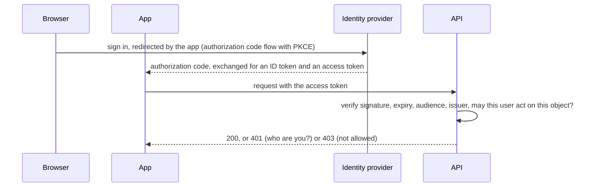
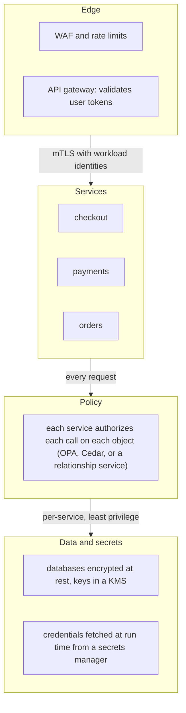
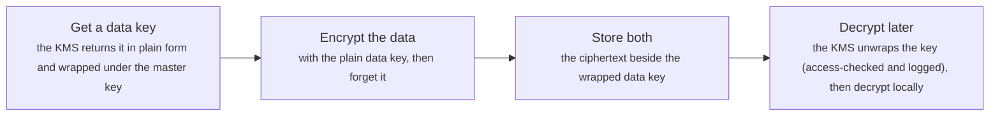

# Security architecture: identity, authorization, zero trust, secrets and encryption

> System Design · L3 Specialist · Search, regions and security · about 110 min · hub module `m08` ([open the hub](https://claude.ai/artifact/W93mxxEWBqV4MS8kJiz9dU))

## Why it matters
At scale, security is architecture rather than a checklist: who is calling (authentication), what they may do (authorization), how services trust each other, where secrets and keys live, and how data is protected in transit and at rest. Most breaches exploit design gaps rather than broken cryptography: long-lived credentials, a permission checked in one place but not another, secrets in code, and flat networks where one compromised machine can reach everything.

## Pre-question (answer before reading)
**Q:** You split a monolith into 20 services behind an API gateway. The gateway validates each user's token and forwards the request. Can the services behind it simply trust every request that reaches them?

<details><summary>Answer</summary>

No. Anything inside the network, such as a compromised service, a misrouted request or a server-side request forgery bug, could call them directly with forged headers. Each service should authenticate its caller (mTLS with workload identities), check the user's token or a signed internal one itself, and authorize each action on the specific object. Trust comes from verified identity, not network location: that's zero trust.

</details>

## 🍎 Story time (kid version)
**Pizza Town and the family road trip: Luigi's badges and key cabinet**

Luigi's staff wear badges with photos, checked at every door, not just the front gate, because a stranger who sneaks in shouldn't wander freely. A badge shows who you are; a separate list at each door says what you may do there: cooks may enter the kitchen, but only the manager opens the safe. Badges expire each week and are reissued, so a lost one soon stops working. Keys hang in a locked cabinet that logs who took what, never on hooks by the door. And the recipe book is written in a code only staff can read, so a stolen copy is useless.

| In the story | In a real system |
|---|---|
| Badges checked at every door | Zero trust: authenticate and authorize every request, not just at the perimeter |
| Who you are, then what you may do | Authentication, then authorization on each object (RBAC, ABAC, relationships) |
| Badges that expire weekly | Short-lived tokens and certificates, renewed automatically |
| The locked, logged key cabinet | A secrets manager or KMS, with access policies and audit logs |
| The recipe book in code | Encryption at rest, with the keys kept apart from the data |

**Where the story breaks:** Luigi's badges carry photos. A bearer token doesn't: anyone holding it can use it until it expires. So tokens must be short-lived, sent only over TLS, and where possible bound to the client that received them.

## Key ideas (grown-up version)
- **Authentication at scale**: users sign in with an identity provider using OpenID Connect, built on OAuth 2.0, and the app receives an ID token and an access token. Access tokens are often JWTs: signed claims (subject, issuer, audience, scopes, expiry) that any service can verify with the issuer's key, without a database call. Because they can't easily be revoked, keep them short-lived (minutes) and renew them with a refresh token that can be revoked.
- **Checking a token**: verify the signature with an algorithm the service chooses (never the token's header), then the expiry with a little leeway for clock skew, the audience (meant for this API) and the issuer. Signed isn't encrypted: anyone holding a JWT can read it, so keep claims minimal and free of secrets.
- **Authorization models**: RBAC grants permissions to roles; ABAC evaluates attributes of the user, the resource and the context; relationship-based access control (Google's Zanzibar, OpenFGA, SpiceDB) answers 'can this user view this document?' from a graph of relations, which suits sharing and folders. Whatever the model, the service that owns the object checks it on every request: broken object-level authorization is the top risk in OWASP's API Security Top 10.
- **Policy as code**: write policies once (OPA's Rego, AWS's Cedar) and evaluate them inside or next to each service with cached data, so a central outage doesn't block every request. Default to deny, let an explicit deny override any allow, and log every decision for audit.
- **Zero trust**: no implicit trust from network location. Every request carries a verified identity: users through tokens, services through workload identities (SPIFFE IDs in short-lived mTLS certificates, often issued by a service mesh), devices through posture checks. Grant least privilege, segment networks, and assume a breach will happen, so one compromised component can reach as little as possible.
- **Between services**: mTLS authenticates both ends and encrypts the traffic, and the caller's identity drives authorization ('only checkout may call payments.charge'). Pass the end user's identity on with a token exchange or a signed internal token, so downstream services can authorize on the user's behalf instead of trusting forwarded headers.
- **Secrets**: never in code, container images or committed environment files. Keep them in a secrets manager (HashiCorp Vault, AWS Secrets Manager, Azure Key Vault), fetch them at run time with the workload's identity, prefer short-lived dynamic credentials such as per-lease database users, rotate automatically, audit every access, and scan repositories for leaks.
- **Encryption**: TLS 1.3 everywhere, inside the network too. At rest, envelope encryption: data is encrypted with data keys, and data keys are encrypted (wrapped) by a master key that never leaves a KMS or HSM. Rotating the master key re-wraps small keys instead of re-encrypting all the data, and destroying a tenant's data key makes every copy of their data unreadable, backups included (crypto-shredding).

## Diagrams
**Signing in with OpenID Connect, then calling an API**



_The API checks the token with the provider's public keys, cached, so there's no call to the provider per request; the object-level permission check still happens in the API._

**Zero trust between services**



_Being inside the network grants nothing: every hop proves who is calling and is checked against policy, so one compromised service reaches as little as possible._

**Envelope encryption**



_The master key never leaves the KMS or HSM. Rotating it means re-wrapping data keys, not re-encrypting data._

## Comparisons
**Three ways to decide what a user may do**

|  | Role-based (RBAC) | Attribute-based (ABAC) | Relationship-based (ReBAC) |
|---|---|---|---|
| Decides from | The user's roles | Attributes of user, resource and context | Relations in a graph: owner, member, parent folder |
| Example | Editors may publish | Doctors may read records from their own ward, while on shift | Viewers of a folder may view its documents |
| Good for | Coarse, stable permissions | Fine-grained, context-dependent rules | Sharing and hierarchies, as in documents and drives |
| Tools | Built into most platforms | OPA (Rego), Cedar | Zanzibar-style: OpenFGA, SpiceDB |

**Server-side sessions or self-contained tokens**

|  | Server-side session | Self-contained JWT |
|---|---|---|
| Checking it | Look the session id up in a store | Verify the signature with a key |
| Revoking it | Delete the session: immediate | Wait for expiry, or check a deny list |
| Across many services | Every service needs the session store | Any service can verify it alone |
| Best for | A browser app with one backend | APIs and many services, with short lifetimes |

## Code (JavaScript + Python)
### Helpers used by the examples: a seeded generator, base64url and HS256 signing
```python
import base64
import hashlib
import hmac
import json

def mulberry32(seed):                           # a tiny seeded random generator, same as the JavaScript one
    state = seed & 0xFFFFFFFF
    def rand():
        nonlocal state
        state = (state + 0x6D2B79F5) & 0xFFFFFFFF
        t = ((state ^ (state >> 15)) * (state | 1)) & 0xFFFFFFFF
        t = (t ^ (t + (((t ^ (t >> 7)) * (t | 61)) & 0xFFFFFFFF))) & 0xFFFFFFFF
        return ((t ^ (t >> 14)) & 0xFFFFFFFF) / 4294967296
    return rand

def b64url(data):                               # base64url without padding, as JWTs use it
    return base64.urlsafe_b64encode(data).rstrip(b"=").decode()

def unb64url(text):
    return base64.urlsafe_b64decode(text + "=" * (-len(text) % 4))

def sign_hs256(claims, key, header=None):       # a JWT: header.payload.signature, signed with HMAC-SHA256
    head = b64url(json.dumps(header or {"alg": "HS256", "typ": "JWT"}, separators=(",", ":")).encode())
    body = b64url(json.dumps(claims, separators=(",", ":")).encode())
    signature = hmac.new(key, f"{head}.{body}".encode(), hashlib.sha256).digest()
    return f"{head}.{body}.{b64url(signature)}"
```

```javascript
const crypto = require("node:crypto");

function mulberry32(seed) {                     // a tiny seeded random generator, same as the Python one
  return function () {
    seed = (seed + 0x6D2B79F5) | 0;
    let t = Math.imul(seed ^ (seed >>> 15), 1 | seed);
    t = (t + Math.imul(t ^ (t >>> 7), 61 | t)) ^ t;
    return ((t ^ (t >>> 14)) >>> 0) / 4294967296;
  };
}

const b64url = data => Buffer.from(data).toString("base64url");   // base64url without padding, as JWTs use it
const unb64url = text => Buffer.from(text, "base64url");

function signHs256(claims, key, header = null) {   // a JWT: header.payload.signature, signed with HMAC-SHA256
  const head = b64url(JSON.stringify(header ?? { alg: "HS256", typ: "JWT" }));
  const body = b64url(JSON.stringify(claims));
  const signature = crypto.createHmac("sha256", key).update(`${head}.${body}`).digest();
  return `${head}.${body}.${b64url(signature)}`;
}
```

### Inside a JWT: readable by anyone, unforgeable without the key
```python
KEY = b"32-bytes-of-secret-from-a-vault!"
claims = {"sub": "user-42", "iss": "https://id.example.com", "aud": "orders-api", "exp": 1760000600, "scope": "orders:read"}
token = sign_hs256(claims, KEY)
head, body, signature = token.split(".")
print(f"token: {token[:40]}... ({len(token)} characters, sent with every request)")
print("anyone holding it can read the payload:", unb64url(body).decode())

def signature_ok(token, key):
    head, body, signature = token.split(".")
    expected = hmac.new(key, f"{head}.{body}".encode(), hashlib.sha256).digest()
    return hmac.compare_digest(b64url(expected), signature)   # constant time: no hints from timing

show = lambda ok: "yes" if ok else "no"
forged_body = b64url(json.dumps({**claims, "scope": "orders:write"}, separators=(",", ":")).encode())
forged = f"{head}.{forged_body}.{signature}"
print("genuine token, signature valid:", show(signature_ok(token, KEY)))
print("scope changed to orders:write, old signature kept:", show(signature_ok(forged, KEY)))
print("re-signed by an attacker with a guessed key:", show(signature_ok(sign_hs256({**claims, "scope": "orders:write"}, b"password123"), KEY)))
```

Output:
```text
token: eyJhbGciOiJIUzI1NiIsInR5cCI6IkpXVCJ9.eyJ... (223 characters, sent with every request)
anyone holding it can read the payload: {"sub":"user-42","iss":"https://id.example.com","aud":"orders-api","exp":1760000600,"scope":"orders:read"}
genuine token, signature valid: yes
scope changed to orders:write, old signature kept: no
re-signed by an attacker with a guessed key: no
```

- line 6: The payload is only base64url-encoded, not encrypted: never put secrets or personal data in it.
- line 11: Compare signatures in constant time, so response timing can't reveal how much of a forged signature was right.
- line 17: Changing one claim invalidates the signature, and making a new one needs the key.
- line 18: So the key is everything: keep it in a secrets manager, or sign with RS256 or ES256 so services hold only the public key.

```javascript
const KEY = Buffer.from("32-bytes-of-secret-from-a-vault!");
const claims = { sub: "user-42", iss: "https://id.example.com", aud: "orders-api", exp: 1760000600, scope: "orders:read" };
const token = signHs256(claims, KEY);
const [head, body, signature] = token.split(".");
console.log(`token: ${token.slice(0, 40)}... (${token.length} characters, sent with every request)`);
console.log("anyone holding it can read the payload:", unb64url(body).toString());

function signatureOk(token, key) {
  const [head, body, signature] = token.split(".");
  const expected = Buffer.from(b64url(crypto.createHmac("sha256", key).update(`${head}.${body}`).digest()));
  const given = Buffer.from(signature);
  return given.length === expected.length && crypto.timingSafeEqual(given, expected);   // constant time: no hints from timing
}

const show = ok => (ok ? "yes" : "no");
const forgedBody = b64url(JSON.stringify({ ...claims, scope: "orders:write" }));
const forged = `${head}.${forgedBody}.${signature}`;
console.log("genuine token, signature valid:", show(signatureOk(token, KEY)));
console.log("scope changed to orders:write, old signature kept:", show(signatureOk(forged, KEY)));
console.log("re-signed by an attacker with a guessed key:", show(signatureOk(signHs256({ ...claims, scope: "orders:write" }, Buffer.from("password123")), KEY)));
```

Output:
```text
token: eyJhbGciOiJIUzI1NiIsInR5cCI6IkpXVCJ9.eyJ... (223 characters, sent with every request)
anyone holding it can read the payload: {"sub":"user-42","iss":"https://id.example.com","aud":"orders-api","exp":1760000600,"scope":"orders:read"}
genuine token, signature valid: yes
scope changed to orders:write, old signature kept: no
re-signed by an attacker with a guessed key: no
```

- line 6: The payload is only base64url-encoded, not encrypted: never put secrets or personal data in it.
- line 12: Compare signatures in constant time, so response timing can't reveal how much of a forged signature was right.
- line 19: Changing one claim invalidates the signature, and making a new one needs the key.
- line 20: So the key is everything: keep it in a secrets manager, or sign with RS256 or ES256 so services hold only the public key.

### Relationship-based authorization, Zanzibar style, against roles
```python
tuples = {                                       # (object, relation) -> subjects: users, or "object#relation" groups
    ("doc:roadmap", "owner"): ["ana"],
    ("doc:roadmap", "parent"): ["folder:plans"],
    ("folder:plans", "viewer"): ["group:eng#member"],
    ("group:eng", "member"): ["ben", "dev"],
    ("doc:salaries", "owner"): ["cara"],
    ("doc:salaries", "parent"): ["folder:hr"],
    ("folder:hr", "viewer"): ["group:hr#member"],
    ("group:hr", "member"): ["cara", "dan"],
}
IMPLIED = {"viewer": ["editor"], "editor": ["owner"]}   # every owner is an editor, every editor a viewer

def check(user, relation, obj, lookups):
    lookups[0] += 1
    for subject in tuples.get((obj, relation), []):
        if subject == user:
            return True
        if "#" in subject and check(user, subject.split("#")[1], subject.split("#")[0], lookups):
            return True                          # a member of a group that holds the relation
    if any(check(user, stronger, obj, lookups) for stronger in IMPLIED.get(relation, [])):
        return True
    if relation == "viewer":                     # whoever can view a folder can view what's in it
        return any(check(user, "viewer", parent, lookups) for parent in tuples.get((obj, "parent"), []))
    return False

for user, relation, obj in (("ben", "viewer", "doc:roadmap"), ("ben", "editor", "doc:roadmap"),
                            ("ana", "viewer", "doc:roadmap"), ("dan", "viewer", "doc:salaries"), ("ben", "viewer", "doc:salaries")):
    lookups = [0]
    print(f"{user} {relation} {obj}: {'allowed' if check(user, relation, obj, lookups) else 'denied'} ({lookups[0]} lookups)")

roles = {"ben": ["engineer"], "dan": ["hr"]}
grants = {"engineer": {"view:doc"}, "hr": {"view:doc"}}   # role-based: permissions per type of object, not per object
print("roles only: ben view doc:salaries:", "allowed" if any("view:doc" in grants[r] for r in roles["ben"]) else "denied")
```

Output:
```text
ben viewer doc:roadmap: allowed (5 lookups)
ben editor doc:roadmap: denied (2 lookups)
ana viewer doc:roadmap: allowed (3 lookups)
dan viewer doc:salaries: allowed (5 lookups)
ben viewer doc:salaries: denied (7 lookups)
roles only: ben view doc:salaries: allowed
```

- line 11: Relations imply each other: owners can edit, and editors can view.
- line 18: A subject such as group:eng#member means 'every member of group:eng', so access can be granted to groups.
- line 23: Viewing a folder means viewing everything inside it; Zanzibar, OpenFGA and SpiceDB declare rules like this in a schema.
- line 29: Each check asks about one user, one relation and one object: exactly the object-level question that vulnerable APIs forget to ask.
- line 33: A role grants view:doc on every document; it can't say 'this folder, shared with that group', so ben could read the salaries.

```javascript
const tuples = new Map([                         // "object relation" -> subjects: users, or "object#relation" groups
  ["doc:roadmap owner", ["ana"]],
  ["doc:roadmap parent", ["folder:plans"]],
  ["folder:plans viewer", ["group:eng#member"]],
  ["group:eng member", ["ben", "dev"]],
  ["doc:salaries owner", ["cara"]],
  ["doc:salaries parent", ["folder:hr"]],
  ["folder:hr viewer", ["group:hr#member"]],
  ["group:hr member", ["cara", "dan"]],
]);
const IMPLIED = { viewer: ["editor"], editor: ["owner"] };   // every owner is an editor, every editor a viewer

function check(user, relation, obj, lookups) {
  lookups.count++;
  for (const subject of tuples.get(`${obj} ${relation}`) ?? []) {
    if (subject === user) return true;
    if (subject.includes("#") && check(user, subject.split("#")[1], subject.split("#")[0], lookups)) return true;   // a member of a group that holds the relation
  }
  if ((IMPLIED[relation] ?? []).some(stronger => check(user, stronger, obj, lookups))) return true;
  if (relation === "viewer") {                   // whoever can view a folder can view what's in it
    return (tuples.get(`${obj} parent`) ?? []).some(parent => check(user, "viewer", parent, lookups));
  }
  return false;
}

for (const [user, relation, obj] of [["ben", "viewer", "doc:roadmap"], ["ben", "editor", "doc:roadmap"],
                                     ["ana", "viewer", "doc:roadmap"], ["dan", "viewer", "doc:salaries"], ["ben", "viewer", "doc:salaries"]]) {
  const lookups = { count: 0 };
  console.log(`${user} ${relation} ${obj}: ${check(user, relation, obj, lookups) ? "allowed" : "denied"} (${lookups.count} lookups)`);
}

const roles = { ben: ["engineer"], dan: ["hr"] };
const grants = { engineer: new Set(["view:doc"]), hr: new Set(["view:doc"]) };   // role-based: permissions per type of object, not per object
console.log("roles only: ben view doc:salaries:", roles.ben.some(r => grants[r].has("view:doc")) ? "allowed" : "denied");
```

Output:
```text
ben viewer doc:roadmap: allowed (5 lookups)
ben editor doc:roadmap: denied (2 lookups)
ana viewer doc:roadmap: allowed (3 lookups)
dan viewer doc:salaries: allowed (5 lookups)
ben viewer doc:salaries: denied (7 lookups)
roles only: ben view doc:salaries: allowed
```

- line 11: Relations imply each other: owners can edit, and editors can view.
- line 17: A subject such as group:eng#member means 'every member of group:eng', so access can be granted to groups.
- line 21: Viewing a folder means viewing everything inside it; Zanzibar, OpenFGA and SpiceDB declare rules like this in a schema.
- line 29: Each check asks about one user, one relation and one object: exactly the object-level question that vulnerable APIs forget to ask.
- line 34: A role grants view:doc on every document; it can't say 'this folder, shared with that group', so ben could read the salaries.

### Envelope encryption, key rotation and crypto-shredding
```python
import os
from cryptography.exceptions import InvalidTag
from cryptography.hazmat.primitives.ciphers.aead import AESGCM   # pip install cryptography

def seal(key, plaintext, aad):                     # AES-256-GCM: nonce + ciphertext + 16-byte tag
    nonce = os.urandom(12)
    return nonce + AESGCM(key).encrypt(nonce, plaintext, aad)

def unseal(key, blob, aad):
    return AESGCM(key).decrypt(blob[:12], blob[12:], aad)   # raises InvalidTag if anything was changed

class KMS:                                         # stands in for a cloud KMS or an HSM: master keys never leave it
    def __init__(self):
        self.masters, self.current, self.calls = {"v1": AESGCM.generate_key(bit_length=256)}, "v1", 0

    def wrap(self, data_key):
        self.calls += 1
        return self.current, seal(self.masters[self.current], data_key, b"data key")

    def unwrap(self, version, wrapped):
        self.calls += 1
        return unseal(self.masters[version], wrapped, b"data key")

    def rotate(self):
        self.current = f"v{len(self.masters) + 1}"
        self.masters[self.current] = AESGCM.generate_key(bit_length=256)

kms, wrapped_keys, rows = KMS(), {}, []
for tenant in ("alpha", "beta", "gamma"):
    data_key = AESGCM.generate_key(bit_length=256)         # one data key per tenant
    wrapped_keys[tenant] = kms.wrap(data_key)              # only the wrapped copy is stored
    for i in range(1000):
        aad = f"{tenant}/{i}".encode()                     # binds each ciphertext to its tenant and row
        rows.append((tenant, i, seal(data_key, f"order {i} for {tenant}".encode(), aad)))
print(f"{len(rows)} rows encrypted for 3 tenants with {kms.calls} KMS calls")

def read(tenant, i, blob):
    data_key = kms.unwrap(*wrapped_keys[tenant])
    return unseal(data_key, blob, f"{tenant}/{i}".encode()).decode()

tenant, i, blob = rows[7]
tampered = blob[:20] + bytes([blob[20] ^ 1]) + blob[21:]
for label, attempt in (("one bit flipped", lambda: read(tenant, i, tampered)),
                       ("alpha's row presented as beta's", lambda: read("beta", i, blob))):
    try:
        attempt()
        print(f"{label}: accepted")
    except InvalidTag:
        print(f"{label}: rejected")

kms.rotate()
for t, (version, wrapped) in wrapped_keys.items():
    wrapped_keys[t] = kms.wrap(kms.unwrap(version, wrapped))   # re-wrap 32-byte keys, not 3,000 rows
print("master key rotated: 3 data keys re-wrapped, 0 rows re-encrypted; all rows readable:",
      "yes" if all(read(t, n, b) == f"order {n} for {t}" for t, n, b in rows) else "no")

del wrapped_keys["beta"]                                   # crypto-shredding: destroy beta's only key
readable = sum(1 for t, n, b in rows if t in wrapped_keys and read(t, n, b))
print(f"beta's key destroyed: {readable} rows still readable, beta's 1000 gone, backups included")
```

Output:
```text
3000 rows encrypted for 3 tenants with 3 KMS calls
one bit flipped: rejected
alpha's row presented as beta's: rejected
master key rotated: 3 data keys re-wrapped, 0 rows re-encrypted; all rows readable: yes
beta's key destroyed: 2000 rows still readable, beta's 1000 gone, backups included
```

- line 10: GCM authenticates as well as encrypts: any change to the ciphertext or its associated data makes decryption fail.
- line 18: Only wrapped data keys leave the KMS; the master key never does, and every unwrap is access-checked and logged.
- line 33: Associated data ties each ciphertext to its tenant and row, so a row can't be copied into another tenant's record.
- line 38: Real services cache unwrapped data keys briefly instead of calling the KMS on every read.
- line 53: Rotating the master key re-wraps a few 32-byte keys instead of re-encrypting every row.
- line 57: Destroying a tenant's only key deletes their data everywhere it was copied, backups included: crypto-shredding.

```javascript
function seal(key, plaintext, aad) {               // AES-256-GCM: nonce + ciphertext + 16-byte tag
  const nonce = crypto.randomBytes(12);
  const cipher = crypto.createCipheriv("aes-256-gcm", key, nonce);
  cipher.setAAD(aad);
  return Buffer.concat([nonce, cipher.update(plaintext), cipher.final(), cipher.getAuthTag()]);
}

function unseal(key, blob, aad) {
  const decipher = crypto.createDecipheriv("aes-256-gcm", key, blob.subarray(0, 12));
  decipher.setAAD(aad);
  decipher.setAuthTag(blob.subarray(blob.length - 16));
  return Buffer.concat([decipher.update(blob.subarray(12, blob.length - 16)), decipher.final()]);   // throws if anything was changed
}

class KMS {                                        // stands in for a cloud KMS or an HSM: master keys never leave it
  constructor() { this.masters = { v1: crypto.randomBytes(32) }; this.current = "v1"; this.calls = 0; }

  wrap(dataKey) {
    this.calls++;
    return [this.current, seal(this.masters[this.current], dataKey, Buffer.from("data key"))];
  }

  unwrap(version, wrapped) {
    this.calls++;
    return unseal(this.masters[version], wrapped, Buffer.from("data key"));
  }

  rotate() {
    this.current = `v${Object.keys(this.masters).length + 1}`;
    this.masters[this.current] = crypto.randomBytes(32);
  }
}

const kms = new KMS(), wrappedKeys = new Map(), rows = [];
for (const tenant of ["alpha", "beta", "gamma"]) {
  const dataKey = crypto.randomBytes(32);              // one data key per tenant
  wrappedKeys.set(tenant, kms.wrap(dataKey));          // only the wrapped copy is stored
  for (let i = 0; i < 1000; i++) {
    const aad = Buffer.from(`${tenant}/${i}`);         // binds each ciphertext to its tenant and row
    rows.push([tenant, i, seal(dataKey, Buffer.from(`order ${i} for ${tenant}`), aad)]);
  }
}
console.log(`${rows.length} rows encrypted for 3 tenants with ${kms.calls} KMS calls`);

function read(tenant, i, blob) {
  const dataKey = kms.unwrap(...wrappedKeys.get(tenant));
  return unseal(dataKey, blob, Buffer.from(`${tenant}/${i}`)).toString();
}

const [tenant, i, blob] = rows[7];
const tampered = Buffer.from(blob);
tampered[20] ^= 1;
for (const [label, attempt] of [["one bit flipped", () => read(tenant, i, tampered)],
                                ["alpha's row presented as beta's", () => read("beta", i, blob)]]) {
  try {
    attempt();
    console.log(`${label}: accepted`);
  } catch {
    console.log(`${label}: rejected`);
  }
}

kms.rotate();
for (const [t, [version, wrapped]] of wrappedKeys) wrappedKeys.set(t, kms.wrap(kms.unwrap(version, wrapped)));   // re-wrap 32-byte keys, not 3,000 rows
console.log("master key rotated: 3 data keys re-wrapped, 0 rows re-encrypted; all rows readable:",
  rows.every(([t, n, b]) => read(t, n, b) === `order ${n} for ${t}`) ? "yes" : "no");

wrappedKeys.delete("beta");                            // crypto-shredding: destroy beta's only key
const readable = rows.filter(([t, n, b]) => wrappedKeys.has(t) && read(t, n, b)).length;
console.log(`beta's key destroyed: ${readable} rows still readable, beta's 1000 gone, backups included`);
```

Output:
```text
3000 rows encrypted for 3 tenants with 3 KMS calls
one bit flipped: rejected
alpha's row presented as beta's: rejected
master key rotated: 3 data keys re-wrapped, 0 rows re-encrypted; all rows readable: yes
beta's key destroyed: 2000 rows still readable, beta's 1000 gone, backups included
```

- line 12: GCM authenticates as well as encrypts: any change to the ciphertext or its associated data makes decryption fail.
- line 20: Only wrapped data keys leave the KMS; the master key never does, and every unwrap is access-checked and logged.
- line 39: Associated data ties each ciphertext to its tenant and row, so a row can't be copied into another tenant's record.
- line 46: Real services cache unwrapped data keys briefly instead of calling the KMS on every read.
- line 64: Rotating the master key re-wraps a few 32-byte keys instead of re-encrypting every row.
- line 68: Destroying a tenant's only key deletes their data everywhere it was copied, backups included: crypto-shredding.

## Worked example
**Problem.** An attacker steals a bearer access token at a random moment. Half the time the theft is spotted by anomaly detection within 10 minutes; otherwise a person notices within a day. Compare four designs: 8-hour server-side sessions, JWTs lasting 60 minutes, JWTs lasting 5 minutes, and 60-minute JWTs checked against a deny list. How long can the attacker use the token on average, and what does each design cost?

1. A server-side session dies the moment it's deleted, but only after someone notices the theft. A self-contained JWT can't be deleted: it works until it expires, whatever anyone notices.
2. So two clocks race: the token's remaining lifetime, and the time to detect and revoke. Sessions and deny lists take whichever ends first; plain JWTs only get the lifetime.
3. Simulate 10,000 thefts at random points in each token's life, with the two-speed detection, and average the usable time.
4. Then add the costs: a store lookup per request for sessions, a cached deny-list lookup for the hybrid, and refreshes to the identity provider, which grow as lifetimes shrink.

```python
rand = mulberry32(42)
thefts = []
for _ in range(10_000):
    position = rand()                                  # how far through the token's life the theft happens
    if rand() < 0.5:
        detected = 60 + int(rand() * 540)              # anomaly detection: 1 to 10 minutes, in seconds
    else:
        detected = 3600 + int(rand() * 82_800)         # noticed by a person: 1 to 24 hours
    thefts.append((position, detected))

def usable_seconds(design, lifetime_s, position, detected):
    remaining = int(lifetime_s * (1 - position))       # what's left of the stolen token's life
    if design == "session":
        return min(remaining, detected)                # the server deletes the session once the theft is noticed
    if design == "jwt + deny list":
        return min(remaining, detected + 30)           # the token id is denied everywhere within 30 s
    return remaining                                   # a plain JWT stays valid until it expires

designs = (("server-side session, 8 h", "session", 8 * 3600, "1 store lookup", 0),
           ("JWT, 60 min", "jwt", 3600, "none", 1),
           ("JWT, 5 min", "jwt", 300, "none", 12),
           ("JWT, 60 min + deny list", "jwt + deny list", 3600, "1 cached lookup", 1))
for label, design, lifetime, lookups, refreshes in designs:
    total = sum(usable_seconds(design, lifetime, p, d) for p, d in thefts)
    tenths = total * 10 // len(thefts) // 60           # average minutes, to one decimal
    print(f"{label}: a stolen token works for {tenths // 10}.{tenths % 10} min on average; "
          f"per request: {lookups}; refreshes per user-hour: {refreshes}")
```

Output:
```text
server-side session, 8 h: a stolen token works for 113.9 min on average; per request: 1 store lookup; refreshes per user-hour: 0
JWT, 60 min: a stolen token works for 29.8 min on average; per request: none; refreshes per user-hour: 1
JWT, 5 min: a stolen token works for 2.4 min on average; per request: none; refreshes per user-hour: 12
JWT, 60 min + deny list: a stolen token works for 17.8 min on average; per request: 1 cached lookup; refreshes per user-hour: 1
```

```javascript
const rand = mulberry32(42);
const thefts = [];
for (let i = 0; i < 10000; i++) {
  const position = rand();                             // how far through the token's life the theft happens
  const detected = rand() < 0.5
    ? 60 + Math.floor(rand() * 540)                    // anomaly detection: 1 to 10 minutes, in seconds
    : 3600 + Math.floor(rand() * 82800);               // noticed by a person: 1 to 24 hours
  thefts.push([position, detected]);
}

function usableSeconds(design, lifetimeS, position, detected) {
  const remaining = Math.floor(lifetimeS * (1 - position));   // what's left of the stolen token's life
  if (design === "session") return Math.min(remaining, detected);   // the server deletes the session once the theft is noticed
  if (design === "jwt + deny list") return Math.min(remaining, detected + 30);   // the token id is denied everywhere within 30 s
  return remaining;                                    // a plain JWT stays valid until it expires
}

const designs = [["server-side session, 8 h", "session", 8 * 3600, "1 store lookup", 0],
                 ["JWT, 60 min", "jwt", 3600, "none", 1],
                 ["JWT, 5 min", "jwt", 300, "none", 12],
                 ["JWT, 60 min + deny list", "jwt + deny list", 3600, "1 cached lookup", 1]];
for (const [label, design, lifetime, lookups, refreshes] of designs) {
  const total = thefts.reduce((sum, [p, d]) => sum + usableSeconds(design, lifetime, p, d), 0);
  const tenths = Math.floor(Math.floor(total * 10 / thefts.length) / 60);   // average minutes, to one decimal
  console.log(`${label}: a stolen token works for ${Math.floor(tenths / 10)}.${tenths % 10} min on average; ` +
              `per request: ${lookups}; refreshes per user-hour: ${refreshes}`);
}
```

Output:
```text
server-side session, 8 h: a stolen token works for 113.9 min on average; per request: 1 store lookup; refreshes per user-hour: 0
JWT, 60 min: a stolen token works for 29.8 min on average; per request: none; refreshes per user-hour: 1
JWT, 5 min: a stolen token works for 2.4 min on average; per request: none; refreshes per user-hour: 12
JWT, 60 min + deny list: a stolen token works for 17.8 min on average; per request: 1 cached lookup; refreshes per user-hour: 1
```

**Answer.** Revocation only helps once someone notices. Eight-hour sessions can be killed instantly, yet a stolen one works for almost two hours on average, because half the thefts go unnoticed for hours. A 5-minute JWT caps every theft at 5 minutes without any lookups, at the price of 12 refreshes per user-hour to the identity provider. The deny list helps only for the half of thefts that detection catches quickly. That's why the common design is short-lived access tokens, refresh tokens that rotate on each use and can be revoked, and a deny list only for high-risk actions.

## Your turn (faded example)
**Problem.** Finish `verify(token, key, audience, issuer, now)`: the signature check is done; add the checks that real token bugs come from. Reject any algorithm except HS256, tokens past their expiry (allowing `leeway` seconds of clock skew), tokens meant for another audience, and tokens from another issuer.

- ✓ A valid signature proves the token was made by someone holding the key and hasn't been changed. It says nothing about whether it's still current, or meant for this API.
- **Why check the algorithm before the signature?**
  <details><summary>Answer</summary>The header is written by whoever made the token. If the verifier trusts it, an attacker can send alg none with no signature at all, or switch algorithms to confuse key handling. The verifier decides the algorithm.</details>
- **Which claims must be checked, and why each?**
  <details><summary>Answer</summary>exp, so a stolen token stops working; aud, so a token issued for another service can't be replayed here; iss, so only your identity provider's tokens count. A small leeway absorbs clock differences between machines.</details>
- **What does it cost?**
  <details><summary>Answer</summary>One HMAC and two JSON parses per request: microseconds, with no network call. Asymmetric algorithms (RS256, ES256) take a little longer to verify, but services then need only the public key.</details>

Starter:
```python
def verify(token, key, audience, issuer, now, leeway=60):
    parts = token.split(".")
    if len(parts) != 3:
        return "malformed"
    head, body, signature = parts
    header = json.loads(unb64url(head))
    ...                                                # TODO: reject any algorithm except HS256
    expected = b64url(hmac.new(key, f"{head}.{body}".encode(), hashlib.sha256).digest())
    if not hmac.compare_digest(expected, signature):
        return "bad signature"
    claims = json.loads(unb64url(body))
    ...                                                # TODO: expiry (with leeway), audience, issuer
    return "ok"
```

```javascript
function verify(token, key, audience, issuer, now, leeway = 60) {
  const parts = token.split(".");
  if (parts.length !== 3) return "malformed";
  const [head, body, signature] = parts;
  const header = JSON.parse(unb64url(head).toString());
  // TODO: reject any algorithm except HS256
  const expected = Buffer.from(b64url(crypto.createHmac("sha256", key).update(`${head}.${body}`).digest()));
  const given = Buffer.from(signature);
  if (given.length !== expected.length || !crypto.timingSafeEqual(given, expected)) return "bad signature";
  const claims = JSON.parse(unb64url(body).toString());
  // TODO: expiry (with leeway), audience, issuer
  return "ok";
}
```

<details><summary>Full solution</summary>

```python
def verify(token, key, audience, issuer, now, leeway=60):
    parts = token.split(".")
    if len(parts) != 3:
        return "malformed"
    head, body, signature = parts
    header = json.loads(unb64url(head))
    if header.get("alg") != "HS256":
        return "unexpected algorithm"                  # the verifier picks the algorithm, never the token
    expected = b64url(hmac.new(key, f"{head}.{body}".encode(), hashlib.sha256).digest())
    if not hmac.compare_digest(expected, signature):
        return "bad signature"
    claims = json.loads(unb64url(body))
    if not isinstance(claims.get("exp"), int) or now > claims["exp"] + leeway:
        return "expired"                               # a little leeway for clock skew between machines
    if claims.get("aud") != audience:
        return "wrong audience"                        # a token minted for another API must not work here
    if claims.get("iss") != issuer:
        return "wrong issuer"
    return "ok"

KEY = b"32-bytes-of-secret-from-a-vault!"
good = {"sub": "user-42", "iss": "https://id.example.com", "aud": "orders-api", "exp": 1760000600}
genuine = sign_hs256(good, KEY)
unsigned = b64url(b'{"alg":"none"}') + "." + genuine.split(".")[1] + "."
swapped = genuine.split(".")[0] + "." + b64url(b'{"sub":"admin"}') + "." + genuine.split(".")[2]
cases = [("valid", genuine), ("expired an hour ago", sign_hs256({**good, "exp": 1759996000}, KEY)),
         ("minted for another API", sign_hs256({**good, "aud": "billing-api"}, KEY)),
         ("from another issuer", sign_hs256({**good, "iss": "https://staging.example.com"}, KEY)),
         ("alg none, no signature", unsigned), ("payload swapped", swapped)]
for label, token in cases:
    print(f"{label}: {verify(token, KEY, 'orders-api', 'https://id.example.com', now=1760000000)}")
```

Output:
```text
valid: ok
expired an hour ago: expired
minted for another API: wrong audience
from another issuer: wrong issuer
alg none, no signature: unexpected algorithm
payload swapped: bad signature
```

```javascript
function verify(token, key, audience, issuer, now, leeway = 60) {
  const parts = token.split(".");
  if (parts.length !== 3) return "malformed";
  const [head, body, signature] = parts;
  const header = JSON.parse(unb64url(head).toString());
  if (header.alg !== "HS256") return "unexpected algorithm";   // the verifier picks the algorithm, never the token
  const expected = Buffer.from(b64url(crypto.createHmac("sha256", key).update(`${head}.${body}`).digest()));
  const given = Buffer.from(signature);
  if (given.length !== expected.length || !crypto.timingSafeEqual(given, expected)) return "bad signature";
  const claims = JSON.parse(unb64url(body).toString());
  if (!Number.isInteger(claims.exp) || now > claims.exp + leeway) return "expired";   // a little leeway for clock skew between machines
  if (claims.aud !== audience) return "wrong audience";   // a token minted for another API must not work here
  if (claims.iss !== issuer) return "wrong issuer";
  return "ok";
}

const KEY = Buffer.from("32-bytes-of-secret-from-a-vault!");
const good = { sub: "user-42", iss: "https://id.example.com", aud: "orders-api", exp: 1760000600 };
const genuine = signHs256(good, KEY);
const unsigned = `${b64url('{"alg":"none"}')}.${genuine.split(".")[1]}.`;
const swapped = `${genuine.split(".")[0]}.${b64url('{"sub":"admin"}')}.${genuine.split(".")[2]}`;
const cases = [["valid", genuine], ["expired an hour ago", signHs256({ ...good, exp: 1759996000 }, KEY)],
               ["minted for another API", signHs256({ ...good, aud: "billing-api" }, KEY)],
               ["from another issuer", signHs256({ ...good, iss: "https://staging.example.com" }, KEY)],
               ["alg none, no signature", unsigned], ["payload swapped", swapped]];
for (const [label, token] of cases) {
  console.log(`${label}: ${verify(token, KEY, "orders-api", "https://id.example.com", 1760000000)}`);
}
```

Output:
```text
valid: ok
expired an hour ago: expired
minted for another API: wrong audience
from another issuer: wrong issuer
alg none, no signature: unexpected algorithm
payload swapped: bad signature
```

</details>

## Socratic checks and quiz (answers hidden)
**1. What does this print?**

```python
import base64
payload = "eyJzdWIiOiJ1c2VyLTQyIiwicm9sZSI6ImFkbWluIn0"
print(base64.urlsafe_b64decode(payload + "=" * (-len(payload) % 4)).decode())
```

```javascript
const payload = "eyJzdWIiOiJ1c2VyLTQyIiwicm9sZSI6ImFkbWluIn0";
console.log(Buffer.from(payload, "base64url").toString());
```

- A. {"sub":"user-42","role":"admin"}
- B. An error: the payload is encrypted
- C. {"sub":"user-42"}
- D. user-42 admin

<details><summary>Answer</summary>

{"sub":"user-42","role":"admin"}. A JWT's payload is plain JSON in base64url, readable by anyone who has the token. The signature only stops changes, so keep secrets out of tokens.

</details>

**2. What does this print?**

```python
now, exp, leeway = 1_000_000, 999_970, 60
print("accepted" if now <= exp + leeway else "expired", now - exp)
```

```javascript
const now = 1000000, exp = 999970, leeway = 60;
console.log(now <= exp + leeway ? "accepted" : "expired", now - exp);
```

- A. accepted 30
- B. expired 30
- C. accepted -30
- D. expired -30

<details><summary>Answer</summary>

accepted 30. The token expired 30 seconds ago, but the 60-second leeway absorbs clock differences between the issuer and this server. Keep the leeway small: it extends every stolen token too.

</details>

**3. An API checks the caller's token, then returns /invoices/{id} for whatever id is asked for. What's the flaw?**

- A. Broken object-level authorization: it must check that this user may see this particular invoice
- B. The token should be sent in a cookie
- C. Invoice ids should be random
- D. It should use HTTP/2

<details><summary>Answer</summary>

Broken object-level authorization: it must check that this user may see this particular invoice. Authentication says who is asking; every request for an object still needs a permission check on that object. Random ids only make guessing harder. It's API1 in the OWASP API Security Top 10.

</details>

**4. Where should a service's database password come from?**

- A. A secrets manager, fetched at run time with the service's identity, ideally as short-lived dynamic credentials
- B. An environment file committed with the code
- C. The container image
- D. A config file every pod can read

<details><summary>Answer</summary>

A secrets manager, fetched at run time with the service's identity, ideally as short-lived dynamic credentials. A secrets manager keeps secrets out of code and images, controls and logs who reads them, and can issue credentials that expire on their own.

</details>

**5. Which are zero-trust practices? (choose 3)**

- A. Authenticate service-to-service calls with mTLS and workload identities
- B. Authorize every request, including those from inside the network
- C. Give each component only the permissions it needs
- D. Trust any request that comes from the internal network
- E. Share one admin credential between all services

<details><summary>Answer</summary>

Authenticate service-to-service calls with mTLS and workload identities, Authorize every request, including those from inside the network, Give each component only the permissions it needs. Zero trust replaces trust in network location with verified identity and least privilege on every request; shared credentials and trusted networks are exactly what it removes.

</details>

**6. Judge each statement.**

- A JWT's payload is encrypted, so it can hold secrets.
- A signed JWT keeps working until it expires, unless services check a deny list.
- Envelope encryption lets you rotate the master key without re-encrypting all the data.
- Authentication decides what a user may do.

<details><summary>Answer</summary>

A JWT's payload is encrypted, so it can hold secrets.: No; A signed JWT keeps working until it expires, unless services check a deny list.: Yes; Envelope encryption lets you rotate the master key without re-encrypting all the data.: Yes; Authentication decides what a user may do.: No. Signed isn't encrypted, and self-contained tokens can't be recalled. Envelope encryption puts a layer of data keys between the master key and the data, so rotation re-wraps keys only. Authorization, not authentication, decides permissions.

</details>

**7. Put an OpenID Connect sign-in and API call in order.**

- (put the steps in order)

<details><summary>Answer</summary>

The app redirects the user to the identity provider → The user signs in, and the provider redirects back with an authorization code → The app exchanges the code for an ID token and an access token → The app calls the API with the access token → The API verifies the token and checks the user's permission on the object. The code exchange happens server to server, so tokens never pass through the browser's address bar; the API's own checks come last, on every call.

</details>

**8. Complete the Python function that evaluates an access policy the way cloud IAM does.**

```
def allowed(policy, principal, action, resource):
    decision = False                           # nothing is allowed unless a statement allows it
    for stmt in policy:
        if principal in stmt["principals"] and action in stmt["actions"] and resource.startswith(stmt["prefix"]):
            if stmt["effect"] == {{0}}:
                return False                   # an explicit deny always wins
            decision = {{1}}
    return decision

```

<details><summary>Answer</summary>

'deny' | True. Access is denied by default, a matching allow grants it, and any matching deny overrides every allow, which is how AWS IAM evaluates policies.

</details>

## Traps & misconceptions
- **“The gateway checked the token, so the services behind it can trust every request.”** Anything inside the network can call them directly: a compromised service, a misrouted request, a server-side request forgery bug. Authenticate callers with mTLS and authorize every request in the service that owns the data.
- **“Put the user's roles and details in the JWT; it's signed.”** Signed isn't encrypted: whoever holds the token can read it, and claims go stale until it expires. Keep claims minimal, and look up anything sensitive or fast-changing.
- **“Long-lived tokens are fine; we can revoke them.”** A self-contained token can't be revoked without a deny list. Keep access tokens to minutes, and make refresh tokens rotate on each use and be revocable.
- **“Secrets in environment files are fine; the repository is private.”** Private repositories leak through forks, laptops, CI logs and former staff. Use a secrets manager, scan for leaks, and rotate anything that was ever committed.
- **“The database is encrypted at rest, so the data is safe.”** At-rest encryption protects stolen disks and backups, not a compromised application holding valid credentials. Authorization, least privilege and audit logs still matter, and the keys must live apart from the data.
- **“The UI hides the button, so users can't do it.”** UI checks are a convenience; attackers call the API directly. Enforce every permission on the server, for the specific object.

## Discussion prompts
- **You're splitting a monolith into 30 services. How do you handle authentication and authorization between them?**
  <details><summary>One good answer</summary>Users sign in once with an OpenID Connect provider; the gateway validates their token and passes it on, or exchanges it for a narrower internal token. Services authenticate each other with mTLS and workload identities from a mesh or SPIFFE. Each service authorizes every request itself, for the specific object, with a shared policy engine (OPA or Cedar) or a relationship service where sharing matters. Secrets come from a manager at run time, and every decision is logged.</details>
- **A tenant asks you to prove that their data is deleted, backups included. How?**
  <details><summary>One good answer</summary>Encrypt each tenant's data with its own data key, wrapped by a master key in a KMS, wherever the data goes, backups included. Deleting the tenant's wrapped key makes every copy unreadable at once (crypto-shredding); the KMS audit log of the key's deletion is the evidence, and live rows are deleted as usual.</details>

## Teach-back
**Prompt:** Explain to a junior colleague how authentication and authorization work across many services, and how secrets and keys should be handled.

Rubric:
- [ ] OpenID Connect sign-in, short-lived access tokens and revocable refresh tokens
- [ ] Verifying a JWT: algorithm, signature, expiry, audience and issuer; readable, not secret
- [ ] Authorization on every request, for the specific object: RBAC, ABAC or relationships
- [ ] Zero trust: mTLS, workload identities and least privilege between services
- [ ] Secrets managers, envelope encryption, rotation and crypto-shredding

<details><summary>Model answer</summary>

Users sign in with an identity provider through OpenID Connect, and the app gets a short-lived access token, often a signed JWT, plus a refresh token it can renew it with. Every service verifies the token itself: the algorithm it expects, the signature, the expiry, the audience and the issuer. The token is readable by anyone, so it carries no secrets. Knowing who the user is isn't enough: each service checks that this user may do this action on this particular object, using roles, attributes or relationships, and denies by default. Between services nothing is trusted because of where it comes from: calls use mTLS with workload identities, and each service gets only the permissions it needs. Secrets live in a secrets manager and are fetched at run time, ideally as short-lived credentials. Data at rest is encrypted with data keys wrapped by a master key in a KMS, so keys can be rotated cheaply, and destroying a tenant's key deletes their data everywhere.

</details>

## Quick Q&A (also in the SRS deck)
- **Authentication or authorization: which says what a user may do?** Authorization; authentication establishes who they are.
- **What must an API check in a JWT before trusting it?** The algorithm it expects, the signature, the expiry, the audience and the issuer.
- **Why keep access tokens short-lived?** A self-contained token can't easily be revoked, so its lifetime bounds what a thief can do with it.
- **What does zero trust mean for a call between two internal services?** It's authenticated, for example with mTLS and workload identities, and authorized like any other request.
- **What is envelope encryption?** Data encrypted with data keys, which are encrypted by a master key held in a KMS.
- **What is crypto-shredding?** Destroying a key so that every copy of the data it encrypted becomes unreadable.

## Practice problems
- [ ] [Reading · OWASP API Security Top 10 (2023)](https://api-security.owasp.org/editions/2023/en/0x11-t10/) · for API1 to API3, find one place in a system you know where each could happen, and the check that prevents it
- [ ] [Reading · NIST SP 800-207: Zero Trust Architecture](https://csrc.nist.gov/pubs/sp/800/207/final) · map the policy engine, policy administrator and enforcement point onto a service mesh with OPA
- [ ] [Reading · Zanzibar: Google's global authorization system](https://research.google/pubs/zanzibar-googles-consistent-global-authorization-system/) · explain the 'new enemy' problem and how zookies (consistency tokens) solve it
- [ ] [Reference · RFC 8725: JWT Best Current Practices](https://www.rfc-editor.org/rfc/rfc8725) · list every check the RFC requires of a verifier, and compare with this module's fade

## Sources (accessed 2026-10-09)
- [OpenID Connect Core 1.0](https://openid.net/specs/openid-connect-core-1_0.html)
- [RFC 8725: JSON Web Token Best Current Practices](https://www.rfc-editor.org/rfc/rfc8725)
- [OWASP API Security Top 10, 2023 edition](https://api-security.owasp.org/editions/2023/en/0x11-t10/)
- [NIST SP 800-207: Zero Trust Architecture](https://csrc.nist.gov/pubs/sp/800/207/final)
- [Pang et al.: Zanzibar, Google's Consistent, Global Authorization System (USENIX ATC 2019)](https://research.google/pubs/zanzibar-googles-consistent-global-authorization-system/)
- [SPIFFE overview](https://spiffe.io/docs/latest/spiffe-about/overview/)
- [AWS KMS: Cryptography essentials (envelope encryption)](https://docs.aws.amazon.com/kms/latest/developerguide/kms-cryptography.html)
