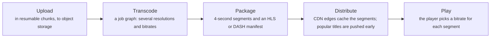
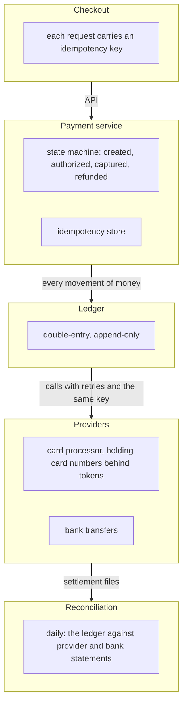
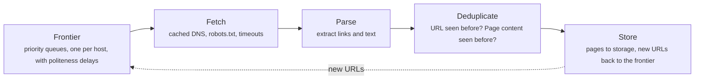

# Classic large designs: video, ride-hailing, collaborative docs, payments, crawlers and key-value stores

> System Design · L3 Specialist · Classic large designs · about 150 min · hub module `m09` ([open the hub](https://claude.ai/artifact/W93mxxEWBqV4MS8kJiz9dU))

## Why it matters
Interviews and real projects keep returning to the same handful of systems, because each forces a distinctive trade-off. Video streaming is a bandwidth and caching problem, ride-hailing a write-heavy location problem, collaborative editing a conflict-merging problem, payments a correctness problem, a web crawler a politeness and scale problem, and a distributed key-value store a partitioning and replication problem. Learn the pattern behind each, and new designs become combinations of patterns you've already seen.

## Pre-question (answer before reading)
**Q:** For each of these, name the one property that dominates the design: a video platform, a payment system, and a collaborative document editor.

<details><summary>Answer</summary>

Video: bandwidth and caching, so encode once into many renditions, serve short segments from CDNs and let the player adapt the bitrate. Payments: correctness under retries and failures, so idempotency keys, a double-entry ledger and daily reconciliation. Collaborative editing: merging concurrent edits so every copy converges, with operational transformation or CRDTs, at typing speed.

</details>

## 🍎 Story time (kid version)
**Pizza Town and the family road trip: Luigi's growing business**

Luigi's business has grown. He films cooking lessons and sends them in short clips, sharper when the customer's connection is good and blurrier when it's slow, so they never stop to load. His riders ring in their positions every few seconds, and he keeps only the latest. Two cooks edit the same recipe card at once, and simple rules merge their changes so both copies end up identical. Every payment slip carries the order number, so a slip sent twice is charged once. And his scout visits suppliers' shops for new ingredients, but never more than one visit per shop per hour, or he'd be thrown out.

| In the story | In a real system |
|---|---|
| Short clips, sharper or blurrier with the connection | Adaptive bitrate streaming: segments at several bitrates, chosen by the player |
| Riders ringing in, only the latest kept | Ride-hailing: an in-memory, write-heavy location index |
| Rules that merge two cooks' edits | Collaborative editing: operational transformation or CRDTs |
| The order number on every payment slip | Idempotency keys: a retried payment is charged once |
| One visit per shop per hour | Crawler politeness: a rate limit per host |

**Where the story breaks:** Luigi solves each problem on its own. Real products combine them: a ride-hailing app also takes payments and streams maps, so the patterns share identity, queues and storage, and the hardest bugs live where they meet.

## Key ideas (grown-up version)
- **A way into any large design**: name the property that dominates it before drawing boxes, then use the L2 framework: requirements, estimates, API and data model, a high-level design, deep dives, and failure modes. Spend the deep dives where the dominant property lives: bandwidth for video, correctness for payments, convergence for editors.
- **Video streaming**: uploads go to object storage in resumable chunks; a transcoding pipeline (a graph of jobs) encodes several resolutions and bitrates, cut into segments of 2 to 6 seconds with HLS or DASH manifests. CDNs serve the segments, so almost no bytes reach the origin, and popular titles are pushed to the edge in advance. The player's adaptive bitrate logic picks each segment's quality from measured throughput and buffer level.
- **Ride-hailing**: drivers report locations every few seconds, so the location index is write-heavy, in memory and partitioned by city, with cells mapping to drivers and a TTL for drivers who go quiet. Matching offers a trip to one nearby driver at a time with a timeout, and never assigns a driver twice, using a conditional update on the driver's state. A trip is a durable state machine (requested, accepted, arrived, in progress, completed); ETAs and pricing are separate services, and location history streams to analytics.
- **Collaborative documents**: every edit is applied locally at once, sent to the server, and merged with concurrent edits. Operational transformation, used by Google Docs, shifts each operation's positions to account for operations it didn't know about, with the server fixing the order; CRDTs such as Yjs and Automerge give every character a unique, ordered id, so copies merge in any order, even after working offline. Cursors and presence travel over WebSockets, and documents are stored as snapshots plus an operation log.
- **Payment systems**: correctness comes first. Every request carries an idempotency key, so a retry after a timeout never charges twice; money moves through a double-entry ledger, where every transaction debits one account and credits another and entries are only ever appended; payments are state machines, with sagas for refunds and reversals; and daily reconciliation compares the ledger with the provider's and the bank's records. Card numbers stay with a PCI-compliant provider, which returns tokens.
- **Web crawlers**: a URL frontier decides what to fetch next and enforces politeness, with one queue per host, a delay between requests to the same host, and respect for robots.txt. Fetchers resolve DNS through a cache and download; parsers extract links, which are normalised and deduplicated with a URL-seen set or Bloom filter before joining the frontier, and content fingerprints catch duplicate pages. How often a page is recrawled follows how often it changes.
- **Distributed key-value stores**, as in Dynamo and Cassandra: consistent hashing with virtual nodes spreads keys and limits movement when nodes join or leave; each key is replicated to N nodes, with tunable quorums (W + R > N for reading your own writes); sloppy quorums and hinted handoff keep writes available during failures; Merkle trees find differing key ranges cheaply for anti-entropy repair; and gossip spreads membership and failure suspicion.
- **The recurring parts**: most designs reuse the same building blocks: object storage and a CDN for large blobs, a cache in front of hot reads, a log or queue between producers and slow consumers, idempotent consumers, a store partitioned by the main access pattern, and asynchronous pipelines for analytics. Naming them quickly leaves time for the part that's unique to the problem.

## Diagrams
**Video: from upload to playback**



_Encoding happens once per title; delivery happens millions of times, so nearly all the cost and engineering is in the CDN and the player._

**A payment system**



_Every step can be retried safely, and reconciliation catches whatever slipped through, such as a charge whose reply was lost._

**A web crawler's loop**



_The frontier is the brain: it decides priority, freshness and politeness; everything else is plumbing that scales out._

## Comparisons
**Six designs, and what dominates each**

| Design | Dominant concern | Key techniques |
|---|---|---|
| Video streaming | Bandwidth and start-up time | Transcoding ladders, segments, CDNs, adaptive bitrate |
| Ride-hailing | Location updates and fast matching | In-memory geo index per city, TTLs, conditional assignment |
| Collaborative docs | Concurrent edits that must converge | OT or CRDTs, WebSockets, snapshots plus an op log |
| Payments | Correctness under failure | Idempotency keys, double-entry ledger, reconciliation |
| Web crawler | Politeness and scale | Per-host queues, robots.txt, URL dedup, recrawl scheduling |
| Key-value store | Availability and partitioning | Consistent hashing, quorums, hinted handoff, Merkle trees |

**Operational transformation or CRDTs**

|  | Operational transformation | CRDTs |
|---|---|---|
| Concurrent edits | Each operation is transformed against the ones it missed | Every element has a unique, ordered id; merges work in any order |
| Needs a server | Usually, to order operations | No: peer-to-peer and offline editing work |
| Metadata | Small | Ids per element, and tombstones for deletions |
| Examples | Google Docs and other server-based editors | Yjs, Automerge and many local-first apps |

## Code (JavaScript + Python)
### Helpers used by the examples: a seeded generator, geohash encoding and a city-scale distance
```python
import math

def mulberry32(seed):                           # a tiny seeded random generator, same as the JavaScript one
    state = seed & 0xFFFFFFFF
    def rand():
        nonlocal state
        state = (state + 0x6D2B79F5) & 0xFFFFFFFF
        t = ((state ^ (state >> 15)) * (state | 1)) & 0xFFFFFFFF
        t = (t ^ (t + (((t ^ (t >> 7)) * (t | 61)) & 0xFFFFFFFF))) & 0xFFFFFFFF
        return ((t ^ (t >> 14)) & 0xFFFFFFFF) / 4294967296
    return rand

BASE32 = "0123456789bcdefghjkmnpqrstuvwxyz"
M_PER_DEG_LAT, M_PER_DEG_LON = 111_195, 73_160  # metres per degree; longitude degrees shrink with latitude (Paris, 48.86° N)

def encode(lat, lon, length):
    """Geohash: halve the longitude and latitude ranges in turn, one bit each time, 5 bits per character."""
    lat_r, lon_r = [-90.0, 90.0], [-180.0, 180.0]
    value, chars = 0, []
    for i in range(length * 5):
        rng, x = (lon_r, lon) if i % 2 == 0 else (lat_r, lat)   # even bits split longitude, odd bits latitude
        mid = (rng[0] + rng[1]) / 2
        bit = 1 if x >= mid else 0
        rng[1 - bit] = mid                      # keep the half that contains the point
        value = value * 2 + bit
        if i % 5 == 4:
            chars.append(BASE32[value])
            value = 0
    return "".join(chars)

def bbox(gh):
    """The cell a geohash names: (lat_lo, lat_hi, lon_lo, lon_hi)."""
    lat_r, lon_r = [-90.0, 90.0], [-180.0, 180.0]
    i = 0
    for ch in gh:
        v = BASE32.index(ch)
        for shift in range(4, -1, -1):
            rng = lon_r if i % 2 == 0 else lat_r
            rng[1 - ((v >> shift) & 1)] = (rng[0] + rng[1]) / 2
            i += 1
    return lat_r[0], lat_r[1], lon_r[0], lon_r[1]

def metres(lat1, lon1, lat2, lon2):             # a flat-earth distance: accurate enough across a city
    dy, dx = (lat2 - lat1) * M_PER_DEG_LAT, (lon2 - lon1) * M_PER_DEG_LON
    return math.sqrt(dx * dx + dy * dy)
```

```javascript
function mulberry32(seed) {                     // a tiny seeded random generator, same as the Python one
  return function () {
    seed = (seed + 0x6D2B79F5) | 0;
    let t = Math.imul(seed ^ (seed >>> 15), 1 | seed);
    t = (t + Math.imul(t ^ (t >>> 7), 61 | t)) ^ t;
    return ((t ^ (t >>> 14)) >>> 0) / 4294967296;
  };
}

const BASE32 = "0123456789bcdefghjkmnpqrstuvwxyz";
const M_PER_DEG_LAT = 111_195, M_PER_DEG_LON = 73_160;   // metres per degree; longitude degrees shrink with latitude (Paris, 48.86° N)

function encode(lat, lon, length) {
  // geohash: halve the longitude and latitude ranges in turn, one bit each time, 5 bits per character
  const latR = [-90, 90], lonR = [-180, 180];
  let value = 0, chars = "";
  for (let i = 0; i < length * 5; i++) {
    const [rng, x] = i % 2 === 0 ? [lonR, lon] : [latR, lat];   // even bits split longitude, odd bits latitude
    const mid = (rng[0] + rng[1]) / 2;
    const bit = x >= mid ? 1 : 0;
    rng[1 - bit] = mid;                         // keep the half that contains the point
    value = value * 2 + bit;
    if (i % 5 === 4) { chars += BASE32[value]; value = 0; }
  }
  return chars;
}

function bbox(gh) {
  // the cell a geohash names: [latLo, latHi, lonLo, lonHi]
  const latR = [-90, 90], lonR = [-180, 180];
  let i = 0;
  for (const ch of gh) {
    const v = BASE32.indexOf(ch);
    for (let shift = 4; shift >= 0; shift--) {
      const rng = i % 2 === 0 ? lonR : latR;
      rng[1 - ((v >> shift) & 1)] = (rng[0] + rng[1]) / 2;
      i++;
    }
  }
  return [latR[0], latR[1], lonR[0], lonR[1]];
}

function metres(lat1, lon1, lat2, lon2) {       // a flat-earth distance: accurate enough across a city
  const dy = (lat2 - lat1) * M_PER_DEG_LAT, dx = (lon2 - lon1) * M_PER_DEG_LON;
  return Math.sqrt(dx * dx + dy * dy);
}
```

### Video: three ways to pick the next segment's bitrate
```python
rand = mulberry32(11)
RATES = [400, 1000, 2500, 5000, 8000]                 # kbit/s of each rendition, from 240p to 4K
SEGMENT_MS, MAX_BUFFER_MS = 4000, 30_000

bandwidth, trace = 6000, []
for n in range(150):                                   # the network during each segment's download, in kbit/s
    bandwidth = max(800, min(12_000, bandwidth + int((rand() - 0.5) * 3000)))
    trace.append(600 if 60 <= n < 75 else bandwidth)   # a train tunnel for a minute

def play(policy):
    buffer = stall = switches = total = 0
    last_rate, measured = None, 3000
    for bw in trace:
        if policy == "fixed 5 Mbit/s":
            rate = 5000
        elif policy == "by throughput":
            rate = max([r for r in RATES if r <= measured * 8 // 10] or [RATES[0]])   # 80% of the last measurement
        else:                                          # by buffer (BBA-0): map the buffer onto the bitrate range
            f = RATES[0] + (RATES[-1] - RATES[0]) * max(0, min(18_000, buffer - 8000)) // 18_000
            prev = last_rate or RATES[0]
            higher, lower = [r for r in RATES if r > prev], [r for r in RATES if r < prev]
            if higher and f >= higher[0]:
                rate = max(r for r in RATES if r <= f)     # step up only when the buffer clearly allows it
            elif lower and f <= lower[-1]:
                rate = min(r for r in RATES if r >= f)     # step down only when it clearly demands it
            else:
                rate = prev
        download_ms = rate * SEGMENT_MS // bw          # the segment's size divided by the bandwidth
        if download_ms > buffer:
            stall += download_ms - buffer              # the buffer ran dry: the picture freezes
        buffer = min(MAX_BUFFER_MS, max(0, buffer - download_ms) + SEGMENT_MS)
        measured = bw
        switches += last_rate is not None and rate != last_rate
        last_rate, total = rate, total + rate
    return stall, total // len(trace), switches

for policy in ("fixed 5 Mbit/s", "by throughput", "by buffer"):
    stall, average, switches = play(policy)
    print(f"{policy}: frozen for {stall // 1000}.{stall % 1000 // 100} s, average {average} kbit/s, {switches} quality switches")
```

Output:
```text
fixed 5 Mbit/s: frozen for 487.4 s, average 5000 kbit/s, 0 quality switches
by throughput: frozen for 0.6 s, average 3120 kbit/s, 30 quality switches
by buffer: frozen for 11.9 s, average 4826 kbit/s, 26 quality switches
```

- line 8: A minute in a tunnel at 600 kbit/s: the stretch that separates good players from bad ones.
- line 17: Throughput-based: pick the best rendition below 80% of the last measured speed.
- line 19: Buffer-based (BBA-0): the buffer level maps onto a bitrate, and the choice moves only when that mapping clearly passes the next level.
- line 30: A stall is the worst outcome for viewers: the picture freezes until the segment arrives.
- line 39: A fixed high bitrate freezes again and again. Throughput-based adapts fastest here; buffer-based keeps higher quality but carried a full buffer's confidence into the tunnel. Real players combine both, and abandon a download that's too slow.

```javascript
const rand = mulberry32(11);
const RATES = [400, 1000, 2500, 5000, 8000];           // kbit/s of each rendition, from 240p to 4K
const SEGMENT_MS = 4000, MAX_BUFFER_MS = 30000;

let bandwidth = 6000;
const trace = [];
for (let n = 0; n < 150; n++) {                        // the network during each segment's download, in kbit/s
  bandwidth = Math.max(800, Math.min(12000, bandwidth + Math.trunc((rand() - 0.5) * 3000)));
  trace.push(n >= 60 && n < 75 ? 600 : bandwidth);     // a train tunnel for a minute
}

function play(policy) {
  let buffer = 0, stall = 0, switches = 0, total = 0, lastRate = null, measured = 3000;
  for (const bw of trace) {
    let rate;
    if (policy === "fixed 5 Mbit/s") rate = 5000;
    else if (policy === "by throughput") {
      const fits = RATES.filter(r => r <= Math.floor(measured * 8 / 10));   // 80% of the last measurement
      rate = fits.length ? Math.max(...fits) : RATES[0];
    } else {                                           // by buffer (BBA-0): map the buffer onto the bitrate range
      const f = RATES[0] + Math.floor((RATES.at(-1) - RATES[0]) * Math.max(0, Math.min(18000, buffer - 8000)) / 18000);
      const prev = lastRate ?? RATES[0];
      const higher = RATES.filter(r => r > prev), lower = RATES.filter(r => r < prev);
      if (higher.length && f >= higher[0]) rate = Math.max(...RATES.filter(r => r <= f));   // step up only when the buffer clearly allows it
      else if (lower.length && f <= lower.at(-1)) rate = Math.min(...RATES.filter(r => r >= f));   // step down only when it clearly demands it
      else rate = prev;
    }
    const downloadMs = Math.floor(rate * SEGMENT_MS / bw);   // the segment's size divided by the bandwidth
    if (downloadMs > buffer) stall += downloadMs - buffer;   // the buffer ran dry: the picture freezes
    buffer = Math.min(MAX_BUFFER_MS, Math.max(0, buffer - downloadMs) + SEGMENT_MS);
    measured = bw;
    if (lastRate !== null && rate !== lastRate) switches++;
    lastRate = rate;
    total += rate;
  }
  return [stall, Math.floor(total / trace.length), switches];
}

for (const policy of ["fixed 5 Mbit/s", "by throughput", "by buffer"]) {
  const [stall, average, switches] = play(policy);
  console.log(`${policy}: frozen for ${Math.floor(stall / 1000)}.${Math.floor((stall % 1000) / 100)} s, average ${average} kbit/s, ${switches} quality switches`);
}
```

Output:
```text
fixed 5 Mbit/s: frozen for 487.4 s, average 5000 kbit/s, 0 quality switches
by throughput: frozen for 0.6 s, average 3120 kbit/s, 30 quality switches
by buffer: frozen for 11.9 s, average 4826 kbit/s, 26 quality switches
```

- line 9: A minute in a tunnel at 600 kbit/s: the stretch that separates good players from bad ones.
- line 18: Throughput-based: pick the best rendition below 80% of the last measured speed.
- line 21: Buffer-based (BBA-0): the buffer level maps onto a bitrate, and the choice moves only when that mapping clearly passes the next level.
- line 29: A stall is the worst outcome for viewers: the picture freezes until the segment arrives.
- line 41: A fixed high bitrate freezes again and again. Throughput-based adapts fastest here; buffer-based keeps higher quality but carried a full buffer's confidence into the tunnel. Real players combine both, and abandon a download that's too slow.

### Collaborative editing: operational transformation keeps copies identical
```python
def apply(text, op):
    kind, pos, ch, site = op
    if pos is None:
        return text                                    # an edit that became a no-op
    return text[:pos] + ch + text[pos:] if kind == "ins" else text[:pos] + text[pos + 1:]

def transform(op, against):
    """Rewrite op so it applies after `against`, an edit made at the same time on another copy."""
    kind, pos, ch, site = op
    other_kind, other_pos, _, other_site = against
    if pos is None or other_pos is None:
        return op
    if other_kind == "ins":
        if other_pos < pos or (other_pos == pos and (kind == "del" or other_site < site)):
            pos += 1                                   # text was inserted before us: move right
    elif other_pos < pos:
        pos -= 1                                       # text was deleted before us: move left
    elif other_pos == pos and kind == "del":
        pos = None                                     # both deleted the same character
    return (kind, pos, ch, site)

base = "cat"
ana, ben = ("ins", 3, "s", 1), ("ins", 1, "h", 2)      # typed at the same moment on two copies
print("without transforming:", apply(apply(base, ana), ben), apply(apply(base, ben), ana))
print("with transforming:", apply(apply(base, ana), transform(ben, ana)), apply(apply(base, ben), transform(ana, ben)))

rand = mulberry32(3)
naive_agree = ot_agree = 0
for _ in range(1000):
    base = "".join("abcdefgh"[int(rand() * 8)] for _ in range(1 + int(rand() * 8)))
    ops = []
    for site in (1, 2):
        if rand() < 0.5:
            ops.append(("del", int(rand() * len(base)), "", site))
        else:
            ops.append(("ins", int(rand() * (len(base) + 1)), "xy"[site - 1], site))
    a, b = ops
    naive_agree += apply(apply(base, a), b) == apply(apply(base, b), a)
    ot_agree += apply(apply(base, a), transform(b, a)) == apply(apply(base, b), transform(a, b))
print(f"1000 random pairs of simultaneous edits: copies agree {naive_agree} times without transforming, {ot_agree} with it")
```

Output:
```text
without transforming: chats chast
with transforming: chats chats
1000 random pairs of simultaneous edits: copies agree 232 times without transforming, 1000 with it
```

- line 14: Two inserts at the same place are ordered by site id, so every copy breaks the tie the same way.
- line 19: If both sides deleted the same character, the second delete becomes a no-op.
- line 24: Applied as they arrive, the same two edits leave the copies different.
- line 40: Transformed, every pair converges: Google Docs runs this idea for every keystroke, with the server ordering operations.

```javascript
function apply(text, [kind, pos, ch]) {
  if (pos === null) return text;                       // an edit that became a no-op
  return kind === "ins" ? text.slice(0, pos) + ch + text.slice(pos) : text.slice(0, pos) + text.slice(pos + 1);
}

function transform(op, against) {
  // rewrite op so it applies after `against`, an edit made at the same time on another copy
  let [kind, pos, ch, site] = op;
  const [otherKind, otherPos, , otherSite] = against;
  if (pos === null || otherPos === null) return op;
  if (otherKind === "ins") {
    if (otherPos < pos || (otherPos === pos && (kind === "del" || otherSite < site))) pos += 1;   // text was inserted before us: move right
  } else if (otherPos < pos) {
    pos -= 1;                                          // text was deleted before us: move left
  } else if (otherPos === pos && kind === "del") {
    pos = null;                                        // both deleted the same character
  }
  return [kind, pos, ch, site];
}

const base = "cat";
const ana = ["ins", 3, "s", 1], ben = ["ins", 1, "h", 2];   // typed at the same moment on two copies
console.log("without transforming:", apply(apply(base, ana), ben), apply(apply(base, ben), ana));
console.log("with transforming:", apply(apply(base, ana), transform(ben, ana)), apply(apply(base, ben), transform(ana, ben)));

const rand = mulberry32(3);
let naiveAgree = 0, otAgree = 0;
for (let i = 0; i < 1000; i++) {
  let text = "";
  for (let n = 1 + Math.floor(rand() * 8); n > 0; n--) text += "abcdefgh"[Math.floor(rand() * 8)];
  const ops = [];
  for (const site of [1, 2]) {
    if (rand() < 0.5) ops.push(["del", Math.floor(rand() * text.length), "", site]);
    else ops.push(["ins", Math.floor(rand() * (text.length + 1)), "xy"[site - 1], site]);
  }
  const [a, b] = ops;
  if (apply(apply(text, a), b) === apply(apply(text, b), a)) naiveAgree++;
  if (apply(apply(text, a), transform(b, a)) === apply(apply(text, b), transform(a, b))) otAgree++;
}
console.log(`1000 random pairs of simultaneous edits: copies agree ${naiveAgree} times without transforming, ${otAgree} with it`);
```

Output:
```text
without transforming: chats chast
with transforming: chats chats
1000 random pairs of simultaneous edits: copies agree 232 times without transforming, 1000 with it
```

- line 12: Two inserts at the same place are ordered by site id, so every copy breaks the tie the same way.
- line 16: If both sides deleted the same character, the second delete becomes a no-op.
- line 23: Applied as they arrive, the same two edits leave the copies different.
- line 40: Transformed, every pair converges: Google Docs runs this idea for every keystroke, with the server ordering operations.

### A crawler's frontier: breadth first against one polite queue per host
```python
HOST_PAGES = [20_000] + [500] * 49                     # one huge site and 49 small ones

def links(host, page):
    """The links on a page: mostly to the same site, sometimes to another. The same page always has the same links."""
    r = mulberry32(host * 100_003 + page)
    out = []
    for _ in range(6):
        h = host if r() < 0.85 else int(r() * len(HOST_PAGES))
        out.append((h, int(r() * HOST_PAGES[h])))
    return out

def crawl(polite, seconds=60, workers=10, fetch_ticks=2, gap_ticks=10):   # ticks of 100 ms
    seeds = [(h, 0) for h in range(5)]                 # the front pages of five sites
    seen, fifo, head = set(seeds), list(seeds), 0
    queues, heads, next_ok = {}, {}, {}                # polite: one queue per host, and when it may be fetched again
    for url in seeds:
        queues.setdefault(url[0], []).append(url)
        heads[url[0]] = 0
    busy_until, fetched, per_second = [0] * workers, 0, {}
    for tick in range(seconds * 10):
        for w in range(workers):
            if busy_until[w] > tick:
                continue
            url = None
            if polite:
                ready = [h for h in queues if heads[h] < len(queues[h]) and next_ok.get(h, 0) <= tick]
                if ready:
                    h = min(ready, key=lambda h: (next_ok.get(h, 0), h))   # the host that has waited longest
                    url, heads[h], next_ok[h] = queues[h][heads[h]], heads[h] + 1, tick + gap_ticks
            elif head < len(fifo):
                url, head = fifo[head], head + 1       # breadth first, whatever the host
            if url is None:
                break
            busy_until[w], fetched = tick + fetch_ticks, fetched + 1
            per_second[(url[0], tick // 10)] = per_second.get((url[0], tick // 10), 0) + 1
            for link in links(*url):
                if link not in seen:                   # deduplicate before queueing
                    seen.add(link)
                    if polite:
                        queues.setdefault(link[0], []).append(link)
                        heads.setdefault(link[0], 0)
                    else:
                        fifo.append(link)
    return fetched, max(per_second.values()), len(seen) - fetched

for polite in (False, True):
    fetched, busiest, waiting = crawl(polite)
    label = "one queue per host, 1 request a second each" if polite else "one breadth-first queue"
    print(f"{label}: {fetched} pages in 60 s, at most {busiest} requests to one site in a second, {waiting} URLs waiting")
```

Output:
```text
one breadth-first queue: 3000 pages in 60 s, at most 47 requests to one site in a second, 9794 URLs waiting
one queue per host, 1 request a second each: 2934 pages in 60 s, at most 1 requests to one site in a second, 9815 URLs waiting
```

- line 8: Most links stay on the same site, so a breadth-first queue fills up with one site's pages.
- line 26: Only hosts whose politeness delay has passed are candidates.
- line 29: After a fetch, that host must wait a second before the next one.
- line 37: Every URL is checked against the seen set before it's queued; at billions of URLs this becomes a Bloom filter or a sharded store.
- line 49: Breadth first is faster here only because it hammers the big site; the polite crawler spreads its requests and stays welcome.

```javascript
const HOST_PAGES = [20000, ...new Array(49).fill(500)];   // one huge site and 49 small ones

function links(host, page) {
  // the links on a page: mostly to the same site, sometimes to another; the same page always has the same links
  const r = mulberry32(host * 100003 + page);
  const out = [];
  for (let i = 0; i < 6; i++) {
    const h = r() < 0.85 ? host : Math.floor(r() * HOST_PAGES.length);
    out.push([h, Math.floor(r() * HOST_PAGES[h])]);
  }
  return out;
}

function crawl(polite, seconds = 60, workers = 10, fetchTicks = 2, gapTicks = 10) {   // ticks of 100 ms
  const seeds = [0, 1, 2, 3, 4].map(h => [h, 0]);     // the front pages of five sites
  const seen = new Set(seeds.map(u => u.join("/"))), fifo = [...seeds];
  let head = 0;
  const queues = new Map(), heads = new Map(), nextOk = new Map();   // polite: one queue per host, and when it may be fetched again
  for (const url of seeds) { queues.set(url[0], [url]); heads.set(url[0], 0); }
  const busyUntil = new Array(workers).fill(0), perSecond = new Map();
  let fetched = 0;
  for (let tick = 0; tick < seconds * 10; tick++) {
    for (let w = 0; w < workers; w++) {
      if (busyUntil[w] > tick) continue;
      let url = null;
      if (polite) {
        const ready = [...queues.keys()].filter(h => heads.get(h) < queues.get(h).length && (nextOk.get(h) ?? 0) <= tick);
        if (ready.length) {
          const h = ready.reduce((best, x) => {        // the host that has waited longest
            const [bx, xx] = [nextOk.get(best) ?? 0, nextOk.get(x) ?? 0];
            return xx < bx || (xx === bx && x < best) ? x : best;
          });
          url = queues.get(h)[heads.get(h)];
          heads.set(h, heads.get(h) + 1);
          nextOk.set(h, tick + gapTicks);
        }
      } else if (head < fifo.length) {
        url = fifo[head++];                            // breadth first, whatever the host
      }
      if (url === null) break;
      busyUntil[w] = tick + fetchTicks;
      fetched++;
      const key = `${url[0]}@${Math.floor(tick / 10)}`;
      perSecond.set(key, (perSecond.get(key) ?? 0) + 1);
      for (const link of links(...url)) {
        if (!seen.has(link.join("/"))) {               // deduplicate before queueing
          seen.add(link.join("/"));
          if (polite) {
            if (!queues.has(link[0])) { queues.set(link[0], []); heads.set(link[0], 0); }
            queues.get(link[0]).push(link);
          } else fifo.push(link);
        }
      }
    }
  }
  return [fetched, Math.max(...perSecond.values()), seen.size - fetched];
}

for (const polite of [false, true]) {
  const [fetched, busiest, waiting] = crawl(polite);
  const label = polite ? "one queue per host, 1 request a second each" : "one breadth-first queue";
  console.log(`${label}: ${fetched} pages in 60 s, at most ${busiest} requests to one site in a second, ${waiting} URLs waiting`);
}
```

Output:
```text
one breadth-first queue: 3000 pages in 60 s, at most 47 requests to one site in a second, 9794 URLs waiting
one queue per host, 1 request a second each: 2934 pages in 60 s, at most 1 requests to one site in a second, 9815 URLs waiting
```

- line 8: Most links stay on the same site, so a breadth-first queue fills up with one site's pages.
- line 27: Only hosts whose politeness delay has passed are candidates.
- line 35: After a fetch, that host must wait a second before the next one.
- line 46: Every URL is checked against the seen set before it's queued; at billions of URLs this becomes a Bloom filter or a sharded store.
- line 62: Breadth first is faster here only because it hammers the big site; the polite crawler spreads its requests and stays welcome.

## Worked example
**Problem.** Design the driver-location service for a ride-hailing app: 2,000 drivers in one city, each reporting every 4 seconds; riders ask for the three nearest available drivers. Drivers who stop reporting must not be offered. Show the index and how much work the updates really cause.

1. Scale: 2,000 drivers every 4 seconds is 500 updates a second for this city; 500,000 drivers nationally would be 125,000 a second, so partition by city and keep positions in memory.
2. Index: driver → (position, cell, last seen) and cell → set of drivers, with 6-character cells (about 800 × 610 m in Paris). An update that stays in the same cell only overwrites the position; only a change of cell touches two sets.
3. Query: read the rider's cell and its 8 neighbours, skip drivers silent for longer than the TTL (30 seconds), compute exact distances and return the nearest three. If fewer than three are found, widen to 5-character cells.
4. Costs: O(1) per update; a query reads nine cells, a few dozen drivers in a busy area. Redis GEO (GEOADD, GEOSEARCH) does the same with a geohash-scored sorted set; replicate per city, and stream the history to cheap storage for ETAs and analytics.

```python
class DriverIndex:
    """Where each driver is now: driver -> (lat, lon, cell, last seen), and cell -> drivers in it."""
    def __init__(self, precision=6, ttl=30):
        self.precision, self.ttl = precision, ttl
        self.drivers, self.cells = {}, {}
        self.updates = self.cell_changes = 0

    def update(self, driver, lat, lon, now):
        cell = encode(lat, lon, self.precision)
        self.updates += 1
        old = self.drivers.get(driver)
        if old is not None and old[2] != cell:
            self.cells[old[2]].discard(driver)     # moved to another cell: the only update that touches two sets
            self.cell_changes += 1
        if old is None or old[2] != cell:
            self.cells.setdefault(cell, set()).add(driver)
        self.drivers[driver] = (lat, lon, cell, now)   # otherwise just overwrite the position

    def nearest(self, lat, lon, k, now):
        lat_lo, lat_hi, lon_lo, lon_hi = bbox(encode(lat, lon, self.precision))
        h, w = lat_hi - lat_lo, lon_hi - lon_lo
        found, stale = [], []
        for dy in (-1, 0, 1):
            for dx in (-1, 0, 1):
                for d in self.cells.get(encode(lat + dy * h, lon + dx * w, self.precision), ()):
                    dlat, dlon, _, seen = self.drivers[d]
                    if now - seen > self.ttl:
                        stale.append(d)            # silent too long: don't offer this driver
                    else:
                        found.append((metres(lat, lon, dlat, dlon), d))
        return sorted(found)[:k], sorted(stale)

rand = mulberry32(5)
index = DriverIndex()
positions = {f"d{i}": [48.84 + rand() * 0.04, 2.31 + rand() * 0.06] for i in range(2000)}
index.update("ghost", 48.8607, 2.3377, 0)          # a driver who reported once, right by the Louvre, then went quiet
for t in range(0, 240, 4):                         # four minutes of updates every 4 seconds
    for driver, p in positions.items():
        p[0] += (rand() - 0.5) * 0.0002            # about 10 km/h of wandering
        p[1] += (rand() - 0.5) * 0.0003
        index.update(driver, p[0], p[1], t)
per_mille = index.cell_changes * 1000 // index.updates
print(f"location updates: {index.updates} | changed cell: {index.cell_changes} ({per_mille // 10}.{per_mille % 10}%)")
nearest, stale = index.nearest(48.8606, 2.3376, 3, 236)
print("nearest three:", ", ".join(f"{d} at {int(m + 0.5)} m" for m, d in nearest), "| skipped as stale:", *stale)
```

Output:
```text
location updates: 120001 | changed cell: 1984 (1.6%)
nearest three: d1155 at 26 m, d1665 at 54 m, d1930 at 74 m | skipped as stale: ghost
```

```javascript
class DriverIndex {
  // where each driver is now: driver -> [lat, lon, cell, last seen], and cell -> drivers in it
  constructor(precision = 6, ttl = 30) {
    this.precision = precision; this.ttl = ttl;
    this.drivers = new Map(); this.cells = new Map();
    this.updates = 0; this.cellChanges = 0;
  }
  update(driver, lat, lon, now) {
    const cell = encode(lat, lon, this.precision);
    this.updates++;
    const old = this.drivers.get(driver);
    if (old !== undefined && old[2] !== cell) {
      this.cells.get(old[2]).delete(driver);       // moved to another cell: the only update that touches two sets
      this.cellChanges++;
    }
    if (old === undefined || old[2] !== cell) {
      if (!this.cells.has(cell)) this.cells.set(cell, new Set());
      this.cells.get(cell).add(driver);
    }
    this.drivers.set(driver, [lat, lon, cell, now]);   // otherwise just overwrite the position
  }
  nearest(lat, lon, k, now) {
    const [latLo, latHi, lonLo, lonHi] = bbox(encode(lat, lon, this.precision));
    const h = latHi - latLo, w = lonHi - lonLo;
    const found = [], stale = [];
    for (const dy of [-1, 0, 1]) {
      for (const dx of [-1, 0, 1]) {
        for (const d of this.cells.get(encode(lat + dy * h, lon + dx * w, this.precision)) ?? []) {
          const [dlat, dlon, , seen] = this.drivers.get(d);
          if (now - seen > this.ttl) stale.push(d);   // silent too long: don't offer this driver
          else found.push([metres(lat, lon, dlat, dlon), d]);
        }
      }
    }
    found.sort((a, b) => a[0] - b[0] || (a[1] < b[1] ? -1 : 1));
    return [found.slice(0, k), stale.sort()];
  }
}

const rand = mulberry32(5);
const index = new DriverIndex();
const positions = new Map(Array.from({ length: 2000 }, (_, i) => [`d${i}`, [48.84 + rand() * 0.04, 2.31 + rand() * 0.06]]));
index.update("ghost", 48.8607, 2.3377, 0);         // a driver who reported once, right by the Louvre, then went quiet
for (let t = 0; t < 240; t += 4) {                 // four minutes of updates every 4 seconds
  for (const [driver, p] of positions) {
    p[0] += (rand() - 0.5) * 0.0002;               // about 10 km/h of wandering
    p[1] += (rand() - 0.5) * 0.0003;
    index.update(driver, p[0], p[1], t);
  }
}
const perMille = Math.floor(index.cellChanges * 1000 / index.updates);
console.log(`location updates: ${index.updates} | changed cell: ${index.cellChanges} (${Math.floor(perMille / 10)}.${perMille % 10}%)`);
const [nearest, stale] = index.nearest(48.8606, 2.3376, 3, 236);
console.log("nearest three:", nearest.map(([m, d]) => `${d} at ${Math.floor(m + 0.5)} m`).join(", "), "| skipped as stale:", ...stale);
```

Output:
```text
location updates: 120001 | changed cell: 1984 (1.6%)
nearest three: d1155 at 26 m, d1665 at 54 m, d1930 at 74 m | skipped as stale: ghost
```

**Answer.** The 2,000 drivers sent 120,000 updates, and only 1,984 of them (1.6%) moved a driver into another cell; the rest simply overwrote a position. The nearest three drivers are 26, 54 and 74 m from the rider, and "ghost", only about 13 m away but silent for almost four minutes, is skipped.

## Your turn (faded example)
**Problem.** Finish the payment provider's `charge(amount, key)`: a request whose idempotency key has been seen must not charge the card again. Replay the first result, or reject the request if its amount differs from the first one.

- ✓ A timeout doesn't mean the charge failed: the provider may have charged the card and lost the reply. Retrying blindly can charge twice; not retrying can lose the sale.
- **What should the provider do with a key it has seen before?**
  <details><summary>Answer</summary>Return the stored result of the first request without charging again, so a retry is safe. If the amount differs, reject it: the key is being misused, not retried.</details>
- **What if every attempt times out?**
  <details><summary>Answer</summary>The outcome is unknown, not failed. Record it, ask the provider for the payment's status later or wait for its webhook, and let reconciliation settle it; never ask the customer to pay again on a guess.</details>
- **What does it cost?**
  <details><summary>Answer</summary>One lookup and one stored result per key, kept for a day or so (Stripe keeps keys at least 24 hours), plus care that two concurrent requests with the same key can't both charge, for example with a unique constraint on the key.</details>

Starter:
```python
class PaymentProvider:
    """A card processor. A reply can be lost on its way back, even when the card was charged."""
    def __init__(self, rand):
        self.rand, self.charges, self.results = rand, [], {}

    def charge(self, amount, key=None):
        ...                                            # TODO: a key seen before: replay its first result, or reject a different amount
        self.charges.append(amount)                    # the card is charged
        result = ("ok", f"ch_{len(self.charges)}")
        ...                                            # TODO: remember the outcome under the key
        return ("timeout", None) if self.rand() < 0.15 else result   # the reply may never arrive
```

```javascript
class PaymentProvider {
  // a card processor; a reply can be lost on its way back, even when the card was charged
  constructor(rand) { this.rand = rand; this.charges = []; this.results = new Map(); }

  charge(amount, key = null) {
    // TODO: a key seen before: replay its first result, or reject a different amount
    this.charges.push(amount);                         // the card is charged
    const result = ["ok", `ch_${this.charges.length}`];
    // TODO: remember the outcome under the key
    return this.rand() < 0.15 ? ["timeout", null] : result;   // the reply may never arrive
  }
}
```

<details><summary>Full solution</summary>

```python
class PaymentProvider:
    """A card processor. A reply can be lost on its way back, even when the card was charged."""
    def __init__(self, rand):
        self.rand, self.charges, self.results = rand, [], {}

    def charge(self, amount, key=None):
        if key is not None and key in self.results:
            first_amount, result = self.results[key]
            if amount != first_amount:
                result = ("rejected", "key reused with a different amount")   # misuse, not a retry
        else:
            self.charges.append(amount)                # the card is charged
            result = ("ok", f"ch_{len(self.charges)}")
            if key is not None:
                self.results[key] = (amount, result)   # remember the outcome under the key
        return ("timeout", None) if self.rand() < 0.15 else result   # the reply may never arrive

def checkout(provider, orders, use_keys, attempts=3):
    unknown = 0
    for order_id, amount in orders:
        for _ in range(attempts):
            status, _ = provider.charge(amount, order_id if use_keys else None)
            if status == "ok":
                break
        else:
            unknown += 1                               # still unknown: ask the provider later, never guess
    return len(provider.charges), unknown

orders = [(f"order-{i}", 1000 + i) for i in range(1, 201)]
for use_keys in (False, True):
    charges, unknown = checkout(PaymentProvider(mulberry32(4)), orders, use_keys)
    print(f"{'with' if use_keys else 'without'} idempotency keys: 200 orders, {charges} charges, {unknown} outcomes still unknown")
provider = PaymentProvider(mulberry32(2))
provider.charge(500, "order-9")
replies = [provider.charge(700, "order-9")[0] for _ in range(5)]
print("same key, different amount:", *replies)
```

Output:
```text
without idempotency keys: 200 orders, 229 charges, 2 outcomes still unknown
with idempotency keys: 200 orders, 200 charges, 2 outcomes still unknown
same key, different amount: rejected rejected rejected rejected rejected
```

```javascript
class PaymentProvider {
  // a card processor; a reply can be lost on its way back, even when the card was charged
  constructor(rand) { this.rand = rand; this.charges = []; this.results = new Map(); }

  charge(amount, key = null) {
    let result;
    if (key !== null && this.results.has(key)) {
      const [firstAmount, first] = this.results.get(key);
      result = amount === firstAmount ? first : ["rejected", "key reused with a different amount"];   // misuse, not a retry
    } else {
      this.charges.push(amount);                       // the card is charged
      result = ["ok", `ch_${this.charges.length}`];
      if (key !== null) this.results.set(key, [amount, result]);   // remember the outcome under the key
    }
    return this.rand() < 0.15 ? ["timeout", null] : result;   // the reply may never arrive
  }
}

function checkout(provider, orders, useKeys, attempts = 3) {
  let unknown = 0;
  for (const [orderId, amount] of orders) {
    let done = false;
    for (let a = 0; a < attempts && !done; a++) done = provider.charge(amount, useKeys ? orderId : null)[0] === "ok";
    if (!done) unknown++;                              // still unknown: ask the provider later, never guess
  }
  return [provider.charges.length, unknown];
}

const orders = Array.from({ length: 200 }, (_, i) => [`order-${i + 1}`, 1001 + i]);
for (const useKeys of [false, true]) {
  const [charges, unknown] = checkout(new PaymentProvider(mulberry32(4)), orders, useKeys);
  console.log(`${useKeys ? "with" : "without"} idempotency keys: 200 orders, ${charges} charges, ${unknown} outcomes still unknown`);
}
const provider = new PaymentProvider(mulberry32(2));
provider.charge(500, "order-9");
const replies = Array.from({ length: 5 }, () => provider.charge(700, "order-9")[0]);
console.log("same key, different amount:", ...replies);
```

Output:
```text
without idempotency keys: 200 orders, 229 charges, 2 outcomes still unknown
with idempotency keys: 200 orders, 200 charges, 2 outcomes still unknown
same key, different amount: rejected rejected rejected rejected rejected
```

</details>

## Socratic checks and quiz (answers hidden)
**1. What does this print?**

```python
rates = [400, 1000, 2500, 5000, 8000]
throughput = 3200
print(max(r for r in rates if r <= throughput * 8 // 10))
```

```javascript
const rates = [400, 1000, 2500, 5000, 8000];
const throughput = 3200;
console.log(Math.max(...rates.filter(r => r <= Math.floor(throughput * 8 / 10))));
```

- A. 2500
- B. 5000
- C. 1000
- D. 3200

<details><summary>Answer</summary>

2500. 80% of 3,200 kbit/s is 2,560, and the best rendition below that is 2,500. The safety margin absorbs estimation errors that would otherwise stall playback.

</details>

**2. What does this print?**

```python
text = "cat"
ana, ben = (3, "s"), (1, "h")                  # (position, letter), typed at the same moment
pos = ana[0] + (1 if ben[0] <= ana[0] else 0)  # shift Ana's insert past Ben's
merged = text[:ben[0]] + ben[1] + text[ben[0]:]
print(merged[:pos] + ana[1] + merged[pos:], pos)
```

```javascript
const text = "cat";
const ana = [3, "s"], ben = [1, "h"];          // [position, letter], typed at the same moment
const pos = ana[0] + (ben[0] <= ana[0] ? 1 : 0);   // shift Ana's insert past Ben's
const merged = text.slice(0, ben[0]) + ben[1] + text.slice(ben[0]);
console.log(merged.slice(0, pos) + ana[1] + merged.slice(pos), pos);
```

- A. chats 4
- B. chast 3
- C. chats 3
- D. chat 4

<details><summary>Answer</summary>

chats 4. Ben's 'h' went in before position 3, so Ana's 's' moves from 3 to 4, and both copies read 'chats'. Without the shift, Ben's copy would read 'chast'.

</details>

**3. Why is video cut into segments of a few seconds, each encoded at several bitrates?**

- A. So the player can change quality between segments as the network changes, and CDNs can cache segments like ordinary files
- B. So each segment can use a different encryption key
- C. So uploads finish faster
- D. To save storage

<details><summary>Answer</summary>

So the player can change quality between segments as the network changes, and CDNs can cache segments like ordinary files. Segments are the unit of both adaptation and caching. They cost extra storage, one copy per rendition, which is cheap compared with bandwidth and frozen screens.

</details>

**4. A checkout service's call to the payment provider times out. What should it do?**

- A. Retry with the same idempotency key; if the outcome is still unknown, check the payment's status with the provider before deciding
- B. Retry without a key
- C. Mark the order as failed and ask the customer to pay again
- D. Assume the payment succeeded

<details><summary>Answer</summary>

Retry with the same idempotency key; if the outcome is still unknown, check the payment's status with the provider before deciding. A timeout leaves the outcome unknown. The same key makes retries safe, and a status check or webhook, followed by reconciliation, settles what really happened.

</details>

**5. Which techniques keep a Dynamo-style key-value store available and its replicas convergent? (choose 3)**

- A. Consistent hashing with virtual nodes
- B. Hinted handoff while a replica is down
- C. Merkle trees to find and repair differences between replicas
- D. One global lock per key
- E. Two-phase commit on every write

<details><summary>Answer</summary>

Consistent hashing with virtual nodes, Hinted handoff while a replica is down, Merkle trees to find and repair differences between replicas. Hashing spreads the keys, hinted handoff keeps accepting writes during failures, and Merkle trees repair what drifted. Global locks and two-phase commit would give up the availability Dynamo was built for.

</details>

**6. Judge each statement.**

- A double-entry ledger updates account balances in place.
- A polite crawler limits how often it fetches from each host.
- CRDT-based editors can merge edits made while offline.
- A ride-hailing app should write every location update to its main relational database.

<details><summary>Answer</summary>

A double-entry ledger updates account balances in place.: No; A polite crawler limits how often it fetches from each host.: Yes; CRDT-based editors can merge edits made while offline.: Yes; A ride-hailing app should write every location update to its main relational database.: No. Ledgers append balanced entries and derive balances. Politeness is per host. CRDTs merge in any order, so offline edits merge on reconnect. Live locations belong in an in-memory index, with history streamed elsewhere.

</details>

**7. Put a video's journey in order.**

- (put the steps in order)

<details><summary>Answer</summary>

Upload the source file in chunks to object storage → Transcode it into several resolutions and bitrates → Cut each rendition into segments and write a manifest → Cache the segments at CDN edges → The player picks a bitrate for each segment. Everything before the CDN happens once per title; the last two steps happen for every viewer, which is where the scale is.

</details>

**8. Complete the Python function that finds which node owns a key on a consistent-hashing ring with virtual nodes.**

```
import bisect
import hashlib

def node_for(key, points, owners):
    h = int(hashlib.md5(key.encode()).hexdigest()[:8], 16)   # the key's position on the ring
    i = bisect.bisect_right(points, {{0}})                  # the first point clockwise after it
    return owners[i % {{1}}]                                # past the last point, wrap to the first

```

<details><summary>Answer</summary>

h | len(points). Each node owns several points (virtual nodes) on the ring, and a key belongs to the first point after its hash, wrapping around. Adding a node takes over only the ranges just before its points.

</details>

## Traps & misconceptions
- **“Stream video straight from our own servers.”** Video is mostly bytes: a single popular title can need terabits a second. Serve segments from CDNs, push popular titles to the edge ahead of demand, and keep the origin for the long tail.
- **“If a payment call times out, just retry it.”** Without an idempotency key the retry can charge the card twice. Retry with the same key, and if the outcome is still unknown, check the payment's status before deciding.
- **“Store each account's balance and update it.”** In-place updates lose the history and make errors untraceable. Record every movement as balanced double-entry ledger lines, append-only, and derive balances from them.
- **“Lock the document while someone is editing.”** Locks kill collaboration and fail badly when a client disconnects. Apply edits locally and merge concurrent ones with operational transformation or CRDTs.
- **“Crawl breadth first, as fast as possible.”** That hammers whichever site has the most links, gets the crawler blocked, and can fall into infinite calendar or session-id URL spaces. Use per-host queues and delays, honour robots.txt, normalise URLs and cap depth per site.
- **“Last-writer-wins is fine for the key-value store; conflicts are rare.”** Concurrent writes do happen, and last-writer-wins silently drops all but one. Keep one writer per key where you can, or detect conflicts with vector clocks and merge them (CRDTs, or the application).

## Discussion prompts
- **How would you make sure a ride-hailing driver is never assigned two trips at once?**
  <details><summary>One good answer</summary>Make assignment a conditional update on the driver's record: set the driver to 'offered' only if they are 'available' (a compare-and-set in the database, or a Lua script in Redis), and expire the offer after 15 seconds so a silent driver is released. The trip service then moves the trip to 'accepted' only if the offer is still valid. Because each step is a state transition guarded by the current state, two matchers racing for one driver can't both win.</details>
- **Five million people start the same premiere at the same second. What keeps the video platform up?**
  <details><summary>One good answer</summary>Push the title's segments to CDN edges before the start, and start players at a low bitrate so adaptive streaming climbs gradually. Shield the origin with a mid-tier cache that collapses identical requests, scale the licence, authentication and manifest services ahead of time, and spread start times with a short random delay or a waiting room if needed.</details>

## Teach-back
**Prompt:** Pick two of the six designs and explain to a junior colleague which property dominates each, and which techniques follow from it.

Rubric:
- [ ] Names the dominant property for each chosen design
- [ ] Video: segments, renditions, CDNs and adaptive bitrate
- [ ] Payments: idempotency keys, ledger, reconciliation; or editors: OT and CRDTs
- [ ] Crawlers: per-host politeness and deduplication; or key-value stores: hashing, quorums, repair
- [ ] Says what fails without each technique

<details><summary>Model answer</summary>

Video streaming is dominated by bandwidth. So each title is encoded once into a ladder of resolutions and bitrates, cut into segments of a few seconds, and served from CDN edges; the player measures throughput and watches its buffer to choose each segment's quality, so it can drop quality instead of freezing. Without segments and CDNs the origin melts; without adaptive bitrate a tunnel freezes the picture. Payments are dominated by correctness. Every request carries an idempotency key, so a retry after a timeout replays the first result instead of charging again; money moves through an append-only double-entry ledger; and daily reconciliation against the provider's and bank's records catches anything left in an unknown state. Without keys, retries double-charge; without reconciliation, lost replies turn into silent errors.

</details>

## Quick Q&A (also in the SRS deck)
- **What does adaptive bitrate streaming adapt to?** The measured throughput and the buffer level, choosing each segment's quality.
- **Why do payment APIs take idempotency keys?** So a retry after a timeout returns the first result instead of charging again.
- **What does operational transformation do?** Shifts each edit's position to account for concurrent edits, so every copy converges.
- **What makes a crawler polite?** A delay between requests to the same host, honouring robots.txt, and identifying itself.
- **How does a Dynamo-style store find differences between replicas cheaply?** By comparing Merkle trees of key ranges.
- **Why keep driver locations in memory, partitioned by city?** Updates arrive every few seconds and only the latest position matters for matching.

## Practice problems
- [ ] [Reading · Dynamo: Amazon's Highly Available Key-value Store](https://www.allthingsdistributed.com/files/amazon-dynamo-sosp2007.pdf) · for each technique in the paper's summary table, name the problem it solves and its cost
- [ ] [Reference · Stripe: Idempotent requests](https://docs.stripe.com/api/idempotent_requests) · compare Stripe's rules for reused keys with this module's fade, and say what happens to keys after 24 hours
- [ ] [Reference · Apple: HTTP Live Streaming](https://developer.apple.com/streaming/) · open an example playlist and identify the renditions, the segment length and the bitrates
- [ ] [Reading · Google Docs: conflict resolution](https://drive.googleblog.com/2010/09/whats-different-about-new-google-docs_22.html) · explain how the server's ordering keeps every collaborator's copy identical

## Sources (accessed 2026-10-09)
- [DeCandia et al.: Dynamo, Amazon's Highly Available Key-value Store (SOSP 2007)](https://www.allthingsdistributed.com/files/amazon-dynamo-sosp2007.pdf)
- [Stripe API reference: Idempotent requests](https://docs.stripe.com/api/idempotent_requests)
- [Apple Developer: HTTP Live Streaming](https://developer.apple.com/streaming/)
- [Google Workspace blog: What's different about the new Google Docs, conflict resolution (2010)](https://drive.googleblog.com/2010/09/whats-different-about-new-google-docs_22.html)
- [Google Search Central: Introduction to robots.txt](https://developers.google.com/search/docs/crawling-indexing/robots/intro)
- [About CRDTs (crdt.tech)](https://crdt.tech/)
