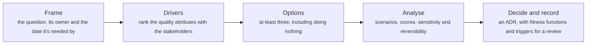
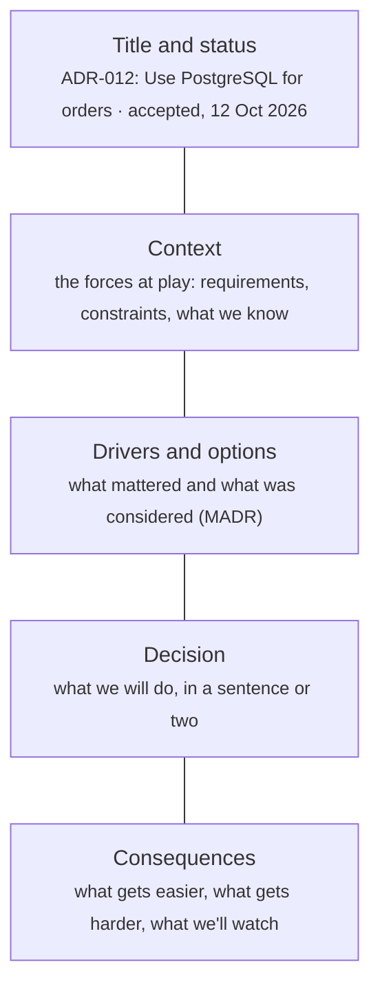
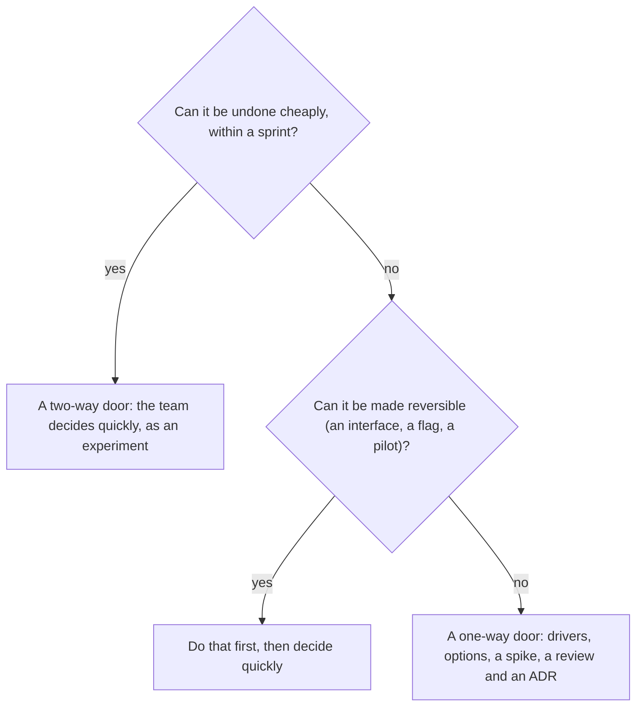

# Architecture decision-making: ADRs, trade-off analysis and reversibility

> System Design · L4 Expert · Decisions and frameworks · about 120 min · hub module `m01` ([open the hub](https://claude.ai/artifact/C3GSn1y8nTQ24VT25d5S3X))

## Why it matters
Senior engineers are judged less by the systems they draw than by the decisions they make and how well those decisions age. An architecture decision record captures one decision with its context, options and consequences, so the next person knows why. A lightweight version of ATAM walks the options through the quality-attribute scenarios that matter and finds the sensitivity points where a small change flips the answer. And telling one-way doors from two-way doors decides how slowly, and with how much evidence, each decision should be made.

## Pre-question (answer before reading)
**Q:** Your team must choose between PostgreSQL and DynamoDB for a new order service, and two senior engineers have argued about it for a week. What would make the decision faster and better, and what should be written down?

<details><summary>Answer</summary>

Agree the decision drivers and their weights first (consistency, query patterns, operations effort, cost at scale, team skills, lock-in), then score both options against them and check how far the weights would have to move to change the answer. Judge how reversible the choice is: a database is costly to undo, so it earns a short spike. Then record the decision as an ADR with the context, the options, the consequences and what would make you revisit it.

</details>

## 🍎 Story time (kid version)
**Pizza Town and the family road trip: Choosing the family car**

Luigi's family must choose a car for the road trip. Instead of arguing, they list what matters (room for four, fuel cost, the steep hill to Grandma's) and agree how much each counts. They score three cars, and notice that if the hill counted a little more, the answer would change, so they test-drive up the hill. Buying a car is hard to undo, so they take their time; choosing the lunch stop is easy to change, so they just pick one. Then Luigi writes the decision in the trip diary: what they chose, why, and what would make them change their minds next year.

| In the story | In a real organisation |
|---|---|
| What matters, and how much each counts | Decision drivers: the quality attributes, ranked or weighted with the stakeholders |
| Scoring three cars | A decision matrix: each option scored against each driver |
| If the hill counted a little more | A sensitivity point: a small change in one weight flips the answer |
| Taking time over the car, not the lunch stop | One-way and two-way doors: match the effort to the reversibility |
| The trip diary entry | An architecture decision record (ADR) |

**Where the story breaks:** Luigi's family can test-drive the car. Many architecture decisions can't be fully tested before they're made, so a good record also says what you'll watch afterwards, and when you'll look at the decision again.

## Key ideas (grown-up version)
- **Decisions are the architecture**: the significant choices are the ones that are costly to change: data stores, service boundaries, protocols, build or buy, and the platforms you depend on. Name them explicitly, and give each an owner and a date by which it must be made.
- **Architecture decision records**: one short document per decision, in Michael Nygard's format: title, status (proposed, accepted, superseded), context, decision and consequences. Kept in the repository, numbered, and never rewritten after acceptance (a later ADR supersedes an old one), they explain why the system looks the way it does. MADR adds the decision drivers and the options considered.
- **Decision drivers**: the quality attributes that matter (performance, availability, security, cost, modifiability, time to market, team skills) ranked or weighted with the stakeholders before the options are compared, so the debate is about priorities rather than favourite technologies.
- **Trade-off analysis, ATAM-lite**: write quality-attribute scenarios with response measures ('a region fails at the peak: checkout is back within 5 minutes'), walk each option through them, and record the risks (scenarios an option misses), the sensitivity points (a parameter that strongly affects one attribute) and the trade-off points (a parameter that helps one attribute and hurts another).
- **Decision matrices and sensitivity**: weighted scores make the reasoning visible, but they're only as good as the weights. Find how far each weight must move to change the winner: a fragile winner needs more evidence, such as a spike, a prototype or a benchmark; a robust one can be decided now.
- **One-way and two-way doors**: reversible decisions should be made quickly, close to the team, and treated as experiments; irreversible or very expensive ones deserve more analysis, more voices and a written record. Make decisions more reversible where you can: an interface in front of a vendor, portable data formats, feature flags, a pilot.
- **When to decide**: deciding too early locks in ignorance, and deciding too late blocks the work. Aim for the last responsible moment, when waiting starts to cost more than the information it buys, and buy information cheaply in the meantime; its value is the expected cost it saves.
- **Keeping decisions true**: turn a decision's key properties into automated fitness functions (latency budgets, dependency rules, cost alerts) so drift is caught, and record the signals that should trigger a review. A superseded ADR isn't a failure: the context changed, and the record shows how.

## Diagrams
**From a question to a recorded decision**



_Most of the value is in the first two steps: agreeing what matters ends most arguments before they start._

**The sections of an ADR**



_Short is the point: one or two pages, written when the decision is made, and kept in the repository beside the code._

**How much process does a decision need?**



## Comparisons
**One-way and two-way doors**

|  | Two-way door | One-way door |
|---|---|---|
| Examples | A library, a feature flag's default, a dashboard, an API field behind a version | A primary database, a cloud provider, a public API contract, a data model in many services |
| Who decides | The team that owns it | The team, with the people affected and a review |
| How fast | Hours or days | Weeks, with a spike or prototype if the winner is fragile |
| Record | A line in the changelog or a short ADR | A full ADR with options, drivers and consequences |

**Three ways to compare options**

| Technique | Answers | Watch out for |
|---|---|---|
| Weighted decision matrix | Which option best fits the agreed priorities? | Weights are opinions: check how sensitive the winner is |
| ATAM-style scenarios | Does each option meet the response measures that matter, and where are the risks? | Scenarios need numbers, or every option passes |
| Expected value and value of information | What does each option cost across possible futures, and is it worth learning more first? | Probabilities are estimates: test several |

## Code (JavaScript + Python)
### A weighted decision matrix: the weights are the decision
```python
scores = {                                             # 1 (poor) to 5 (excellent), agreed with the team
    "PostgreSQL": {"consistency": 5, "query flexibility": 5, "operations effort": 3, "cost at 10x": 3, "team skills": 5, "lock-in": 5},
    "DynamoDB":   {"consistency": 3, "query flexibility": 2, "operations effort": 5, "cost at 10x": 4, "team skills": 2, "lock-in": 2},
    "MongoDB":    {"consistency": 3, "query flexibility": 4, "operations effort": 3, "cost at 10x": 3, "team skills": 3, "lock-in": 4},
}
ours = {"consistency": 30, "query flexibility": 20, "operations effort": 15, "cost at 10x": 15, "team skills": 10, "lock-in": 10}
platform = {"consistency": 10, "query flexibility": 10, "operations effort": 40, "cost at 10x": 30, "team skills": 5, "lock-in": 5}

def ranking(weights):
    totals = {option: sum(w * s[d] for d, w in weights.items()) for option, s in scores.items()}
    return sorted(totals.items(), key=lambda item: -item[1])   # out of 500: weights sum to 100, scores reach 5

for label, weights in (("our weights", ours), ("the platform team's weights", platform)):
    print(f"{label}:", " | ".join(f"{option} {total}" for option, total in ranking(weights)))
best = {d: max(scores, key=lambda o: scores[o][d]) for d in ours}
print("best on each driver:", ", ".join(f"{d}: {o}" for d, o in best.items()))
```

Output:
```text
our weights: PostgreSQL 440 | MongoDB 330 | DynamoDB 305
the platform team's weights: DynamoDB 390 | PostgreSQL 360 | MongoDB 315
best on each driver: consistency: PostgreSQL, query flexibility: PostgreSQL, operations effort: DynamoDB, cost at 10x: DynamoDB, team skills: PostgreSQL, lock-in: PostgreSQL
```

- line 6: Agree the weights before anyone sees the totals: that's where the real disagreement lives.
- line 10: Each total is the sum of weight × score: with weights summing to 100 and scores up to 5, the best possible is 500.
- line 14: Same scores, the platform team's weights, and DynamoDB wins: the argument was about priorities, not facts.
- line 16: No option is best at everything, and the matrix shows what each choice gives up.

```javascript
const scores = {                                       // 1 (poor) to 5 (excellent), agreed with the team
  PostgreSQL: { "consistency": 5, "query flexibility": 5, "operations effort": 3, "cost at 10x": 3, "team skills": 5, "lock-in": 5 },
  DynamoDB:   { "consistency": 3, "query flexibility": 2, "operations effort": 5, "cost at 10x": 4, "team skills": 2, "lock-in": 2 },
  MongoDB:    { "consistency": 3, "query flexibility": 4, "operations effort": 3, "cost at 10x": 3, "team skills": 3, "lock-in": 4 },
};
const ours = { "consistency": 30, "query flexibility": 20, "operations effort": 15, "cost at 10x": 15, "team skills": 10, "lock-in": 10 };
const platform = { "consistency": 10, "query flexibility": 10, "operations effort": 40, "cost at 10x": 30, "team skills": 5, "lock-in": 5 };

function ranking(weights) {
  const totals = Object.entries(scores).map(([option, s]) => [option, Object.entries(weights).reduce((sum, [d, w]) => sum + w * s[d], 0)]);
  return totals.sort((a, b) => b[1] - a[1]);           // out of 500: weights sum to 100, scores reach 5
}

for (const [label, weights] of [["our weights", ours], ["the platform team's weights", platform]]) {
  console.log(`${label}:`, ranking(weights).map(([option, total]) => `${option} ${total}`).join(" | "));
}
const best = Object.keys(ours).map(d => [d, Object.keys(scores).reduce((a, b) => (scores[b][d] > scores[a][d] ? b : a))]);
console.log("best on each driver:", best.map(([d, o]) => `${d}: ${o}`).join(", "));
```

Output:
```text
our weights: PostgreSQL 440 | MongoDB 330 | DynamoDB 305
the platform team's weights: DynamoDB 390 | PostgreSQL 360 | MongoDB 315
best on each driver: consistency: PostgreSQL, query flexibility: PostgreSQL, operations effort: DynamoDB, cost at 10x: DynamoDB, team skills: PostgreSQL, lock-in: PostgreSQL
```

- line 6: Agree the weights before anyone sees the totals: that's where the real disagreement lives.
- line 10: Each total is the sum of weight × score: with weights summing to 100 and scores up to 5, the best possible is 500.
- line 15: Same scores, the platform team's weights, and DynamoDB wins: the argument was about priorities, not facts.
- line 18: No option is best at everything, and the matrix shows what each choice gives up.

### Is it worth finding out more before deciding?
```python
P_GROWTH = 0.3                                         # chance that traffic grows tenfold within the three years
cost = {                                               # three-year cost in thousands of dollars: (no growth, growth)
    "managed queue": (120, 900),                       # cheap now, but per-message prices explode with growth
    "self-hosted Kafka": (400, 500),                   # a fixed cluster: dear now, cheap at scale
    "managed now, switch if growth comes": (120, 150 + 250 + 400),   # a year on managed, a migration, then Kafka
}

def expected(p_growth):
    return {option: (1 - p_growth) * low + p_growth * high for option, (low, high) in cost.items()}

def best(p_growth):
    return min(expected(p_growth).items(), key=lambda item: item[1])

k = lambda x: int(x + 0.5)                             # whole thousands
print("expected cost, k$:", " | ".join(f"{o} {k(v)}" for o, v in expected(P_GROWTH).items()))
choice, without = best(P_GROWTH)
perfect = (1 - P_GROWTH) * min(lo for lo, _ in cost.values()) + P_GROWTH * min(hi for _, hi in cost.values())
print(f"best without more information: {choice} ({k(without)}); with perfect foresight {k(perfect)}, "
      f"so information is worth at most {k(without - perfect)}")

ACCURACY = 0.8                                         # a pilot that predicts growth correctly 80% of the time
p_signal = P_GROWTH * ACCURACY + (1 - P_GROWTH) * (1 - ACCURACY)
after_yes = best(P_GROWTH * ACCURACY / p_signal)[1]    # Bayes: the chance of growth after each result
after_no = best(P_GROWTH * (1 - ACCURACY) / (1 - p_signal))[1]
with_pilot = p_signal * after_yes + (1 - p_signal) * after_no
print(f"with an 80%-accurate pilot {k(with_pilot)}: the pilot is worth up to {k(without - with_pilot)}, "
      f"so run it if it costs less")
```

Output:
```text
expected cost, k$: managed queue 354 | self-hosted Kafka 430 | managed now, switch if growth comes 324
best without more information: managed now, switch if growth comes (324); with perfect foresight 234, so information is worth at most 90
with an 80%-accurate pilot 291: the pilot is worth up to 33, so run it if it costs less
```

- line 5: The reversible option: start cheap and pay to switch only if growth comes. Keeping a decision reversible is often the best decision.
- line 17: Perfect foresight picks the best option in each future; the gap to the best plan without it is the most any information can be worth.
- line 23: Bayes' rule: after a 'growth' signal, growth is 63% likely; after a 'no growth' signal, under 10%.
- line 26: An imperfect pilot is worth less than perfect information, but still about 33 k$: run it if it costs less than that.

```javascript
const P_GROWTH = 0.3;                                  // chance that traffic grows tenfold within the three years
const cost = {                                         // three-year cost in thousands of dollars: [no growth, growth]
  "managed queue": [120, 900],                         // cheap now, but per-message prices explode with growth
  "self-hosted Kafka": [400, 500],                     // a fixed cluster: dear now, cheap at scale
  "managed now, switch if growth comes": [120, 150 + 250 + 400],   // a year on managed, a migration, then Kafka
};

const expected = pGrowth => Object.entries(cost).map(([option, [low, high]]) => [option, (1 - pGrowth) * low + pGrowth * high]);
const best = pGrowth => expected(pGrowth).reduce((a, b) => (b[1] < a[1] ? b : a));
const k = x => Math.floor(x + 0.5);                    // whole thousands

console.log("expected cost, k$:", expected(P_GROWTH).map(([o, v]) => `${o} ${k(v)}`).join(" | "));
const [choice, without] = best(P_GROWTH);
const lows = Object.values(cost).map(([lo]) => lo), highs = Object.values(cost).map(([, hi]) => hi);
const perfect = (1 - P_GROWTH) * Math.min(...lows) + P_GROWTH * Math.min(...highs);
console.log(`best without more information: ${choice} (${k(without)}); with perfect foresight ${k(perfect)}, ` +
            `so information is worth at most ${k(without - perfect)}`);

const ACCURACY = 0.8;                                  // a pilot that predicts growth correctly 80% of the time
const pSignal = P_GROWTH * ACCURACY + (1 - P_GROWTH) * (1 - ACCURACY);
const afterYes = best(P_GROWTH * ACCURACY / pSignal)[1];   // Bayes: the chance of growth after each result
const afterNo = best(P_GROWTH * (1 - ACCURACY) / (1 - pSignal))[1];
const withPilot = pSignal * afterYes + (1 - pSignal) * afterNo;
console.log(`with an 80%-accurate pilot ${k(withPilot)}: the pilot is worth up to ${k(without - withPilot)}, ` +
            `so run it if it costs less`);
```

Output:
```text
expected cost, k$: managed queue 354 | self-hosted Kafka 430 | managed now, switch if growth comes 324
best without more information: managed now, switch if growth comes (324); with perfect foresight 234, so information is worth at most 90
with an 80%-accurate pilot 291: the pilot is worth up to 33, so run it if it costs less
```

- line 5: The reversible option: start cheap and pay to switch only if growth comes. Keeping a decision reversible is often the best decision.
- line 15: Perfect foresight picks the best option in each future; the gap to the best plan without it is the most any information can be worth.
- line 21: Bayes' rule: after a 'growth' signal, growth is 63% likely; after a 'no growth' signal, under 10%.
- line 24: An imperfect pilot is worth less than perfect information, but still about 33 k$: run it if it costs less than that.

### An ADR log: what's in force, what's waiting, what needs a review
```python
from datetime import date

LOG = """
# ADR-001: Use PostgreSQL for orders
Status: superseded
Date: 2024-03-02
Review: 2025-03-01

# ADR-004: Publish domain events through an outbox
Status: accepted
Date: 2024-09-14
Review: 2026-09-01

# ADR-007: Move orders to Aurora PostgreSQL
Status: accepted
Supersedes: ADR-001
Date: 2025-06-20
Review: 2026-12-01

# ADR-009: Adopt OpenTelemetry for tracing
Status: proposed
Date: 2026-09-30
"""

def parse(text):
    adrs = []
    for block in text.strip().split("\n\n"):
        lines = block.splitlines()
        number, title = lines[0][2:].split(": ", 1)  # "# ADR-007: Move orders ..."
        record = {"id": number, "title": title}
        for line in lines[1:]:
            key, value = line.split(": ", 1)
            record[key.lower()] = value
        adrs.append(record)
    return adrs

adrs, today = parse(LOG), date(2026, 10, 12)
replaced = {a["supersedes"]: a["id"] for a in adrs if "supersedes" in a}
current = [a for a in adrs if a["status"] == "accepted" and a["id"] not in replaced]
print("in force:", ", ".join(f"{a['id']} {a['title']}" for a in current))
for a in adrs:
    if a["status"] == "proposed":
        print(f"waiting for a decision: {a['id']}, open {(today - date.fromisoformat(a['date'])).days} days")
    if a in current and date.fromisoformat(a["review"]) < today:
        print(f"overdue for review: {a['id']} (due {a['review']})")
for old, new in replaced.items():
    status = next(a["status"] for a in adrs if a["id"] == old)
    print(f"history: {old} -> {new}; {old} marked superseded: {'yes' if status == 'superseded' else 'no, fix it'}")
```

Output:
```text
in force: ADR-004 Publish domain events through an outbox, ADR-007 Move orders to Aurora PostgreSQL
overdue for review: ADR-004 (due 2026-09-01)
waiting for a decision: ADR-009, open 12 days
history: ADR-001 -> ADR-007; ADR-001 marked superseded: yes
```

- line 16: A new ADR supersedes the old one instead of rewriting it, so the history of why stays readable.
- line 39: In force means accepted and not superseded by a later record.
- line 44: Each decision carries a review date: the moment to check whether its context still holds.
- line 48: Supersession is recorded on both sides; a check like this keeps the log honest.

```javascript
const LOG = `
# ADR-001: Use PostgreSQL for orders
Status: superseded
Date: 2024-03-02
Review: 2025-03-01

# ADR-004: Publish domain events through an outbox
Status: accepted
Date: 2024-09-14
Review: 2026-09-01

# ADR-007: Move orders to Aurora PostgreSQL
Status: accepted
Supersedes: ADR-001
Date: 2025-06-20
Review: 2026-12-01

# ADR-009: Adopt OpenTelemetry for tracing
Status: proposed
Date: 2026-09-30
`;

function parse(text) {
  return text.trim().split("\n\n").map(block => {
    const [head, ...lines] = block.split("\n");
    const [id, title] = head.slice(2).split(/: (.*)/s);   // "# ADR-007: Move orders ..."
    const record = { id, title };
    for (const line of lines) {
      const [key, value] = line.split(/: (.*)/s);
      record[key.toLowerCase()] = value;
    }
    return record;
  });
}

const adrs = parse(LOG), today = Date.UTC(2026, 9, 12);
const days = iso => Math.round((today - Date.parse(iso)) / 86400000);
const replaced = new Map(adrs.filter(a => a.supersedes).map(a => [a.supersedes, a.id]));
const current = adrs.filter(a => a.status === "accepted" && !replaced.has(a.id));
console.log("in force:", current.map(a => `${a.id} ${a.title}`).join(", "));
for (const a of adrs) {
  if (a.status === "proposed") console.log(`waiting for a decision: ${a.id}, open ${days(a.date)} days`);
  if (current.includes(a) && a.review < "2026-10-12") console.log(`overdue for review: ${a.id} (due ${a.review})`);
}
for (const [old, next] of replaced) {
  const status = adrs.find(a => a.id === old).status;
  console.log(`history: ${old} -> ${next}; ${old} marked superseded: ${status === "superseded" ? "yes" : "no, fix it"}`);
}
```

Output:
```text
in force: ADR-004 Publish domain events through an outbox, ADR-007 Move orders to Aurora PostgreSQL
overdue for review: ADR-004 (due 2026-09-01)
waiting for a decision: ADR-009, open 12 days
history: ADR-001 -> ADR-007; ADR-001 marked superseded: yes
```

- line 14: A new ADR supersedes the old one instead of rewriting it, so the history of why stays readable.
- line 39: In force means accepted and not superseded by a later record.
- line 43: Each decision carries a review date: the moment to check whether its context still holds.
- line 47: Supersession is recorded on both sides; a check like this keeps the log honest.

## Worked example
**Problem.** A checkout service is proposed with asynchronous replication, a cache and two regions. Four quality-attribute scenarios matter: p99 latency at the peak of at most 300 ms, checkout back within 5 minutes after a region fails, no committed order lost in that failover, and a cost of at most 30 k$ a month. Using a simple model of each choice, find the risks, the sensitivity points and the trade-off points, and say whether any design meets all four.

1. Write each scenario as a measurable response, so an option can pass or fail it: 'fast enough' can't be checked; 'p99 at most 300 ms at the peak' can.
2. Model how each architectural choice moves the responses: synchronous replication adds latency and cost but removes data loss; turning the cache off adds latency and saves money; one region halves the cost and makes recovery an hour long.
3. Evaluate the proposal: the scenarios it misses are risks. Then change one choice at a time: a change that flips one scenario marks a sensitivity point; a change that fixes one and breaks another marks a trade-off point.
4. Finally, check every combination. If none passes everything, the decision belongs to the stakeholders: which scenario gives way, or which constraint moves.

```python
from itertools import product

def measure(replication, cache, regions):
    """A rough model of the checkout service: the four responses the scenarios care about."""
    latency = 150 + (60 if replication == "sync" else 0) + (60 if replication == "sync" and regions == 2 else 0)
    latency += 0 if cache == "on" else 170             # every read goes to the database
    rto = 2 if regions == 2 else 60                    # minutes to restore checkout after a region fails
    rpo = 0 if replication == "sync" else 2            # seconds of committed orders lost in that failover
    cost = 12 * regions + (4 if cache == "on" else 0) + (3 if replication == "sync" else 0)   # k$ a month
    return {"latency": latency, "rto": rto, "rpo": rpo, "cost": cost}

SCENARIOS = {                                          # quality-attribute scenarios and their response measures
    "peak checkout p99 <= 300 ms": lambda m: m["latency"] <= 300,
    "region outage: back within 5 min": lambda m: m["rto"] <= 5,
    "failover loses no committed order": lambda m: m["rpo"] == 0,
    "runs within 30 k$ a month": lambda m: m["cost"] <= 30,
}
CHOICES = {"replication": ["async", "sync"], "cache": ["on", "off"], "regions": [2, 1]}

def verdicts(design):
    m = measure(**design)
    return {name: ok(m) for name, ok in SCENARIOS.items()}

def analyse(design):
    base = verdicts(design)
    risks = [name for name, ok in base.items() if not ok]
    sensitivity, tradeoffs = [], []
    for param, values in CHOICES.items():
        for value in values:
            if value == design[param]:
                continue
            after = verdicts({**design, param: value})
            gained = [n for n in base if after[n] and not base[n]]
            lost = [n for n in base if base[n] and not after[n]]
            if gained and lost:
                tradeoffs.append(f"{param}={value}: gains '{gained[0]}', loses '{lost[0]}'")
            elif gained or lost:
                sensitivity.append(f"{param}={value} flips '{(gained or lost)[0]}'")
    return risks, sensitivity, tradeoffs

proposed = {"replication": "async", "cache": "on", "regions": 2}
risks, sensitivity, tradeoffs = analyse(proposed)
print("risks:", "; ".join(risks) or "none")
print("sensitivity points:", "; ".join(sensitivity))
print("trade-off points:", "; ".join(tradeoffs))
designs = [dict(zip(CHOICES, combo)) for combo in product(*CHOICES.values())]
print("designs meeting every scenario:", sum(all(verdicts(d).values()) for d in designs), "of", len(designs))
```

Output:
```text
risks: failover loses no committed order
sensitivity points: cache=off flips 'peak checkout p99 <= 300 ms'; regions=1 flips 'region outage: back within 5 min'
trade-off points: replication=sync: gains 'failover loses no committed order', loses 'runs within 30 k$ a month'
designs meeting every scenario: 0 of 8
```

```javascript
function measure({ replication, cache, regions }) {
  // a rough model of the checkout service: the four responses the scenarios care about
  let latency = 150 + (replication === "sync" ? 60 : 0) + (replication === "sync" && regions === 2 ? 60 : 0);
  latency += cache === "on" ? 0 : 170;                 // every read goes to the database
  const rto = regions === 2 ? 2 : 60;                  // minutes to restore checkout after a region fails
  const rpo = replication === "sync" ? 0 : 2;          // seconds of committed orders lost in that failover
  const cost = 12 * regions + (cache === "on" ? 4 : 0) + (replication === "sync" ? 3 : 0);   // k$ a month
  return { latency, rto, rpo, cost };
}

const SCENARIOS = {                                    // quality-attribute scenarios and their response measures
  "peak checkout p99 <= 300 ms": m => m.latency <= 300,
  "region outage: back within 5 min": m => m.rto <= 5,
  "failover loses no committed order": m => m.rpo === 0,
  "runs within 30 k$ a month": m => m.cost <= 30,
};
const CHOICES = { replication: ["async", "sync"], cache: ["on", "off"], regions: [2, 1] };

function verdicts(design) {
  const m = measure(design);
  return Object.fromEntries(Object.entries(SCENARIOS).map(([name, ok]) => [name, ok(m)]));
}

function analyse(design) {
  const base = verdicts(design);
  const risks = Object.keys(base).filter(n => !base[n]);
  const sensitivity = [], tradeoffs = [];
  for (const [param, values] of Object.entries(CHOICES)) {
    for (const value of values) {
      if (value === design[param]) continue;
      const after = verdicts({ ...design, [param]: value });
      const gained = Object.keys(base).filter(n => after[n] && !base[n]);
      const lost = Object.keys(base).filter(n => base[n] && !after[n]);
      if (gained.length && lost.length) tradeoffs.push(`${param}=${value}: gains '${gained[0]}', loses '${lost[0]}'`);
      else if (gained.length || lost.length) sensitivity.push(`${param}=${value} flips '${(gained.length ? gained : lost)[0]}'`);
    }
  }
  return [risks, sensitivity, tradeoffs];
}

const proposed = { replication: "async", cache: "on", regions: 2 };
const [risks, sensitivity, tradeoffs] = analyse(proposed);
console.log("risks:", risks.join("; ") || "none");
console.log("sensitivity points:", sensitivity.join("; "));
console.log("trade-off points:", tradeoffs.join("; "));
const designs = Object.entries(CHOICES).reduce((acc, [param, values]) => acc.flatMap(d => values.map(v => ({ ...d, [param]: v }))), [{}]);
console.log("designs meeting every scenario:", designs.filter(d => Object.values(verdicts(d)).every(Boolean)).length, "of", designs.length);
```

Output:
```text
risks: failover loses no committed order
sensitivity points: cache=off flips 'peak checkout p99 <= 300 ms'; regions=1 flips 'region outage: back within 5 min'
trade-off points: replication=sync: gains 'failover loses no committed order', loses 'runs within 30 k$ a month'
designs meeting every scenario: 0 of 8
```

**Answer.** The proposal misses one scenario: with asynchronous replication a regional failover loses about 2 seconds of committed orders, so that's the risk. The cache is a sensitivity point (without it, latency breaks its 300 ms budget) and so is the number of regions (one region turns a 2-minute recovery into an hour). Replication is the trade-off point: synchronous replication saves every order but pushes the cost to 31 k$, past the budget. No combination meets all four scenarios, so this isn't an engineering call: the stakeholders must either raise the budget by about 3 k$ a month or accept 2 seconds of exposure, and the ADR should record which, and why.

## Your turn (faded example)
**Problem.** Finish `smallest_flip(weights, scores, driver)`: the smallest change to one driver's weight, with the other weights fixed, that changes the winning option. Return (change, new winner), or None if nothing within `limit` points does it.

- ✓ Compute today's winner once. Then try changes of growing size, +1, −1, +2, −2 and so on, skipping weights that would go below zero.
- **Why search outward from zero rather than scanning every weight?**
  <details><summary>Answer</summary>The question is how close the decision is to flipping. The first change that flips it is the answer, so searching by size stops as early as possible.</details>
- **What do you do with the result?**
  <details><summary>Answer</summary>A winner that flips with a few points of weight is fragile: get evidence before deciding, such as a spike or a benchmark on the driver concerned. A winner that survives large changes can be decided now and recorded.</details>
- **What does it cost?**
  <details><summary>Answer</summary>Up to 2 × limit re-scorings of every option, each O(options × drivers): trivial for a decision matrix, and cheap enough to run for every driver.</details>

Starter:
```python
def total(weights, option_scores):
    return sum(w * option_scores[d] for d, w in weights.items())

def winner(weights, scores):
    return max(scores, key=lambda o: (total(weights, scores[o]), o))   # ties broken by name, the same every time

def smallest_flip(weights, scores, driver, limit=100):
    """The smallest change to one driver's weight (the others fixed) that changes the winner, or None."""
    now = winner(weights, scores)
    ...                                            # TODO: try +1, -1, +2, -2 ... up to limit
    return None
```

```javascript
const total = (weights, optionScores) => Object.entries(weights).reduce((sum, [d, w]) => sum + w * optionScores[d], 0);

function winner(weights, scores) {                     // ties broken by name, the same every time
  return Object.keys(scores).reduce((a, b) => {
    const ta = total(weights, scores[a]), tb = total(weights, scores[b]);
    return tb > ta || (tb === ta && b > a) ? b : a;
  });
}

function smallestFlip(weights, scores, driver, limit = 100) {
  // the smallest change to one driver's weight (the others fixed) that changes the winner, or null
  const now = winner(weights, scores);
  // TODO: try +1, -1, +2, -2 ... up to limit
  return null;
}
```

<details><summary>Full solution</summary>

```python
def total(weights, option_scores):
    return sum(w * option_scores[d] for d, w in weights.items())

def winner(weights, scores):
    return max(scores, key=lambda o: (total(weights, scores[o]), o))   # ties broken by name, the same every time

def smallest_flip(weights, scores, driver, limit=100):
    """The smallest change to one driver's weight (the others fixed) that changes the winner, or None."""
    now = winner(weights, scores)
    for size in range(1, limit + 1):
        for delta in (size, -size):                    # try +n before -n at each size
            w = weights[driver] + delta
            if w < 0:
                continue
            other = winner({**weights, driver: w}, scores)
            if other != now:
                return delta, other
    return None

scores = {
    "PostgreSQL": {"consistency": 5, "query flexibility": 5, "operations effort": 3, "cost at 10x": 3, "team skills": 5, "lock-in": 5},
    "DynamoDB": {"consistency": 3, "query flexibility": 2, "operations effort": 5, "cost at 10x": 4, "team skills": 2, "lock-in": 2},
    "MongoDB": {"consistency": 3, "query flexibility": 4, "operations effort": 3, "cost at 10x": 3, "team skills": 3, "lock-in": 4},
}
ours = {"consistency": 30, "query flexibility": 20, "operations effort": 15, "cost at 10x": 15, "team skills": 10, "lock-in": 10}
platform = {"consistency": 10, "query flexibility": 10, "operations effort": 40, "cost at 10x": 30, "team skills": 5, "lock-in": 5}
for label, weights in (("our weights", ours), ("the platform team's weights", platform)):
    flips = sorted((abs(f[0]), d, f) for d in weights if (f := smallest_flip(weights, scores, d)))
    _, driver, (delta, other) = flips[0]
    print(f"{label}: {winner(weights, scores)} wins; the smallest flip is {driver} {delta:+d} points, and {other} wins")
```

Output:
```text
our weights: PostgreSQL wins; the smallest flip is operations effort +68 points, and DynamoDB wins
the platform team's weights: DynamoDB wins; the smallest flip is lock-in +10 points, and PostgreSQL wins
```

```javascript
const total = (weights, optionScores) => Object.entries(weights).reduce((sum, [d, w]) => sum + w * optionScores[d], 0);

function winner(weights, scores) {                     // ties broken by name, the same every time
  return Object.keys(scores).reduce((a, b) => {
    const ta = total(weights, scores[a]), tb = total(weights, scores[b]);
    return tb > ta || (tb === ta && b > a) ? b : a;
  });
}

function smallestFlip(weights, scores, driver, limit = 100) {
  // the smallest change to one driver's weight (the others fixed) that changes the winner, or null
  const now = winner(weights, scores);
  for (let size = 1; size <= limit; size++) {
    for (const delta of [size, -size]) {               // try +n before -n at each size
      const w = weights[driver] + delta;
      if (w < 0) continue;
      const other = winner({ ...weights, [driver]: w }, scores);
      if (other !== now) return [delta, other];
    }
  }
  return null;
}

const scores = {
  PostgreSQL: { "consistency": 5, "query flexibility": 5, "operations effort": 3, "cost at 10x": 3, "team skills": 5, "lock-in": 5 },
  DynamoDB: { "consistency": 3, "query flexibility": 2, "operations effort": 5, "cost at 10x": 4, "team skills": 2, "lock-in": 2 },
  MongoDB: { "consistency": 3, "query flexibility": 4, "operations effort": 3, "cost at 10x": 3, "team skills": 3, "lock-in": 4 },
};
const ours = { "consistency": 30, "query flexibility": 20, "operations effort": 15, "cost at 10x": 15, "team skills": 10, "lock-in": 10 };
const platform = { "consistency": 10, "query flexibility": 10, "operations effort": 40, "cost at 10x": 30, "team skills": 5, "lock-in": 5 };
for (const [label, weights] of [["our weights", ours], ["the platform team's weights", platform]]) {
  const flips = Object.keys(weights).map(d => [d, smallestFlip(weights, scores, d)]).filter(([, f]) => f)
    .sort((a, b) => Math.abs(a[1][0]) - Math.abs(b[1][0]) || (a[0] < b[0] ? -1 : 1));
  const [driver, [delta, other]] = flips[0];
  console.log(`${label}: ${winner(weights, scores)} wins; the smallest flip is ${driver} ${delta > 0 ? "+" : ""}${delta} points, and ${other} wins`);
}
```

Output:
```text
our weights: PostgreSQL wins; the smallest flip is operations effort +68 points, and DynamoDB wins
the platform team's weights: DynamoDB wins; the smallest flip is lock-in +10 points, and PostgreSQL wins
```

</details>

## Socratic checks and quiz (answers hidden)
**1. What does this print?**

```python
weights = {"latency": 50, "cost": 30, "skills": 20}
a = {"latency": 5, "cost": 2, "skills": 4}
b = {"latency": 3, "cost": 5, "skills": 3}
print(*(sum(w * opt[d] for d, w in weights.items()) for opt in (a, b)))
```

```javascript
const weights = { latency: 50, cost: 30, skills: 20 };
const a = { latency: 5, cost: 2, skills: 4 }, b = { latency: 3, cost: 5, skills: 3 };
console.log(...[a, b].map(opt => Object.entries(weights).reduce((s, [d, w]) => s + w * opt[d], 0)));
```

- A. 390 360
- B. 360 390
- C. 11 11
- D. 390 300

<details><summary>Answer</summary>

390 360. A scores 250 + 60 + 80 = 390 and B scores 150 + 150 + 60 = 360. Shift 10 points of weight from latency to cost and B wins, so this is close enough to deserve a sensitivity check.

</details>

**2. What does this print?**

```python
p, managed, kafka = 30, (120, 900), (400, 500)
print(*((100 - p) * lo // 100 + p * hi // 100 for lo, hi in (managed, kafka)))
```

```javascript
const p = 30, managed = [120, 900], kafka = [400, 500];
console.log(...[managed, kafka].map(([lo, hi]) => Math.floor((100 - p) * lo / 100) + Math.floor(p * hi / 100)));
```

- A. 354 430
- B. 430 354
- C. 510 900
- D. 120 400

<details><summary>Answer</summary>

354 430. 0.7 × 120 + 0.3 × 900 = 84 + 270 = 354, and 0.7 × 400 + 0.3 × 500 = 280 + 150 = 430. The cheap option wins on average while carrying a big risk in the growth case: the reversible middle path was cheaper still.

</details>

**3. Which decision is most clearly a one-way door?**

- A. Choosing the database that will hold every customer's orders across twelve services
- B. Choosing a logging library for one service
- C. The default value of a feature flag
- D. The colour of the status dashboard

<details><summary>Answer</summary>

Choosing the database that will hold every customer's orders across twelve services. A shared primary database is expensive to undo: data migrations, every service's queries and the team's skills depend on it. The others can be changed within a sprint.

</details>

**4. An accepted ADR from last year turns out to be wrong. What should the team do?**

- A. Write a new ADR that supersedes it, explain what changed, and mark the old one superseded
- B. Edit the old ADR so it describes the current decision
- C. Delete the old ADR
- D. Leave both as they are

<details><summary>Answer</summary>

Write a new ADR that supersedes it, explain what changed, and mark the old one superseded. ADRs are a history of reasoning. Superseding keeps that history and points readers to the current decision.

</details>

**5. What belongs in an ADR? (choose 3)**

- A. The context: the forces and constraints at the time
- B. The decision, stated plainly
- C. The consequences: what gets easier, what gets harder
- D. A transcript of every meeting about it
- E. The full implementation code

<details><summary>Answer</summary>

The context: the forces and constraints at the time, The decision, stated plainly, The consequences: what gets easier, what gets harder. Nygard's format is title, status, context, decision and consequences, kept to a page or two; MADR adds drivers and options. Transcripts and code belong elsewhere.

</details>

**6. Judge each statement.**

- A trade-off point is a parameter that helps one quality attribute and hurts another.
- A winner that flips when one weight changes by a few points should be decided without further evidence.
- Making a decision reversible, for example with an interface in front of a vendor, can be worth paying for.
- The value of perfect information is the cost of the best option.

<details><summary>Answer</summary>

A trade-off point is a parameter that helps one quality attribute and hurts another.: Yes; A winner that flips when one weight changes by a few points should be decided without further evidence.: No; Making a decision reversible, for example with an interface in front of a vendor, can be worth paying for.: Yes; The value of perfect information is the cost of the best option.: No. Fragile winners need evidence. Reversibility has value because it lets you switch when the future arrives. The value of information is the gap between the best expected cost without it and with it.

</details>

**7. Put the steps of a significant architecture decision in order.**

- (put the steps in order)

<details><summary>Answer</summary>

Frame the question, its owner and its deadline → Agree the decision drivers and their weights → Develop at least three options, including doing nothing → Analyse them with scenarios or a weighted matrix, and check sensitivity → Decide, write the ADR, and add fitness functions and review triggers. Drivers come before options so the comparison is fair, and the record and its checks come last, when there's something to keep true.

</details>

**8. Complete the Python function that lists the ADRs currently in force.**

```
def in_force(adrs):
    replaced = {a["supersedes"] for a in adrs if a.get("supersedes")}
    return [a["id"] for a in adrs if a["status"] == {{0}} and a["id"] not in {{1}}]

```

<details><summary>Answer</summary>

'accepted' | replaced. A decision is in force when it was accepted and no later ADR supersedes it, even if someone forgot to update the old record's status.

</details>

## Traps & misconceptions
- **“We'll decide once we have all the facts.”** You never will. Decide at the last responsible moment, when waiting starts to cost more than it teaches, and buy cheap information (spikes, prototypes) in the meantime.
- **“The decision matrix chose it.”** The weights chose it, and weights are opinions. Agree them first, show how sensitive the winner is, and get evidence where it's fragile.
- **“We'll write the ADR afterwards, for the documentation.”** Written later, it becomes a justification: the options that were rejected, and why, are forgotten. Write it while deciding, and let it shape the discussion.
- **“Every decision should go through the architecture review board.”** That turns the board into a queue and teams into ticket writers. Let teams make two-way-door decisions themselves; save reviews for one-way doors and cross-team impact.
- **“Update the old ADR when the decision changes.”** Rewriting history hides why things were done. Write a new ADR that supersedes the old one, and mark the old one superseded.
- **“A good architecture is one that meets today's requirements.”** Requirements change. Treat modifiability and reversibility as drivers in their own right, and prefer designs that keep options open where it's cheap.

## Discussion prompts
- **Every change in your organisation waits two weeks for an architecture review board. How would you change that without losing the oversight?**
  <details><summary>One good answer</summary>Publish the principles and the decisions that already exist (ADRs, a technology radar), let teams decide two-way doors themselves with a lightweight ADR, and keep the board for one-way doors and cross-team impact. Make reviews advisory and fast: a weekly slot, a written proposal, a decision within days. Track the lead time of decisions as a metric, and run occasional retrospective reviews of decisions already made to see whether the guidance works.</details>
- **Two senior engineers disagree strongly about event sourcing for a billing system. How do you run the decision?**
  <details><summary>One good answer</summary>Separate the people from the positions: agree the drivers and their weights first (auditability, query patterns, team experience, operational load, time to market), then have each side write the strongest case for the other option. Score both, find the sensitivity points, and if the result is fragile run a short spike on the riskiest assumption. Decide by a set date, record the ADR with the dissent and the review triggers, and commit together.</details>

## Teach-back
**Prompt:** Explain to a junior colleague how you'd make and record an important architecture decision.

Rubric:
- [ ] Frame the question, its owner and its deadline
- [ ] Agree the drivers and weights before comparing options
- [ ] At least three options, scenarios or a matrix, and a sensitivity check
- [ ] Reversibility decides how much process; the value of information decides whether to spike
- [ ] An ADR with context, decision and consequences, plus fitness functions and review triggers

<details><summary>Model answer</summary>

I start by framing the question: what exactly are we deciding, who owns it and when it must be decided. Then I agree with the people affected what matters most, the quality attributes and how much each counts, before anyone compares technologies, because most arguments are really about priorities. I look at at least three options, including doing nothing, and either score them against the weighted drivers or walk them through concrete scenarios with response measures. I check how fragile the result is: if a small change in a weight flips it, I buy evidence with a spike first. How reversible the decision is sets how much of this I do. Then I write an ADR with the context, the decision and its consequences, add fitness functions that keep it true, and note what would make us revisit it.

</details>

## Quick Q&A (also in the SRS deck)
- **What are the classic sections of an ADR?** Title, status, context, decision and consequences.
- **What do you do when an accepted ADR turns out to be wrong?** Write a new ADR that supersedes it, and mark the old one superseded.
- **What is a sensitivity point?** A parameter that strongly affects one quality attribute.
- **What is a trade-off point?** A parameter that improves one quality attribute while worsening another.
- **How should a two-way-door decision be made?** Quickly, by the team that owns it, treated as an experiment.
- **What is information worth before a decision?** At most the expected cost it would save, the gap between deciding now and deciding with it.

## Practice problems
- [ ] [Reading · Documenting Architecture Decisions (Nygard, 2011)](https://www.cognitect.com/blog/2011/11/15/documenting-architecture-decisions) · write ADRs for two decisions your team made this year, in this format
- [ ] [Reference · MADR: Markdown Architectural Decision Records](https://adr.github.io/madr/) · compare MADR's template with Nygard's, and pick one for your repository
- [ ] [Reading · ATAM: Method for Architecture Evaluation (SEI)](https://www.sei.cmu.edu/library/atam-method-for-architecture-evaluation/) · build a small utility tree of quality-attribute scenarios for a system you know
- [ ] [Reading · Amazon's 2015 letter to shareholders (Type 1 and Type 2 decisions)](https://www.sec.gov/Archives/edgar/data/1018724/000119312516530910/d168744dex991.htm) · classify five recent decisions in your team as one-way or two-way doors, and say whether the process matched

## Sources (accessed 2026-10-12)
- [Michael Nygard: Documenting Architecture Decisions (2011)](https://www.cognitect.com/blog/2011/11/15/documenting-architecture-decisions)
- [MADR: Markdown Architectural Decision Records](https://adr.github.io/madr/)
- [Software Engineering Institute: ATAM, Method for Architecture Evaluation](https://www.sei.cmu.edu/library/atam-method-for-architecture-evaluation/)
- [Amazon.com 2015 letter to shareholders (SEC filing, exhibit 99.1)](https://www.sec.gov/Archives/edgar/data/1018724/000119312516530910/d168744dex991.htm)
- [Thoughtworks Technology Radar: Lightweight Architecture Decision Records](https://www.thoughtworks.com/radar/techniques/lightweight-architecture-decision-records)
