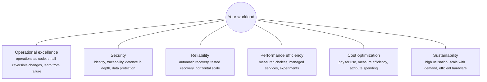
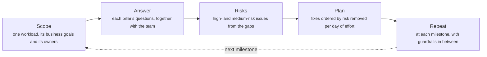
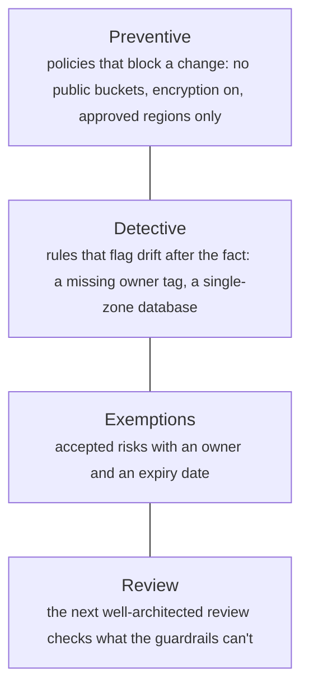

# Well-architected frameworks: the pillars, reviews and trade-offs

> System Design · L4 Expert · Decisions and frameworks · about 115 min · hub module `m02` ([open the hub](https://claude.ai/artifact/C3GSn1y8nTQ24VT25d5S3X))

## Why it matters
The cloud providers' well-architected frameworks distil thousands of architecture reviews into a set of pillars and questions: six pillars for AWS, five for Azure. Their real value isn't the checklist but the habit it builds: review every important workload against every pillar, find the high-risk issues, fix them in a sensible order, and trade the pillars off on purpose (reliability against cost, security against speed) with numbers the business agrees with.

## Pre-question (answer before reading)
**Q:** An online shop runs in one availability zone and loses about $300 for every minute it's down. A colleague proposes going straight to two regions, active-active, 'to be safe'. How would you decide?

<details><summary>Answer</summary>

Put a price on both sides. Expected downtime per month times $300 is the cost of unavailability; the extra infrastructure is the cost of reliability. For a shop at that loss rate, three zones in one region usually cut downtime from hours to tens of minutes for less than twice the cost, while two active-active regions cost far more and save only a few more minutes. Reliability is a business decision with a price, not a default to maximise.

</details>

## 🍎 Story time (kid version)
**Pizza Town and the family road trip: The mechanic's checklist**

Luigi's mechanic friend checks the family car before every long trip with the same six-part list: will it get there, is it locked and safe, what will fuel and tolls cost, does everyone know who drives when and what to do in a breakdown, will it climb the hills fully loaded, and how much fuel does it waste idling. The list doesn't fix anything itself; it finds the worst problems first. A bigger engine helps on the hills but burns more fuel, so they choose deliberately. And they check again before every trip, not just once.

| In the story | In a real organisation |
|---|---|
| The same six-part list before every trip | A well-architected review: the same pillar questions for every workload |
| Finding the worst problems first | High-risk issues, then an improvement plan in priority order |
| A bigger engine helps on hills but burns fuel | Pillar trade-offs, such as reliability against cost, made deliberately |
| Checking again before every trip | Reviews repeated at milestones, with automated guardrails in between |

**Where the story breaks:** The mechanic's list is the same for every car. Real reviews add lenses for the kind of workload (serverless, SaaS, machine learning), and need the business's numbers: a checklist can't tell you what a minute of downtime costs.

## Key ideas (grown-up version)
- **The frameworks**: the AWS Well-Architected Framework has six pillars: operational excellence, security, reliability, performance efficiency, cost optimization and sustainability. Microsoft's Azure Well-Architected Framework has five: reliability, security, cost optimization, operational excellence and performance efficiency, with sustainability covered in separate guidance. Both are distilled from many customer reviews and come with review tools.
- **The review**: the team answers each pillar's questions for one workload; answers that miss best practices become high- or medium-risk issues (HRIs and MRIs); the output is an improvement plan, and the review is repeated at milestones. AWS's Well-Architected Tool records answers, risks and milestones. It's a conversation that surfaces risk, not an audit to pass.
- **Reliability**: AWS's design principles are to recover from failure automatically, test recovery procedures, scale horizontally to raise aggregate availability, stop guessing capacity, and manage change through automation. Set the availability target from what downtime costs the business, not by default.
- **Security and operational excellence**: a strong identity foundation with least privilege, traceability, security at every layer, data protected in transit and at rest, and preparation for incidents. Operations as code, small frequent reversible changes, anticipating failure with game days, and learning from every incident.
- **Performance, cost and sustainability**: choose resource types and sizes from measurements and prefer managed services; pay for what you use, measure efficiency, and attribute every cost with tags; maximise utilisation, scale with demand and remove idle resources, which serves both the bill and the carbon footprint.
- **Trade-offs between pillars**: more replicas raise reliability and cost; encryption and inspection cost some performance; shipping faster can raise operational risk. Azure publishes a trade-offs page for each pillar. The architect's job is to choose with the business, using numbers such as the cost of a minute of downtime.
- **Lenses**: in the AWS Well-Architected Tool a lens is a set of questions and best practices for a kind of workload or industry, such as serverless, SaaS or machine learning. Use the general framework plus the lenses that fit.
- **From review to guardrails**: findings become a backlog ordered by risk removed per day of effort, and checks that must always hold become automated guardrails: policies that block or flag violations such as unencrypted storage, public buckets or missing owner tags, with time-limited exemptions for risks the business has accepted.

## Diagrams
**The six pillars of the AWS Well-Architected Framework**



**A well-architected review**



_The review's output is an improvement plan with owners and dates; a review that only produces a score has failed._

**Turning findings into guardrails**



_Automate the checks that must always hold, so humans can spend reviews on judgment._

## Comparisons
**AWS and Azure well-architected frameworks**

|  | AWS Well-Architected | Azure Well-Architected |
|---|---|---|
| Pillars | Six: operational excellence, security, reliability, performance efficiency, cost optimization, sustainability | Five: reliability, security, cost optimization, operational excellence, performance efficiency |
| Sustainability | A pillar since 2021 | Separate guidance, not a pillar |
| Review tooling | The Well-Architected Tool, with lenses, risks and milestones | The Well-Architected assessment, plus Azure Advisor recommendations |
| Trade-offs | Discussed within each pillar | A published trade-offs page for each pillar |

**Reliability against cost: how much availability to buy**

| Design | Typical availability | Downtime a month | Relative cost |
|---|---|---|---|
| One zone | 99.5% | about 3.6 hours | 1× |
| Three zones in a region | 99.95% | about 22 minutes | about 1.8× |
| Two regions, active-passive | 99.99% | about 4 minutes | about 2.6× |
| Two regions, active-active | 99.995% | about 2 minutes | about 3.5× |

## Code (JavaScript + Python)
### The seeded random generator used by the fleet simulation
```python
def mulberry32(seed):
    state = seed & 0xFFFFFFFF
    def rand():
        nonlocal state
        state = (state + 0x6D2B79F5) & 0xFFFFFFFF
        t = ((state ^ (state >> 15)) * (state | 1)) & 0xFFFFFFFF
        t = (t ^ (t + (((t ^ (t >> 7)) * (t | 61)) & 0xFFFFFFFF))) & 0xFFFFFFFF
        return ((t ^ (t >> 14)) & 0xFFFFFFFF) / 4294967296
    return rand
```

```javascript
function mulberry32(seed) {
  return function () {
    seed = (seed + 0x6D2B79F5) | 0;
    let t = Math.imul(seed ^ (seed >>> 15), 1 | seed);
    t = (t + Math.imul(t ^ (t >>> 7), 61 | t)) ^ t;
    return ((t ^ (t >>> 14)) >>> 0) / 4294967296;
  };
}
```

### A review as data: risks per pillar
```python
REVIEW = [                                             # (pillar, question, best practices, the ones the team has)
    ("reliability", "How do you back up data?", ["automated backups", "tested restores", "cross-region copies"], ["automated backups"]),
    ("reliability", "How do you withstand component failures?", ["multiple zones", "health checks", "automatic recovery"], ["multiple zones", "health checks"]),
    ("security", "How do you manage identities?", ["single sign-on", "no long-lived keys", "least privilege"], ["single sign-on", "no long-lived keys", "least privilege"]),
    ("security", "How do you protect data at rest?", ["encryption", "key rotation"], []),
    ("cost optimization", "How do you watch spending?", ["cost allocation tags", "budgets and alerts"], ["budgets and alerts"]),
    ("operational excellence", "How do you deploy changes?", ["infrastructure as code", "small reversible changes", "automatic rollback"], ["infrastructure as code"]),
    ("performance efficiency", "How do you choose compute?", ["load-tested sizes", "right-sizing reviews"], ["load-tested sizes", "right-sizing reviews"]),
    ("sustainability", "How do you match resources to demand?", ["scale to zero when idle", "managed services"], ["managed services"]),
]

def risk(practices, present):
    missing = [p for p in practices if p not in present]
    if len(missing) * 2 >= len(practices):
        return "high", missing                         # half or more of the best practices are missing
    return ("medium" if missing else "none"), missing

summary = {}
for pillar, question, practices, present in REVIEW:
    level, missing = risk(practices, present)
    summary.setdefault(pillar, {"high": 0, "medium": 0, "none": 0})[level] += 1
    if level == "high":
        print(f"high risk ({pillar}): {question} missing {', '.join(missing)}")
for pillar, counts in summary.items():
    print(f"{pillar}: {counts['high']} high, {counts['medium']} medium, {counts['none']} without risk")
```

Output:
```text
high risk (reliability): How do you back up data? missing tested restores, cross-region copies
high risk (security): How do you protect data at rest? missing encryption, key rotation
high risk (cost optimization): How do you watch spending? missing cost allocation tags
high risk (operational excellence): How do you deploy changes? missing small reversible changes, automatic rollback
high risk (sustainability): How do you match resources to demand? missing scale to zero when idle
reliability: 1 high, 1 medium, 0 without risk
security: 1 high, 0 medium, 1 without risk
cost optimization: 1 high, 0 medium, 0 without risk
operational excellence: 1 high, 0 medium, 0 without risk
performance efficiency: 0 high, 0 medium, 1 without risk
sustainability: 1 high, 0 medium, 0 without risk
```

- line 1: Each row is one question: the pillar, the best practices it looks for, and what the team actually has.
- line 14: A toy rule: half or more of the practices missing makes a high risk. The real tool derives risks from the answers to each question.
- line 23: The summary shows where the risk concentrates; the improvement plan starts with the high-risk issues.

```javascript
const REVIEW = [                                       // [pillar, question, best practices, the ones the team has]
  ["reliability", "How do you back up data?", ["automated backups", "tested restores", "cross-region copies"], ["automated backups"]],
  ["reliability", "How do you withstand component failures?", ["multiple zones", "health checks", "automatic recovery"], ["multiple zones", "health checks"]],
  ["security", "How do you manage identities?", ["single sign-on", "no long-lived keys", "least privilege"], ["single sign-on", "no long-lived keys", "least privilege"]],
  ["security", "How do you protect data at rest?", ["encryption", "key rotation"], []],
  ["cost optimization", "How do you watch spending?", ["cost allocation tags", "budgets and alerts"], ["budgets and alerts"]],
  ["operational excellence", "How do you deploy changes?", ["infrastructure as code", "small reversible changes", "automatic rollback"], ["infrastructure as code"]],
  ["performance efficiency", "How do you choose compute?", ["load-tested sizes", "right-sizing reviews"], ["load-tested sizes", "right-sizing reviews"]],
  ["sustainability", "How do you match resources to demand?", ["scale to zero when idle", "managed services"], ["managed services"]],
];

function risk(practices, present) {
  const missing = practices.filter(p => !present.includes(p));
  if (missing.length * 2 >= practices.length) return ["high", missing];   // half or more of the best practices are missing
  return [missing.length ? "medium" : "none", missing];
}

const summary = new Map();
for (const [pillar, question, practices, present] of REVIEW) {
  const [level, missing] = risk(practices, present);
  if (!summary.has(pillar)) summary.set(pillar, { high: 0, medium: 0, none: 0 });
  summary.get(pillar)[level]++;
  if (level === "high") console.log(`high risk (${pillar}): ${question} missing ${missing.join(", ")}`);
}
for (const [pillar, counts] of summary) console.log(`${pillar}: ${counts.high} high, ${counts.medium} medium, ${counts.none} without risk`);
```

Output:
```text
high risk (reliability): How do you back up data? missing tested restores, cross-region copies
high risk (security): How do you protect data at rest? missing encryption, key rotation
high risk (cost optimization): How do you watch spending? missing cost allocation tags
high risk (operational excellence): How do you deploy changes? missing small reversible changes, automatic rollback
high risk (sustainability): How do you match resources to demand? missing scale to zero when idle
reliability: 1 high, 1 medium, 0 without risk
security: 1 high, 0 medium, 1 without risk
cost optimization: 1 high, 0 medium, 0 without risk
operational excellence: 1 high, 0 medium, 0 without risk
performance efficiency: 0 high, 0 medium, 1 without risk
sustainability: 1 high, 0 medium, 0 without risk
```

- line 1: Each row is one question: the pillar, the best practices it looks for, and what the team actually has.
- line 14: A toy rule: half or more of the practices missing makes a high risk. The real tool derives risks from the answers to each question.
- line 25: The summary shows where the risk concentrates; the improvement plan starts with the high-risk issues.

### How much reliability to buy: infrastructure plus the cost of downtime
```python
OPTIONS = [                                            # (design, availability in thousandths of a percent, monthly infrastructure $)
    ("one zone", 99_500, 10_000),
    ("three zones", 99_950, 18_000),
    ("two regions, active-passive", 99_990, 26_000),
    ("two regions, active-active", 99_995, 35_000),
]
MINUTES = 30 * 24 * 60                                 # in a 30-day month

def monthly(loss_per_minute):
    rows = []
    for design, a, infra in OPTIONS:
        lost = (100_000 - a) * MINUTES                 # expected minutes of downtime, times 100,000
        rows.append((design, (lost + 5_000) // 10_000, infra + (lost * loss_per_minute + 50_000) // 100_000))
    return rows                                        # (design, tenths of a minute down, total $ a month)

for business, loss in (("a shop losing $300 a minute when down", 300), ("a payment network losing $5,000 a minute", 5_000)):
    rows = monthly(loss)
    cheapest = min(rows, key=lambda r: r[2])[0]
    print(f"{business}:")
    for design, tenths, total in rows:
        mark = "  <- cheapest overall" if design == cheapest else ""
        print(f"  {design}: {tenths // 10}.{tenths % 10} min down, ${total:,} a month{mark}")
```

Output:
```text
a shop losing $300 a minute when down:
  one zone: 216.0 min down, $74,800 a month
  three zones: 21.6 min down, $24,480 a month  <- cheapest overall
  two regions, active-passive: 4.3 min down, $27,296 a month
  two regions, active-active: 2.2 min down, $35,648 a month
a payment network losing $5,000 a minute:
  one zone: 216.0 min down, $1,090,000 a month
  three zones: 21.6 min down, $126,000 a month
  two regions, active-passive: 4.3 min down, $47,600 a month
  two regions, active-active: 2.2 min down, $45,800 a month  <- cheapest overall
```

- line 1: Illustrative availabilities and costs: real numbers come from your provider's documentation and your own incident history.
- line 12: Expected downtime: the unavailable fraction of a month's 43,200 minutes, in integers to keep the arithmetic exact.
- line 13: Total cost = infrastructure + downtime × what a minute of downtime costs.
- line 22: The shop's cheapest option is three zones; the payment network's is two active regions. The right amount of reliability depends on the business.

```javascript
const OPTIONS = [                                      // [design, availability in thousandths of a percent, monthly infrastructure $]
  ["one zone", 99500, 10000],
  ["three zones", 99950, 18000],
  ["two regions, active-passive", 99990, 26000],
  ["two regions, active-active", 99995, 35000],
];
const MINUTES = 30 * 24 * 60;                          // in a 30-day month

function monthly(lossPerMinute) {
  return OPTIONS.map(([design, a, infra]) => {
    const lost = (100000 - a) * MINUTES;               // expected minutes of downtime, times 100,000
    return [design, Math.floor((lost + 5000) / 10000), infra + Math.floor((lost * lossPerMinute + 50000) / 100000)];
  });                                                  // [design, tenths of a minute down, total $ a month]
}

for (const [business, loss] of [["a shop losing $300 a minute when down", 300], ["a payment network losing $5,000 a minute", 5000]]) {
  const rows = monthly(loss);
  const cheapest = rows.reduce((a, b) => (b[2] < a[2] ? b : a))[0];
  console.log(`${business}:`);
  for (const [design, tenths, total] of rows) {
    const mark = design === cheapest ? "  <- cheapest overall" : "";
    console.log(`  ${design}: ${Math.floor(tenths / 10)}.${tenths % 10} min down, $${total.toLocaleString("en-US")} a month${mark}`);
  }
}
```

Output:
```text
a shop losing $300 a minute when down:
  one zone: 216.0 min down, $74,800 a month
  three zones: 21.6 min down, $24,480 a month  <- cheapest overall
  two regions, active-passive: 4.3 min down, $27,296 a month
  two regions, active-active: 2.2 min down, $35,648 a month
a payment network losing $5,000 a minute:
  one zone: 216.0 min down, $1,090,000 a month
  three zones: 21.6 min down, $126,000 a month
  two regions, active-passive: 4.3 min down, $47,600 a month
  two regions, active-active: 2.2 min down, $45,800 a month  <- cheapest overall
```

- line 1: Illustrative availabilities and costs: real numbers come from your provider's documentation and your own incident history.
- line 11: Expected downtime: the unavailable fraction of a month's 43,200 minutes, in integers to keep the arithmetic exact.
- line 12: Total cost = infrastructure + downtime × what a minute of downtime costs.
- line 22: The shop's cheapest option is three zones; the payment network's is two active regions. The right amount of reliability depends on the business.

### Right-sizing a fleet: cost and sustainability together
```python
rand = mulberry32(3)
SIZES = [("large", 8, 40), ("xlarge", 16, 80), ("2xlarge", 32, 160)]   # (name, vCPUs, cents an hour; illustrative prices)
fleet = []
for i in range(12):
    size = int(rand() * 3)
    typical = 5 + int(rand() * 60)                     # each server's usual CPU percentage
    samples = [max(1, min(100, typical + int((rand() - 0.5) * 30))) for _ in range(720)]   # a month, hourly
    fleet.append((f"web-{i:02d}", size, samples))
fleet.append(("db-01", 1, [70 + h % 24 for h in range(720)]))   # a database that runs hot every evening

def p95(values):
    ordered = sorted(values)
    return ordered[(len(ordered) * 95 + 99) // 100 - 1]   # nearest-rank 95th percentile

saved = added = saved_vcpu_hours = 0
for name, size, samples in fleet:
    busy = p95(samples)
    if busy < 40 and size > 0:
        new = size - 1                                 # half the vCPUs: about twice the CPU percentage, still below 80
    elif busy > 80 and size < len(SIZES) - 1:
        new = size + 1                                 # too hot at the peak: one size up
    else:
        continue
    change = (SIZES[size][2] - SIZES[new][2]) * 730
    saved, added = (saved + change, added) if change > 0 else (saved, added - change)
    saved_vcpu_hours += (SIZES[size][1] - SIZES[new][1]) * 730
    print(f"{name}: p95 CPU {busy}% on {SIZES[size][0]} -> {SIZES[new][0]}")
total_cents = sum(SIZES[size][2] * 730 for _, size, _ in fleet)
usd = lambda cents: f"${cents // 100:,}"
print(f"downsizing saves {usd(saved)} a month, upsizing costs {usd(added)}: net {usd(saved - added)} of {usd(total_cents)} "
      f"({(saved - added) * 100 // total_cents}%), and {saved_vcpu_hours:,} fewer vCPU-hours")
```

Output:
```text
web-00: p95 CPU 20% on 2xlarge -> xlarge
web-01: p95 CPU 18% on xlarge -> large
web-05: p95 CPU 20% on 2xlarge -> xlarge
web-06: p95 CPU 25% on 2xlarge -> xlarge
web-08: p95 CPU 21% on 2xlarge -> xlarge
db-01: p95 CPU 92% on xlarge -> 2xlarge
downsizing saves $2,628 a month, upsizing costs $584: net $2,044 of $9,928 (20%), and 40,880 fewer vCPU-hours
```

- line 9: A database that runs hot every evening: right-sizing goes both ways.
- line 13: The 95th percentile, not the average: a server must cope with its busy hours.
- line 18: Below 40% at the 95th percentile, half the vCPUs still leaves headroom below 80%.
- line 30: About a fifth of the bill and of the vCPU-hours go: idle capacity costs money and energy alike.

```javascript
const rand = mulberry32(3);
const SIZES = [["large", 8, 40], ["xlarge", 16, 80], ["2xlarge", 32, 160]];   // [name, vCPUs, cents an hour; illustrative prices]
const fleet = [];
for (let i = 0; i < 12; i++) {
  const size = Math.floor(rand() * 3);
  const typical = 5 + Math.floor(rand() * 60);          // each server's usual CPU percentage
  const samples = Array.from({ length: 720 }, () => Math.max(1, Math.min(100, typical + Math.trunc((rand() - 0.5) * 30))));   // a month, hourly
  fleet.push([`web-${String(i).padStart(2, "0")}`, size, samples]);
}
fleet.push(["db-01", 1, Array.from({ length: 720 }, (_, h) => 70 + (h % 24))]);   // a database that runs hot every evening

function p95(values) {
  const ordered = [...values].sort((a, b) => a - b);
  return ordered[Math.floor((ordered.length * 95 + 99) / 100) - 1];   // nearest-rank 95th percentile
}

let saved = 0, added = 0, savedVcpuHours = 0;
for (const [name, size, samples] of fleet) {
  const busy = p95(samples);
  let next;
  if (busy < 40 && size > 0) next = size - 1;          // half the vCPUs: about twice the CPU percentage, still below 80
  else if (busy > 80 && size < SIZES.length - 1) next = size + 1;   // too hot at the peak: one size up
  else continue;
  const change = (SIZES[size][2] - SIZES[next][2]) * 730;
  if (change > 0) saved += change; else added -= change;
  savedVcpuHours += (SIZES[size][1] - SIZES[next][1]) * 730;
  console.log(`${name}: p95 CPU ${busy}% on ${SIZES[size][0]} -> ${SIZES[next][0]}`);
}
const totalCents = fleet.reduce((sum, [, size]) => sum + SIZES[size][2] * 730, 0);
const usd = cents => `$${Math.floor(cents / 100).toLocaleString("en-US")}`;
console.log(`downsizing saves ${usd(saved)} a month, upsizing costs ${usd(added)}: net ${usd(saved - added)} of ${usd(totalCents)} ` +
            `(${Math.floor((saved - added) * 100 / totalCents)}%), and ${savedVcpuHours.toLocaleString("en-US")} fewer vCPU-hours`);
```

Output:
```text
web-00: p95 CPU 20% on 2xlarge -> xlarge
web-01: p95 CPU 18% on xlarge -> large
web-05: p95 CPU 20% on 2xlarge -> xlarge
web-06: p95 CPU 25% on 2xlarge -> xlarge
web-08: p95 CPU 21% on 2xlarge -> xlarge
db-01: p95 CPU 92% on xlarge -> 2xlarge
downsizing saves $2,628 a month, upsizing costs $584: net $2,044 of $9,928 (20%), and 40,880 fewer vCPU-hours
```

- line 10: A database that runs hot every evening: right-sizing goes both ways.
- line 14: The 95th percentile, not the average: a server must cope with its busy hours.
- line 21: Below 40% at the 95th percentile, half the vCPUs still leaves headroom below 80%.
- line 31: About a fifth of the bill and of the vCPU-hours go: idle capacity costs money and energy alike.

## Worked example
**Problem.** A review found eight issues across five pillars, each with a likelihood and an impact from 1 to 5, an effort in days, and some prerequisites (key rotation needs encryption first). With one engineer working through them in order, compare two plans: the scariest issue first, and the most risk removed per day of effort first. Measure the exposure (each issue's risk × the day it's fixed) and when the high risks are gone.

1. Score each issue: risk = likelihood × impact. Anything at 15 or more counts as a high risk.
2. At each step only issues whose prerequisites are fixed are ready. One plan takes the highest risk; the other takes the highest risk per day of effort (weighted shortest job first).
3. Exposure adds up risk × the day each issue is closed: the area under the open-risk curve. Lower is better.
4. Compare both measures: total exposure, and the day the last high risk closes. They can disagree, and that disagreement is a decision for the risk owner.

```python
FINDINGS = [                                           # (id, what to fix, pillar, likelihood 1-5, impact 1-5, days, depends on)
    ("F1", "encrypt data at rest", "security", 4, 5, 3, []),
    ("F2", "test restores monthly", "reliability", 3, 5, 5, []),
    ("F3", "copy backups to a second region", "reliability", 2, 5, 8, ["F2"]),
    ("F4", "automatic rollback on failed deploys", "operational excellence", 4, 3, 4, []),
    ("F5", "cost allocation tags", "cost optimization", 5, 2, 2, []),
    ("F6", "canary releases", "operational excellence", 3, 4, 6, ["F4"]),
    ("F7", "rotate encryption keys", "security", 3, 4, 2, ["F1"]),
    ("F8", "scale idle environments to zero", "sustainability", 2, 2, 3, []),
]

def plan(findings, key):
    done, order, day = set(), [], 0
    pending = list(findings)
    while pending:
        ready = [f for f in pending if all(d in done for d in f[6])]   # only findings whose prerequisites are fixed
        f = max(ready, key=key)
        pending.remove(f)
        day += f[5]
        done.add(f[0])
        order.append((f, day))
    return order

risk = lambda f: f[3] * f[4]                           # likelihood × impact
by_value_per_day = lambda f: (risk(f) * 1000 // f[5], -int(f[0][1:]))   # risk removed per day of work
by_risk = lambda f: (risk(f), -int(f[0][1:]))          # the scariest first, whatever it costs
exposure = lambda order: sum(risk(f) * day for f, day in order)   # risk × days it stays open: lower is better

order = plan(FINDINGS, by_value_per_day)
for f, day in order:
    print(f"day {day:>2}: {f[0]} {f[1]} ({f[2]}, risk {risk(f)}, {f[5]} days)")
for label, key in (("value per day first", by_value_per_day), ("scariest first", by_risk)):
    o = plan(FINDINGS, key)
    high = max(day for f, day in o if risk(f) >= 15)
    print(f"{label}: high risks (15 or more) all fixed by day {high}, exposure {exposure(o)} risk-days")
```

Output:
```text
day  3: F1 encrypt data at rest (security, risk 20, 3 days)
day  5: F7 rotate encryption keys (security, risk 12, 2 days)
day  7: F5 cost allocation tags (cost optimization, risk 10, 2 days)
day 12: F2 test restores monthly (reliability, risk 15, 5 days)
day 16: F4 automatic rollback on failed deploys (operational excellence, risk 12, 4 days)
day 22: F6 canary releases (operational excellence, risk 12, 6 days)
day 25: F8 scale idle environments to zero (sustainability, risk 4, 3 days)
day 33: F3 copy backups to a second region (reliability, risk 10, 8 days)
value per day first: high risks (15 or more) all fixed by day 12, exposure 1256 risk-days
scariest first: high risks (15 or more) all fixed by day 8, exposure 1492 risk-days
```

```javascript
const FINDINGS = [                                     // [id, what to fix, pillar, likelihood 1-5, impact 1-5, days, depends on]
  ["F1", "encrypt data at rest", "security", 4, 5, 3, []],
  ["F2", "test restores monthly", "reliability", 3, 5, 5, []],
  ["F3", "copy backups to a second region", "reliability", 2, 5, 8, ["F2"]],
  ["F4", "automatic rollback on failed deploys", "operational excellence", 4, 3, 4, []],
  ["F5", "cost allocation tags", "cost optimization", 5, 2, 2, []],
  ["F6", "canary releases", "operational excellence", 3, 4, 6, ["F4"]],
  ["F7", "rotate encryption keys", "security", 3, 4, 2, ["F1"]],
  ["F8", "scale idle environments to zero", "sustainability", 2, 2, 3, []],
];

function plan(findings, key) {
  const done = new Set(), order = [];
  let day = 0, pending = [...findings];
  while (pending.length) {
    const ready = pending.filter(f => f[6].every(d => done.has(d)));   // only findings whose prerequisites are fixed
    const f = ready.reduce((a, b) => {
      const [ka, kb] = [key(a), key(b)];
      return kb[0] > ka[0] || (kb[0] === ka[0] && kb[1] > ka[1]) ? b : a;
    });
    pending = pending.filter(x => x !== f);
    day += f[5];
    done.add(f[0]);
    order.push([f, day]);
  }
  return order;
}

const risk = f => f[3] * f[4];                         // likelihood × impact
const byValuePerDay = f => [Math.floor(risk(f) * 1000 / f[5]), -Number(f[0].slice(1))];   // risk removed per day of work
const byRisk = f => [risk(f), -Number(f[0].slice(1))];   // the scariest first, whatever it costs
const exposure = order => order.reduce((sum, [f, day]) => sum + risk(f) * day, 0);   // risk × days it stays open: lower is better

for (const [f, day] of plan(FINDINGS, byValuePerDay)) {
  console.log(`day ${String(day).padStart(2)}: ${f[0]} ${f[1]} (${f[2]}, risk ${risk(f)}, ${f[5]} days)`);
}
for (const [label, key] of [["value per day first", byValuePerDay], ["scariest first", byRisk]]) {
  const o = plan(FINDINGS, key);
  const high = Math.max(...o.filter(([f]) => risk(f) >= 15).map(([, day]) => day));
  console.log(`${label}: high risks (15 or more) all fixed by day ${high}, exposure ${exposure(o)} risk-days`);
}
```

Output:
```text
day  3: F1 encrypt data at rest (security, risk 20, 3 days)
day  5: F7 rotate encryption keys (security, risk 12, 2 days)
day  7: F5 cost allocation tags (cost optimization, risk 10, 2 days)
day 12: F2 test restores monthly (reliability, risk 15, 5 days)
day 16: F4 automatic rollback on failed deploys (operational excellence, risk 12, 4 days)
day 22: F6 canary releases (operational excellence, risk 12, 6 days)
day 25: F8 scale idle environments to zero (sustainability, risk 4, 3 days)
day 33: F3 copy backups to a second region (reliability, risk 10, 8 days)
value per day first: high risks (15 or more) all fixed by day 12, exposure 1256 risk-days
scariest first: high risks (15 or more) all fixed by day 8, exposure 1492 risk-days
```

**Answer.** Ordering by risk removed per day cuts the total exposure from 1,492 to 1,256 risk-days, because cheap fixes such as key rotation and cost tags go early and stop accumulating risk. But it closes the last high risk on day 12 instead of day 8: taking the scariest first gets the restore tests done sooner. Neither plan is simply right. A common policy is to fix high risks with severe impact first, then order the rest by risk per day, and to record that policy, and any accepted risks, in the review's improvement plan.

## Your turn (faded example)
**Problem.** Finish `violations(resources, rules, today)`: check every resource against every guardrail rule and return the failures, sorted, as (pillar, resource id, rule). A failure doesn't count if the resource has an exemption for that rule that hasn't expired.

- ✓ Loop over resources and rules; a rule's check returns true when the resource complies.
- **When should an exemption hide a failure?**
  <details><summary>Answer</summary>Only when one exists for that exact rule and its expiry date is today or later. An expired exemption is an accepted risk nobody re-accepted, so the failure must come back.</details>
- **Why give exemptions an expiry date at all?**
  <details><summary>Answer</summary>Accepted risks get forgotten. An expiry forces someone to look again: fix it, or consciously accept it for another period, with an owner.</details>
- **What does it cost?**
  <details><summary>Answer</summary>O(resources × rules) checks, plus sorting the failures. Cloud policy engines run the same loop continuously, or block a change before it's made.</details>

Starter:
```python
RULES = [                                              # (rule, pillar, check that must pass)
    ("encrypted", "security", lambda r: r.get("encrypted", False)),
    ("not-public", "security", lambda r: not r.get("public", False)),
    ("owner-tag", "cost optimization", lambda r: "owner" in r.get("tags", {})),
    ("multi-zone", "reliability", lambda r: r["type"] != "database" or r.get("zones", 1) >= 2),
]

def violations(resources, rules, today):
    found = []
    ...                                                # TODO: each failed rule, unless an unexpired exemption covers it
    return sorted(found)
```

```javascript
const RULES = [                                        // [rule, pillar, check that must pass]
  ["encrypted", "security", r => r.encrypted ?? false],
  ["not-public", "security", r => !(r.public ?? false)],
  ["owner-tag", "cost optimization", r => "owner" in (r.tags ?? {})],
  ["multi-zone", "reliability", r => r.type !== "database" || (r.zones ?? 1) >= 2],
];

function violations(resources, rules, today) {
  const found = [];
  // TODO: each failed rule, unless an unexpired exemption covers it
  return found.sort((a, b) => (a.join("\u0000") < b.join("\u0000") ? -1 : 1));
}
```

<details><summary>Full solution</summary>

```python
RULES = [                                              # (rule, pillar, check that must pass)
    ("encrypted", "security", lambda r: r.get("encrypted", False)),
    ("not-public", "security", lambda r: not r.get("public", False)),
    ("owner-tag", "cost optimization", lambda r: "owner" in r.get("tags", {})),
    ("multi-zone", "reliability", lambda r: r["type"] != "database" or r.get("zones", 1) >= 2),
]

def violations(resources, rules, today):
    found = []
    for r in resources:
        for rule, pillar, check in rules:
            if check(r):
                continue
            until = r.get("exemptions", {}).get(rule)  # an approved exception, valid until an ISO date
            if until is not None and until >= today:
                continue
            found.append((pillar, r["id"], rule))
    return sorted(found)

resources = [
    {"id": "orders-db", "type": "database", "encrypted": True, "zones": 3, "tags": {"owner": "orders"}},
    {"id": "reports-db", "type": "database", "encrypted": True, "zones": 1, "tags": {"owner": "data"},
     "exemptions": {"multi-zone": "2026-12-31"}},     # a reporting copy: an accepted risk, until the year's end
    {"id": "legacy-db", "type": "database", "encrypted": False, "zones": 1, "tags": {},
     "exemptions": {"encrypted": "2026-06-30"}},       # this exemption has expired
    {"id": "assets-bucket", "type": "bucket", "encrypted": True, "public": True, "tags": {"owner": "web"}},
]
for pillar, rid, rule in violations(resources, RULES, today="2026-10-12"):
    print(f"{pillar}: {rid} fails {rule}")
```

Output:
```text
cost optimization: legacy-db fails owner-tag
reliability: legacy-db fails multi-zone
security: assets-bucket fails not-public
security: legacy-db fails encrypted
```

```javascript
const RULES = [                                        // [rule, pillar, check that must pass]
  ["encrypted", "security", r => r.encrypted ?? false],
  ["not-public", "security", r => !(r.public ?? false)],
  ["owner-tag", "cost optimization", r => "owner" in (r.tags ?? {})],
  ["multi-zone", "reliability", r => r.type !== "database" || (r.zones ?? 1) >= 2],
];

function violations(resources, rules, today) {
  const found = [];
  for (const r of resources) {
    for (const [rule, pillar, check] of rules) {
      if (check(r)) continue;
      const until = (r.exemptions ?? {})[rule];      // an approved exception, valid until an ISO date
      if (until !== undefined && until >= today) continue;
      found.push([pillar, r.id, rule]);
    }
  }
  return found.sort((a, b) => (a.join("\u0000") < b.join("\u0000") ? -1 : 1));
}

const resources = [
  { id: "orders-db", type: "database", encrypted: true, zones: 3, tags: { owner: "orders" } },
  { id: "reports-db", type: "database", encrypted: true, zones: 1, tags: { owner: "data" },
    exemptions: { "multi-zone": "2026-12-31" } },      // a reporting copy: an accepted risk, until the year's end
  { id: "legacy-db", type: "database", encrypted: false, zones: 1, tags: {},
    exemptions: { encrypted: "2026-06-30" } },         // this exemption has expired
  { id: "assets-bucket", type: "bucket", encrypted: true, public: true, tags: { owner: "web" } },
];
for (const [pillar, rid, rule] of violations(resources, RULES, "2026-10-12")) console.log(`${pillar}: ${rid} fails ${rule}`);
```

Output:
```text
cost optimization: legacy-db fails owner-tag
reliability: legacy-db fails multi-zone
security: assets-bucket fails not-public
security: legacy-db fails encrypted
```

</details>

## Socratic checks and quiz (answers hidden)
**1. What does this print?**

```python
print((1000 - 999) * 30 * 24 * 60 / 1000)
```

```javascript
console.log((1000 - 999) * 30 * 24 * 60 / 1000);
```

- A. 43.2
- B. 4.32
- C. 432
- D. 8.76

<details><summary>Answer</summary>

43.2. 0.1% of 43,200 minutes is 43.2 minutes. Each extra nine divides it by ten: 4.3 minutes at 99.99%.

</details>

**2. What does this print?**

```python
loss = 300                                   # dollars per minute of downtime
designs = {"one zone": (216, 10_000), "three zones": (22, 18_000)}   # (minutes down, infrastructure $)
print(*(f"{name} {infra + down * loss}" for name, (down, infra) in designs.items()))
```

```javascript
const loss = 300;                            // dollars per minute of downtime
const designs = { "one zone": [216, 10000], "three zones": [22, 18000] };   // [minutes down, infrastructure $]
console.log(...Object.entries(designs).map(([name, [down, infra]]) => `${name} ${infra + down * loss}`));
```

- A. one zone 74800 three zones 24600
- B. one zone 10000 three zones 18000
- C. one zone 64800 three zones 6600
- D. one zone 74800 three zones 18000

<details><summary>Answer</summary>

one zone 74800 three zones 24600. One zone: 10,000 + 216 × 300 = 74,800. Three zones: 18,000 + 22 × 300 = 24,600. The cheaper infrastructure is the more expensive choice.

</details>

**3. Which pillar is in the AWS Well-Architected Framework but not in Azure's list of pillars?**

- A. Sustainability
- B. Reliability
- C. Operational excellence
- D. Cost optimization

<details><summary>Answer</summary>

Sustainability. AWS added sustainability as a sixth pillar in 2021. Azure's framework has five pillars and covers sustainability in separate guidance.

</details>

**4. A review finds that backups exist but restores have never been tested. Which pillar does this high-risk issue belong to, and what's the first fix?**

- A. Reliability: schedule and automate regular test restores, and measure how long they take
- B. Security: encrypt the backups
- C. Cost optimization: delete old backups
- D. Performance efficiency: use faster disks

<details><summary>Answer</summary>

Reliability: schedule and automate regular test restores, and measure how long they take. 'Test recovery procedures' is a reliability design principle: an untested backup is a hope, not a recovery plan, and the restore time sets the real RTO.

</details>

**5. Which are AWS reliability design principles? (choose 3)**

- A. Automatically recover from failure
- B. Test recovery procedures
- C. Stop guessing capacity
- D. Prefer one large server to several small ones
- E. Apply changes by hand for more control

<details><summary>Answer</summary>

Automatically recover from failure, Test recovery procedures, Stop guessing capacity. The other two run against the framework: it recommends scaling horizontally and managing change through automation.

</details>

**6. Judge each statement.**

- A well-architected review is a pass-or-fail audit.
- More replicas usually improve reliability and increase cost.
- Right-sizing should look at a high percentile of utilisation, not the average.
- Azure's framework publishes trade-offs between its pillars.

<details><summary>Answer</summary>

A well-architected review is a pass-or-fail audit.: No; More replicas usually improve reliability and increase cost.: Yes; Right-sizing should look at a high percentile of utilisation, not the average.: Yes; Azure's framework publishes trade-offs between its pillars.: Yes. The review produces risks and a plan rather than a grade. Reliability and cost pull against each other, and Azure documents such trade-offs for each pillar. Busy hours, not averages, decide sizes.

</details>

**7. Put a well-architected review in order.**

- (put the steps in order)

<details><summary>Answer</summary>

Choose the workload, its business goals and the people who know it → Answer each pillar's questions together → Record the high- and medium-risk issues → Prioritise them into an improvement plan with owners and dates → Repeat the review at the next milestone. The plan, not the score, is the deliverable, and repeating the review shows whether the risks actually went down.

</details>

**8. Complete the Python function behind the toy review's risk levels.**

```
def risk_level(practices, present):
    missing = len([p for p in practices if p not in present])
    if missing * 2 >= {{0}}:
        return "high"                          # half or more of the best practices are missing
    return "medium" if missing > {{1}} else "none"

```

<details><summary>Answer</summary>

len(practices) | 0. Half or more missing is a high risk, any missing practice at all is a medium risk, and none missing means no risk, for this toy rule.

</details>

## Traps & misconceptions
- **“We passed the well-architected review.”** There's nothing to pass. The review's output is a list of risks and a plan to reduce them; a workload with no open risks usually means the questions weren't answered honestly.
- **“Maximise every pillar.”** The pillars pull against each other: more reliability and performance cost money and energy. Agree targets per workload, such as an availability goal priced from the cost of downtime, and stop there.
- **“Do the review once, at launch.”** Workloads drift: new features, new dependencies, new traffic. Review at milestones and after major incidents, and automate the checks that must always hold.
- **“Size servers by their average CPU.”** Averages hide the busy hours. Size from a high percentile, keep headroom for spikes and failover, and right-size in both directions.
- **“Sustainability is a separate project.”** Most of it is the same work as cost optimisation: higher utilisation, scaling with demand, removing idle resources and efficient hardware. Track it with the same data.
- **“A permanent exemption is fine for that one database.”** Accepted risks need an owner and an expiry date; otherwise they become invisible. Re-accept them consciously, or fix them.

## Discussion prompts
- **Your organisation runs 300 workloads. How would you roll out well-architected reviews without creating a bottleneck?**
  <details><summary>One good answer</summary>Rank workloads by business criticality and review the top tier first, with each team answering its own questions and an experienced facilitator in the room. Turn the most common findings into shared guardrails and platform defaults (encryption on, tagging enforced, multi-zone templates) so whole classes of risk disappear without reviews. Track open high-risk issues per team as a metric, and re-review at milestones rather than on a fixed calendar.</details>
- **The CFO asks you to cut the cloud bill by 20% without hurting reliability. Where do you start?**
  <details><summary>One good answer</summary>Measure first: attribute every cost to a team and workload with tags, then go after the big items: idle and oversized resources (right-sizing from p95 utilisation), environments running nights and weekends, storage that should move to cheaper tiers, and commitment discounts for steady load. Leave the reliability architecture alone unless the review shows over-provisioning against the agreed targets. Report savings per workload, and set budgets with alerts so the cuts stick.</details>

## Teach-back
**Prompt:** Explain to a junior colleague what a well-architected review is and how you'd act on its results.

Rubric:
- [ ] The pillars (AWS six, Azure five) and what each one covers
- [ ] The review: questions per pillar, high- and medium-risk issues, an improvement plan, milestones
- [ ] Trade-offs between pillars, decided with the business and with numbers
- [ ] Prioritising fixes by risk and effort
- [ ] Guardrails and exemptions with expiry dates

<details><summary>Model answer</summary>

A well-architected review takes one workload and walks its team through a structured set of questions for each pillar: operational excellence, security, reliability, performance efficiency, cost optimization and, on AWS, sustainability. Where the answers miss best practices, the review records high- and medium-risk issues. The output is an improvement plan: I'd score each issue by likelihood and impact, order the fixes by risk removed per day of effort while fixing any severe high risk first, and assign owners and dates. The pillars trade off against each other, so targets come from the business, such as pricing a minute of downtime to choose how much reliability to buy. Checks that must always hold become automated guardrails, with time-limited exemptions for accepted risks, and the review is repeated at milestones.

</details>

## Quick Q&A (also in the SRS deck)
- **Name AWS's six well-architected pillars.** Operational excellence, security, reliability, performance efficiency, cost optimization and sustainability.
- **Which pillar does Azure's framework not have?** Sustainability, which Azure covers in separate guidance.
- **What is an HRI?** A high-risk issue: a gap the review found that could significantly hurt the business.
- **What is a lens in the Well-Architected Tool?** A set of questions and best practices for a particular kind of workload or industry.
- **How do you decide how much reliability to buy?** Compare the infrastructure cost of each design with the expected cost of its downtime.
- **Why should exemptions expire?** So accepted risks are looked at again instead of being forgotten.

## Practice problems
- [ ] [Reference · AWS Well-Architected Framework: the pillars](https://docs.aws.amazon.com/wellarchitected/latest/framework/the-pillars-of-the-framework.html) · answer the reliability pillar's questions for a system you know, and list its high-risk issues
- [ ] [Reference · Azure Well-Architected Framework: the pillars](https://learn.microsoft.com/en-us/azure/well-architected/pillars) · compare Azure's five pillars with AWS's six, and say where sustainability went
- [ ] [Reading · Azure: Reliability trade-offs](https://learn.microsoft.com/en-us/azure/well-architected/reliability/tradeoffs) · pick two trade-offs from the page and find an example of each in your own systems
- [ ] [Reference · AWS Well-Architected Tool: lenses](https://docs.aws.amazon.com/wellarchitected/latest/userguide/lenses.html) · choose the lens that best fits your main workload, and list three questions it adds

## Sources (accessed 2026-10-12)
- [AWS Well-Architected Framework: The pillars of the framework](https://docs.aws.amazon.com/wellarchitected/latest/framework/the-pillars-of-the-framework.html)
- [AWS Reliability Pillar: Design principles](https://docs.aws.amazon.com/wellarchitected/latest/reliability-pillar/design-principles.html)
- [AWS Well-Architected Tool user guide: workloads, high and medium risks](https://docs.aws.amazon.com/wellarchitected/latest/userguide/workloads.html)
- [AWS Well-Architected Tool user guide: lenses](https://docs.aws.amazon.com/wellarchitected/latest/userguide/lenses.html)
- [Microsoft Azure Well-Architected Framework: pillars](https://learn.microsoft.com/en-us/azure/well-architected/pillars)
- [Microsoft Azure Well-Architected Framework: Reliability trade-offs](https://learn.microsoft.com/en-us/azure/well-architected/reliability/tradeoffs)
