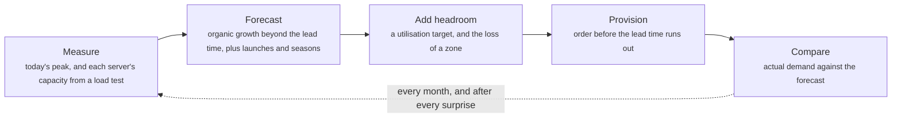
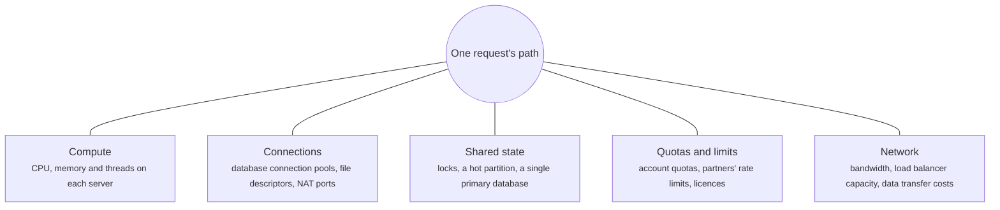
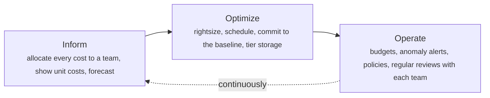

# Capacity and cost: planning, queueing, load testing and FinOps

> System Design · L4 Expert · Capacity, cost and evolution · about 125 min · hub module `m03` ([open the hub](https://claude.ai/artifact/C3GSn1y8nTQ24VT25d5S3X))

## Why it matters
Systems rarely fail because nobody could build them. They fail on the busiest day of the year, or they succeed and the bill grows faster than the business. Capacity planning forecasts demand further ahead than it takes to get capacity; queueing theory explains why latency explodes as servers approach full utilisation; load tests turn servers into service capacity; and FinOps puts the cost of every decision in front of the engineers who make it.

## Pre-question (answer before reading)
**Q:** Your API's peak is 6,000 requests a second on 30 servers spread over three zones. Traffic grows 4% a month, December runs 50% above a normal month, and a load test showed one server meets the latency target up to 450 requests a second. It's October. Are you ready for December?

<details><summary>Answer</summary>

December's peak is about 6,000 × 1.04² × 1.5 ≈ 9,730 requests a second, which needs 22 servers. But to survive losing a zone, the other two zones must carry the whole peak: 11 servers in each zone, 33 in total. You're three short, and if capacity takes two months to arrive (a quota, hardware or a commitment), the order has to go in now. Check the database and the other shared parts too: the servers may not be the first thing to run out.

</details>

## 🍎 Story time (kid version)
**Pizza Town and the family road trip: Friday night at the pizza oven**

Luigi's oven bakes a pizza every five minutes. On quiet nights it's busy half the time and nobody waits long; on Fridays it's busy nine minutes in ten and the line goes out of the door, far longer than the extra customers explain. A second oven helps most when both share one line. Before the festival, Luigi counts last year's crowd, adds this year's growth, and orders another oven two months ahead, because ovens take time to arrive. He holds a practice night where friends arrive every few minutes, ready or not. And the family buys a monthly gas plan for the gas they always use, paying full price only on festival nights.

| In the story | In a real organisation |
|---|---|
| An oven busy nine minutes in ten, and a line out of the door | Queueing: waiting time grows like 1 ÷ (1 − utilisation) |
| Two ovens sharing one line | Pooling: one queue feeding several servers waits less than separate queues |
| Last year's festival plus growth, ordered two months ahead | Demand forecasting: organic growth, seasonal peaks and the lead time |
| Friends arriving on time, ready or not | An open-model load test: a fixed arrival rate, like real users |
| A gas plan for the usual, full price for festival nights | Commitments for the steady baseline, on-demand for the peaks |

**Where the story breaks:** In the story an oven is just an oven. In real systems the first thing to run out is often not the obvious one: a database's connections, a lock, an account quota or a partner's rate limit. Only a load test of the whole path finds it.

## Key ideas (grown-up version)
- **Capacity planning**: Google's SRE book names three mandatory steps: an organic demand forecast that reaches beyond the lead time for getting capacity, the inorganic demand from launches, campaigns and seasons, and regular load tests that turn raw capacity (servers, disks) into service capacity (requests a second within the latency target). Plan for the peak hour, not the average, and add headroom for failures: with three zones, losing one means the other two must carry the whole peak.
- **Little's law**: L = λW. The average number of requests in a system equals the arrival rate times the average time each spends there, whatever the distributions. At 200 requests a second and 50 ms each, 10 are in flight. Use it to size thread and connection pools, and to sanity-check a load test's numbers.
- **Utilisation and queueing**: for one server with random arrivals (an M/M/1 queue), the mean time in the system is the service time ÷ (1 − utilisation): double at 50% busy, ten times at 90%, and the tail grows the same way. That's why latency-sensitive services run well below 100% at peak, often around 50–70% (a rule of thumb; your latency target sets the real number). One queue feeding several servers waits far less than separate queues at the same utilisation.
- **Scalability has limits**: throughput doesn't grow in step with nodes. Neil Gunther's Universal Scalability Law, X(N) = γN ÷ (1 + α(N − 1) + βN(N − 1)), adds contention (α: queueing for shared resources) and coherency (β: the cost of keeping nodes in step). With β above zero, throughput peaks at N = √((1 − α) ÷ β) and then falls. Fit it to a few load-test points to see how far adding nodes can take you.
- **Load testing**: run several kinds: smoke (the script works), average-load, stress (above normal), soak (many hours, for leaks and slow growth), spike (sudden surges) and breakpoint (keep increasing until something breaks). Use production-like data and request mixes, test the whole path including databases and third parties (or realistic stand-ins), and find the first bottleneck: fix it, then test again to find the next.
- **Open and closed models**: a closed-model load tester sends a new request only after the previous reply arrives, so when the system slows it quietly sends less, and the slow periods are barely measured. This is coordinated omission. Real users arrive whether or not the system is slow, so latency targets need an open model: a fixed arrival rate (k6's arrival-rate executors), with each latency measured from when the request should have been sent.
- **Paying for capacity**: know your unit costs (per order, per request, per customer) and how they change at ten times the scale. Buy in layers: commitments (savings plans, reservations, committed-use discounts) for the steady baseline, on-demand for the daily peaks, and spot or preemptible capacity for work that can be interrupted (AWS gives a two-minute warning). A commitment pays off for capacity that's needed in a larger share of hours than its price ÷ the on-demand price.
- **FinOps**: the FinOps Foundation's practice for managing cloud spending. Its principles: teams collaborate and take ownership of their usage, business value drives technology decisions, cost data is accessible, timely and accurate, a central team enables the practice, and the cloud's variable cost model is used to advantage. It runs in three repeating phases: Inform (allocate costs to teams with tags and accounts, show unit costs), Optimize (rightsizing, scheduling, commitments, storage tiers) and Operate (budgets, anomaly alerts, policies). Showback reports each team's costs; chargeback bills them.

## Diagrams
**The capacity planning loop**



_A forecast is never exactly right; the loop is how you find out early enough to act._

**Where capacity runs out first**



**The FinOps lifecycle**



_Engineers make most spending decisions, so FinOps puts timely cost data in front of them._

## Comparisons
**Six kinds of load test (Grafana k6's names)**

| Test | The question it answers | Shape |
|---|---|---|
| Smoke | Does the script work, and does the system cope with a trickle? | a few users for a minute or two |
| Average-load | Do we meet our targets on a normal day? | ramp up to normal traffic and hold it |
| Stress | What happens above normal, at the peaks we expect? | ramp above normal and hold it |
| Soak | Does it stay healthy for hours? | normal traffic for many hours: leaks, growing queues, full disks |
| Spike | Can it absorb a sudden surge? | jump to many times normal in seconds, then drop |
| Breakpoint | Where is the limit, and how does it fail? | keep increasing until something breaks |

**Ways to pay for compute**

|  | On-demand | Commitment | Spot or preemptible |
|---|---|---|---|
| Price | full price, by the second or hour | discounted, paid whether used or not | the deepest discount |
| Risk | none: stop paying when you stop | paying for idle capacity if demand falls | reclaimed at short notice (two minutes on AWS) |
| Use it for | daily peaks and the unknown | the steady baseline | batch jobs, CI, workers that can retry |

## Code (JavaScript + Python)
### Why latency explodes near full utilisation, and how a shared queue helps
```python
SERVICE_MS = 20                                        # each request needs 20 ms of one server's time
LN_100 = 4.605170185988092                             # ln(100): an exponential's 99th percentile is its mean × ln(100)

def erlang_c(c, a):                                    # chance a request has to wait: c servers, offered load a
    term = total = 1.0                                 # a^k / k!, starting at k = 0
    for k in range(1, c):
        term *= a / k
        total += term
    waiting = term * a / c * c / (c - a)               # a^c / c! × c / (c - a)
    return waiting / (total + waiting)

def mean_ms(c, busy):                                  # mean time in the system: c servers sharing one queue
    a = busy * c
    return SERVICE_MS + erlang_c(c, a) * SERVICE_MS / (c - a)

def tenths(ms):
    t = int(ms * 10 + 0.5)
    return f"{t // 10}.{t % 10}"

for pct in (50, 70, 80, 90, 95):
    one, four = mean_ms(1, pct / 100), mean_ms(4, pct / 100)
    print(f"{pct}% busy: one server {tenths(one)} ms (p99 about {tenths(one * LN_100)} ms), four sharing a queue {tenths(four)} ms")

rate = 4 * 1000 // SERVICE_MS * 90 // 100              # four servers at 90%: 180 requests a second
in_system = rate * mean_ms(4, 0.9) / 1000              # Little's law: L = arrival rate × time in the system
print(f"Little's law at {rate} requests a second: {tenths(in_system)} requests in the system on average")
```

Output:
```text
50% busy: one server 40.0 ms (p99 about 184.2 ms), four sharing a queue 21.7 ms
70% busy: one server 66.7 ms (p99 about 307.0 ms), four sharing a queue 27.1 ms
80% busy: one server 100.0 ms (p99 about 460.5 ms), four sharing a queue 34.9 ms
90% busy: one server 200.0 ms (p99 about 921.0 ms), four sharing a queue 59.4 ms
95% busy: one server 400.0 ms (p99 about 1842.1 ms), four sharing a queue 109.1 ms
Little's law at 180 requests a second: 10.7 requests in the system on average
```

- line 4: Erlang's C formula: the chance that an arriving request finds every server busy. With one server it's simply the utilisation.
- line 14: Mean time = service time + waiting time, and the wait grows as c − a, the spare capacity, shrinks towards nothing.
- line 22: One server: 2× the service time at 50% busy, 10× at 90%, 20× at 95%. Four servers sharing one queue at the same utilisation wait far less.
- line 25: Little's law: requests in the system = arrival rate × time in the system. Size thread and connection pools from it, with headroom.

```javascript
const SERVICE_MS = 20;                                 // each request needs 20 ms of one server's time
const LN_100 = 4.605170185988092;                      // ln(100): an exponential's 99th percentile is its mean × ln(100)

function erlangC(c, a) {                               // chance a request has to wait: c servers, offered load a
  let term = 1, total = 1;                             // a^k / k!, starting at k = 0
  for (let k = 1; k < c; k++) {
    term *= a / k;
    total += term;
  }
  const waiting = term * a / c * c / (c - a);          // a^c / c! × c / (c - a)
  return waiting / (total + waiting);
}

function meanMs(c, busy) {                             // mean time in the system: c servers sharing one queue
  const a = busy * c;
  return SERVICE_MS + erlangC(c, a) * SERVICE_MS / (c - a);
}

const tenths = ms => { const t = Math.floor(ms * 10 + 0.5); return `${Math.floor(t / 10)}.${t % 10}`; };

for (const pct of [50, 70, 80, 90, 95]) {
  const one = meanMs(1, pct / 100), four = meanMs(4, pct / 100);
  console.log(`${pct}% busy: one server ${tenths(one)} ms (p99 about ${tenths(one * LN_100)} ms), four sharing a queue ${tenths(four)} ms`);
}

const rate = Math.floor(Math.floor(4 * 1000 / SERVICE_MS) * 90 / 100);   // four servers at 90%: 180 requests a second
const inSystem = rate * meanMs(4, 0.9) / 1000;         // Little's law: L = arrival rate × time in the system
console.log(`Little's law at ${rate} requests a second: ${tenths(inSystem)} requests in the system on average`);
```

Output:
```text
50% busy: one server 40.0 ms (p99 about 184.2 ms), four sharing a queue 21.7 ms
70% busy: one server 66.7 ms (p99 about 307.0 ms), four sharing a queue 27.1 ms
80% busy: one server 100.0 ms (p99 about 460.5 ms), four sharing a queue 34.9 ms
90% busy: one server 200.0 ms (p99 about 921.0 ms), four sharing a queue 59.4 ms
95% busy: one server 400.0 ms (p99 about 1842.1 ms), four sharing a queue 109.1 ms
Little's law at 180 requests a second: 10.7 requests in the system on average
```

- line 4: Erlang's C formula: the chance that an arriving request finds every server busy. With one server it's simply the utilisation.
- line 16: Mean time = service time + waiting time, and the wait grows as c − a, the spare capacity, shrinks towards nothing.
- line 23: One server: 2× the service time at 50% busy, 10× at 90%, 20× at 95%. Four servers sharing one queue at the same utilisation wait far less.
- line 27: Little's law: requests in the system = arrival rate × time in the system. Size thread and connection pools from it, with headroom.

### A capacity plan: growth, seasons, a lost zone and the lead time
```python
PER_SERVER = 450                                       # requests a second one server handles within the p99 target (load test)
ZONES = 3
GROWTH = 104                                           # +4% a month, compounding
SEASON = {"Nov": 130, "Dec": 150}                      # Black Friday and December, as % of a normal month's peak
LEAD = 2                                               # months from order to capacity: quota, hardware or a commitment
MONTHS = ["Oct", "Nov", "Dec", "Jan", "Feb", "Mar", "Apr", "May", "Jun", "Jul", "Aug", "Sep"]

def servers_needed(peak):
    n = -(-peak // PER_SERVER)                         # ceiling division
    return -(-n // (ZONES - 1)) * ZONES                # enough in each zone to carry the peak with one zone lost

fleet, base = 30, 6_000                                # 10 servers per zone; today's normal peak in requests a second
peak_fleet = again = None
for i, month in enumerate(MONTHS):
    year = 2026 if i < 3 else 2027
    peak = base * SEASON.get(month, 100) // 100
    need = servers_needed(peak)
    line = f"{month} {year}: peak {peak:,} req/s, needs {need} servers"
    if need > fleet:
        when = f"{MONTHS[i - LEAD]} {2026 if i - LEAD < 3 else 2027}" if i >= LEAD else "now (already late)"
        line += f": {need - fleet} short, order by {when}"
        fleet = need
    if month in SEASON:
        peak_fleet = fleet
    elif peak_fleet and need >= peak_fleet and again is None:
        again = f"{month} {year}"
    print(line)
    base = base * GROWTH // 100
print(f"December's {peak_fleet} servers are all needed again in {again}: this year's seasonal peak is next year's normal")
```

Output:
```text
Oct 2026: peak 6,000 req/s, needs 21 servers
Nov 2026: peak 8,112 req/s, needs 30 servers
Dec 2026: peak 9,733 req/s, needs 33 servers: 3 short, order by Oct 2026
Jan 2027: peak 6,748 req/s, needs 24 servers
Feb 2027: peak 7,017 req/s, needs 24 servers
Mar 2027: peak 7,297 req/s, needs 27 servers
Apr 2027: peak 7,588 req/s, needs 27 servers
May 2027: peak 7,891 req/s, needs 27 servers
Jun 2027: peak 8,206 req/s, needs 30 servers
Jul 2027: peak 8,534 req/s, needs 30 servers
Aug 2027: peak 8,875 req/s, needs 30 servers
Sep 2027: peak 9,230 req/s, needs 33 servers
December's 33 servers are all needed again in Sep 2027: this year's seasonal peak is next year's normal
```

- line 1: Service capacity comes from a load test: requests a second within the latency target, not a guess from CPU.
- line 10: Surviving the loss of one zone in three means each zone carries half the peak: 50% more servers than the bare minimum.
- line 20: Lead time: if capacity takes two months to arrive, December's shortfall must be ordered in October, which is now.
- line 29: Growth puts seasonal capacity to work later: by next September, the normal peak needs December's fleet.

```javascript
const PER_SERVER = 450;                                // requests a second one server handles within the p99 target (load test)
const ZONES = 3;
const GROWTH = 104;                                    // +4% a month, compounding
const SEASON = { Nov: 130, Dec: 150 };                 // Black Friday and December, as % of a normal month's peak
const LEAD = 2;                                        // months from order to capacity: quota, hardware or a commitment
const MONTHS = ["Oct", "Nov", "Dec", "Jan", "Feb", "Mar", "Apr", "May", "Jun", "Jul", "Aug", "Sep"];

function serversNeeded(peak) {
  const n = Math.ceil(peak / PER_SERVER);
  return Math.ceil(n / (ZONES - 1)) * ZONES;           // enough in each zone to carry the peak with one zone lost
}

let fleet = 30, base = 6000;                           // 10 servers per zone; today's normal peak in requests a second
let peakFleet = null, again = null;
MONTHS.forEach((month, i) => {
  const year = i < 3 ? 2026 : 2027;
  const peak = Math.floor(base * (SEASON[month] ?? 100) / 100);
  const need = serversNeeded(peak);
  let line = `${month} ${year}: peak ${peak.toLocaleString("en-US")} req/s, needs ${need} servers`;
  if (need > fleet) {
    const when = i >= LEAD ? `${MONTHS[i - LEAD]} ${i - LEAD < 3 ? 2026 : 2027}` : "now (already late)";
    line += `: ${need - fleet} short, order by ${when}`;
    fleet = need;
  }
  if (month in SEASON) peakFleet = fleet;
  else if (peakFleet && need >= peakFleet && again === null) again = `${month} ${year}`;
  console.log(line);
  base = Math.floor(base * GROWTH / 100);
});
console.log(`December's ${peakFleet} servers are all needed again in ${again}: this year's seasonal peak is next year's normal`);
```

Output:
```text
Oct 2026: peak 6,000 req/s, needs 21 servers
Nov 2026: peak 8,112 req/s, needs 30 servers
Dec 2026: peak 9,733 req/s, needs 33 servers: 3 short, order by Oct 2026
Jan 2027: peak 6,748 req/s, needs 24 servers
Feb 2027: peak 7,017 req/s, needs 24 servers
Mar 2027: peak 7,297 req/s, needs 27 servers
Apr 2027: peak 7,588 req/s, needs 27 servers
May 2027: peak 7,891 req/s, needs 27 servers
Jun 2027: peak 8,206 req/s, needs 30 servers
Jul 2027: peak 8,534 req/s, needs 30 servers
Aug 2027: peak 8,875 req/s, needs 30 servers
Sep 2027: peak 9,230 req/s, needs 33 servers
December's 33 servers are all needed again in Sep 2027: this year's seasonal peak is next year's normal
```

- line 1: Service capacity comes from a load test: requests a second within the latency target, not a guess from CPU.
- line 10: Surviving the loss of one zone in three means each zone carries half the peak: 50% more servers than the bare minimum.
- line 21: Lead time: if capacity takes two months to arrive, December's shortfall must be ordered in October, which is now.
- line 30: Growth puts seasonal capacity to work later: by next September, the normal peak needs December's fleet.

### Commit to the baseline, rent the peaks
```python
ON_DEMAND, COMMITTED = 40, 24                          # cents per server-hour (illustrative); a commitment is paid every hour

def demand(hour):                                      # servers needed in each hour of a week, Monday 00:00 first
    day, h = divmod(hour, 24)
    if day >= 5:
        return 12 if 8 <= h < 22 else 8                # the weekend
    if 12 <= h < 14:
        return 26                                      # the weekday lunchtime peak
    return 22 if 9 <= h < 18 else 14 if 7 <= h < 22 else 8

WEEK = [demand(h) for h in range(168)]

def weekly_cost(committed):
    on_demand_hours = sum(max(0, d - committed) for d in WEEK)
    return committed * len(WEEK) * COMMITTED + on_demand_hours * ON_DEMAND

def dollars(cents):
    return f"${cents // 100:,}.{cents % 100:02d}"

average = (sum(WEEK) + len(WEEK) // 2) // len(WEEK)
for label, k in (("all on demand", 0), ("commit to the night-time floor", min(WEEK)),
                 ("commit to the average", average), ("commit to the peak", max(WEEK))):
    print(f"{label} ({k} servers): {dollars(weekly_cost(k))} a week")
best = min(range(max(WEEK) + 1), key=weekly_cost)
saving = ((weekly_cost(0) - weekly_cost(best)) * 100 + weekly_cost(0) // 2) // weekly_cost(0)
print(f"best: commit to {best} servers, {dollars(weekly_cost(best))} a week, {saving}% less than all on demand")
share = lambda k: (sum(d >= k for d in WEEK) * 100 + 84) // 168    # % of hours that need at least k servers
print(f"the rule: commit while a server is needed in more than {COMMITTED * 100 // ON_DEMAND}% of hours: "
      f"server {best} is needed in {share(best)}%, server {best + 1} in {share(best + 1)}%")
```

Output:
```text
all on demand (0 servers): $922.40 a week
commit to the night-time floor (8 servers): $707.36 a week
commit to the average (14 servers): $724.48 a week
commit to the peak (26 servers): $1,048.32 a week
best: commit to 12 servers, $703.84 a week, 24% less than all on demand
the rule: commit while a server is needed in more than 60% of hours: server 12 is needed in 61%, server 13 in 45%
```

- line 1: Illustrative prices: a commitment is cheaper per hour, but it's paid every hour, used or not.
- line 15: The committed servers cost the same every hour; anything above them is bought on demand.
- line 24: Try every commitment level: the best is neither the night-time floor, nor the average, nor the peak.
- line 28: Each extra committed server costs 24¢ every hour and saves 40¢ in each hour it's needed, so it pays off when it's needed in more than 60% of hours.

```javascript
const ON_DEMAND = 40, COMMITTED = 24;                  // cents per server-hour (illustrative); a commitment is paid every hour

function demand(hour) {                                // servers needed in each hour of a week, Monday 00:00 first
  const day = Math.floor(hour / 24), h = hour % 24;
  if (day >= 5) return 8 <= h && h < 22 ? 12 : 8;      // the weekend
  if (12 <= h && h < 14) return 26;                    // the weekday lunchtime peak
  return 9 <= h && h < 18 ? 22 : 7 <= h && h < 22 ? 14 : 8;
}

const WEEK = Array.from({ length: 168 }, (_, h) => demand(h));

function weeklyCost(committed) {
  const onDemandHours = WEEK.reduce((sum, d) => sum + Math.max(0, d - committed), 0);
  return committed * WEEK.length * COMMITTED + onDemandHours * ON_DEMAND;
}

const dollars = cents => `$${Math.floor(cents / 100).toLocaleString("en-US")}.${String(cents % 100).padStart(2, "0")}`;

const total = WEEK.reduce((a, b) => a + b, 0);
const average = Math.floor((total + Math.floor(WEEK.length / 2)) / WEEK.length);
for (const [label, k] of [["all on demand", 0], ["commit to the night-time floor", Math.min(...WEEK)],
                          ["commit to the average", average], ["commit to the peak", Math.max(...WEEK)]]) {
  console.log(`${label} (${k} servers): ${dollars(weeklyCost(k))} a week`);
}
let best = 0;
for (let k = 1; k <= Math.max(...WEEK); k++) if (weeklyCost(k) < weeklyCost(best)) best = k;
const saving = Math.floor(((weeklyCost(0) - weeklyCost(best)) * 100 + Math.floor(weeklyCost(0) / 2)) / weeklyCost(0));
console.log(`best: commit to ${best} servers, ${dollars(weeklyCost(best))} a week, ${saving}% less than all on demand`);
const share = k => Math.floor((WEEK.filter(d => d >= k).length * 100 + 84) / 168);   // % of hours that need at least k servers
console.log(`the rule: commit while a server is needed in more than ${Math.floor(COMMITTED * 100 / ON_DEMAND)}% of hours: ` +
            `server ${best} is needed in ${share(best)}%, server ${best + 1} in ${share(best + 1)}%`);
```

Output:
```text
all on demand (0 servers): $922.40 a week
commit to the night-time floor (8 servers): $707.36 a week
commit to the average (14 servers): $724.48 a week
commit to the peak (26 servers): $1,048.32 a week
best: commit to 12 servers, $703.84 a week, 24% less than all on demand
the rule: commit while a server is needed in more than 60% of hours: server 12 is needed in 61%, server 13 in 45%
```

- line 1: Illustrative prices: a commitment is cheaper per hour, but it's paid every hour, used or not.
- line 14: The committed servers cost the same every hour; anything above them is bought on demand.
- line 25: Try every commitment level: the best is neither the night-time floor, nor the average, nor the peak.
- line 30: Each extra committed server costs 24¢ every hour and saves 40¢ in each hour it's needed, so it pays off when it's needed in more than 60% of hours.

## Worked example
**Problem.** A test server takes 5 ms per request and freezes for 2 seconds once during a 60-second test, as a long garbage-collection pause or a failover would. Compare what two load testers report: a closed model with 10 virtual users who each wait for their reply and then think for 95 ms, and an open model that sends 100 requests a second on a fixed schedule.

1. Model the server as one first-come, first-served queue: each request starts when it arrives or when the server is free, whichever is later, and nothing runs during the freeze.
2. Closed model: each user sends a request, waits for the reply, thinks, and sends the next. During the freeze, each user has one request stuck and sends nothing else.
3. Open model: a request leaves every 10 ms whatever happened to the earlier ones, and each latency is measured from its scheduled send time. During the freeze, 200 requests pile up.
4. Compare the number of requests and the percentiles (nearest rank). The difference is coordinated omission: the closed model stops measuring exactly when the system is struggling.

```python
SERVICE, FREEZE, RESUME, END = 5, 10_000, 12_000, 60_000   # ms: each request takes 5 ms; the server freezes for 2 s

def serve(arrival, free_at):                           # one server, first come first served; returns the finish time
    start = max(arrival, free_at)
    if FREEZE <= start < RESUME:
        start = RESUME                                 # nothing runs during the freeze
    finish = start + SERVICE
    if start < FREEZE < finish:
        finish += RESUME - FREEZE                      # caught mid-request
    return finish

def open_model(every_ms):                              # requests leave on schedule, whatever the replies are doing
    latencies, free_at = [], 0
    for sent in range(0, END, every_ms):
        free_at = serve(sent, free_at)
        latencies.append(free_at - sent)               # measured from the moment it was meant to be sent
    return latencies

def closed_model(users, think_ms):                     # each virtual user waits for its reply, thinks, then sends again
    latencies, free_at = [], 0
    next_send = [u * 10 for u in range(users)]         # staggered starts
    while min(next_send) < END:
        sent = min(next_send)                          # requests reach the server in the order they're sent
        user = next_send.index(sent)
        free_at = serve(sent, free_at)
        latencies.append(free_at - sent)
        next_send[user] = free_at + think_ms           # no new request from this user until the reply is back
    return latencies

def pct(values, per_mille):                            # nearest-rank percentile
    ordered = sorted(values)
    return ordered[(len(ordered) * per_mille + 999) // 1000 - 1]

for label, lat in (("closed model, 10 users", closed_model(10, 95)), ("open model, 100 a second", open_model(10))):
    print(f"{label}: {len(lat):,} requests, p50 {pct(lat, 500)} ms, p99 {pct(lat, 990):,} ms, "
          f"p99.9 {pct(lat, 999):,} ms, {sum(l >= 1000 for l in lat)} took a second or more")
```

Output:
```text
closed model, 10 users: 5,800 requests, p50 5 ms, p99 5 ms, p99.9 1,980 ms, 10 took a second or more
open model, 100 a second: 6,000 requests, p50 5 ms, p99 1,705 ms, p99.9 1,975 ms, 202 took a second or more
```

```javascript
const SERVICE = 5, FREEZE = 10000, RESUME = 12000, END = 60000;   // ms: each request takes 5 ms; the server freezes for 2 s

function serve(arrival, freeAt) {                      // one server, first come first served; returns the finish time
  let start = Math.max(arrival, freeAt);
  if (FREEZE <= start && start < RESUME) start = RESUME;   // nothing runs during the freeze
  let finish = start + SERVICE;
  if (start < FREEZE && FREEZE < finish) finish += RESUME - FREEZE;   // caught mid-request
  return finish;
}

function openModel(everyMs) {                          // requests leave on schedule, whatever the replies are doing
  const latencies = [];
  let freeAt = 0;
  for (let sent = 0; sent < END; sent += everyMs) {
    freeAt = serve(sent, freeAt);
    latencies.push(freeAt - sent);                     // measured from the moment it was meant to be sent
  }
  return latencies;
}

function closedModel(users, thinkMs) {                 // each virtual user waits for its reply, thinks, then sends again
  const latencies = [];
  let freeAt = 0;
  const nextSend = Array.from({ length: users }, (_, u) => u * 10);   // staggered starts
  while (Math.min(...nextSend) < END) {
    const sent = Math.min(...nextSend);                // requests reach the server in the order they're sent
    const user = nextSend.indexOf(sent);
    freeAt = serve(sent, freeAt);
    latencies.push(freeAt - sent);
    nextSend[user] = freeAt + thinkMs;                 // no new request from this user until the reply is back
  }
  return latencies;
}

function pct(values, perMille) {                       // nearest-rank percentile
  const ordered = [...values].sort((a, b) => a - b);
  return ordered[Math.floor((ordered.length * perMille + 999) / 1000) - 1];
}

const fmt = n => n.toLocaleString("en-US");
for (const [label, lat] of [["closed model, 10 users", closedModel(10, 95)], ["open model, 100 a second", openModel(10)]]) {
  console.log(`${label}: ${fmt(lat.length)} requests, p50 ${pct(lat, 500)} ms, p99 ${fmt(pct(lat, 990))} ms, ` +
              `p99.9 ${fmt(pct(lat, 999))} ms, ${lat.filter(l => l >= 1000).length} took a second or more`);
}
```

Output:
```text
closed model, 10 users: 5,800 requests, p50 5 ms, p99 5 ms, p99.9 1,980 ms, 10 took a second or more
open model, 100 a second: 6,000 requests, p50 5 ms, p99 1,705 ms, p99.9 1,975 ms, 202 took a second or more
```

**Answer.** The closed model reports a p99 of 5 ms: its ten users stopped sending during the freeze, so only 10 of its 5,800 requests saw it, and the test looks perfect. The open model keeps sending, as real users do: 200 requests arrived during the freeze and 202 took a second or more, so its p99 is 1,705 ms. Same server, same freeze. Use open-model (arrival-rate) load tests for latency targets, measure from the intended send time, and check your tool by pausing the system in the middle of a test.

## Your turn (faded example)
**Problem.** Finish `nodes_for(target)`: using the Universal Scalability Law fitted from load tests, return the fewest nodes whose throughput reaches the target, or None if the curve turns down before it gets there. β is always above zero, so the curve always has a peak.

- ✓ Start at one node, and add nodes while the throughput is below the target.
- **Why does the throughput fall after the peak?**
  <details><summary>Answer</summary>The coherency term grows with N × (N − 1): every node has to keep in step with every other, so past the peak each new node adds more coordination than work.</details>
- **The target is beyond the peak. What now?**
  <details><summary>Answer</summary>Change the system, not the node count: share less between nodes (partition the data so the coherency term falls), cut contention (fewer locks, shorter critical sections) or make each node faster. Then load-test again and refit the curve.</details>

Starter:
```python
MODEL = (1_000, 0.03, 0.0005)                          # fitted from load tests: one node's req/s, contention, coherency

def throughput(n, model=MODEL):                        # the Universal Scalability Law: requests a second with n nodes
    gamma, alpha, beta = model
    return gamma * n / (1 + alpha * (n - 1) + beta * n * (n - 1))

def nodes_for(target, model=MODEL):
    n = 1
    ...                                                # TODO: add nodes until the target is met; None once the curve turns down
    return None
```

```javascript
const MODEL = [1000, 0.03, 0.0005];                    // fitted from load tests: one node's req/s, contention, coherency

function throughput(n, model = MODEL) {                // the Universal Scalability Law: requests a second with n nodes
  const [gamma, alpha, beta] = model;
  return gamma * n / (1 + alpha * (n - 1) + beta * n * (n - 1));
}

function nodesFor(target, model = MODEL) {
  let n = 1;
  // TODO: add nodes until the target is met; null once the curve turns down
  return null;
}
```

<details><summary>Full solution</summary>

```python
MODEL = (1_000, 0.03, 0.0005)                          # fitted from load tests: one node's req/s, contention, coherency

def throughput(n, model=MODEL):                        # the Universal Scalability Law: requests a second with n nodes
    gamma, alpha, beta = model
    return gamma * n / (1 + alpha * (n - 1) + beta * n * (n - 1))

def nodes_for(target, model=MODEL):
    n = 1
    while throughput(n, model) < target:
        if throughput(n + 1, model) <= throughput(n, model):
            return None                                # past the peak: another node adds more coordination than work
        n += 1
    return n

print("nodes → req/s: " + ", ".join(f"{n} → {int(throughput(n)):,}" for n in (1, 2, 4, 8, 16, 32, 64)))
best = max(range(1, 201), key=throughput)
for target in (8_000, 12_000, 15_000):
    n = nodes_for(target)
    print(f"{target:,} req/s: " + (f"{n} nodes" if n else f"out of reach, the curve peaks at {int(throughput(best)):,} with {best} nodes"))
```

Output:
```text
nodes → req/s: 1 → 1,000, 2 → 1,939, 4 → 3,649, 8 → 6,462, 16 → 10,191, 32 → 13,190, 64 → 13,045
8,000 req/s: 11 nodes
12,000 req/s: 23 nodes
15,000 req/s: out of reach, the curve peaks at 13,597 with 44 nodes
```

```javascript
const MODEL = [1000, 0.03, 0.0005];                    // fitted from load tests: one node's req/s, contention, coherency

function throughput(n, model = MODEL) {                // the Universal Scalability Law: requests a second with n nodes
  const [gamma, alpha, beta] = model;
  return gamma * n / (1 + alpha * (n - 1) + beta * n * (n - 1));
}

function nodesFor(target, model = MODEL) {
  let n = 1;
  while (throughput(n, model) < target) {
    if (throughput(n + 1, model) <= throughput(n, model)) return null;   // past the peak: another node adds more coordination than work
    n++;
  }
  return n;
}

console.log("nodes → req/s: " + [1, 2, 4, 8, 16, 32, 64].map(n => `${n} → ${Math.floor(throughput(n)).toLocaleString("en-US")}`).join(", "));
let best = 1;
for (let n = 2; n <= 200; n++) if (throughput(n) > throughput(best)) best = n;
for (const target of [8000, 12000, 15000]) {
  const n = nodesFor(target);
  console.log(`${target.toLocaleString("en-US")} req/s: ` +
              (n ? `${n} nodes` : `out of reach, the curve peaks at ${Math.floor(throughput(best)).toLocaleString("en-US")} with ${best} nodes`));
}
```

Output:
```text
nodes → req/s: 1 → 1,000, 2 → 1,939, 4 → 3,649, 8 → 6,462, 16 → 10,191, 32 → 13,190, 64 → 13,045
8,000 req/s: 11 nodes
12,000 req/s: 23 nodes
15,000 req/s: out of reach, the curve peaks at 13,597 with 44 nodes
```

</details>

## Socratic checks and quiz (answers hidden)
**1. What does this print?**

```python
rate, time_ms = 200, 50                      # requests a second, and the time each one spends in the service
print(rate * time_ms // 1000)
```

```javascript
const rate = 200, timeMs = 50;               // requests a second, and the time each one spends in the service
console.log(Math.floor(rate * timeMs / 1000));
```

- A. 10
- B. 4
- C. 250
- D. 10000

<details><summary>Answer</summary>

10. L = λW = 200 × 0.05 s = 10 requests in the service on average. A pool of exactly 10 connections would be busy all the time, so size it with headroom.

</details>

**2. What does this print?**

```python
service_ms = 10
print(" ".join(str(service_ms * 100 // (100 - busy)) for busy in (50, 75, 90)))
```

```javascript
const serviceMs = 10;
console.log([50, 75, 90].map(busy => Math.floor(serviceMs * 100 / (100 - busy))).join(" "));
```

- A. 20 40 100
- B. 15 17 19
- C. 20 30 40
- D. 10 10 10

<details><summary>Answer</summary>

20 40 100. S ÷ (1 − ρ): two, four and ten times the service time. Going from 75% to 90% busy more than doubles the mean, and the tail grows faster still.

</details>

**3. Which test would find a memory leak that only shows after hours of normal traffic?**

- A. A soak test
- B. A spike test
- C. A smoke test
- D. A breakpoint test

<details><summary>Answer</summary>

A soak test. A soak test holds normal load for hours, long enough for leaks, growing queues and filling disks to show. Spike tests check sudden surges, and breakpoint tests find the limit.

</details>

**4. A load test with 50 virtual users, each waiting for its reply before sending again, reports a p99 of 12 ms. Users complain of two-second freezes every few minutes. What's the most likely explanation?**

- A. The test's users stop sending while they wait, so the freezes are barely measured; rerun it with a fixed arrival rate
- B. The p99 is right; the users' own networks are slow
- C. 50 users is too few; add more virtual users of the same kind
- D. Percentiles hide freezes; report the average instead

<details><summary>Answer</summary>

The test's users stop sending while they wait, so the freezes are barely measured; rerun it with a fixed arrival rate. Coordinated omission: a closed-model tester slows down exactly when the system does. An open model keeps sending during the freeze, so the backlog shows up in the percentiles. More closed-model users would help a little but keep the flaw.

</details>

**5. Which belong in a capacity plan? (choose 3)**

- A. An organic demand forecast that reaches beyond the lead time for getting capacity
- B. Inorganic demand: launches, campaigns and seasonal peaks
- C. Regular load tests that turn servers into requests a second within the latency target
- D. Last year's average CPU utilisation as the sizing target
- E. One fixed server count for the whole year

<details><summary>Answer</summary>

An organic demand forecast that reaches beyond the lead time for getting capacity, Inorganic demand: launches, campaigns and seasonal peaks, Regular load tests that turn servers into requests a second within the latency target. These are the three mandatory steps in Google's SRE book. Averages hide the peak hour, and a fixed count ignores growth and seasons.

</details>

**6. Judge each statement.**

- Doubling a server's utilisation from 45% to 90% roughly doubles its mean latency.
- At the same utilisation, one queue shared by four servers gives lower latency than four separate queues.
- Committing to the peak capacity gives the lowest total cost.
- Showback reports each team's cloud costs to it; chargeback bills the team for them.

<details><summary>Answer</summary>

Doubling a server's utilisation from 45% to 90% roughly doubles its mean latency.: No; At the same utilisation, one queue shared by four servers gives lower latency than four separate queues.: Yes; Committing to the peak capacity gives the lowest total cost.: No; Showback reports each team's cloud costs to it; chargeback bills the team for them.: Yes. Latency follows 1 ÷ (1 − ρ): from about 1.8× to 10× the service time, more than five times worse. Pooling cuts waiting. Commitments are paid every hour, so committing to the peak pays for idle servers most of the week.

</details>

**7. Put a capacity plan in order.**

- (put the steps in order)

<details><summary>Answer</summary>

Measure today's peak, and each server's capacity with a load test → Forecast organic growth beyond the lead time → Add launches, campaigns and seasonal peaks → Add headroom for the utilisation target and the loss of a zone → Order capacity before the lead time runs out → Compare actual demand with the forecast, and plan again. Measure, forecast, add events, add headroom, provision in time, and close the loop: the forecast is always wrong, so the comparison keeps the plan honest.

</details>

**8. Complete the Python cost model for committed and on-demand servers.**

```
ON_DEMAND_CENTS, COMMITTED_CENTS = 40, 24              # per server-hour; a commitment is paid whether used or not

def weekly_cost(demand, committed):                    # demand: servers needed in each hour of the week
    on_demand_hours = sum(max(0, d - committed) for d in demand)
    return committed * len(demand) * {{0}} + on_demand_hours * {{1}}

```

<details><summary>Answer</summary>

COMMITTED_CENTS | ON_DEMAND_CENTS. Committed servers are paid at the committed price in every hour of the week; only the demand above them is bought on demand.

</details>

## Traps & misconceptions
- **“Size for the average load.”** Users arrive in peaks. Plan for the peak hour of the peak day, then add headroom for the latency target and for losing a zone.
- **“CPU is at 50%, so we can double the traffic.”** Latency rises steeply long before 100%, and something else may run out first: connections, locks, quotas, a partner's rate limit. Only a load test of the whole path tells you.
- **“The load test passed with 100 virtual users.”** Closed-model users send less when the system slows, so stalls go unmeasured. Specify an arrival rate, use production-like data and request mixes, and measure from the intended send time.
- **“If we need more throughput, we'll add nodes.”** Contention and coherency make throughput flatten and then fall. Past the peak, more nodes make it slower: share less state, or partition the work instead.
- **“Commit to everything for the biggest discount.”** Commitments are paid whether used or not. Commit to the capacity that's needed in most hours (more than the price ratio), and rent the peaks.
- **“FinOps is the finance team's job.”** Engineers make most of the spending decisions. FinOps gives each team timely cost data and ownership of it, with a central team enabling the practice.

## Discussion prompts
- **Marketing plans a TV advert that could bring ten times the normal traffic for an hour. How do you prepare?**
  <details><summary>One good answer</summary>Treat it as inorganic demand with a date. Estimate the arrival rate from past campaigns, then load-test the whole path with an open model at that rate and above, to find which part breaks first (often the database or a third party, not the web tier). Scale up before the advert rather than relying on autoscaling's reaction time, warm the caches, raise quotas, and agree what to switch off or degrade under overload (recommendations, search suggestions) and where to shed load. Watch it live, and compare the real curve with the forecast afterwards.</details>
- **The cloud bill grew 40% this year while traffic grew 15%. How do you find out why, and stop it happening again?**
  <details><summary>One good answer</summary>Inform first: allocate every cost to a team and service with tags and accounts, and track unit costs such as the cost per thousand orders, to see whose unit costs rose. The usual causes are idle or oversized resources, non-production environments running all week, growing storage and logs, data transfer between zones and regions, and new services nobody priced. Optimize: rightsize from p95 utilisation, schedule non-production, tier storage and commit to the steady baseline. Operate: per-team budgets with anomaly alerts, showback reviews, and a cost estimate in every design review.</details>

## Teach-back
**Prompt:** Explain to a junior colleague how you'd work out how many servers a service needs next year, and how you'd keep the cost under control.

Rubric:
- [ ] Forecast: organic growth beyond the lead time, plus launches and seasonal peaks
- [ ] Capacity per server from load tests, not CPU guesses, and the first bottleneck on the whole path
- [ ] Headroom: a utilisation target, because latency grows like 1 ÷ (1 − ρ), and surviving the loss of a zone
- [ ] Open-model load tests, and why closed models hide stalls
- [ ] Cost: commitments for the baseline, on-demand peaks, spot for interruptible work, unit costs and FinOps ownership

<details><summary>Model answer</summary>

I'd start from today's peak hour and forecast it forward: compounding organic growth, plus the launches and seasonal peaks we know about, far enough ahead to cover the time it takes to get capacity. Then I'd turn demand into servers with a load test, which tells me how many requests a second one server handles within our latency target, because CPU percentages don't scale in a straight line and something else, such as the database, may run out first. I'd keep headroom: latency grows like 1 ÷ (1 − utilisation), so we stay well below 100% at peak, and with three zones each zone must carry half the peak so we survive losing one. The load tests use a fixed arrival rate, because testers that wait for replies hide stalls. For cost, I'd commit to the capacity we need most hours, rent the peaks on demand, put batch work on spot, and track a unit cost such as the cost per order, with each team owning its own spending.

</details>

## Quick Q&A (also in the SRS deck)
- **State Little's law.** L = λW: the average number in a system equals the arrival rate times the average time each spends in it.
- **Mean time in a single-server (M/M/1) queue at utilisation ρ?** The service time ÷ (1 − ρ): 2× at 50% busy, 10× at 90%.
- **What is coordinated omission?** A load tester that waits for replies sends less when the system slows, so slow periods are under-measured and the percentiles look too good.
- **What does the Universal Scalability Law add to Amdahl's law?** A coherency term (β), so throughput peaks and then falls as nodes are added.
- **What are the FinOps phases?** Inform, Optimize and Operate, repeated continuously.
- **When does a capacity commitment pay off?** When the committed capacity is needed in a larger share of hours than the committed price ÷ the on-demand price.

## Practice problems
- [ ] [Reading · Google SRE book: Introduction (demand forecasting and capacity planning)](https://sre.google/sre-book/introduction/) · write a one-page capacity plan for a service you know: organic growth, events, lead time and headroom
- [ ] [Reference · Grafana k6: load test types](https://grafana.com/docs/k6/latest/testing-guides/test-types/) · design an average-load, a stress and a soak test for that service, each with its pass criteria
- [ ] [Reading · Tyler Treat: Everything you know about latency is wrong](https://bravenewgeek.com/everything-you-know-about-latency-is-wrong/) · find out whether your load-testing tool uses a closed or an open model, and pause the system mid-test to check
- [ ] [Reference · FinOps Foundation: FinOps principles](https://www.finops.org/framework/principles/) · score your organisation from 1 to 5 against each of the six principles, and pick one to improve

## Sources (accessed 2026-10-12)
- [Google SRE book: Introduction (demand forecasting and capacity planning)](https://sre.google/sre-book/introduction/)
- [Grafana k6 documentation: Load test types](https://grafana.com/docs/k6/latest/testing-guides/test-types/)
- [Grafana k6 documentation: Open and closed models](https://grafana.com/docs/k6/latest/using-k6/scenarios/concepts/open-vs-closed/)
- [Tyler Treat (2015): Everything You Know About Latency Is Wrong](https://bravenewgeek.com/everything-you-know-about-latency-is-wrong/)
- [Gil Tene: How NOT to Measure Latency (InfoQ talk)](https://www.infoq.com/presentations/latency-response-time/)
- [Neil Gunther: The Universal Scalability Law](http://www.perfdynamics.com/Manifesto/USLscalability.html)
- [FinOps Foundation: FinOps principles](https://www.finops.org/framework/principles/)
- [FinOps Foundation: FinOps phases](https://www.finops.org/framework/phases/)
- [AWS EC2 user guide: Spot Instance interruption notices](https://docs.aws.amazon.com/AWSEC2/latest/UserGuide/spot-instance-termination-notices.html)
