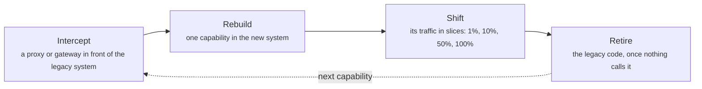
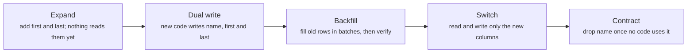
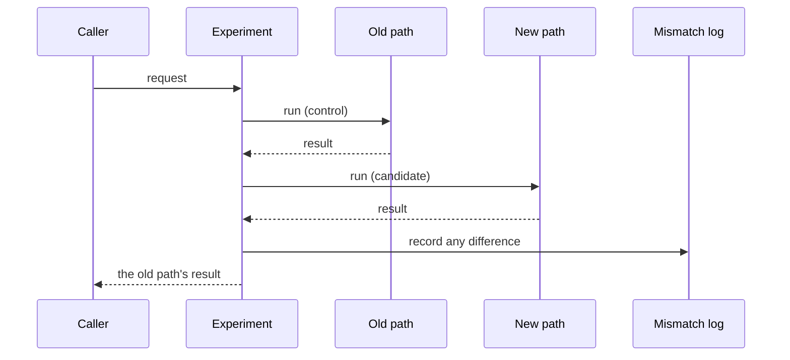

# Evolution and migration: the strangler fig, data migrations and backwards compatibility

> System Design · L4 Expert · Capacity, cost and evolution · about 125 min · hub module `m04` ([open the hub](https://claude.ai/artifact/C3GSn1y8nTQ24VT25d5S3X))

## Why it matters
Most architecture work changes a system that's already running. You replace a legacy system piece by piece while the business depends on it, move data to a new schema or store without downtime, and change APIs and events without breaking clients you can't see. Big-bang rewrites tend to fail; migrations that move in small, verified, reversible steps succeed, and they deliver value long before they finish.

## Pre-question (answer before reading)
**Q:** You must split a `name` column into `first_name` and `last_name` in a table used by four services that deploy independently. Why can't you rename the column and change the code in one release, and how would you do it instead?

<details><summary>Answer</summary>

The services deploy at different times, so for a while old and new code run side by side, and a rollback brings old code back. Any single step that changes the schema and the code together breaks whichever version isn't ready. Use expand and contract: add the new columns, deploy code that writes both and reads the new ones with a fallback, backfill the old rows, move everything to the new columns, and only then drop `name`. Every step works with both the previous and the next release, and every step can be undone except the last one.

</details>

## 🍎 Story time (kid version)
**Pizza Town and the family road trip: Moving Grandma's recipes**

Luigi's family is moving its recipes from Grandma's old notebook into a new folder. They don't copy the whole notebook in one weekend. Every new recipe goes straight into the folder; whenever someone cooks from the notebook, they copy that page across; on rainy days they copy pages in bulk. While both exist, any change is written in both places. For a few weeks they cook from the folder but check it against the notebook. When Luigi renames "tomato sauce" to "marinara", the label says both for a while. Only when nobody has opened the notebook for a month does it go on the shelf.

| In the story | In a real organisation |
|---|---|
| New recipes go straight into the folder | The strangler fig: new and moved features live in the new system |
| Copying pages when they're used, and in bulk on rainy days | Lazy migration on access, plus a batch backfill |
| Writing every change in both places | Dual writes while two stores are live |
| Cooking from the folder, checking the notebook | Parallel run: compare the new path with the old before trusting it |
| A label with both names, then the notebook on the shelf | Expand and contract: support old and new, then remove the old |

**Where the story breaks:** In a family, everyone hears about the change. A public API's clients may be programs that nobody has looked at for years, so an old field or version may have to stay for a long time, and you measure who still uses it before you remove anything.

## Key ideas (grown-up version)
- **Evolve rather than rewrite**: a big-bang rewrite has to match years of behaviour while the old system keeps changing, and it delivers value only at the end, if at all. Incremental migration ships value early, can pause or stop at any point, and keeps a way back at every step.
- **The strangler fig**: put a routing layer (a proxy, an API gateway or the front end) in front of the legacy system, rebuild one capability at a time, move its traffic across in slices, and retire the old code once nothing calls it. Martin Fowler's advice: be clear about the outcomes you want, find the seams, replace small pieces first to deliver value early, and accept transitional architecture (temporary code that lets old and new coexist) as the price of lower risk.
- **Branch by abstraction**: to replace a component inside one codebase, put an abstraction in front of the old implementation, build the new one behind it, switch callers over gradually (often with feature flags), then delete the old implementation.
- **Expand and contract**: parallel change, as Danilo Sato named it: expand the interface or schema so it supports old and new, migrate the clients, then contract by removing the old. Every intermediate state works with both versions of the code, so services can deploy independently and each step can be rolled back. The contract step, which deletes things, is the one-way door.
- **Online data migrations**: Stripe's four steps: dual write to the old and new stores; move reads to the new store once comparisons show they match; move writes so the new store becomes the source of truth; then remove the old data and code. Backfill existing records in batches that are idempotent, resumable and throttled, write them conditionally so they never overwrite newer data, and verify with counts, checksums and sampled comparisons. A parallel run, such as GitHub's Scientist library, executes both code paths, returns the old result, and reports any mismatch.
- **Backwards-compatible APIs**: adding is usually safe; removing or renaming, changing a type, a default or a value's format all break clients. Google's AIP-180 distinguishes source, wire and semantic compatibility. Break only in a new major version run alongside the old one, announce deprecation with dates (the Deprecation and Sunset HTTP headers), and measure who still calls the old version before you remove it.
- **Schema evolution for events**: events outlive the code that wrote them, and consumers replay old ones. In Protocol Buffers, never change or reuse a field number, reserve deleted ones, and add fields freely. A schema registry enforces a compatibility mode: backward (new consumers read old data; upgrade consumers first), forward (old consumers read new data; upgrade producers first) or full (both).
- **A way back at every step**: feature flags separate deploying code from releasing a feature; canaries and percentage rollouts limit the blast radius; and success metrics and rollback triggers are agreed before each step starts. Keep every step reversible for as long as possible, and treat deleting data as the final, deliberate decision.

## Diagrams
**The strangler fig, one capability at a time**



_The legacy system shrinks while the business keeps running. You can stop at any point, and you've already delivered value._

**Expand and contract: splitting a column**



_Each step works with both the previous and the next release of every service, so each can be rolled back, except the last._

**A parallel run: trust the new path by comparing it in production**



_Users always get the old result, and errors in the new path are caught and logged. Once mismatches stop, switch over._

## Comparisons
**Ways to migrate**

| Approach | Use it for | The way back |
|---|---|---|
| Strangler fig | Replacing a legacy system behind a routing layer | Route the capability back to the legacy system |
| Branch by abstraction | Replacing a component inside one codebase | Switch callers back to the old implementation |
| Expand and contract | Schema and interface changes with independent deploys | Any step except the final contract |
| Dual write and backfill | Moving data to a new store or model | Reads stay on the old store until verified |
| Parallel run | Proving new logic matches the old | Users only ever see the old result |

**Schema registry compatibility modes**

| Mode | Guarantees | Typical safe changes | Upgrade first |
|---|---|---|---|
| Backward | New consumers read data written with the old schema | Delete fields; add optional fields | Consumers |
| Forward | Old consumers read data written with the new schema | Add fields; delete optional fields | Producers |
| Full | Both | Add or delete optional fields | Either, in any order |

## Code (JavaScript + Python)
### The seeded random generator used by the backfill simulation
```python
def mulberry32(seed):
    state = seed & 0xFFFFFFFF
    def rand():
        nonlocal state
        state = (state + 0x6D2B79F5) & 0xFFFFFFFF
        t = ((state ^ (state >> 15)) * (state | 1)) & 0xFFFFFFFF
        t = (t ^ (t + (((t ^ (t >> 7)) * (t | 61)) & 0xFFFFFFFF))) & 0xFFFFFFFF
        return ((t ^ (t >> 14)) & 0xFFFFFFFF) / 4294967296
    return rand
```

```javascript
function mulberry32(seed) {
  return function () {
    seed = (seed + 0x6D2B79F5) | 0;
    let t = Math.imul(seed ^ (seed >>> 15), 1 | seed);
    t = (t + Math.imul(t ^ (t >>> 7), 61 | t)) ^ t;
    return ((t ^ (t >>> 14)) >>> 0) / 4294967296;
  };
}
```

### Strangler fig routing: shift a capability in slices, with an instant way back
```python
def bucket(user):                                      # a stable number from 0 to 99 for each user (FNV-1a hash)
    h = 2166136261
    for byte in user.encode():
        h = ((h ^ byte) * 16777619) & 0xFFFFFFFF
    return h % 100

def backend(path, user, routes):
    for prefix, share in routes:
        if path.startswith(prefix):
            return "new" if bucket(user) < share else "legacy"
    return "legacy"                                    # anything not yet migrated stays where it was

USERS = [f"user-{i}" for i in range(1000)]
routes = [("/search", 100), ("/catalog", 100), ("/orders", 0)]   # search and catalog have moved; orders is next
print(f"/account/settings goes to {backend('/account/settings', 'user-1', routes)}: not migrated yet")
before = {u: "legacy" for u in USERS}
first_25 = None
for stage, share in (("canary", 1), ("widen", 10), ("widen", 25), ("errors up, roll back", 0),
                     ("fixed, resume", 25), ("widen", 50), ("finish", 100)):
    routes[2] = ("/orders", share)
    now = {u: backend("/orders/42", u, routes) for u in USERS}
    on_new = [u for u in USERS if now[u] == "new"]
    switched = sum(before[u] != now[u] for u in USERS)
    print(f"{stage} ({share}%): {len(on_new):,} of 1,000 users on the new orders service, {switched} switched")
    if share == 25:
        first_25 = first_25 or on_new
        same = on_new == first_25
    before = now
print(f"after the rollback, 25% brought back exactly the same users: {'yes' if same else 'no'}")
```

Output:
```text
/account/settings goes to legacy: not migrated yet
canary (1%): 9 of 1,000 users on the new orders service, 9 switched
widen (10%): 102 of 1,000 users on the new orders service, 93 switched
widen (25%): 246 of 1,000 users on the new orders service, 144 switched
errors up, roll back (0%): 0 of 1,000 users on the new orders service, 246 switched
fixed, resume (25%): 246 of 1,000 users on the new orders service, 246 switched
widen (50%): 492 of 1,000 users on the new orders service, 246 switched
finish (100%): 1,000 of 1,000 users on the new orders service, 508 switched
after the rollback, 25% brought back exactly the same users: yes
```

- line 1: Hashing the user id gives each user a fixed bucket, so a user stays on the same side between requests.
- line 11: Paths without a route stay on the legacy system: the routing table only lists what has moved.
- line 19: A rollback is a one-line routing change, not a redeploy: the legacy code is still there.
- line 29: Raising the share only adds users, and returning to 25% brings back the same ones, so nobody flips between systems.

```javascript
function bucket(user) {                                // a stable number from 0 to 99 for each user (FNV-1a hash)
  let h = 2166136261;
  for (const byte of Buffer.from(user)) h = Math.imul(h ^ byte, 16777619) >>> 0;
  return h % 100;
}

function backend(path, user, routes) {
  for (const [prefix, share] of routes) {
    if (path.startsWith(prefix)) return bucket(user) < share ? "new" : "legacy";
  }
  return "legacy";                                     // anything not yet migrated stays where it was
}

const USERS = Array.from({ length: 1000 }, (_, i) => `user-${i}`);
const routes = [["/search", 100], ["/catalog", 100], ["/orders", 0]];   // search and catalog have moved; orders is next
console.log(`/account/settings goes to ${backend("/account/settings", "user-1", routes)}: not migrated yet`);
let before = new Map(USERS.map(u => [u, "legacy"]));
let first25 = null, same = false;
for (const [stage, share] of [["canary", 1], ["widen", 10], ["widen", 25], ["errors up, roll back", 0],
                              ["fixed, resume", 25], ["widen", 50], ["finish", 100]]) {
  routes[2] = ["/orders", share];
  const now = new Map(USERS.map(u => [u, backend("/orders/42", u, routes)]));
  const onNew = USERS.filter(u => now.get(u) === "new");
  const switched = USERS.filter(u => before.get(u) !== now.get(u)).length;
  console.log(`${stage} (${share}%): ${onNew.length.toLocaleString("en-US")} of 1,000 users on the new orders service, ${switched} switched`);
  if (share === 25) {
    first25 = first25 ?? onNew;
    same = onNew.join() === first25.join();
  }
  before = now;
}
console.log(`after the rollback, 25% brought back exactly the same users: ${same ? "yes" : "no"}`);
```

Output:
```text
/account/settings goes to legacy: not migrated yet
canary (1%): 9 of 1,000 users on the new orders service, 9 switched
widen (10%): 102 of 1,000 users on the new orders service, 93 switched
widen (25%): 246 of 1,000 users on the new orders service, 144 switched
errors up, roll back (0%): 0 of 1,000 users on the new orders service, 246 switched
fixed, resume (25%): 246 of 1,000 users on the new orders service, 246 switched
widen (50%): 492 of 1,000 users on the new orders service, 246 switched
finish (100%): 1,000 of 1,000 users on the new orders service, 508 switched
after the rollback, 25% brought back exactly the same users: yes
```

- line 1: Hashing the user id gives each user a fixed bucket, so a user stays on the same side between requests.
- line 11: Paths without a route stay on the legacy system: the routing table only lists what has moved.
- line 20: A rollback is a one-line routing change, not a redeploy: the legacy code is still there.
- line 32: Raising the share only adds users, and returning to 25% brings back the same ones, so nobody flips between systems.

### Expand and contract: which steps are safe with two versions running
```python
def write(version, schema, first, last):               # the row a service version inserts
    if version == "v1":
        values = {"name": f"{first} {last}"}
    elif version == "v2":                              # the transition release writes both
        values = {"name": f"{first} {last}", "first": first, "last": last}
    else:
        values = {"first": first, "last": last}        # v3 writes the new columns only
    for column in values:
        if column not in schema:
            raise ValueError(f"{version} writes {column}: no such column")
    return {c: values.get(c) for c in schema}          # columns it doesn't write are left empty

def read(version, schema, row):
    if version == "v1" or (version == "v2" and row.get("first") is None):
        if "name" not in schema:                       # v2 falls back to name for rows not yet backfilled
            raise ValueError(f"{version} reads name: no such column")
        return row["name"]
    if row.get("first") is None:
        raise ValueError(f"{version} reads an old row: first is empty")
    return f"{row['first']} {row['last']}"

def check(schema, versions, rows):                     # every running version writes, then reads every row
    rows = [{c: r.get(c) for c in schema} for r in rows]
    try:
        rows += [write(v, schema, "Ada", "Lovelace") for v in versions]
        for v in versions:
            for row in rows:
                if read(v, schema, row) != "Ada Lovelace":
                    return f"breaks ({v} reads the wrong name)"
    except ValueError as error:
        return f"breaks ({error})"
    return "ok"

EXPANDED, CONTRACTED = ["name", "first", "last"], ["first", "last"]
OLD = [{"name": "Ada Lovelace"}]                       # a row written before the migration
BACKFILLED = [{"name": "Ada Lovelace", "first": "Ada", "last": "Lovelace"}]
for label, schema, versions, rows in (
        ("expand: add first and last", EXPANDED, ["v1"], OLD),
        ("roll out v2: write both, read new or fall back", EXPANDED, ["v1", "v2"], OLD),
        ("backfill first and last for old rows", EXPANDED, ["v2"], BACKFILLED),
        ("roll out v3: new columns only", EXPANDED, ["v2", "v3"], BACKFILLED),
        ("contract: drop name", CONTRACTED, ["v3"], BACKFILLED),
        ("shortcut: rename in one release while v1 still runs", CONTRACTED, ["v1", "v3"], BACKFILLED),
        ("shortcut: roll out v3 before the backfill", EXPANDED, ["v2", "v3"], OLD),
        ("shortcut: roll back to v2 after the contract", CONTRACTED, ["v2", "v3"], BACKFILLED)):
    print(f"{label}: {check(schema, versions, rows)}")
```

Output:
```text
expand: add first and last: ok
roll out v2: write both, read new or fall back: ok
backfill first and last for old rows: ok
roll out v3: new columns only: ok
contract: drop name: ok
shortcut: rename in one release while v1 still runs: breaks (v1 writes name: no such column)
shortcut: roll out v3 before the backfill: breaks (v3 reads an old row: first is empty)
shortcut: roll back to v2 after the contract: breaks (v2 writes name: no such column)
```

- line 4: The transition release writes both shapes, so old readers still work and new readers find the new columns.
- line 14: v2 reads the new columns but falls back to name for rows nobody has backfilled yet.
- line 22: During a rolling deploy two versions run at once, so each must read what the other writes, old rows included.
- line 43: The shortcuts break because some running code, or a rollback, still expects a column that's gone or empty.

```javascript
function write(version, schema, first, last) {         // the row a service version inserts
  let values;
  if (version === "v1") values = { name: `${first} ${last}` };
  else if (version === "v2") values = { name: `${first} ${last}`, first, last };   // the transition release writes both
  else values = { first, last };                       // v3 writes the new columns only
  for (const column of Object.keys(values)) {
    if (!schema.includes(column)) throw new Error(`${version} writes ${column}: no such column`);
  }
  return Object.fromEntries(schema.map(c => [c, values[c] ?? null]));   // columns it doesn't write are left empty
}

function read(version, schema, row) {
  if (version === "v1" || (version === "v2" && (row.first ?? null) === null)) {
    if (!schema.includes("name")) throw new Error(`${version} reads name: no such column`);   // v2 falls back to name for rows not yet backfilled
    return row.name;
  }
  if ((row.first ?? null) === null) throw new Error(`${version} reads an old row: first is empty`);
  return `${row.first} ${row.last}`;
}

function check(schema, versions, rows) {               // every running version writes, then reads every row
  rows = rows.map(r => Object.fromEntries(schema.map(c => [c, r[c] ?? null])));
  try {
    rows.push(...versions.map(v => write(v, schema, "Ada", "Lovelace")));
    for (const v of versions) {
      for (const row of rows) {
        if (read(v, schema, row) !== "Ada Lovelace") return `breaks (${v} reads the wrong name)`;
      }
    }
  } catch (error) {
    return `breaks (${error.message})`;
  }
  return "ok";
}

const EXPANDED = ["name", "first", "last"], CONTRACTED = ["first", "last"];
const OLD = [{ name: "Ada Lovelace" }];                // a row written before the migration
const BACKFILLED = [{ name: "Ada Lovelace", first: "Ada", last: "Lovelace" }];
for (const [label, schema, versions, rows] of [
  ["expand: add first and last", EXPANDED, ["v1"], OLD],
  ["roll out v2: write both, read new or fall back", EXPANDED, ["v1", "v2"], OLD],
  ["backfill first and last for old rows", EXPANDED, ["v2"], BACKFILLED],
  ["roll out v3: new columns only", EXPANDED, ["v2", "v3"], BACKFILLED],
  ["contract: drop name", CONTRACTED, ["v3"], BACKFILLED],
  ["shortcut: rename in one release while v1 still runs", CONTRACTED, ["v1", "v3"], BACKFILLED],
  ["shortcut: roll out v3 before the backfill", EXPANDED, ["v2", "v3"], OLD],
  ["shortcut: roll back to v2 after the contract", CONTRACTED, ["v2", "v3"], BACKFILLED],
]) {
  console.log(`${label}: ${check(schema, versions, rows)}`);
}
```

Output:
```text
expand: add first and last: ok
roll out v2: write both, read new or fall back: ok
backfill first and last for old rows: ok
roll out v3: new columns only: ok
contract: drop name: ok
shortcut: rename in one release while v1 still runs: breaks (v1 writes name: no such column)
shortcut: roll out v3 before the backfill: breaks (v3 reads an old row: first is empty)
shortcut: roll back to v2 after the contract: breaks (v2 writes name: no such column)
```

- line 4: The transition release writes both shapes, so old readers still work and new readers find the new columns.
- line 13: v2 reads the new columns but falls back to name for rows nobody has backfilled yet.
- line 21: During a rolling deploy two versions run at once, so each must read what the other writes, old rows included.
- line 45: The shortcuts break because some running code, or a rollback, still expects a column that's gone or empty.

### Event schemas: which changes are compatible, and who upgrades first
```python
OLD = {                                                # field -> (type, default); None means required, no default
    "order_id": ("string", None),
    "amount_cents": ("int", None),
    "currency": ("string", "EUR"),
    "coupon": ("string", ""),
}

def readable(reader, writer):                          # can code built on `reader` read data written with `writer`?
    for field, (kind, default) in reader.items():
        if field in writer:
            if writer[field][0] != kind:
                return False                           # same name, different type
        elif default is None:
            return False                               # the reader needs a field the data doesn't have
    return True                                        # fields the reader doesn't know are skipped

def mode(old, new):
    backward, forward = readable(new, old), readable(old, new)
    if backward and forward:
        return "full: upgrade in any order"
    if backward:
        return "backward: upgrade consumers first"
    if forward:
        return "forward: upgrade producers first, and new consumers can't read old events"
    return "breaking: publish a new event type or topic"

def without(schema, field):
    return {k: v for k, v in schema.items() if k != field}

for label, new in (
        ("add channel with a default", {**OLD, "channel": ("string", "web")}),
        ("add customer_id, required", {**OLD, "customer_id": ("string", None)}),
        ("remove coupon, which has a default", without(OLD, "coupon")),
        ("remove amount_cents, which is required", without(OLD, "amount_cents")),
        ("change amount_cents to a string", {**OLD, "amount_cents": ("string", None)}),
        ("rename order_id to id", {**without(OLD, "order_id"), "id": ("string", None)})):
    print(f"{label}: {mode(OLD, new)}")
```

Output:
```text
add channel with a default: full: upgrade in any order
add customer_id, required: forward: upgrade producers first, and new consumers can't read old events
remove coupon, which has a default: full: upgrade in any order
remove amount_cents, which is required: backward: upgrade consumers first
change amount_cents to a string: breaking: publish a new event type or topic
rename order_id to id: breaking: publish a new event type or topic
```

- line 8: Avro-style resolution: the reader's fields are matched by name, a missing field takes the reader's default, and unknown fields are skipped.
- line 18: Backward: new code reads old events. Forward: old code reads new events. Full: both.
- line 32: A new required field breaks replays: new consumers can't read the events written before it existed.
- line 36: A rename is a delete plus an add, so it breaks both directions: keep the old name, or publish a new event type.

```javascript
const OLD = {                                          // field -> [type, default]; null means required, no default
  order_id: ["string", null],
  amount_cents: ["int", null],
  currency: ["string", "EUR"],
  coupon: ["string", ""],
};

function readable(reader, writer) {                    // can code built on `reader` read data written with `writer`?
  for (const [field, [kind, fallback]] of Object.entries(reader)) {
    if (field in writer) {
      if (writer[field][0] !== kind) return false;     // same name, different type
    } else if (fallback === null) {
      return false;                                    // the reader needs a field the data doesn't have
    }
  }
  return true;                                         // fields the reader doesn't know are skipped
}

function mode(oldSchema, newSchema) {
  const backward = readable(newSchema, oldSchema), forward = readable(oldSchema, newSchema);
  if (backward && forward) return "full: upgrade in any order";
  if (backward) return "backward: upgrade consumers first";
  if (forward) return "forward: upgrade producers first, and new consumers can't read old events";
  return "breaking: publish a new event type or topic";
}

const without = (schema, field) => Object.fromEntries(Object.entries(schema).filter(([k]) => k !== field));

for (const [label, newSchema] of [
  ["add channel with a default", { ...OLD, channel: ["string", "web"] }],
  ["add customer_id, required", { ...OLD, customer_id: ["string", null] }],
  ["remove coupon, which has a default", without(OLD, "coupon")],
  ["remove amount_cents, which is required", without(OLD, "amount_cents")],
  ["change amount_cents to a string", { ...OLD, amount_cents: ["string", null] }],
  ["rename order_id to id", { ...without(OLD, "order_id"), id: ["string", null] }],
]) {
  console.log(`${label}: ${mode(OLD, newSchema)}`);
}
```

Output:
```text
add channel with a default: full: upgrade in any order
add customer_id, required: forward: upgrade producers first, and new consumers can't read old events
remove coupon, which has a default: full: upgrade in any order
remove amount_cents, which is required: backward: upgrade consumers first
change amount_cents to a string: breaking: publish a new event type or topic
rename order_id to id: breaking: publish a new event type or topic
```

- line 8: Avro-style resolution: the reader's fields are matched by name, a missing field takes the reader's default, and unknown fields are skipped.
- line 20: Backward: new code reads old events. Forward: old code reads new events. Full: both.
- line 31: A new required field breaks replays: new consumers can't read the events written before it existed.
- line 35: A rename is a delete plus an add, so it breaks both directions: keep the old name, or publish a new event type.

## Worked example
**Problem.** You're moving 10,000 records to a new store while the application keeps updating them. Dual writes are already on: every update goes to both stores. A backfill copies the old store in batches of 500, and about 40 updates land while each batch is between its read and its write. Compare a plain copy with a copy that writes only if the record is missing or older, by version, and verify both.

1. Turn dual writes on first, so every change from now on reaches the new store (Stripe's step 1).
2. The backfill reads a batch from the old store, then writes it to the new one. Live updates can land in between, and they're dual-written straight away.
3. A plain copy then puts the older snapshot over the newer dual-written record. A conditional write (in a real database, a compare-and-set on the version) never goes backwards.
4. Verify before moving reads: compare every record, or checksums by range, and count the differences.

```python
N, BATCH, UPDATES = 10_000, 500, 40                    # records; backfill batch size; live updates while a batch is in flight

def migrate(conditional):
    rand = mulberry32(11)                              # the same live traffic for both runs
    old = [(1, i * 7 % 1000) for i in range(N)]        # each record is (version, value)
    new = [None] * N                                   # the new store starts empty
    dual_writes = 0
    for start in range(0, N, BATCH):
        snapshot = old[start:start + BATCH]            # the backfill reads a batch from the old store...
        for _ in range(UPDATES):                       # ...live traffic keeps updating records meanwhile...
            i = int(rand() * N)
            old[i] = (old[i][0] + 1, int(rand() * 1000))
            new[i] = old[i]                            # dual write: every update goes to both stores
            dual_writes += 1
        for offset, record in enumerate(snapshot):     # ...then the backfill writes the batch
            i = start + offset
            if not conditional or new[i] is None or new[i][0] < record[0]:
                new[i] = record
    stale = sum(new[i] != old[i] for i in range(N))    # verification: compare every record
    return dual_writes, stale

for label, conditional in (("plain copy", False), ("copy only if newer, by version", True)):
    writes, stale = migrate(conditional)
    print(f"{label}: {writes} dual writes during the backfill, {stale} records stale in the new store")
```

Output:
```text
plain copy: 800 dual writes during the backfill, 40 records stale in the new store
copy only if newer, by version: 800 dual writes during the backfill, 0 records stale in the new store
```

```javascript
const N = 10000, BATCH = 500, UPDATES = 40;            // records; backfill batch size; live updates while a batch is in flight

function migrate(conditional) {
  const rand = mulberry32(11);                         // the same live traffic for both runs
  const old = Array.from({ length: N }, (_, i) => [1, (i * 7) % 1000]);   // each record is [version, value]
  const fresh = new Array(N).fill(null);               // the new store starts empty
  let dualWrites = 0;
  for (let start = 0; start < N; start += BATCH) {
    const snapshot = old.slice(start, start + BATCH);  // the backfill reads a batch from the old store...
    for (let u = 0; u < UPDATES; u++) {                // ...live traffic keeps updating records meanwhile...
      const i = Math.floor(rand() * N);
      old[i] = [old[i][0] + 1, Math.floor(rand() * 1000)];
      fresh[i] = old[i];                               // dual write: every update goes to both stores
      dualWrites++;
    }
    snapshot.forEach((record, offset) => {             // ...then the backfill writes the batch
      const i = start + offset;
      if (!conditional || fresh[i] === null || fresh[i][0] < record[0]) fresh[i] = record;
    });
  }
  let stale = 0;                                       // verification: compare every record
  for (let i = 0; i < N; i++) if (fresh[i] === null || fresh[i][0] !== old[i][0] || fresh[i][1] !== old[i][1]) stale++;
  return [dualWrites, stale];
}

for (const [label, conditional] of [["plain copy", false], ["copy only if newer, by version", true]]) {
  const [writes, stale] = migrate(conditional);
  console.log(`${label}: ${writes} dual writes during the backfill, ${stale} records stale in the new store`);
}
```

Output:
```text
plain copy: 800 dual writes during the backfill, 40 records stale in the new store
copy only if newer, by version: 800 dual writes during the backfill, 0 records stale in the new store
```

**Answer.** The plain copy leaves 40 records stale: each was updated, and dual-written, after the backfill read its batch, and the backfill then put the older version back. Nothing failed and nothing logged an error, so only verification finds it. Writing only when the record is missing or older makes the backfill safe to run alongside live traffic, and idempotent, so it can be stopped, throttled and resumed. Verify before moving reads, keep comparing during the switch, and remember that dual writes have their own failure mode: one of the two writes can fail, which is why continuous verification, or a single write plus change data capture, is worth the effort.

## Your turn (faded example)
**Problem.** Finish `differences(old, new, n, size)`: compare the two stores range by range (ids 0 to size − 1, then size to 2 × size − 1, and so on; the last range may be shorter) using `checksum`, and only where a range's checksums differ, compare its records one by one. Return the differing ids in order, and how many records you compared one by one.

- ✓ For each range, ask both stores for a checksum; if they match, skip the range.
- **Why compare checksums first?**
  <details><summary>Answer</summary>Each store computes one number per range where the data lives, so only numbers cross the network. Records are fetched only where the numbers differ: with a few differences, that's a small fraction of the data.</details>
- **What can a checksum miss?**
  <details><summary>Answer</summary>Two different ranges can, rarely, produce the same checksum. Plain FNV hashes added together cancel surprisingly often for one-character edits, which is why each hash goes through a finaliser first. Real tools use stronger hashes and still sample records directly; Merkle trees apply the same idea recursively.</details>

Starter:
```python
def fnv(text):                                         # FNV-1a, 32 bits
    h = 2166136261
    for byte in text.encode():
        h = ((h ^ byte) * 16777619) & 0xFFFFFFFF
    return h

def mix(h):                                             # MurmurHash3's finaliser: every input bit moves every output bit,
    h ^= h >> 16                                       # so small edits can't cancel out when hashes are added up
    h = (h * 0x85EBCA6B) & 0xFFFFFFFF
    h ^= h >> 13
    h = (h * 0xC2B2AE35) & 0xFFFFFFFF
    return h ^ (h >> 16)

def checksum(store, start, end):                       # one number for ids start .. end - 1; each store computes its own
    total = 0
    for i in range(start, end):
        record = store.get(i)
        total += mix(fnv(f"{i}:{record[0]}:{record[1]}" if record else f"{i}:missing"))
    return total % 2**32

def differences(old, new, n, size):
    ids, compared = [], 0
    ...                                                # TODO: compare checksums per range; records only where they differ
    return ids, compared
```

```javascript
function fnv(text) {                                   // FNV-1a, 32 bits
  let h = 2166136261;
  for (const byte of Buffer.from(text)) h = Math.imul(h ^ byte, 16777619) >>> 0;
  return h;
}

function mix(h) {                                      // MurmurHash3's finaliser: every input bit moves every output bit,
  h ^= h >>> 16;                                       // so small edits can't cancel out when hashes are added up
  h = Math.imul(h, 0x85ebca6b);
  h ^= h >>> 13;
  h = Math.imul(h, 0xc2b2ae35);
  return (h ^ (h >>> 16)) >>> 0;
}

function checksum(store, start, end) {                 // one number for ids start .. end - 1; each store computes its own
  let total = 0;
  for (let i = start; i < end; i++) {
    const record = store.get(i);
    total += mix(fnv(record ? `${i}:${record[0]}:${record[1]}` : `${i}:missing`));
  }
  return total % 2 ** 32;
}

const same = (a, b) => (a && b ? a[0] === b[0] && a[1] === b[1] : a === b);

function differences(oldStore, newStore, n, size) {
  const ids = [];
  let compared = 0;
  // TODO: compare checksums per range; records only where they differ
  return [ids, compared];
}
```

<details><summary>Full solution</summary>

```python
def fnv(text):                                         # FNV-1a, 32 bits
    h = 2166136261
    for byte in text.encode():
        h = ((h ^ byte) * 16777619) & 0xFFFFFFFF
    return h

def mix(h):                                             # MurmurHash3's finaliser: every input bit moves every output bit,
    h ^= h >> 16                                       # so small edits can't cancel out when hashes are added up
    h = (h * 0x85EBCA6B) & 0xFFFFFFFF
    h ^= h >> 13
    h = (h * 0xC2B2AE35) & 0xFFFFFFFF
    return h ^ (h >> 16)

def checksum(store, start, end):                       # one number for ids start .. end - 1; each store computes its own
    total = 0
    for i in range(start, end):
        record = store.get(i)
        total += mix(fnv(f"{i}:{record[0]}:{record[1]}" if record else f"{i}:missing"))
    return total % 2**32

def differences(old, new, n, size):
    ids, compared = [], 0
    for start in range(0, n, size):
        end = min(start + size, n)
        if checksum(old, start, end) == checksum(new, start, end):
            continue                                   # one number per range crossed the network, not size records
        for i in range(start, end):
            compared += 1
            if old.get(i) != new.get(i):
                ids.append(i)
    return ids, compared

old = {i: (1, i * 7 % 1000) for i in range(10_000)}
new = dict(old)
new[1234] = (2, 99)                                    # an update the new store missed
del new[1300]                                          # a record the backfill skipped
new[7777] = (1, 0)                                     # a corrupted value
ids, compared = differences(old, new, 10_000, 500)
print(f"{len(ids)} records differ: {', '.join(map(str, ids))}")
print(f"compared 20 checksums, then {compared:,} records one by one instead of 10,000")
```

Output:
```text
3 records differ: 1234, 1300, 7777
compared 20 checksums, then 1,000 records one by one instead of 10,000
```

```javascript
function fnv(text) {                                   // FNV-1a, 32 bits
  let h = 2166136261;
  for (const byte of Buffer.from(text)) h = Math.imul(h ^ byte, 16777619) >>> 0;
  return h;
}

function mix(h) {                                      // MurmurHash3's finaliser: every input bit moves every output bit,
  h ^= h >>> 16;                                       // so small edits can't cancel out when hashes are added up
  h = Math.imul(h, 0x85ebca6b);
  h ^= h >>> 13;
  h = Math.imul(h, 0xc2b2ae35);
  return (h ^ (h >>> 16)) >>> 0;
}

function checksum(store, start, end) {                 // one number for ids start .. end - 1; each store computes its own
  let total = 0;
  for (let i = start; i < end; i++) {
    const record = store.get(i);
    total += mix(fnv(record ? `${i}:${record[0]}:${record[1]}` : `${i}:missing`));
  }
  return total % 2 ** 32;
}

const same = (a, b) => (a && b ? a[0] === b[0] && a[1] === b[1] : a === b);

function differences(oldStore, newStore, n, size) {
  const ids = [];
  let compared = 0;
  for (let start = 0; start < n; start += size) {
    const end = Math.min(start + size, n);
    if (checksum(oldStore, start, end) === checksum(newStore, start, end)) continue;   // one number per range crossed the network, not size records
    for (let i = start; i < end; i++) {
      compared++;
      if (!same(oldStore.get(i), newStore.get(i))) ids.push(i);
    }
  }
  return [ids, compared];
}

const oldStore = new Map(Array.from({ length: 10000 }, (_, i) => [i, [1, (i * 7) % 1000]]));
const newStore = new Map(oldStore);
newStore.set(1234, [2, 99]);                           // an update the new store missed
newStore.delete(1300);                                 // a record the backfill skipped
newStore.set(7777, [1, 0]);                            // a corrupted value
const [ids, compared] = differences(oldStore, newStore, 10000, 500);
console.log(`${ids.length} records differ: ${ids.join(", ")}`);
console.log(`compared 20 checksums, then ${compared.toLocaleString("en-US")} records one by one instead of 10,000`);
```

Output:
```text
3 records differ: 1234, 1300, 7777
compared 20 checksums, then 1,000 records one by one instead of 10,000
```

</details>

## Socratic checks and quiz (answers hidden)
**1. What does this print?**

```python
version = (2, 4, 1)
changes = ["fix a typo", "add an optional field"]
major, minor, patch = version
if "remove a field" in changes:
    major, minor, patch = major + 1, 0, 0
elif "add an optional field" in changes:
    minor, patch = minor + 1, 0
else:
    patch += 1
print(f"{major}.{minor}.{patch}")
```

```javascript
const version = [2, 4, 1];
const changes = ["fix a typo", "add an optional field"];
let [major, minor, patch] = version;
if (changes.includes("remove a field")) [major, minor, patch] = [major + 1, 0, 0];
else if (changes.includes("add an optional field")) [minor, patch] = [minor + 1, 0];
else patch++;
console.log(`${major}.${minor}.${patch}`);
```

- A. 2.5.0
- B. 2.4.2
- C. 3.0.0
- D. 2.5.1

<details><summary>Answer</summary>

2.5.0. A backwards-compatible addition raises the minor version and resets the patch. Only a breaking change, such as removing a field, raises the major version.

</details>

**2. What does this print?**

```python
store = {"a": (3, "blue")}                   # (version, value), already dual-written
snapshot = (2, "green")                      # what the backfill read a moment earlier
if store.get("a", (0, None))[0] < snapshot[0]:
    store["a"] = snapshot
print(store["a"][1])
```

```javascript
const store = { a: [3, "blue"] };            // [version, value], already dual-written
const snapshot = [2, "green"];               // what the backfill read a moment earlier
if ((store.a ?? [0, null])[0] < snapshot[0]) store.a = snapshot;
console.log(store.a[1]);
```

- A. blue
- B. green
- C. None or null
- D. an error

<details><summary>Answer</summary>

blue. The store already holds version 3, newer than the snapshot's version 2, so the conditional write leaves it alone. A plain copy would have put the stale green back.

</details>

**3. In an expand-and-contract migration, which step is the one-way door?**

- A. Dropping the old column in the contract step
- B. Adding the new columns in the expand step
- C. Releasing code that writes both columns
- D. Running the backfill

<details><summary>Answer</summary>

Dropping the old column in the contract step. Every earlier step can be undone by deploying the previous release. Once the old column and its data are gone, a rollback to code that needs it fails, so the drop comes last, after a quiet period.

</details>

**4. You're replacing a legacy monolith's order handling with a new service. What does the strangler fig pattern suggest?**

- A. Route order requests through a proxy to the new service, a slice of traffic at a time, while the monolith keeps everything else
- B. Freeze the monolith, rewrite all of it, then switch over in one weekend
- C. Copy the monolith's code into the new service and delete the original
- D. Give the new service the same database tables and let both write to them indefinitely

<details><summary>Answer</summary>

Route order requests through a proxy to the new service, a slice of traffic at a time, while the monolith keeps everything else. The routing layer moves one capability at a time and can send traffic back instantly. A shared database forever would keep the two coupled, so data ownership moves too, with change data capture or dual writes on the way.

</details>

**5. Which changes are backwards compatible within one major version of an API? (choose 2)**

- A. Adding an optional field to a response
- B. Adding a new method
- C. Renaming a field
- D. Changing a field's default value
- E. Adding a required field to a request

<details><summary>Answer</summary>

Adding an optional field to a response, Adding a new method. Google's AIP-180 treats renames, changed defaults and new required request fields as breaking: existing clients would fail or quietly behave differently.

</details>

**6. Judge each statement.**

- Under a schema registry's BACKWARD mode, consumers are upgraded before producers.
- A deleted protobuf field number can be reused once every client has upgraded.
- A parallel run returns the new path's result once the two usually match.
- Feature flags let you deploy code without releasing the feature.

<details><summary>Answer</summary>

Under a schema registry's BACKWARD mode, consumers are upgraded before producers.: Yes; A deleted protobuf field number can be reused once every client has upgraded.: No; A parallel run returns the new path's result once the two usually match.: No; Feature flags let you deploy code without releasing the feature.: Yes. Backward means new readers handle old data, so consumers go first. Protobuf field numbers must never be reused; reserve them. Scientist-style experiments always return the old (control) result, and flags decouple deploy from release.

</details>

**7. Put an online data migration in order.**

- (put the steps in order)

<details><summary>Answer</summary>

Start dual writing to the old and new stores → Backfill existing records, then verify → Move reads to the new store, comparing results → Move writes so the new store is the source of truth → Remove the old data and the code that wrote it. This is Stripe's four-step pattern with the backfill made explicit. Each step is verified before the next, and only the last can't be undone.

</details>

**8. Complete the Python backfill write so it never overwrites newer data.**

```
def backfill_write(new, record_id, snapshot):         # snapshot: (version, value) read from the old store earlier
    current = new.get(record_id)
    if current is None or current[0] {{0}} snapshot[0]:
        new[record_id] = {{1}}

```

<details><summary>Answer</summary>

< | snapshot. Write only when the record is missing or older than the snapshot. A record with the same or a newer version was already copied or dual-written, so the backfill leaves it alone.

</details>

## Traps & misconceptions
- **“We'll rewrite it from scratch; it'll take a year.”** The old system keeps changing, the new one must match years of behaviour, and nothing ships until the end. Strangle it instead: one capability at a time, each delivering value.
- **“Rename the column in the same release as the code.”** Services deploy at different times and rollbacks bring old code back. Expand, migrate, then contract, so every step works with both versions.
- **“Dual writes keep the two stores in sync.”** One write can succeed while the other fails, and concurrent writes can arrive in different orders. Verify continuously, repair differences, or write once and propagate with change data capture or an outbox.
- **“The backfill just copies the rows.”** A live update can land between the backfill's read and its write. Write conditionally by version, and make the backfill idempotent, resumable and throttled.
- **“Adding a field is always safe.”** Not if it's a required field in a request, if it changes a default, or if clients treat an unknown enum value as an error. Check source, wire and semantic compatibility.
- **“We announced the deprecation, so we can switch v1 off.”** Announcements don't reach every caller. Measure traffic by client, contact the remaining callers, and switch off only when usage is gone or the agreed date has passed.

## Discussion prompts
- **Your company wants to move from a monolith with one shared database to services that own their data. Where do you start, and how do you avoid a two-year freeze?**
  <details><summary>One good answer</summary>Start from outcomes, then pick a first capability with a clear seam and visible value. Put a gateway in front of the monolith and route that capability to a new service, which first gets its data from the monolith's tables through change data capture, then takes over the writes with dual writes or an outbox, verified before the switch. Keep the monolith working and shipping throughout, move one capability at a time, measure the results, and stop when the value is captured. Change team ownership to match the new boundaries, or the old structure will grow back.</details>
- **A partner integration uses v1 of your public API, and v2 changes the order format. How do you retire v1 safely?**
  <details><summary>One good answer</summary>Run v1 and v2 side by side, with v1 as a thin adapter over v2's implementation so there's one codebase to maintain. Announce the deprecation with a date in the docs and with Deprecation and Sunset headers, and publish a migration guide. Measure v1 traffic by client key, contact the remaining callers directly, and consider short, announced brownouts near the end to flush out forgotten integrations. Switch v1 off only when traffic is gone or the contractual date has passed.</details>

## Teach-back
**Prompt:** Explain to a junior colleague how you'd split a database column used by several services, without downtime.

Rubric:
- [ ] Why one release can't do it: independent deploys and rollbacks mean two versions run at once
- [ ] Expand: add the new columns; release code that writes both and reads new with a fallback
- [ ] Backfill old rows in idempotent, conditional batches, and verify
- [ ] Switch reads and writes to the new columns, then contract by dropping the old one
- [ ] Every step reversible except the last; feature flags and metrics decide each step

<details><summary>Model answer</summary>

Services deploy independently, and a rollback brings old code back, so for a while two versions of the code run against the same table. Any single step that changes the schema and the code together breaks one of them. So I'd expand first: add the new columns, then release code that writes both the old and the new columns and reads the new ones, falling back to the old column for rows that haven't been backfilled. Next, a backfill fills the new columns for old rows in small, resumable batches, writing only where the values are still missing so it never overwrites newer data, and I'd verify with counts and comparisons. Once every service reads and writes the new columns, and nothing has used the old one for a while, I'd contract by dropping it. Each step can be rolled back except the drop, which is why it comes last.

</details>

## Quick Q&A (also in the SRS deck)
- **What is the strangler fig pattern?** Replacing a legacy system gradually: route one capability at a time to a new system behind a proxy, and retire the old code once nothing calls it.
- **The three phases of parallel change?** Expand (support old and new), migrate (move the clients), contract (remove the old).
- **Stripe's four steps for an online data migration?** Dual write, move reads, move writes, then remove the old data.
- **Why must a backfill write be conditional?** A live update can land between the backfill's read and its write; writing only if newer, by version, stops it overwriting newer data.
- **Under BACKWARD compatibility, which side upgrades first?** Consumers, because the new schema must read data written with the old one.
- **Why reserve a deleted protobuf field number?** So it's never reused: old data and old clients would read the new field as the old one.

## Practice problems
- [ ] [Reading · Martin Fowler: Strangler Fig Application](https://martinfowler.com/bliki/StranglerFigApplication.html) · find the seams in a legacy system you know, and choose the first capability to move and why
- [ ] [Reading · Stripe: Online migrations at scale](https://stripe.com/blog/online-migrations) · write a four-step plan for a migration you've done or will do, with the verification for each step
- [ ] [Reference · Confluent: Schema evolution and compatibility](https://docs.confluent.io/platform/current/schema-registry/fundamentals/schema-evolution.html) · classify five recent changes to your events by compatibility mode, and say who had to upgrade first
- [ ] [Reference · Google AIP-180: Backwards compatibility](https://google.aip.dev/180) · check your last three API changes against its list of breaking changes

## Sources (accessed 2026-10-12)
- [Martin Fowler: Strangler Fig Application (updated August 2024)](https://martinfowler.com/bliki/StranglerFigApplication.html)
- [Danilo Sato (2014): Parallel Change](https://martinfowler.com/bliki/ParallelChange.html)
- [Martin Fowler (2014): Branch By Abstraction](https://martinfowler.com/bliki/BranchByAbstraction.html)
- [Jacqueline Xu, Stripe (2017): Online migrations at scale](https://stripe.com/blog/online-migrations)
- [GitHub Scientist: a library for carefully refactoring critical paths](https://github.com/github/scientist)
- [Protocol Buffers: Language guide (proto 3), updating a message type](https://protobuf.dev/programming-guides/proto3/)
- [Confluent: Schema evolution and compatibility](https://docs.confluent.io/platform/current/schema-registry/fundamentals/schema-evolution.html)
- [Google AIP-180: Backwards compatibility](https://google.aip.dev/180)
- [RFC 9745: The Deprecation HTTP Response Header Field (2025)](https://www.rfc-editor.org/rfc/rfc9745.html)
