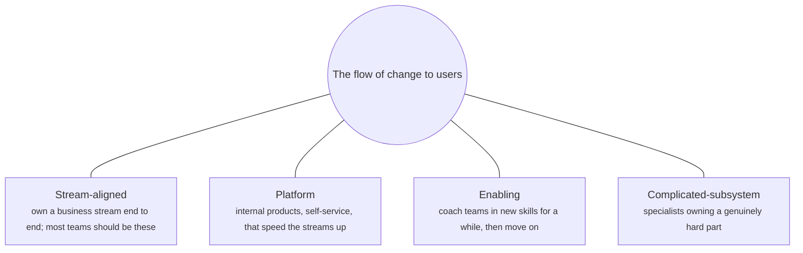
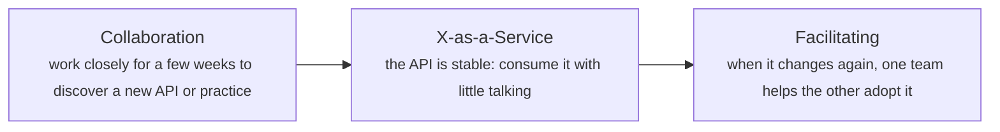
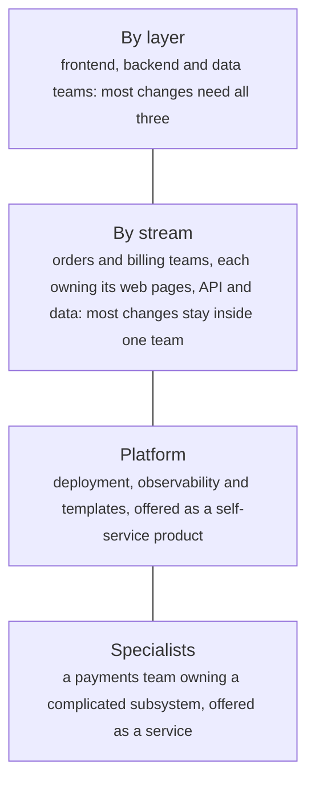

# Socio-technical design: Conway's law, Team Topologies and platform teams

> System Design · L4 Expert · Organisations and AI systems · about 120 min · hub module `m05` ([open the hub](https://claude.ai/artifact/C3GSn1y8nTQ24VT25d5S3X))

## Why it matters
Every architecture is built by an organisation, and the organisation leaves its fingerprints on it. Melvin Conway noticed in 1968 that systems copy the communication structures of the groups that design them. So an architect who ignores team boundaries gets an architecture shaped by accident. This module covers designing teams and systems together: Conway's law and its inverse, Team Topologies' team types and interaction modes, cognitive load, and platform teams that speed others up instead of becoming a queue.

## Pre-question (answer before reading)
**Q:** In your company, every feature needs changes from the frontend, backend and data teams, and features take six weeks to ship though the work itself takes two. What does Conway's law suggest, and what would you look at first?

<details><summary>Answer</summary>

The architecture mirrors the layer-based teams, so every feature crosses three team boundaries, and the time goes into hand-offs and waiting in each team's queue, not into the work. Look at the data first: how often changes need more than one team, and where features wait. Then consider teams aligned to streams of business change, each owning its slice from user interface to database, with the architecture's boundaries moved to match: the inverse Conway maneuver.

</details>

## 🍎 Story time (kid version)
**Pizza Town and the family road trip: Who bakes which pizza**

At first Luigi's family splits the kitchen by job: one makes the dough, one the sauce, one the toppings, one works the oven. Every pizza passes through four pairs of hands, and when the sauce-maker is busy, everyone waits. So they change: each person makes whole pizzas for one kind of order, start to finish. Grandma, who knows the wood-fired oven's secrets, keeps the tricky oven running for everyone. Uncle Marco spends a week teaching the cousins his dough trick, then goes back to his own pizzas. And nobody is given more recipes than they can remember.

| In the story | In a real organisation |
|---|---|
| Splitting by job: dough, sauce, toppings, oven | Teams by technical layer: every feature needs several teams |
| Each person making whole pizzas for one kind of order | Stream-aligned teams that own a flow of change end to end |
| Grandma keeping the tricky oven running for everyone | A platform or complicated-subsystem team, offering its work as a service |
| Uncle Marco teaching for a week, then leaving | An enabling team, facilitating for a while |
| Nobody gets more recipes than they can remember | Cognitive load: a team owns only what it can understand |

**Where the story breaks:** A family kitchen can reorganise in an afternoon. Real reorganisations take months, and the code doesn't move just because the teams did, so team boundaries and module boundaries have to change together, in small steps.

## Key ideas (grown-up version)
- **Conway's law**: in his 1968 paper, Melvin Conway argued that organisations that design systems are constrained to produce designs that copy their communication structures. Teams that talk easily build tightly coupled code; teams that rarely talk build components with narrow interfaces. Teams organised by layer (frontend, backend, database) therefore produce features that need every layer's team to ship.
- **The inverse Conway maneuver**: since the organisation shapes the architecture, shape the organisation on purpose: decide the boundaries you want, then form teams around them. Martin Fowler's caution: it isn't magic. A reorganisation alone won't untangle a rigid legacy system, so team boundaries and code boundaries are changed together, in small steps, watching for friction.
- **Team Topologies' four team types**: stream-aligned teams own a flow of change for a part of the business, end to end, and should be most of your teams; enabling teams help them adopt new skills and practices, then move on; complicated-subsystem teams own parts that need deep specialist knowledge; platform teams provide internal products that let stream-aligned teams deliver faster, as a self-service.
- **Three interaction modes**: collaboration (two teams working closely for a defined period, to discover something new), X-as-a-Service (one team consumes what another provides, through a clear interface, with little talking) and facilitating (one team helps and mentors another). Interactions should be explicit, and they change over time: a collaboration that discovers an API often ends as X-as-a-Service.
- **Cognitive load**: a team can only own well what it can understand. Overloaded teams, like overloaded CPUs, slow down and make poor decisions. Size each team's responsibilities to fit it, reduce the complexity that doesn't add value, and keep teams small and long-lived, often five to nine people (a rule of thumb: communication paths grow with the square of team size).
- **Platforms as products**: the CNCF's platforms white paper describes a good internal platform as a product designed around its users' needs, with self-service interfaces, good documentation and golden paths, reduced cognitive load, optional and composable parts, and security by default. Start with the thinnest viable platform, sometimes only documentation and templates, and earn adoption rather than mandating it.
- **Measuring the socio-technical system**: track flow (deployment frequency, lead time for changes, change failure rate and time to restore, the DORA measures), how often changes need more than one team, how long work waits between teams, platform adoption and developer satisfaction. Rising cross-team change and waiting time are signs that team and system boundaries have drifted apart.
- **Design them together**: when you draw service boundaries, say which team will own each one and how it will interact with its neighbours. Domain-driven design's bounded contexts are good candidates for both, because each groups the people, the language and the code around one area of the business.

## Diagrams
**Team Topologies: four team types**



**How two teams' interaction typically evolves**



_Collaboration is expensive and meant to be temporary; most interactions should settle into X-as-a-Service._

**The same product, organised two ways**



_Moving from the first row to the other three is the inverse Conway maneuver._

## Comparisons
**Team Topologies' interaction modes**

| Mode | What it looks like | When to use it | Watch for |
|---|---|---|---|
| Collaboration | Two teams work closely, sharing goals | Discovering something new, for a defined period | It never ends, and both teams slow down |
| X-as-a-Service | One team consumes what another provides | The interface is understood and fairly stable | A ticket queue in place of real self-service |
| Facilitating | One team coaches another | Adopting a new skill, tool or practice | The enabling team doing the work itself |

**Signs that teams and architecture have drifted apart**

| Signal | What it usually means |
|---|---|
| Most changes need two or more teams | Boundaries follow layers or history, not the flow of change |
| Work waits days for another team | Hand-offs and queues dominate lead time |
| One team owns far more than the others | Cognitive overload: slow, risky changes |
| Dependencies nobody declared | Hidden coupling; outages and surprise breakages |
| The platform has a long ticket queue | It's a service desk, not a self-service product |

## Code (JavaScript + Python)
### The seeded random generator used to simulate a year of changes
```python
def mulberry32(seed):
    state = seed & 0xFFFFFFFF
    def rand():
        nonlocal state
        state = (state + 0x6D2B79F5) & 0xFFFFFFFF
        t = ((state ^ (state >> 15)) * (state | 1)) & 0xFFFFFFFF
        t = (t ^ (t + (((t ^ (t >> 7)) * (t | 61)) & 0xFFFFFFFF))) & 0xFFFFFFFF
        return ((t ^ (t >> 14)) & 0xFFFFFFFF) / 4294967296
    return rand
```

```javascript
function mulberry32(seed) {
  return function () {
    seed = (seed + 0x6D2B79F5) | 0;
    let t = Math.imul(seed ^ (seed >>> 15), 1 | seed);
    t = (t + Math.imul(t ^ (t >>> 7), 61 | t)) ^ t;
    return ((t ^ (t >>> 14)) >>> 0) / 4294967296;
  };
}
```

### Conway's law in the commit log: how often a change needs more than one team
```python
STREAMS = [                                            # (business stream, % of changes, [(module, % of its changes touching it)])
    ("orders", 45, [("web-orders", 70), ("orders-api", 100), ("orders-db", 40), ("design-system", 10)]),
    ("billing", 35, [("web-billing", 60), ("billing-api", 100), ("billing-db", 50), ("orders-api", 15)]),
    ("search", 20, [("web-search", 60), ("search-api", 100), ("search-index", 50)]),
]
rand = mulberry32(7)
CHANGES = []                                           # 200 changes, each the list of modules it touched
for _ in range(200):
    r = int(rand() * 100)
    for stream, share, modules in STREAMS:
        if r < share:
            break
        r -= share
    CHANGES.append([m for m, chance in modules if int(rand() * 100) < chance])

BY_LAYER = {"web-orders": "Frontend", "web-billing": "Frontend", "web-search": "Frontend", "design-system": "Frontend",
            "orders-api": "Backend", "billing-api": "Backend", "search-api": "Backend",
            "orders-db": "Data", "billing-db": "Data", "search-index": "Data"}
BY_STREAM = {"web-orders": "Orders", "orders-api": "Orders", "orders-db": "Orders",
             "web-billing": "Billing", "billing-api": "Billing", "billing-db": "Billing",
             "web-search": "Search", "search-api": "Search", "search-index": "Search", "design-system": "Platform"}

def analyse(owner):
    crossing, pairs = 0, {}
    for modules in CHANGES:
        teams = sorted({owner[m] for m in modules})
        if len(teams) > 1:
            crossing += 1
            for i in range(len(teams)):
                for j in range(i + 1, len(teams)):
                    pair = f"{teams[i]} + {teams[j]}"
                    pairs[pair] = pairs.get(pair, 0) + 1
    top = sorted(pairs.items(), key=lambda kv: (-kv[1], kv[0]))[:2]
    return crossing, top

for label, owner in (("teams by layer", BY_LAYER), ("teams by stream", BY_STREAM)):
    crossing, top = analyse(owner)
    print(f"{label}: {crossing} of {len(CHANGES)} changes need more than one team ({crossing * 100 // len(CHANGES)}%)")
    print("  most often changed together: " + ", ".join(f"{pair} ({n})" for pair, n in top))
```

Output:
```text
teams by layer: 163 of 200 changes need more than one team (81%)
  most often changed together: Backend + Frontend (122), Backend + Data (95)
teams by stream: 17 of 200 changes need more than one team (8%)
  most often changed together: Billing + Orders (9), Orders + Platform (8)
```

- line 1: Changes follow the business: most orders work touches the orders pages, API and data together.
- line 16: Today's teams are organised by layer, the way the code was first split.
- line 26: A change that touches modules owned by two teams needs both teams: a conversation, a hand-off or a wait.
- line 36: The same changes, owned by stream-aligned teams, rarely cross a boundary; the pairs that remain show where team APIs are needed.

```javascript
const STREAMS = [                                      // [business stream, % of changes, [[module, % of its changes touching it]]]
  ["orders", 45, [["web-orders", 70], ["orders-api", 100], ["orders-db", 40], ["design-system", 10]]],
  ["billing", 35, [["web-billing", 60], ["billing-api", 100], ["billing-db", 50], ["orders-api", 15]]],
  ["search", 20, [["web-search", 60], ["search-api", 100], ["search-index", 50]]],
];
const rand = mulberry32(7);
const CHANGES = [];                                    // 200 changes, each the list of modules it touched
for (let c = 0; c < 200; c++) {
  let r = Math.floor(rand() * 100), modules;
  for (const [, share, mods] of STREAMS) {
    modules = mods;
    if (r < share) break;
    r -= share;
  }
  CHANGES.push(modules.filter(([, chance]) => Math.floor(rand() * 100) < chance).map(([m]) => m));
}

const BY_LAYER = { "web-orders": "Frontend", "web-billing": "Frontend", "web-search": "Frontend", "design-system": "Frontend",
                   "orders-api": "Backend", "billing-api": "Backend", "search-api": "Backend",
                   "orders-db": "Data", "billing-db": "Data", "search-index": "Data" };
const BY_STREAM = { "web-orders": "Orders", "orders-api": "Orders", "orders-db": "Orders",
                    "web-billing": "Billing", "billing-api": "Billing", "billing-db": "Billing",
                    "web-search": "Search", "search-api": "Search", "search-index": "Search", "design-system": "Platform" };

function analyse(owner) {
  let crossing = 0;
  const pairs = new Map();
  for (const modules of CHANGES) {
    const teams = [...new Set(modules.map(m => owner[m]))].sort();
    if (teams.length > 1) {
      crossing++;
      for (let i = 0; i < teams.length; i++) {
        for (let j = i + 1; j < teams.length; j++) {
          const pair = `${teams[i]} + ${teams[j]}`;
          pairs.set(pair, (pairs.get(pair) ?? 0) + 1);
        }
      }
    }
  }
  const top = [...pairs].sort((a, b) => b[1] - a[1] || (a[0] < b[0] ? -1 : 1)).slice(0, 2);
  return [crossing, top];
}

for (const [label, owner] of [["teams by layer", BY_LAYER], ["teams by stream", BY_STREAM]]) {
  const [crossing, top] = analyse(owner);
  console.log(`${label}: ${crossing} of ${CHANGES.length} changes need more than one team (${Math.floor(crossing * 100 / CHANGES.length)}%)`);
  console.log("  most often changed together: " + top.map(([pair, n]) => `${pair} (${n})`).join(", "));
}
```

Output:
```text
teams by layer: 163 of 200 changes need more than one team (81%)
  most often changed together: Backend + Frontend (122), Backend + Data (95)
teams by stream: 17 of 200 changes need more than one team (8%)
  most often changed together: Billing + Orders (9), Orders + Platform (8)
```

- line 1: Changes follow the business: most orders work touches the orders pages, API and data together.
- line 18: Today's teams are organised by layer, the way the code was first split.
- line 29: A change that touches modules owned by two teams needs both teams: a conversation, a hand-off or a wait.
- line 44: The same changes, owned by stream-aligned teams, rarely cross a boundary; the pairs that remain show where team APIs are needed.

### The arithmetic behind small teams and few dependencies
```python
for people in (3, 5, 9, 15, 50):
    print(f"a team of {people}: {people * (people - 1) // 2:,} pairs of people who may need to talk")

ON_TIME = 90                                           # % of the time each team delivers its part when planned
for teams in (1, 2, 4, 8):
    chance = ON_TIME ** teams * 100 // 100 ** teams    # every team must be on time, so the chances multiply
    print(f"a feature that needs {teams} team{'s' if teams > 1 else ''}: on time {chance}% of the time")

WORK, WAIT = 10, 4                                     # days of work in a feature; days waiting in each team's queue
for teams in (1, 4):
    print(f"built by {teams} team{'s' if teams > 1 else ''}: {teams - 1} hand-offs, about {WORK + (teams - 1) * WAIT} days from start to finish")
```

Output:
```text
a team of 3: 3 pairs of people who may need to talk
a team of 5: 10 pairs of people who may need to talk
a team of 9: 36 pairs of people who may need to talk
a team of 15: 105 pairs of people who may need to talk
a team of 50: 1,225 pairs of people who may need to talk
a feature that needs 1 team: on time 90% of the time
a feature that needs 2 teams: on time 81% of the time
a feature that needs 4 teams: on time 65% of the time
a feature that needs 8 teams: on time 43% of the time
built by 1 team: 0 hand-offs, about 10 days from start to finish
built by 4 teams: 3 hand-offs, about 22 days from start to finish
```

- line 1: Pairs grow with the square of team size: one reason long-lived teams of five to nine work well.
- line 6: Every team must deliver its part, so the chances multiply: eight 90% teams are on time less than half the time.
- line 9: Illustrative numbers: work in a queue waits, and every hand-off adds a wait.

```javascript
for (const people of [3, 5, 9, 15, 50]) {
  console.log(`a team of ${people}: ${(people * (people - 1) / 2).toLocaleString("en-US")} pairs of people who may need to talk`);
}

const ON_TIME = 90;                                    // % of the time each team delivers its part when planned
for (const teams of [1, 2, 4, 8]) {
  const chance = Math.floor(ON_TIME ** teams * 100 / 100 ** teams);   // every team must be on time, so the chances multiply
  console.log(`a feature that needs ${teams} team${teams > 1 ? "s" : ""}: on time ${chance}% of the time`);
}

const WORK = 10, WAIT = 4;                             // days of work in a feature; days waiting in each team's queue
for (const teams of [1, 4]) {
  console.log(`built by ${teams} team${teams > 1 ? "s" : ""}: ${teams - 1} hand-offs, about ${WORK + (teams - 1) * WAIT} days from start to finish`);
}
```

Output:
```text
a team of 3: 3 pairs of people who may need to talk
a team of 5: 10 pairs of people who may need to talk
a team of 9: 36 pairs of people who may need to talk
a team of 15: 105 pairs of people who may need to talk
a team of 50: 1,225 pairs of people who may need to talk
a feature that needs 1 team: on time 90% of the time
a feature that needs 2 teams: on time 81% of the time
a feature that needs 4 teams: on time 65% of the time
a feature that needs 8 teams: on time 43% of the time
built by 1 team: 0 hand-offs, about 10 days from start to finish
built by 4 teams: 3 hand-offs, about 22 days from start to finish
```

- line 1: Pairs grow with the square of team size: one reason long-lived teams of five to nine work well.
- line 7: Every team must deliver its part, so the chances multiply: eight 90% teams are on time less than half the time.
- line 11: Illustrative numbers: work in a queue waits, and every hand-off adds a wait.

### Does the platform team pay for itself? Adoption decides
```python
TEAMS, TOIL = 40, 15                                   # stream-aligned teams; hours of infrastructure toil per team per week
PLATFORM, WEEK = 5, 40                                 # platform engineers; hours a week each
BEST_SHARE = 60                                        # % of toil the finished platform removes for a team that uses it

def two_years(first_release, start_share, teams_a_month):
    adopted = net = 0
    payback = None
    for month in range(1, 25):
        share = 0
        if month > first_release:
            adopted = min(TEAMS, adopted + teams_a_month)          # teams join once it solves a problem they have
            share = min(BEST_SHARE, start_share + 5 * (month - first_release - 1))
        net += adopted * TOIL * share // 100 * 4 - PLATFORM * WEEK * 4   # hours saved minus hours spent, per month
        if payback is None and month > first_release and net >= 0:
            payback = month
    return payback, net

for label, first, start, rate in (("build for six months, then launch", 6, 60, 3),
                                  ("ship a thin version in month two, then improve it", 2, 30, 3),
                                  ("ship it, but nobody adopts it", 2, 30, 0)):
    payback, net = two_years(first, start, rate)
    when = f"pays back in month {payback}" if payback else "doesn't pay back within two years"
    print(f"{label}: {when}, net {net:+,} hours after 24 months")
monthly_cost = PLATFORM * WEEK * 4
per_team = TOIL * BEST_SHARE // 100 * 4
print(f"just to cover its own cost, {-(-monthly_cost // per_team)} of {TEAMS} teams must use the finished platform")
```

Output:
```text
build for six months, then launch: doesn't pay back within two years, net -2,172 hours after 24 months
ship a thin version in month two, then improve it: pays back in month 20, net +3,076 hours after 24 months
ship it, but nobody adopts it: doesn't pay back within two years, net -19,200 hours after 24 months
just to cover its own cost, 23 of 40 teams must use the finished platform
```

- line 1: Illustrative numbers: measure the real toil (environments, pipelines, on-call plumbing) before you build anything.
- line 11: Value starts only when teams adopt it, so the release date and the adoption rate matter more than the feature list.
- line 19: The thinnest viable platform removes less toil at first, but starts earning adoption four months earlier.
- line 26: A platform nobody uses is pure cost: treat adoption as the product's main measure.

```javascript
const TEAMS = 40, TOIL = 15;                           // stream-aligned teams; hours of infrastructure toil per team per week
const PLATFORM = 5, WEEK = 40;                         // platform engineers; hours a week each
const BEST_SHARE = 60;                                 // % of toil the finished platform removes for a team that uses it

function twoYears(firstRelease, startShare, teamsAMonth) {
  let adopted = 0, net = 0, payback = null;
  for (let month = 1; month <= 24; month++) {
    let share = 0;
    if (month > firstRelease) {
      adopted = Math.min(TEAMS, adopted + teamsAMonth);           // teams join once it solves a problem they have
      share = Math.min(BEST_SHARE, startShare + 5 * (month - firstRelease - 1));
    }
    net += Math.floor(adopted * TOIL * share / 100) * 4 - PLATFORM * WEEK * 4;   // hours saved minus hours spent, per month
    if (payback === null && month > firstRelease && net >= 0) payback = month;
  }
  return [payback, net];
}

const signed = n => (n >= 0 ? "+" : "-") + Math.abs(n).toLocaleString("en-US");
for (const [label, first, start, rate] of [["build for six months, then launch", 6, 60, 3],
                                           ["ship a thin version in month two, then improve it", 2, 30, 3],
                                           ["ship it, but nobody adopts it", 2, 30, 0]]) {
  const [payback, net] = twoYears(first, start, rate);
  const when = payback ? `pays back in month ${payback}` : "doesn't pay back within two years";
  console.log(`${label}: ${when}, net ${signed(net)} hours after 24 months`);
}
const monthlyCost = PLATFORM * WEEK * 4;
const perTeam = Math.floor(TOIL * BEST_SHARE / 100) * 4;
console.log(`just to cover its own cost, ${Math.ceil(monthlyCost / perTeam)} of ${TEAMS} teams must use the finished platform`);
```

Output:
```text
build for six months, then launch: doesn't pay back within two years, net -2,172 hours after 24 months
ship a thin version in month two, then improve it: pays back in month 20, net +3,076 hours after 24 months
ship it, but nobody adopts it: doesn't pay back within two years, net -19,200 hours after 24 months
just to cover its own cost, 23 of 40 teams must use the finished platform
```

- line 1: Illustrative numbers: measure the real toil (environments, pipelines, on-call plumbing) before you build anything.
- line 10: Value starts only when teams adopt it, so the release date and the adoption rate matter more than the feature list.
- line 21: The thinnest viable platform removes less toil at first, but starts earning adoption four months earlier.
- line 29: A platform nobody uses is pure cost: treat adoption as the product's main measure.

## Worked example
**Problem.** Seven services, each with a complexity score, and a year of co-change counts between them. Today three teams own them by layer. Find the way to give the services to three teams that minimises the co-changes crossing team boundaries, without any team owning more than 10 points of complexity.

1. Score a design by the co-changes that cross team boundaries: each is a conversation, a hand-off or a wait.
2. Cap each team's cognitive load: the total complexity it owns must stay at or below what one team can understand.
3. Try every assignment (3⁷ = 2,187 here; real tools use heuristics) and keep the one with the fewest crossings within the cap.
4. Compare it with today's teams, and name each new team's type.

```python
SERVICES = ["web-orders", "web-billing", "orders-api", "billing-api", "orders-db", "billing-db", "payments-gateway"]
LOAD = [3, 2, 4, 4, 2, 2, 5]                           # complexity points: how much each service takes to understand
CO_CHANGES = {("web-orders", "orders-api"): 40, ("orders-api", "orders-db"): 25, ("web-billing", "billing-api"): 30,
              ("billing-api", "billing-db"): 20, ("billing-api", "payments-gateway"): 15,
              ("orders-api", "billing-api"): 10, ("web-orders", "web-billing"): 5}   # changes that touched both, last year
CAP, TEAMS = 10, 3                                     # the most complexity one team can own well; teams available

def crossings(team_of):                                # co-changes that need two teams to coordinate
    return sum(n for (a, b), n in CO_CHANGES.items() if team_of[a] != team_of[b])

def loads(team_of):
    return [sum(LOAD[i] for i, s in enumerate(SERVICES) if team_of[s] == t) for t in range(TEAMS)]

def groups(team_of):
    found = [[s for s in SERVICES if team_of[s] == t] for t in range(TEAMS)]
    return sorted((g for g in found if g), key=lambda g: SERVICES.index(g[0]))

by_layer = {"web-orders": 0, "web-billing": 0, "orders-api": 1, "billing-api": 1, "payments-gateway": 1,
            "orders-db": 2, "billing-db": 2}
total = sum(CO_CHANGES.values())
print(f"teams by layer: {crossings(by_layer)} of {total} co-changes cross teams, loads {', '.join(map(str, loads(by_layer)))} (cap {CAP})")

best = None
for code in range(TEAMS ** len(SERVICES)):             # every way to give 7 services to 3 teams: 2,187
    team_of = {s: code // TEAMS ** i % TEAMS for i, s in enumerate(SERVICES)}
    if max(loads(team_of)) <= CAP and (best is None or crossings(team_of) < crossings(best)):
        best = team_of
print(f"best within the cap: {crossings(best)} cross teams")
for group in groups(best):
    print(f"  a team owning {', '.join(group)} (load {sum(LOAD[SERVICES.index(s)] for s in group)})")
```

Output:
```text
teams by layer: 115 of 145 co-changes cross teams, loads 5, 13, 4 (cap 10)
best within the cap: 30 cross teams
  a team owning web-orders, orders-api, orders-db (load 9)
  a team owning web-billing, billing-api, billing-db (load 8)
  a team owning payments-gateway (load 5)
```

```javascript
const SERVICES = ["web-orders", "web-billing", "orders-api", "billing-api", "orders-db", "billing-db", "payments-gateway"];
const LOAD = [3, 2, 4, 4, 2, 2, 5];                    // complexity points: how much each service takes to understand
const CO_CHANGES = [["web-orders", "orders-api", 40], ["orders-api", "orders-db", 25], ["web-billing", "billing-api", 30],
                    ["billing-api", "billing-db", 20], ["billing-api", "payments-gateway", 15],
                    ["orders-api", "billing-api", 10], ["web-orders", "web-billing", 5]];   // changes that touched both, last year
const CAP = 10, TEAMS = 3;                             // the most complexity one team can own well; teams available

function crossings(teamOf) {                           // co-changes that need two teams to coordinate
  return CO_CHANGES.reduce((sum, [a, b, n]) => sum + (teamOf[a] !== teamOf[b] ? n : 0), 0);
}

function loads(teamOf) {
  return Array.from({ length: TEAMS }, (_, t) => SERVICES.reduce((sum, s, i) => sum + (teamOf[s] === t ? LOAD[i] : 0), 0));
}

function groups(teamOf) {
  const found = Array.from({ length: TEAMS }, (_, t) => SERVICES.filter(s => teamOf[s] === t));
  return found.filter(g => g.length).sort((g, h) => SERVICES.indexOf(g[0]) - SERVICES.indexOf(h[0]));
}

const byLayer = { "web-orders": 0, "web-billing": 0, "orders-api": 1, "billing-api": 1, "payments-gateway": 1,
                  "orders-db": 2, "billing-db": 2 };
const total = CO_CHANGES.reduce((sum, [, , n]) => sum + n, 0);
console.log(`teams by layer: ${crossings(byLayer)} of ${total} co-changes cross teams, loads ${loads(byLayer).join(", ")} (cap ${CAP})`);

let best = null;
for (let code = 0; code < TEAMS ** SERVICES.length; code++) {   // every way to give 7 services to 3 teams: 2,187
  const teamOf = Object.fromEntries(SERVICES.map((s, i) => [s, Math.floor(code / TEAMS ** i) % TEAMS]));
  if (Math.max(...loads(teamOf)) <= CAP && (best === null || crossings(teamOf) < crossings(best))) best = teamOf;
}
console.log(`best within the cap: ${crossings(best)} cross teams`);
for (const group of groups(best)) {
  console.log(`  a team owning ${group.join(", ")} (load ${group.reduce((sum, s) => sum + LOAD[SERVICES.indexOf(s)], 0)})`);
}
```

Output:
```text
teams by layer: 115 of 145 co-changes cross teams, loads 5, 13, 4 (cap 10)
best within the cap: 30 cross teams
  a team owning web-orders, orders-api, orders-db (load 9)
  a team owning web-billing, billing-api, billing-db (load 8)
  a team owning payments-gateway (load 5)
```

**Answer.** Organised by layer, 115 of the 145 co-changes cross a team boundary, and the backend team carries 13 points, beyond what one team can own well. The best design within the cap has only 30 crossings: two stream-aligned teams own orders and billing end to end, and the payments gateway, too complex to fit inside the billing team's load, becomes a complicated-subsystem team that offers it as a service. The crossings that remain become explicit interactions: billing's calls into orders and payments are X-as-a-Service with documented APIs. Choosing the boundaries first and shaping the teams to fit is the inverse Conway maneuver in miniature.

## Your turn (faded example)
**Problem.** Finish `undeclared(calls, owner, declared)`: from service calls seen in traces, return every call between two different teams that have no declared interaction in either direction, as sorted (caller's team, callee's team, caller, callee) tuples.

- ✓ Look up both services' owning teams; calls inside one team are fine.
- **Why does an undeclared dependency matter?**
  <details><summary>Answer</summary>It's coordination nobody planned for. The called team doesn't know it has a consumer, can break it without warning, and the work never shows up in either team's planning. Declare it, with a team API and an interaction mode, or remove it.</details>
- **Should every pair of teams have a declared interaction?**
  <details><summary>Answer</summary>No: most pairs should have none at all. A team that needs many interactions is a sign its boundaries are wrong, or that a platform should offer the shared parts as a service.</details>

Starter:
```python
OWNER = {"checkout": "Orders", "orders-api": "Orders", "billing-api": "Billing", "invoices": "Billing",
         "payments-gateway": "Payments", "search-api": "Search", "deploy-pipeline": "Platform", "metrics": "Platform"}
DECLARED = {("Orders", "Billing"): "X-as-a-Service", ("Billing", "Payments"): "X-as-a-Service",
            ("Orders", "Platform"): "X-as-a-Service", ("Billing", "Platform"): "X-as-a-Service",
            ("Search", "Platform"): "X-as-a-Service", ("Orders", "Search"): "collaboration"}
CALLS = [("checkout", "orders-api"), ("checkout", "billing-api"), ("orders-api", "search-api"),
         ("search-api", "orders-api"), ("invoices", "payments-gateway"), ("orders-api", "payments-gateway"),
         ("checkout", "metrics"), ("payments-gateway", "metrics"), ("invoices", "search-api")]   # seen in traces

def undeclared(calls, owner, declared):
    found = []
    ...                                                # TODO: cross-team calls whose two teams have no declared interaction
    return sorted(found)
```

```javascript
const OWNER = { "checkout": "Orders", "orders-api": "Orders", "billing-api": "Billing", "invoices": "Billing",
                "payments-gateway": "Payments", "search-api": "Search", "deploy-pipeline": "Platform", "metrics": "Platform" };
const DECLARED = new Map([["Orders|Billing", "X-as-a-Service"], ["Billing|Payments", "X-as-a-Service"],
                          ["Orders|Platform", "X-as-a-Service"], ["Billing|Platform", "X-as-a-Service"],
                          ["Search|Platform", "X-as-a-Service"], ["Orders|Search", "collaboration"]]);
const CALLS = [["checkout", "orders-api"], ["checkout", "billing-api"], ["orders-api", "search-api"],
               ["search-api", "orders-api"], ["invoices", "payments-gateway"], ["orders-api", "payments-gateway"],
               ["checkout", "metrics"], ["payments-gateway", "metrics"], ["invoices", "search-api"]];   // seen in traces
const byFields = (x, y) => { const p = x.join("\u0000"), q = y.join("\u0000"); return p < q ? -1 : p > q ? 1 : 0; };

function undeclared(calls, owner, declared) {
  const found = [];
  // TODO: cross-team calls whose two teams have no declared interaction ("A|B" or "B|A")
  return found.sort(byFields);
}
```

<details><summary>Full solution</summary>

```python
OWNER = {"checkout": "Orders", "orders-api": "Orders", "billing-api": "Billing", "invoices": "Billing",
         "payments-gateway": "Payments", "search-api": "Search", "deploy-pipeline": "Platform", "metrics": "Platform"}
DECLARED = {("Orders", "Billing"): "X-as-a-Service", ("Billing", "Payments"): "X-as-a-Service",
            ("Orders", "Platform"): "X-as-a-Service", ("Billing", "Platform"): "X-as-a-Service",
            ("Search", "Platform"): "X-as-a-Service", ("Orders", "Search"): "collaboration"}
CALLS = [("checkout", "orders-api"), ("checkout", "billing-api"), ("orders-api", "search-api"),
         ("search-api", "orders-api"), ("invoices", "payments-gateway"), ("orders-api", "payments-gateway"),
         ("checkout", "metrics"), ("payments-gateway", "metrics"), ("invoices", "search-api")]   # seen in traces

def undeclared(calls, owner, declared):
    found = []
    for caller, callee in calls:
        a, b = owner[caller], owner[callee]
        if a != b and (a, b) not in declared and (b, a) not in declared:
            found.append((a, b, caller, callee))       # a dependency nobody planned for
    return sorted(found)

for a, b, caller, callee in undeclared(CALLS, OWNER, DECLARED):
    print(f"{a} depends on {b} without an agreed interaction: {caller} calls {callee}")
```

Output:
```text
Billing depends on Search without an agreed interaction: invoices calls search-api
Orders depends on Payments without an agreed interaction: orders-api calls payments-gateway
Payments depends on Platform without an agreed interaction: payments-gateway calls metrics
```

```javascript
const OWNER = { "checkout": "Orders", "orders-api": "Orders", "billing-api": "Billing", "invoices": "Billing",
                "payments-gateway": "Payments", "search-api": "Search", "deploy-pipeline": "Platform", "metrics": "Platform" };
const DECLARED = new Map([["Orders|Billing", "X-as-a-Service"], ["Billing|Payments", "X-as-a-Service"],
                          ["Orders|Platform", "X-as-a-Service"], ["Billing|Platform", "X-as-a-Service"],
                          ["Search|Platform", "X-as-a-Service"], ["Orders|Search", "collaboration"]]);
const CALLS = [["checkout", "orders-api"], ["checkout", "billing-api"], ["orders-api", "search-api"],
               ["search-api", "orders-api"], ["invoices", "payments-gateway"], ["orders-api", "payments-gateway"],
               ["checkout", "metrics"], ["payments-gateway", "metrics"], ["invoices", "search-api"]];   // seen in traces
const byFields = (x, y) => { const p = x.join("\u0000"), q = y.join("\u0000"); return p < q ? -1 : p > q ? 1 : 0; };

function undeclared(calls, owner, declared) {
  const found = [];
  for (const [caller, callee] of calls) {
    const a = owner[caller], b = owner[callee];
    if (a !== b && !declared.has(`${a}|${b}`) && !declared.has(`${b}|${a}`)) found.push([a, b, caller, callee]);   // a dependency nobody planned for
  }
  return found.sort(byFields);
}

for (const [a, b, caller, callee] of undeclared(CALLS, OWNER, DECLARED)) {
  console.log(`${a} depends on ${b} without an agreed interaction: ${caller} calls ${callee}`);
}
```

Output:
```text
Billing depends on Search without an agreed interaction: invoices calls search-api
Orders depends on Payments without an agreed interaction: orders-api calls payments-gateway
Payments depends on Platform without an agreed interaction: payments-gateway calls metrics
```

</details>

## Socratic checks and quiz (answers hidden)
**1. What does this print?**

```python
print(*(n * (n - 1) // 2 for n in (4, 8)))
```

```javascript
console.log(...[4, 8].map(n => n * (n - 1) / 2));
```

- A. 6 28
- B. 4 8
- C. 8 16
- D. 12 56

<details><summary>Answer</summary>

6 28. n(n − 1) ÷ 2 pairs: doubling a team from 4 to 8 people takes it from 6 to 28 possible conversations.

</details>

**2. What does this print?**

```python
chance = 90 ** 3 * 100 // 100 ** 3
print(chance)
```

```javascript
const chance = Math.floor(90 ** 3 * 100 / 100 ** 3);
console.log(chance);
```

- A. 72
- B. 90
- C. 70
- D. 81

<details><summary>Answer</summary>

72. 0.9³ = 0.729, so a feature that needs all three teams on time ships on time about 72% of the time. Dependencies multiply risk.

</details>

**3. Which statement best captures Conway's law?**

- A. Organisations design systems that copy their own communication structures
- B. Adding people to a late project makes it later
- C. Work expands to fill the time available
- D. Systems should be split into services of equal size

<details><summary>Answer</summary>

Organisations design systems that copy their own communication structures. Conway, 1968. The others are Brooks's law, Parkinson's law, and not a law at all.

</details>

**4. A team spends a few months helping other teams adopt contract testing, then moves on to the next practice. Which Team Topologies team type is it?**

- A. Enabling team
- B. Platform team
- C. Complicated-subsystem team
- D. Stream-aligned team

<details><summary>Answer</summary>

Enabling team. Enabling teams coach others in new skills and practices, facilitating for a limited time, and don't take over the work.

</details>

**5. Which are Team Topologies interaction modes? (choose 3)**

- A. Collaboration
- B. X-as-a-Service
- C. Facilitating
- D. Hand-off
- E. Shared ownership

<details><summary>Answer</summary>

Collaboration, X-as-a-Service, Facilitating. Hand-offs and shared ownership are what the model tries to remove: they hide coordination costs.

</details>

**6. Judge each statement.**

- The inverse Conway maneuver changes team structure to encourage the architecture you want.
- A platform team should make its platform mandatory, so adoption is guaranteed.
- Collaboration between two teams is meant to be permanent.
- A team's cognitive load is a reason to keep its responsibilities small enough to own fully.

<details><summary>Answer</summary>

The inverse Conway maneuver changes team structure to encourage the architecture you want.: Yes; A platform team should make its platform mandatory, so adoption is guaranteed.: No; Collaboration between two teams is meant to be permanent.: No; A team's cognitive load is a reason to keep its responsibilities small enough to own fully.: Yes. Platforms earn adoption by being useful (thinnest viable platform, self-service); collaboration is for discovery over a defined period; overloaded teams slow down.

</details>

**7. Put an inverse Conway reorganisation in order.**

- (put the steps in order)

<details><summary>Answer</summary>

Map today's teams, services and how changes flow between them → Find where changes cross team boundaries most often → Draw the target boundaries around streams of business change → Form teams around those boundaries, within each team's cognitive load → Declare the interactions between teams, mostly as services → Measure lead time and cross-team changes, and adjust. Evidence first, target boundaries second, teams third, then explicit interactions and measurement, because the first design is never perfect.

</details>

**8. Complete the Python function for the number of pairs of people in a team.**

```
def conversations(people):                            # pairs of people in a team who may need to talk
    return people * ({{0}}) // {{1}}

```

<details><summary>Answer</summary>

people - 1 | 2. Each of n people can talk to n − 1 others, and each pair is counted twice: n(n − 1) ÷ 2.

</details>

## Traps & misconceptions
- **“Architecture and organisation design are separate decisions.”** Conway's law says they converge whether you plan it or not. Decide service boundaries and team boundaries together.
- **“Bigger teams get more done.”** Communication paths grow with the square of team size, and so does the time spent coordinating. Split by stream into small, long-lived teams.
- **“Component teams are efficient: each is expert in its layer.”** Each feature then queues at every layer's team. Stream-aligned teams own a slice end to end; keep specialists for the genuinely hard parts.
- **“The platform team is the infrastructure team, renamed.”** A platform is an internal product: research users' needs, self-service APIs and docs, a roadmap, and adoption earned, not mandated.
- **“Collaboration between teams is always good.”** Collaboration is expensive and meant for discovery, for a limited time. Long-running collaboration usually means a boundary is in the wrong place.
- **“Microservices will fix our coordination problems.”** Services whose boundaries don't match team ownership create a distributed monolith: the same coordination, now over the network.

## Discussion prompts
- **Every feature in your company needs changes from four teams (frontend, backend, data and operations), and lead time is six weeks. What would you change?**
  <details><summary>One good answer</summary>First measure where the time goes: working versus waiting, and the share of changes that need more than one team. Then map the value streams and move towards stream-aligned teams that own a business area end to end, with the architecture's boundaries moved to match, one stream at a time. Turn operations work into a platform team offering self-service deployment and observability, use an enabling team to spread skills the new teams lack, and keep a complicated-subsystem team only where the specialism is real. Track lead time and cross-team changes to see whether it's working, and expect a transition period.</details>
- **You're asked to set up a platform team. How do you make sure it speeds teams up rather than becoming a bottleneck?**
  <details><summary>One good answer</summary>Run it as a product: interview the stream-aligned teams about their biggest sources of toil, and start with the thinnest viable platform that removes the top one, even if that's documentation and templates. Offer self-service interfaces with golden paths rather than ticket queues, keep the parts optional and composable, and collaborate closely with early adopters for a limited time. Measure adoption, the time for a new service to reach production, and developer satisfaction, and treat a growing ticket queue as a sign the product is missing something.</details>

## Teach-back
**Prompt:** Explain to a junior colleague what Conway's law means for how we design systems and teams.

Rubric:
- [ ] Conway's law: systems copy the communication structure of the teams that build them
- [ ] Layer teams make every feature cross boundaries; stream-aligned teams own a flow end to end
- [ ] The inverse Conway maneuver: shape teams to get the architecture you want, changing code and teams together
- [ ] Team Topologies' team types and interaction modes, and cognitive load as a limit
- [ ] Measuring cross-team changes, waiting time and platform adoption

<details><summary>Model answer</summary>

Conway's law says a system ends up mirroring how the teams that build it communicate. If we organise teams by layer, with frontend, backend and data teams, almost every feature crosses three team boundaries and waits in three queues. So we design teams and architecture together: most teams should be stream-aligned, each owning a part of the business end to end, supported by a platform team that offers self-service tools, enabling teams that coach for a while, and specialists only for genuinely hard subsystems. Interactions between teams should be explicit, mostly X-as-a-Service, with collaboration kept short. Each team's responsibilities must fit its cognitive load. Deliberately reshaping teams to get the architecture we want is the inverse Conway maneuver, and it works when code boundaries move along with the teams. We check it by measuring how often changes need several teams and how long work waits between them.

</details>

## Quick Q&A (also in the SRS deck)
- **State Conway's law.** Organisations that design systems produce designs that copy their own communication structures.
- **What is the inverse Conway maneuver?** Shaping team structure on purpose so that the architecture you want is the one the organisation naturally produces.
- **Team Topologies' four team types?** Stream-aligned, enabling, complicated-subsystem and platform.
- **Team Topologies' three interaction modes?** Collaboration, X-as-a-Service and facilitating.
- **Why limit a team's cognitive load?** A team can only own well what it can understand; overload slows delivery and lowers quality.
- **What is the thinnest viable platform?** The smallest platform, sometimes just documentation and templates, that makes stream-aligned teams faster.

## Practice problems
- [ ] [Reading · Martin Fowler: Conway's Law](https://martinfowler.com/bliki/ConwaysLaw.html) · find one place in a system you know where the code's structure mirrors a team boundary, for better or worse
- [ ] [Reference · Team Topologies: key concepts](https://teamtopologies.com/key-concepts) · label each team you work with by type, and each of its interactions by mode
- [ ] [Reading · CNCF: Platforms white paper](https://tag-app-delivery.cncf.io/whitepapers/platforms/) · score your internal platform against its attributes, and pick the one that would help most
- [ ] [Reading · Melvin Conway: How Do Committees Invent? (1968)](https://www.melconway.com/Home/Committees_Paper.html) · read the original argument, and note what Conway says happens as organisations grow

## Sources (accessed 2026-10-12)
- [Melvin E. Conway (1968): How Do Committees Invent?](https://www.melconway.com/Home/Committees_Paper.html)
- [Martin Fowler (2022): Conway's Law](https://martinfowler.com/bliki/ConwaysLaw.html)
- [Team Topologies: key concepts](https://teamtopologies.com/key-concepts)
- [CNCF TAG App Delivery: Platforms white paper](https://tag-app-delivery.cncf.io/whitepapers/platforms/)
