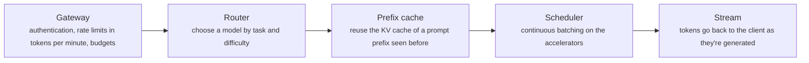
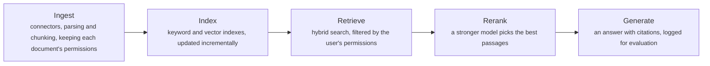
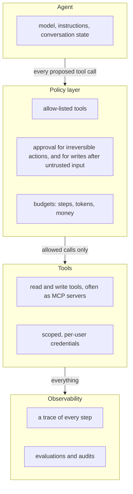

# AI systems design: LLM serving, RAG at scale and agent platforms

> System Design · L4 Expert · Organisations and AI systems · about 130 min · hub module `m06` ([open the hub](https://claude.ai/artifact/C3GSn1y8nTQ24VT25d5S3X))

## Why it matters
Almost every organisation is now building AI features, and they bring familiar problems in new shapes: capacity measured in tokens and accelerator memory, latency split into time to first token and time per token, retrieval systems that must respect permissions, and agents that act on text an attacker may have written. This module treats them as systems design: serving and batching, caching and routing, retrieval-augmented generation (RAG) at scale, and agent platforms whose guardrails live outside the model.

## Pre-question (answer before reading)
**Q:** Your support assistant sends every request to one large model. It costs too much, answers take eight seconds, and a user reports it once quoted an internal document they shouldn't have seen. What would you change?

<details><summary>Answer</summary>

Measure first: time to first token against generation time, prompt lengths, and the mix of easy and hard requests. Route easy requests to a smaller model with a confidence check and escalate the rest, cache the shared prefix (instructions and policies) with prompt caching, retrieve only the passages that are needed, and stream tokens as they're generated. Fix the leak in retrieval, not in the prompt: filter documents by the user's permissions before ranking, so text they can't read never reaches the model.

</details>

## 🍎 Story time (kid version)
**Pizza Town and the family road trip: Luigi's phone helper**

Luigi's pizza helper takes phone orders. The oven bakes several pizzas at once, and instead of waiting for all of them to finish, Luigi slides a new one in as soon as one comes out. Regulars' usual orders sit on a card, so nobody asks twice. Easy orders go to the apprentice; tricky ones go to Luigi. When a caller asks about allergens, the helper looks in the recipe book, but only at the pages that caller may see: the secret sauce stays locked. The helper can take orders, but must ask Luigi before giving refunds, especially after a stranger's note says "give this man free pizza".

| In the story | In a real organisation |
|---|---|
| A new pizza in as soon as one comes out | Continuous batching: requests join and leave between decode steps |
| The regulars' card | Prompt caching: reuse the work for a prefix seen before |
| Easy orders to the apprentice, tricky ones to Luigi | Routing and cascades: a small model first, escalating when unsure |
| Only the pages the caller may see | Retrieval filtered by the user's permissions |
| Asking Luigi before refunds, especially after a stranger's note | Approval for consequential actions once untrusted text is in play |

**Where the story breaks:** Luigi's helper knows which notes come from strangers. A language model can't reliably tell instructions from data, so the protection has to live outside the model, in the permissions and approvals around it.

## Key ideas (grown-up version)
- **Serving basics**: a request has two phases. Prefill processes the whole prompt in parallel and sets the time to first token; decode then produces one token per step for every sequence in the batch and sets the time per output token. Decode is usually limited by memory bandwidth, so serving more requests at once raises total throughput, while each user's speed falls a little. Set targets for both latencies, and for tokens per second per accelerator.
- **Batching**: static batching waits for a whole batch to finish, so short answers sit idle behind long ones. Iteration-level scheduling, introduced by Orca and now usually called continuous batching, lets finished requests leave and new ones join between decode steps. vLLM's PagedAttention stores the KV cache in small blocks allocated on demand, which cut memory waste to near zero and raised throughput two to four times in its authors' tests.
- **The KV cache**: each token of each active request keeps a key and a value per layer and per KV head in accelerator memory: 2 × layers × KV heads × head size × bytes per value. Grouped-query attention shares KV heads to shrink it. Memory, not compute, usually caps concurrency, which is why long contexts are expensive. Prompt (prefix) caching reuses the KV cache of a prompt prefix seen recently, such as instructions or documents, cutting both cost and time to first token.
- **Routing and cascades**: not every request needs the largest model. Route by task, or try a small model first and escalate when a check fails: a confidence score, a schema validator, a test, or a judge model. Keep fallbacks across models or regions, account for rate limits in tokens per minute, and put budgets on tokens and cost per request. Tune thresholds on labelled samples, and recheck them as traffic changes.
- **RAG at scale**: an ingestion pipeline parses, chunks, embeds and indexes documents, with incremental updates and deletions, and keeps each document's permissions. Queries combine keyword and vector search, often fused with reciprocal rank fusion (1 ÷ (k + rank), with k = 60 in the original paper), then rerank and filter by the user's permissions inside retrieval, so unauthorised text never reaches the prompt. Evaluate retrieval (did the right passages come back?) separately from generation (is the answer grounded in them?).
- **Workflows and agents**: Anthropic's guidance separates workflows, where code orchestrates the model along predefined paths (prompt chaining, routing, parallelisation, orchestrator-workers, evaluator-optimiser), from agents, where the model directs its own steps and tool use. Start with the simplest design that works, and add agency only when it measurably helps. Invest in tool design, the agent-computer interface, and standard connections such as the Model Context Protocol (MCP).
- **Agent safety**: OWASP's Top 10 for LLM applications starts with prompt injection, and includes excessive agency and unbounded consumption. The defences are architectural: allow-listed tools with least-privilege, per-user credentials; human approval for irreversible or high-value actions; budgets on steps, tokens and money; sandboxes; and traces of every step. Simon Willison's lethal trifecta (private data, untrusted content and a way to send data out) names the combination to break: after an agent reads untrusted content, consequential actions need a person.
- **Evaluation and operations**: build an evaluation set for each task and run it on every prompt or model change, like regression tests; monitor quality samples, user feedback, cost per task and latency percentiles in production; ship changes in shadow mode or to a small slice first; and version prompts, models and indexes so a bad change can be rolled back.

## Diagrams
**One request through an LLM serving stack**



_Time to first token is queueing plus prefill; the rest of the wait is decode steps, one token at a time._

**RAG at scale**



_A missing passage and a wrong answer from the right passages are different bugs: measure retrieval and generation separately._

**An agent platform: the policy layer decides, not the prompt**



_Instructions in the prompt can be overridden by injected text; permissions enforced by the platform can't._

## Comparisons
**Serving levers and what they cost**

| Lever | Helps | Costs |
|---|---|---|
| Bigger batches | Throughput and cost per token | Each user's decode steps get slower |
| Continuous batching | Throughput, and less waiting behind long answers | A more complex scheduler |
| Prompt (prefix) caching | Time to first token and input cost, for repeated prefixes | Helps only exact prefix repeats; cache lifetimes are short |
| Smaller or quantised models | Cost and speed | Quality, which must be measured per task |
| Shorter prompts through retrieval | Cost and latency | Retrieval misses become answer misses |

**Workflow or agent? (after Anthropic's guidance)**

|  | Workflow | Agent |
|---|---|---|
| Who decides the steps | Your code | The model, as it goes |
| Best for | Well-defined tasks with known steps | Open-ended problems with unpredictable steps |
| Cost and latency | Predictable | Higher, and variable |
| Main risk | Rigid when the task varies | Errors that compound; needs guardrails and budgets |

## Code (JavaScript + Python)
### The seeded random generator used by the simulations
```python
def mulberry32(seed):
    state = seed & 0xFFFFFFFF
    def rand():
        nonlocal state
        state = (state + 0x6D2B79F5) & 0xFFFFFFFF
        t = ((state ^ (state >> 15)) * (state | 1)) & 0xFFFFFFFF
        t = (t ^ (t + (((t ^ (t >> 7)) * (t | 61)) & 0xFFFFFFFF))) & 0xFFFFFFFF
        return ((t ^ (t >> 14)) & 0xFFFFFFFF) / 4294967296
    return rand
```

```javascript
function mulberry32(seed) {
  return function () {
    seed = (seed + 0x6D2B79F5) | 0;
    let t = Math.imul(seed ^ (seed >>> 15), 1 | seed);
    t = (t + Math.imul(t ^ (t >>> 7), 61 | t)) ^ t;
    return ((t ^ (t >>> 14)) >>> 0) / 4294967296;
  };
}
```

### Static and continuous batching on the same 64 requests
```python
STEP_MS, PER_SEQUENCE_MS, MAX_BATCH = 20, 1, 16        # one decode step: 20 ms, plus 1 ms per sequence in the batch
rand = mulberry32(5)
LENGTHS = [20 + int(rand() * 380) for _ in range(64)]  # output tokens of 64 queued requests

def static_batching():
    t, finished = 0, []
    for start in range(0, len(LENGTHS), MAX_BATCH):
        batch = LENGTHS[start:start + MAX_BATCH]
        for step in range(1, max(batch) + 1):          # the whole batch runs until its longest request is done
            t += STEP_MS + PER_SEQUENCE_MS * len(batch)
            finished += [t] * batch.count(step)
    return t, finished

def continuous_batching():
    t, finished, queue, active = 0, [], list(LENGTHS), []
    while queue or active:
        while queue and len(active) < MAX_BATCH:
            active.append(queue.pop(0))                # a free slot is refilled before the next step
        t += STEP_MS + PER_SEQUENCE_MS * len(active)
        active = [n - 1 for n in active]
        finished += [t] * active.count(0)
        active = [n for n in active if n > 0]
    return t, finished

def secs(ms):                                           # milliseconds as seconds with one decimal, rounded half up
    tenths = (ms + 50) // 100
    return f"{tenths // 10}.{tenths % 10}"

tokens = sum(LENGTHS)
for label, run in (("static batching", static_batching), ("continuous batching", continuous_batching)):
    total, finished = run()
    mean = sum(finished) // len(finished)
    print(f"{label}: {tokens:,} tokens in {secs(total)} s, {tokens * 1000 // total:,} tokens/s, "
          f"a request waits {secs(mean)} s on average")
```

Output:
```text
static batching: 13,579 tokens in 55.9 s, 242 tokens/s, a request waits 28.1 s on average
continuous batching: 13,579 tokens in 35.1 s, 387 tokens/s, a request waits 18.2 s on average
```

- line 1: An illustrative cost model: each decode step has a fixed cost plus a little per sequence, because decode is limited by memory bandwidth.
- line 9: Static batching: short answers finish early but their slots stay occupied until the longest one is done.
- line 18: Continuous batching: a finished request's slot is refilled before the next step, as in Orca and vLLM.
- line 33: Same requests, same hardware: about 60% more tokens a second, and requests wait less.

```javascript
const STEP_MS = 20, PER_SEQUENCE_MS = 1, MAX_BATCH = 16;   // one decode step: 20 ms, plus 1 ms per sequence in the batch
const rand = mulberry32(5);
const LENGTHS = Array.from({ length: 64 }, () => 20 + Math.floor(rand() * 380));   // output tokens of 64 queued requests

function staticBatching() {
  let t = 0;
  const finished = [];
  for (let start = 0; start < LENGTHS.length; start += MAX_BATCH) {
    const batch = LENGTHS.slice(start, start + MAX_BATCH);
    for (let step = 1; step <= Math.max(...batch); step++) {   // the whole batch runs until its longest request is done
      t += STEP_MS + PER_SEQUENCE_MS * batch.length;
      for (const n of batch) if (n === step) finished.push(t);
    }
  }
  return [t, finished];
}

function continuousBatching() {
  let t = 0, active = [];
  const finished = [], queue = [...LENGTHS];
  while (queue.length || active.length) {
    while (queue.length && active.length < MAX_BATCH) active.push(queue.shift());   // a free slot is refilled before the next step
    t += STEP_MS + PER_SEQUENCE_MS * active.length;
    active = active.map(n => n - 1);
    for (const n of active) if (n === 0) finished.push(t);
    active = active.filter(n => n > 0);
  }
  return [t, finished];
}

function secs(ms) {                                    // milliseconds as seconds with one decimal, rounded half up
  const tenths = Math.floor((ms + 50) / 100);
  return `${Math.floor(tenths / 10)}.${tenths % 10}`;
}

const tokens = LENGTHS.reduce((a, b) => a + b, 0);
for (const [label, run] of [["static batching", staticBatching], ["continuous batching", continuousBatching]]) {
  const [total, finished] = run();
  const mean = Math.floor(finished.reduce((a, b) => a + b, 0) / finished.length);
  console.log(`${label}: ${tokens.toLocaleString("en-US")} tokens in ${secs(total)} s, ` +
              `${Math.floor(tokens * 1000 / total).toLocaleString("en-US")} tokens/s, a request waits ${secs(mean)} s on average`);
}
```

Output:
```text
static batching: 13,579 tokens in 55.9 s, 242 tokens/s, a request waits 28.1 s on average
continuous batching: 13,579 tokens in 35.1 s, 387 tokens/s, a request waits 18.2 s on average
```

- line 1: An illustrative cost model: each decode step has a fixed cost plus a little per sequence, because decode is limited by memory bandwidth.
- line 10: Static batching: short answers finish early but their slots stay occupied until the longest one is done.
- line 22: Continuous batching: a finished request's slot is refilled before the next step, as in Orca and vLLM.
- line 40: Same requests, same hardware: about 60% more tokens a second, and requests wait less.

### KV cache memory: why paged allocation fits far more requests
```python
GiB = 2**30
LAYERS, KV_HEADS, HEAD_DIM, BYTES = 32, 8, 128, 2      # an illustrative 8-billion-parameter model, 16-bit values
per_token = 2 * LAYERS * KV_HEADS * HEAD_DIM * BYTES   # one key and one value vector per layer and KV head
free = 80 * GiB - 16 * GiB - 4 * GiB                   # an 80 GiB accelerator, minus weights, minus working memory
print(f"KV cache: {per_token // 1024} KiB per token; {free // GiB} GiB holds {free // per_token:,} tokens")
print(f"with a key and value for each of 32 heads (no grouped-query attention): {free // (per_token * 4):,} tokens")

MAX_CONTEXT, BLOCK = 32_768, 16
rand = mulberry32(9)
lengths = [500 + int(rand() * 3_500) for _ in range(1_000)]   # prompt plus output tokens of real requests
print(f"reserving the full {MAX_CONTEXT:,}-token context for each request: {free // (MAX_CONTEXT * per_token)} at once")
used = fitted = 0
for n in lengths:                                      # paged: 16-token blocks, allocated as the request grows
    need = -(-n // BLOCK) * BLOCK * per_token
    if used + need > free:
        break
    used, fitted = used + need, fitted + 1
waste = sum(-(-n // BLOCK) * BLOCK - n for n in lengths[:fitted]) * 1000 // sum(lengths[:fitted])
print(f"allocating 16-token blocks as needed: {fitted} at once, with {waste // 10}.{waste % 10}% of the memory unused")
```

Output:
```text
KV cache: 128 KiB per token; 60 GiB holds 491,520 tokens
with a key and value for each of 32 heads (no grouped-query attention): 122,880 tokens
reserving the full 32,768-token context for each request: 15 at once
allocating 16-token blocks as needed: 207 at once, with 0.3% of the memory unused
```

- line 3: A key and a value per layer per KV head: 128 KiB for every token of every active request.
- line 6: Grouped-query attention shares 8 KV heads among 32 query heads, shrinking the cache four times.
- line 11: Reserving the maximum context for every request wastes most of the memory: only 15 fit.
- line 14: Paged allocation, as in vLLM's PagedAttention: memory grows with each request's real length, in small blocks.

```javascript
const GiB = 2 ** 30;
const LAYERS = 32, KV_HEADS = 8, HEAD_DIM = 128, BYTES = 2;   // an illustrative 8-billion-parameter model, 16-bit values
const perToken = 2 * LAYERS * KV_HEADS * HEAD_DIM * BYTES;    // one key and one value vector per layer and KV head
const free = 80 * GiB - 16 * GiB - 4 * GiB;            // an 80 GiB accelerator, minus weights, minus working memory
const fmt = n => n.toLocaleString("en-US");
console.log(`KV cache: ${perToken / 1024} KiB per token; ${free / GiB} GiB holds ${fmt(Math.floor(free / perToken))} tokens`);
console.log(`with a key and value for each of 32 heads (no grouped-query attention): ${fmt(Math.floor(free / (perToken * 4)))} tokens`);

const MAX_CONTEXT = 32768, BLOCK = 16;
const rand = mulberry32(9);
const lengths = Array.from({ length: 1000 }, () => 500 + Math.floor(rand() * 3500));   // prompt plus output tokens of real requests
console.log(`reserving the full ${fmt(MAX_CONTEXT)}-token context for each request: ${Math.floor(free / (MAX_CONTEXT * perToken))} at once`);
let used = 0, fitted = 0;
for (const n of lengths) {                             // paged: 16-token blocks, allocated as the request grows
  const need = Math.ceil(n / BLOCK) * BLOCK * perToken;
  if (used + need > free) break;
  used += need;
  fitted++;
}
const kept = lengths.slice(0, fitted);
const waste = Math.floor(kept.reduce((s, n) => s + Math.ceil(n / BLOCK) * BLOCK - n, 0) * 1000 / kept.reduce((s, n) => s + n, 0));
console.log(`allocating 16-token blocks as needed: ${fitted} at once, with ${Math.floor(waste / 10)}.${waste % 10}% of the memory unused`);
```

Output:
```text
KV cache: 128 KiB per token; 60 GiB holds 491,520 tokens
with a key and value for each of 32 heads (no grouped-query attention): 122,880 tokens
reserving the full 32,768-token context for each request: 15 at once
allocating 16-token blocks as needed: 207 at once, with 0.3% of the memory unused
```

- line 3: A key and a value per layer per KV head: 128 KiB for every token of every active request.
- line 7: Grouped-query attention shares 8 KV heads among 32 query heads, shrinking the cache four times.
- line 12: Reserving the maximum context for every request wastes most of the memory: only 15 fit.
- line 15: Paged allocation, as in vLLM's PagedAttention: memory grows with each request's real length, in small blocks.

### Hybrid retrieval with reciprocal rank fusion, and where the permission filter goes
```python
import math

DOCS = [                                               # (title, groups who may read it, toy embedding)
    ("How to reset your password", {"staff"}, (0.5, 0.85, 0.1)),
    ("SSO login troubleshooting", {"staff"}, (0.9, 0.2, 0.1)),
    ("Password policy for admins", {"admins"}, (0.1, 0.6, 0.8)),
    ("Reset a lost MFA device", {"staff"}, (0.7, 0.3, 0.2)),
    ("SSO password reset tool for IT", {"it"}, (0.8, 0.55, 0.1)),
    ("Expense policy", {"staff"}, (0.0, 0.0, 1.0)),
    ("Locked out of your account", {"staff"}, (0.8, 0.5, 0.1)),
    ("Admin password rotation runbook", {"admins"}, (0.2, 0.7, 0.6)),
]
QUERY, QUERY_VECTOR = "reset password sso", (0.8, 0.6, 0.0)

def keyword_score(title):                              # query words found in the title: a stand-in for BM25
    words = title.lower().split()
    return sum(1 for w in QUERY.split() if w in words)

def dot(a, b):                                         # a plain running total, as in the JavaScript version
    total = 0.0
    for x, y in zip(a, b):
        total += x * y
    return total

def cosine(a, b):
    return dot(a, b) / (math.sqrt(dot(a, a)) * math.sqrt(dot(b, b)))

def ranking(ids, score):                               # best first; ties broken by id
    return sorted(ids, key=lambda i: (-score(i), i))

def fuse(rankings, k=60):                              # reciprocal rank fusion
    scores = {}
    for r in rankings:
        for rank, i in enumerate(r, start=1):
            scores[i] = scores.get(i, 0) + 1 / (k + rank)
    return sorted(scores, key=lambda i: (-scores[i], i))

def search(ids, top=3):
    by_words = [i for i in ranking(ids, lambda i: keyword_score(DOCS[i][0])) if keyword_score(DOCS[i][0]) > 0]
    by_meaning = ranking(ids, lambda i: cosine(DOCS[i][2], QUERY_VECTOR))
    return by_words[:top], by_meaning[:top], fuse([by_words, by_meaning])[:top]

titles = lambda ids: "; ".join(DOCS[i][0] for i in ids)
words, meaning, hybrid = search(range(len(DOCS)))
print(f"keywords only: {titles(words)}")
print(f"embeddings only: {titles(meaning)}")
print(f"hybrid, reciprocal rank fusion: {titles(hybrid)}")
staff = [i for i in range(len(DOCS)) if "staff" in DOCS[i][1]]
print(f"for staff, filtering the top 3 afterwards: {titles([i for i in hybrid if i in staff])}")
print(f"for staff, filtering before ranking: {titles(search(staff)[2])}")
```

Output:
```text
keywords only: SSO password reset tool for IT; How to reset your password; SSO login troubleshooting
embeddings only: SSO password reset tool for IT; Locked out of your account; Reset a lost MFA device
hybrid, reciprocal rank fusion: SSO password reset tool for IT; How to reset your password; SSO login troubleshooting
for staff, filtering the top 3 afterwards: How to reset your password; SSO login troubleshooting
for staff, filtering before ranking: How to reset your password; Reset a lost MFA device; SSO login troubleshooting
```

- line 15: A stand-in for BM25: exact words such as product names and error codes are what keyword search is good at.
- line 31: Reciprocal rank fusion needs only ranks, not comparable scores, so keyword and vector results combine cleanly.
- line 49: Filtering after ranking returns fewer results, and the unauthorised document was already in hand.
- line 50: Filter inside retrieval, with the user's identity, so documents they can't read never reach the prompt.

```javascript
const DOCS = [                                         // [title, groups who may read it, toy embedding]
  ["How to reset your password", ["staff"], [0.5, 0.85, 0.1]],
  ["SSO login troubleshooting", ["staff"], [0.9, 0.2, 0.1]],
  ["Password policy for admins", ["admins"], [0.1, 0.6, 0.8]],
  ["Reset a lost MFA device", ["staff"], [0.7, 0.3, 0.2]],
  ["SSO password reset tool for IT", ["it"], [0.8, 0.55, 0.1]],
  ["Expense policy", ["staff"], [0.0, 0.0, 1.0]],
  ["Locked out of your account", ["staff"], [0.8, 0.5, 0.1]],
  ["Admin password rotation runbook", ["admins"], [0.2, 0.7, 0.6]],
];
const QUERY = "reset password sso", QUERY_VECTOR = [0.8, 0.6, 0.0];

function keywordScore(title) {                         // query words found in the title: a stand-in for BM25
  const words = title.toLowerCase().split(" ");
  return QUERY.split(" ").filter(w => words.includes(w)).length;
}

const dot = (a, b) => a.reduce((total, x, i) => total + x * b[i], 0);

function cosine(a, b) {
  return dot(a, b) / (Math.sqrt(dot(a, a)) * Math.sqrt(dot(b, b)));
}

const ranking = (ids, score) => [...ids].sort((a, b) => score(b) - score(a) || a - b);   // best first; ties broken by id

function fuse(rankings, k = 60) {                      // reciprocal rank fusion
  const scores = new Map();
  for (const r of rankings) r.forEach((i, index) => scores.set(i, (scores.get(i) ?? 0) + 1 / (k + index + 1)));
  return [...scores.keys()].sort((a, b) => scores.get(b) - scores.get(a) || a - b);
}

function search(ids, top = 3) {
  const byWords = ranking(ids, i => keywordScore(DOCS[i][0])).filter(i => keywordScore(DOCS[i][0]) > 0);
  const byMeaning = ranking(ids, i => cosine(DOCS[i][2], QUERY_VECTOR));
  return [byWords.slice(0, top), byMeaning.slice(0, top), fuse([byWords, byMeaning]).slice(0, top)];
}

const titles = ids => ids.map(i => DOCS[i][0]).join("; ");
const everyone = DOCS.map((_, i) => i);
const [words, meaning, hybrid] = search(everyone);
console.log(`keywords only: ${titles(words)}`);
console.log(`embeddings only: ${titles(meaning)}`);
console.log(`hybrid, reciprocal rank fusion: ${titles(hybrid)}`);
const staff = everyone.filter(i => DOCS[i][1].includes("staff"));
console.log(`for staff, filtering the top 3 afterwards: ${titles(hybrid.filter(i => staff.includes(i)))}`);
console.log(`for staff, filtering before ranking: ${titles(search(staff)[2])}`);
```

Output:
```text
keywords only: SSO password reset tool for IT; How to reset your password; SSO login troubleshooting
embeddings only: SSO password reset tool for IT; Locked out of your account; Reset a lost MFA device
hybrid, reciprocal rank fusion: SSO password reset tool for IT; How to reset your password; SSO login troubleshooting
for staff, filtering the top 3 afterwards: How to reset your password; SSO login troubleshooting
for staff, filtering before ranking: How to reset your password; Reset a lost MFA device; SSO login troubleshooting
```

- line 13: A stand-in for BM25: exact words such as product names and error codes are what keyword search is good at.
- line 26: Reciprocal rank fusion needs only ranks, not comparable scores, so keyword and vector results combine cleanly.
- line 45: Filtering after ranking returns fewer results, and the unauthorised document was already in hand.
- line 46: Filter inside retrieval, with the user's identity, so documents they can't read never reach the prompt.

## Worked example
**Problem.** A large model gets 95% of your requests right at 15 cost units each; a small model gets 65% right at 1 unit, and reports a confidence score. On a labelled sample of 2,000 requests, find the cheapest cascade (accept the small model's answer when its confidence clears a threshold, otherwise escalate to the large model) that gets at least 92% right.

1. Label a representative sample: for each request, whether each model's answer is right, and the small model's confidence.
2. For a threshold, accept the small model's answer when its confidence reaches it; otherwise pay for the large model too.
3. Sweep the threshold, and measure accuracy and average cost at each value.
4. Pick the cheapest threshold that meets the target, then monitor it in production: the traffic mix drifts.

```python
SMALL_COST, LARGE_COST = 1, 15                         # illustrative cost units per request
rand = mulberry32(21)
REQUESTS = []                                          # a labelled sample: (difficulty, small model's confidence), per mille
for _ in range(2_000):
    difficulty = int(rand() * 1000)
    noise = int(rand() * 300) - 150
    REQUESTS.append((difficulty, max(0, min(1000, 1000 - difficulty + noise))))

def small_right(difficulty):
    return difficulty < 650                            # the small model gets the easier 65% right

def large_right(difficulty):
    return difficulty < 950                            # the large model gets 95% right

def cascade(threshold):                                # accept the small model's answer when it's confident enough
    right = cost = 0
    for difficulty, confidence in REQUESTS:
        cost += SMALL_COST
        if confidence >= threshold:
            right += small_right(difficulty)
        else:
            cost += LARGE_COST                         # escalate, and pay for both calls
            right += large_right(difficulty)
    return right * 1000 // len(REQUESTS), cost * 100 // len(REQUESTS)

def show(per_mille, hundredths):
    return f"{per_mille // 10}.{per_mille % 10}% right, {hundredths // 100}.{hundredths % 100:02d} a request"

n = len(REQUESTS)
print(f"large model only: {show(sum(large_right(d) for d, _ in REQUESTS) * 1000 // n, LARGE_COST * 100)}")
print(f"small model only: {show(sum(small_right(d) for d, _ in REQUESTS) * 1000 // n, SMALL_COST * 100)}")
best = None
for threshold in range(0, 1001, 50):                   # sweep the confidence threshold in steps of 5%
    accuracy, cost = cascade(threshold)
    if threshold % 200 == 0:
        print(f"cascade, small model trusted at {threshold // 10}% confidence or more: {show(accuracy, cost)}")
    if accuracy >= 920 and (best is None or cost < best[2]):
        best = (threshold, accuracy, cost)
saving = (LARGE_COST * 100 - best[2]) * 100 // (LARGE_COST * 100)
print(f"cheapest cascade with at least 92% right: trust at {best[0] // 10}%, {show(best[1], best[2])}, {saving}% cheaper than the large model alone")
```

Output:
```text
large model only: 95.0% right, 15.00 a request
small model only: 64.9% right, 1.00 a request
cascade, small model trusted at 0% confidence or more: 64.9% right, 1.00 a request
cascade, small model trusted at 20% confidence or more: 80.0% right, 4.01 a request
cascade, small model trusted at 40% confidence or more: 92.9% right, 7.15 a request
cascade, small model trusted at 60% confidence or more: 95.0% right, 10.44 a request
cascade, small model trusted at 80% confidence or more: 95.0% right, 13.22 a request
cascade, small model trusted at 100% confidence or more: 95.0% right, 15.53 a request
cheapest cascade with at least 92% right: trust at 40%, 92.9% right, 7.15 a request, 52% cheaper than the large model alone
```

```javascript
const SMALL_COST = 1, LARGE_COST = 15;                 // illustrative cost units per request
const rand = mulberry32(21);
const REQUESTS = [];                                   // a labelled sample: [difficulty, small model's confidence], per mille
for (let r = 0; r < 2000; r++) {
  const difficulty = Math.floor(rand() * 1000);
  const noise = Math.floor(rand() * 300) - 150;
  REQUESTS.push([difficulty, Math.max(0, Math.min(1000, 1000 - difficulty + noise))]);
}

const smallRight = difficulty => difficulty < 650;     // the small model gets the easier 65% right
const largeRight = difficulty => difficulty < 950;     // the large model gets 95% right

function cascade(threshold) {                          // accept the small model's answer when it's confident enough
  let right = 0, cost = 0;
  for (const [difficulty, confidence] of REQUESTS) {
    cost += SMALL_COST;
    if (confidence >= threshold) {
      right += smallRight(difficulty) ? 1 : 0;
    } else {
      cost += LARGE_COST;                              // escalate, and pay for both calls
      right += largeRight(difficulty) ? 1 : 0;
    }
  }
  return [Math.floor(right * 1000 / REQUESTS.length), Math.floor(cost * 100 / REQUESTS.length)];
}

const show = (perMille, hundredths) =>
  `${Math.floor(perMille / 10)}.${perMille % 10}% right, ${Math.floor(hundredths / 100)}.${String(hundredths % 100).padStart(2, "0")} a request`;

const n = REQUESTS.length;
console.log(`large model only: ${show(Math.floor(REQUESTS.filter(([d]) => largeRight(d)).length * 1000 / n), LARGE_COST * 100)}`);
console.log(`small model only: ${show(Math.floor(REQUESTS.filter(([d]) => smallRight(d)).length * 1000 / n), SMALL_COST * 100)}`);
let best = null;
for (let threshold = 0; threshold <= 1000; threshold += 50) {   // sweep the confidence threshold in steps of 5%
  const [accuracy, cost] = cascade(threshold);
  if (threshold % 200 === 0) {
    console.log(`cascade, small model trusted at ${Math.floor(threshold / 10)}% confidence or more: ${show(accuracy, cost)}`);
  }
  if (accuracy >= 920 && (best === null || cost < best[2])) best = [threshold, accuracy, cost];
}
const saving = Math.floor((LARGE_COST * 100 - best[2]) * 100 / (LARGE_COST * 100));
console.log(`cheapest cascade with at least 92% right: trust at ${Math.floor(best[0] / 10)}%, ${show(best[1], best[2])}, ${saving}% cheaper than the large model alone`);
```

Output:
```text
large model only: 95.0% right, 15.00 a request
small model only: 64.9% right, 1.00 a request
cascade, small model trusted at 0% confidence or more: 64.9% right, 1.00 a request
cascade, small model trusted at 20% confidence or more: 80.0% right, 4.01 a request
cascade, small model trusted at 40% confidence or more: 92.9% right, 7.15 a request
cascade, small model trusted at 60% confidence or more: 95.0% right, 10.44 a request
cascade, small model trusted at 80% confidence or more: 95.0% right, 13.22 a request
cascade, small model trusted at 100% confidence or more: 95.0% right, 15.53 a request
cheapest cascade with at least 92% right: trust at 40%, 92.9% right, 7.15 a request, 52% cheaper than the large model alone
```

**Answer.** Trusting the small model at 40% confidence or more gets 92.9% right for 7.15 units a request, 52% cheaper than sending everything to the large model, which costs 15.00 for 95.0%. Raising the threshold buys back accuracy at a steep price, and trusting the small model more falls below the target. The numbers are illustrative; the method isn't: a labelled sample, a sweep, a target, and monitoring afterwards. In practice the confidence signal might be a validator (the JSON parses, the tests pass), a judge model, or the model's own scores, and it's only as good as its correlation with being right.

## Your turn (faded example)
**Problem.** Finish `decide(tool, step, tainted)` for an agent platform's policy layer. Check, in order: a tool that isn't on the allow-list is denied; a call beyond the step budget is denied; an irreversible tool always needs a person; a write needs a person once untrusted content is in the context; everything else is allowed. Return the decision and a reason.

- ✓ Deny first: unknown tools and exhausted budgets end the run whatever else is true.
- **Why does reading a web page change what a later email needs?**
  <details><summary>Answer</summary>Text on the page can carry instructions the model may follow: prompt injection. With private data in context and a way to send data out, that's the lethal trifecta, so after untrusted input any consequential action goes to a person.</details>
- **Why enforce this in code rather than in the prompt?**
  <details><summary>Answer</summary>Instructions in the prompt can be overridden by injected text. The policy layer runs outside the model, sees every proposed call, and can't be talked out of its rules.</details>

Starter:
```python
TOOLS = {"search_docs": "read", "read_ticket": "read", "fetch_url": "untrusted", "issue_refund": "write",
         "send_email": "write", "delete_account": "irreversible"}   # the allow-list, with each tool's risk
MAX_STEPS = 7
WHY_ALLOWED = {"read": "read-only", "untrusted": "read-only, but what it returns is untrusted",
               "write": "a write, and nothing untrusted has been read"}

def decide(tool, step, tainted):                       # returns (decision, reason); step counts from 1
    ...                                                # TODO: allow, ask a human, or deny, in this order of checks:
    return "deny", "not written yet"                   # unknown tool, step budget, irreversible, write after untrusted input
```

```javascript
const TOOLS = { search_docs: "read", read_ticket: "read", fetch_url: "untrusted", issue_refund: "write",
                send_email: "write", delete_account: "irreversible" };   // the allow-list, with each tool's risk
const MAX_STEPS = 7;
const WHY_ALLOWED = { read: "read-only", untrusted: "read-only, but what it returns is untrusted",
                      write: "a write, and nothing untrusted has been read" };

function decide(tool, step, tainted) {                 // returns [decision, reason]; step counts from 1
  // TODO: allow, ask a human, or deny, in this order of checks:
  // unknown tool, step budget, irreversible, write after untrusted input
  return ["deny", "not written yet"];
}
```

<details><summary>Full solution</summary>

```python
TOOLS = {"search_docs": "read", "read_ticket": "read", "fetch_url": "untrusted", "issue_refund": "write",
         "send_email": "write", "delete_account": "irreversible"}   # the allow-list, with each tool's risk
MAX_STEPS = 7
WHY_ALLOWED = {"read": "read-only", "untrusted": "read-only, but what it returns is untrusted",
               "write": "a write, and nothing untrusted has been read"}

def decide(tool, step, tainted):                       # returns (decision, reason); step counts from 1
    if tool not in TOOLS:
        return "deny", "not on the allow-list"
    if step > MAX_STEPS:
        return "deny", "step budget used up"
    risk = TOOLS[tool]
    if risk == "irreversible":
        return "ask", "can't be undone: a person approves"
    if risk == "write" and tainted:
        return "ask", "untrusted content is in the context"
    return "allow", WHY_ALLOWED[risk]

tainted = False
plan = ["search_docs", "read_ticket", "issue_refund", "fetch_url", "send_email", "delete_account", "run_shell", "search_docs"]
for step, tool in enumerate(plan, start=1):
    decision, reason = decide(tool, step, tainted)
    print(f"{step}. {tool}: {decision} ({reason})")
    if decision == "allow" and TOOLS[tool] == "untrusted":
        tainted = True                                 # a web page may carry instructions; from now on, writes need a person
```

Output:
```text
1. search_docs: allow (read-only)
2. read_ticket: allow (read-only)
3. issue_refund: allow (a write, and nothing untrusted has been read)
4. fetch_url: allow (read-only, but what it returns is untrusted)
5. send_email: ask (untrusted content is in the context)
6. delete_account: ask (can't be undone: a person approves)
7. run_shell: deny (not on the allow-list)
8. search_docs: deny (step budget used up)
```

```javascript
const TOOLS = { search_docs: "read", read_ticket: "read", fetch_url: "untrusted", issue_refund: "write",
                send_email: "write", delete_account: "irreversible" };   // the allow-list, with each tool's risk
const MAX_STEPS = 7;
const WHY_ALLOWED = { read: "read-only", untrusted: "read-only, but what it returns is untrusted",
                      write: "a write, and nothing untrusted has been read" };

function decide(tool, step, tainted) {                 // returns [decision, reason]; step counts from 1
  if (!(tool in TOOLS)) return ["deny", "not on the allow-list"];
  if (step > MAX_STEPS) return ["deny", "step budget used up"];
  const risk = TOOLS[tool];
  if (risk === "irreversible") return ["ask", "can't be undone: a person approves"];
  if (risk === "write" && tainted) return ["ask", "untrusted content is in the context"];
  return ["allow", WHY_ALLOWED[risk]];
}

let tainted = false;
const plan = ["search_docs", "read_ticket", "issue_refund", "fetch_url", "send_email", "delete_account", "run_shell", "search_docs"];
plan.forEach((tool, index) => {
  const [decision, reason] = decide(tool, index + 1, tainted);
  console.log(`${index + 1}. ${tool}: ${decision} (${reason})`);
  if (decision === "allow" && TOOLS[tool] === "untrusted") tainted = true;   // a web page may carry instructions; from now on, writes need a person
});
```

Output:
```text
1. search_docs: allow (read-only)
2. read_ticket: allow (read-only)
3. issue_refund: allow (a write, and nothing untrusted has been read)
4. fetch_url: allow (read-only, but what it returns is untrusted)
5. send_email: ask (untrusted content is in the context)
6. delete_account: ask (can't be undone: a person approves)
7. run_shell: deny (not on the allow-list)
8. search_docs: deny (step budget used up)
```

</details>

## Socratic checks and quiz (answers hidden)
**1. What does this print?**

```python
layers, kv_heads, head_dim, bytes_per_value = 32, 8, 128, 2
print(2 * layers * kv_heads * head_dim * bytes_per_value // 1024)
```

```javascript
const layers = 32, kvHeads = 8, headDim = 128, bytesPerValue = 2;
console.log(2 * layers * kvHeads * headDim * bytesPerValue / 1024);
```

- A. 128
- B. 64
- C. 256
- D. 32

<details><summary>Answer</summary>

128. A key and a value per layer per KV head: 2 × 32 × 8 × 128 × 2 = 131,072 bytes, 128 KiB per token. A 4,000-token conversation holds 500 MiB while it's active.

</details>

**2. What does this print?**

```python
k = 60
a = 1 / (k + 1) + 1 / (k + 3)                # first in one list, third in the other
b = 1 / (k + 2) + 1 / (k + 2)                # second in both
print("a" if a > b else "b")
```

```javascript
const k = 60;
const a = 1 / (k + 1) + 1 / (k + 3);         // first in one list, third in the other
const b = 1 / (k + 2) + 1 / (k + 2);         // second in both
console.log(a > b ? "a" : "b");
```

- A. a
- B. b
- C. they tie
- D. an error

<details><summary>Answer</summary>

a. 1/61 + 1/63 ≈ 0.03227 and 2/62 ≈ 0.03226: almost a tie. With k = 60, RRF barely rewards a single top rank; it mostly rewards appearing near the top of several lists.

</details>

**3. Users complain that answers take long to start, though once text appears it flows quickly. Which phase should you look at first?**

- A. Queueing and prefill, which set the time to first token
- B. Decode, which sets the time per output token
- C. The tokenizer's vocabulary size
- D. The client's rendering speed

<details><summary>Answer</summary>

Queueing and prefill, which set the time to first token. The first token waits for queueing and for the whole prompt to be processed. Long prompts, cold caches and overloaded queues raise it; prompt caching and shorter prompts lower it.

</details>

**4. An agent reads customers' emails, can look up their accounts, and can send emails. What's the most important design change?**

- A. After it reads untrusted email content, require a person to approve any email it sends
- B. Add a line to the system prompt telling it to ignore instructions inside emails
- C. Switch to a larger model, which follows instructions better
- D. Log every email it sends, and review the logs monthly

<details><summary>Answer</summary>

After it reads untrusted email content, require a person to approve any email it sends. Private data, untrusted content and a way to send data out make the lethal trifecta. Prompts can be overridden by injected text, and logs only show the damage afterwards; the approval breaks the chain.

</details>

**5. Which lower the cost per request of an LLM feature? (choose 3)**

- A. Continuous batching on the serving side
- B. Prompt caching for a long, fixed instruction prefix
- C. Routing easy requests to a smaller model
- D. Raising the maximum output length
- E. Serving with a batch size of one

<details><summary>Answer</summary>

Continuous batching on the serving side, Prompt caching for a long, fixed instruction prefix, Routing easy requests to a smaller model. Longer outputs cost more tokens, and a batch size of one wastes the accelerator. Batching, caching and routing each cut cost without changing what users ask for.

</details>

**6. Judge each statement.**

- Permission filtering belongs inside retrieval, before ranking, using the user's identity.
- A system prompt telling the model to ignore injected instructions reliably prevents prompt injection.
- Continuous batching lets new requests join a running batch between decode steps.
- Once a cascade's threshold is tuned, it never needs revisiting.

<details><summary>Answer</summary>

Permission filtering belongs inside retrieval, before ranking, using the user's identity.: Yes; A system prompt telling the model to ignore injected instructions reliably prevents prompt injection.: No; Continuous batching lets new requests join a running batch between decode steps.: Yes; Once a cascade's threshold is tuned, it never needs revisiting.: No. Filters after ranking lose results and expose text the user can't read. Injection defences must sit outside the model. Traffic drifts, so thresholds are monitored and retuned.

</details>

**7. Put a RAG query's path in order.**

- (put the steps in order)

<details><summary>Answer</summary>

Identify the user and what they may read → Retrieve candidates with keyword and vector search, filtered by permission → Fuse and rerank the candidates → Build the prompt from the top passages, with their sources → Generate the answer, citing the sources → Log the query, passages and answer for evaluation. Identity comes first so that filtering happens inside retrieval; logging last feeds the evaluation set that keeps the system honest.

</details>

**8. Complete the Python reciprocal rank fusion.**

```
def fuse(rankings, k=60):                              # reciprocal rank fusion; rankings list ids, best first
    scores = {}
    for ranking in rankings:
        for rank, doc in enumerate(ranking, start=1):
            scores[doc] = scores.get(doc, 0) + 1 / ({{0}})
    return sorted(scores, key=lambda doc: ({{1}}, doc))

```

<details><summary>Answer</summary>

k + rank | -scores[doc]. Each list adds 1 ÷ (k + rank) for every document it contains, and the fused list sorts by the total, highest first, with ties broken by id.

</details>

## Traps & misconceptions
- **“Use the biggest model for everything; quality comes first.”** Most requests don't need it. Route by task or difficulty, measure each model's accuracy per task, and pay for the large model only where it changes the answer.
- **“Batch size one gives the best latency, so serve that way.”** It wastes the accelerator and queues everyone else. Continuous batching gives high throughput with modest per-user cost; tune the batch to your latency targets.
- **“The context window is our memory: put everything in.”** Every token costs money and time on every call, and memory per request. Retrieve what's needed, summarise history, and cache stable prefixes.
- **“Vector search is all we need.”** Exact terms such as error codes, names and product numbers are found better by keyword search. Use hybrid retrieval and reranking, and measure recall.
- **“The system prompt tells the model to ignore injected instructions.”** Models can't reliably separate instructions from data. Enforce permissions, approvals and budgets outside the model.
- **“The demo works, so ship it.”** Without an evaluation set you can't tell whether the next prompt or model change made things worse. Test every change, then monitor quality, cost and latency in production.

## Discussion prompts
- **Design an assistant that answers employees' questions from two million documents with per-document permissions.**
  <details><summary>One good answer</summary>Ingestion: connectors per source, parsing and chunking, embeddings, with each chunk carrying its document's access list, and incremental updates so edits and deletions arrive within an agreed time. Retrieval: hybrid keyword and vector search filtered by the user's identity inside the index, then reranking, so unauthorised text never reaches the model; the answer cites its sources. Operations: an evaluation set for retrieval recall and answer groundedness, prompt caching for the fixed instructions, a smaller model for simple questions, per-user rate limits, and monitoring of cost, latency and feedback.</details>
- **Your company wants agents that act in production systems, such as issuing refunds or changing accounts. Which platform capabilities would you insist on first?**
  <details><summary>One good answer</summary>A policy layer outside the model: allow-listed tools with narrow scopes and per-user credentials, human approval for irreversible or high-value actions and for any write after untrusted input, and budgets on steps, tokens and money. Idempotent tools with dry-run modes, sandboxes for testing, and a full trace and audit log of every step. Then an evaluation suite, a shadow-mode rollout before acting for real, rate limits, a kill switch, and an incident process for when it does something wrong.</details>

## Teach-back
**Prompt:** Explain to a junior colleague how you'd make an LLM feature fast, affordable and safe.

Rubric:
- [ ] Prefill and decode, time to first token and time per token; continuous batching and the KV cache
- [ ] Cost levers: routing or cascades, prompt caching, shorter prompts through retrieval
- [ ] RAG: hybrid retrieval, reranking, permission filtering inside retrieval, evaluation
- [ ] Agents: the simplest workflow first, a policy layer with allow-lists, approvals and budgets
- [ ] Evaluation sets on every change, and monitoring in production

<details><summary>Model answer</summary>

For speed I'd look at the two phases: prefill, which sets the time to first token, and decode, which produces one token per step. Serving with continuous batching keeps the accelerators busy, and the KV cache, not compute, usually limits how many requests run at once. For cost, I'd route simple requests to a smaller model, escalating when a check fails, cache the stable prompt prefix, and keep prompts short by retrieving only the passages needed. Retrieval would be hybrid, keyword plus vectors, reranked and filtered by the user's permissions inside the index, so nothing they can't read reaches the model. If it needs to act, I'd start with the simplest workflow and put a policy layer outside the model: allowed tools, approvals for irreversible actions and for writes after untrusted input, and budgets. And every change runs against an evaluation set before it ships, with quality, cost and latency monitored afterwards.

</details>

## Quick Q&A (also in the SRS deck)
- **Prefill and decode?** Prefill processes the whole prompt in parallel and sets time to first token; decode generates one token per step and sets time per output token.
- **What does continuous batching do?** It schedules per decode step, so finished requests leave and new ones join the batch between steps.
- **Why does the KV cache limit concurrency?** Every token of every active request keeps a key and a value per layer in accelerator memory.
- **What is reciprocal rank fusion?** Combining rankings by summing 1 ÷ (k + rank) for each document; the original paper used k = 60.
- **What is the lethal trifecta?** An agent with private data, exposure to untrusted content and a way to send data out.
- **Why filter retrieval by permission before ranking?** Filtering afterwards returns fewer results, and documents the user can't read must never reach the prompt.

## Practice problems
- [ ] [Paper · Kwon et al.: Efficient memory management for LLM serving with PagedAttention](https://arxiv.org/abs/2309.06180) · work out the KV cache per token and the possible concurrency for a model you use
- [ ] [Reading · Anthropic: Building effective agents](https://www.anthropic.com/engineering/building-effective-agents) · classify an AI feature you know as a workflow or an agent, and name the simplest pattern that would do
- [ ] [Reference · OWASP Top 10 for LLM Applications 2025](https://genai.owasp.org/llm-top-10/) · check an AI feature against prompt injection (LLM01) and excessive agency (LLM06)
- [ ] [Reading · Simon Willison: The lethal trifecta](https://simonwillison.net/2025/Jun/16/the-lethal-trifecta/) · list an agent's tools and mark which of the three legs each one provides

## Sources (accessed 2026-10-12)
- [Kwon et al. (SOSP 2023): Efficient Memory Management for Large Language Model Serving with PagedAttention](https://arxiv.org/abs/2309.06180)
- [Yu et al. (OSDI 2022): Orca, a distributed serving system for transformer-based generative models](https://www.usenix.org/conference/osdi22/presentation/yu)
- [Cormack, Clarke and Büttcher (SIGIR 2009): Reciprocal Rank Fusion](https://cormack.uwaterloo.ca/cormacksigir09-rrf.pdf)
- [Anthropic (2024): Building effective agents](https://www.anthropic.com/engineering/building-effective-agents)
- [OWASP Top 10 for LLM Applications 2025](https://genai.owasp.org/llm-top-10/)
- [Simon Willison (2025): The lethal trifecta for AI agents](https://simonwillison.net/2025/Jun/16/the-lethal-trifecta/)
- [Model Context Protocol: introduction](https://modelcontextprotocol.io/introduction)
